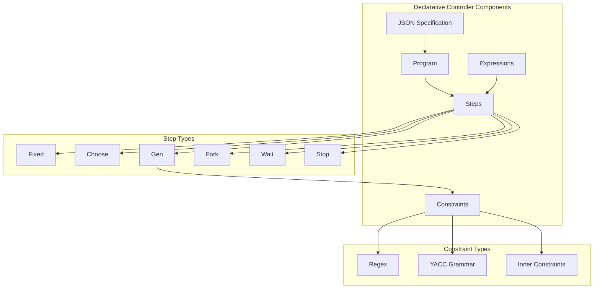
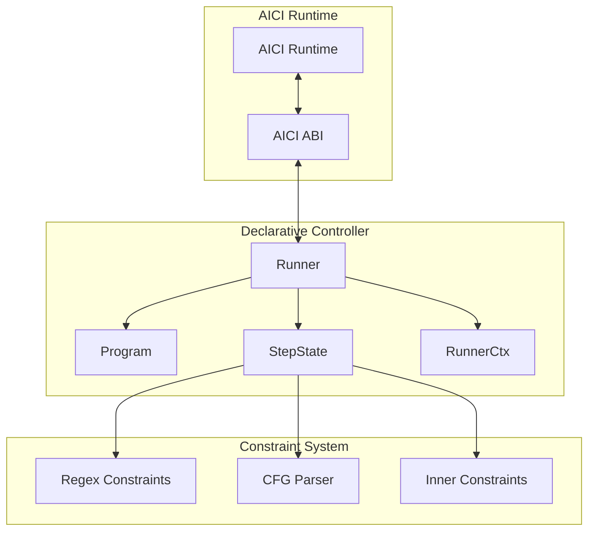
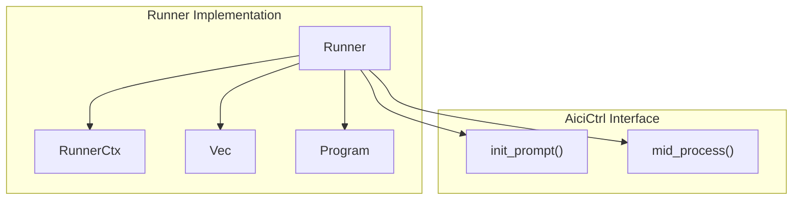
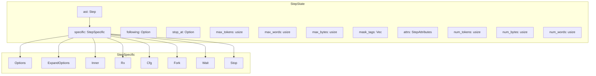
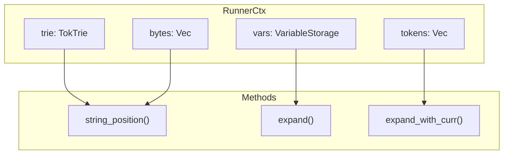
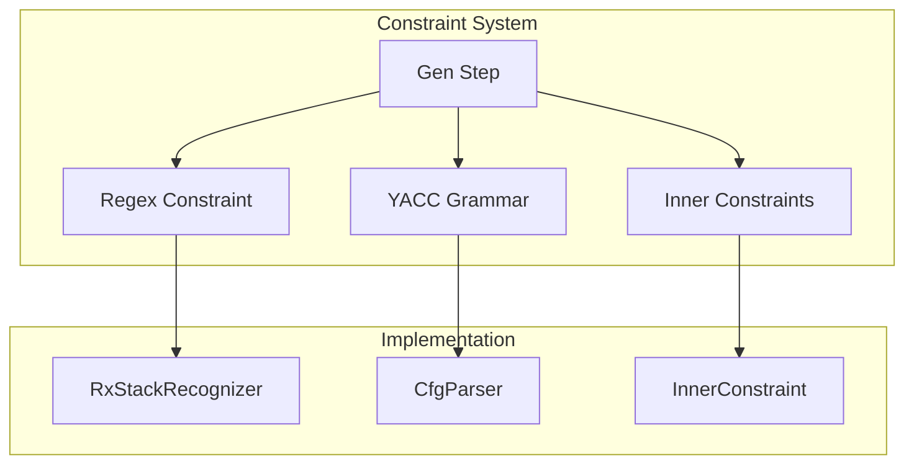
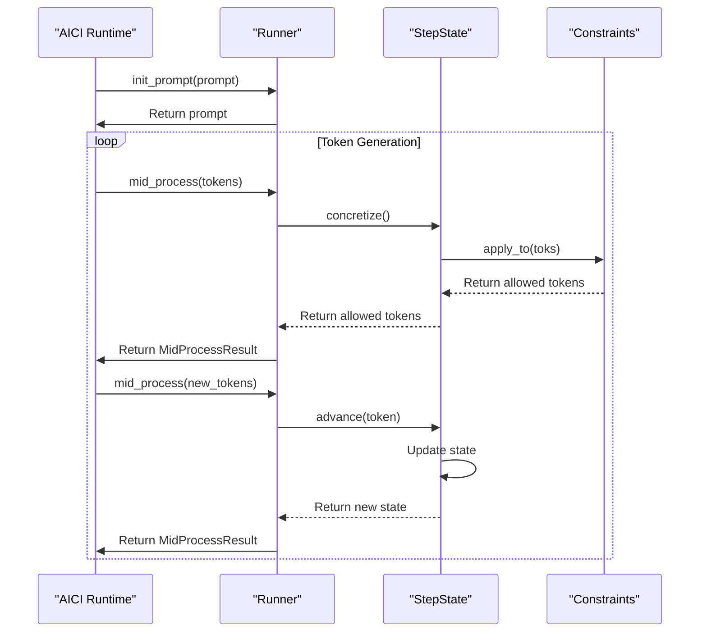

<!-- source: DeepWiki mcp.deepwiki.com · repo microsoft/aici · page 3.3 Declarative Controller (declctrl) · fetched 2026-10-26 -->

# Declarative Controller (declctrl)

<details>
<summary>Relevant source files</summary>

The following files were used as context for generating this wiki page:

- [controllers/aici_abi/src/cfg.rs](controllers/aici_abi/src/cfg.rs)
- [controllers/aici_abi/src/dlex.rs](controllers/aici_abi/src/dlex.rs)
- [controllers/aici_abi/src/host.rs](controllers/aici_abi/src/host.rs)
- [controllers/aici_abi/src/lib.rs](controllers/aici_abi/src/lib.rs)
- [controllers/declctrl/src/declctrl.rs](controllers/declctrl/src/declctrl.rs)
- [controllers/jsctrl/src/jsctrl.rs](controllers/jsctrl/src/jsctrl.rs)
- [controllers/pyctrl/src/pyctrl.rs](controllers/pyctrl/src/pyctrl.rs)

</details>


The Declarative Controller (declctrl) is a component of the AICI (Artificial Intelligence Controller Interface) system that allows users to control LLM token generation through declarative specifications. Unlike the Python and JavaScript controllers ([Python Controller](#3.1) and [JavaScript Controller](#3.2)), which require writing code, the Declarative Controller uses a JSON-based specification language to define generation constraints, token manipulation, and control flow.

## Overview

The Declarative Controller provides a way to define complex token generation patterns without writing code. It uses a JSON-based AST (Abstract Syntax Tree) to describe a sequence of steps that control how tokens are generated, manipulated, and constrained.



Sources: [controllers/declctrl/src/declctrl.rs:25-250](), [controllers/declctrl/src/declctrl.rs:366-369]()

## Architecture

The Declarative Controller is implemented as a WebAssembly module that interprets a JSON specification and controls token generation. It implements the AICI ABI (Application Binary Interface) to interact with the AICI runtime.



Sources: [controllers/declctrl/src/declctrl.rs:489-577](), [controllers/declctrl/src/declctrl.rs:1146-1289]()

## JSON Specification

The Declarative Controller uses a JSON-based specification language to define a program consisting of steps. Each step controls how tokens are generated, manipulated, and constrained.

### Program Structure

A program consists of a sequence of steps:

```json
{
  "steps": [
    { /* Step 1 */ },
    { /* Step 2 */ },
    /* ... */
  ]
}
```

Sources: [controllers/declctrl/src/declctrl.rs:366-369]()

### Step Types

The Declarative Controller supports several types of steps:

| Step Type | Description |
|-----------|-------------|
| `Fixed`   | Generate exactly the provided string |
| `Choose`  | Generate exactly one of the provided strings |
| `Gen`     | Generate text with constraints (regex, grammar, etc.) |
| `Fork`    | Generate one sequence for each branch |
| `Wait`    | Wait for variables to be set |
| `Stop`    | Stop the sequence |

Sources: [controllers/declctrl/src/declctrl.rs:182-250]()

#### Fixed Step

The `Fixed` step generates exactly the provided string:

```json
{
  "text": "Hello, world!",
  "following": "label_name",
  "label": "my_label",
  "tag": "greeting"
}
```

- `text`: The text to generate (can be an expression)
- `following` (optional): Backtrack to this label before generating
- `label` (optional): Label for this step
- `tag` (optional): Tag for attention masking

Sources: [controllers/declctrl/src/declctrl.rs:182-194]()

#### Choose Step

The `Choose` step generates exactly one of the provided strings:

```json
{
  "options": ["Option 1", "Option 2", "Option 3"],
  "label": "choice_label",
  "tag": "choice"
}
```

- `options`: List of options to choose from (can be an expression)
- `label` (optional): Label for this step
- `tag` (optional): Tag for attention masking

Sources: [controllers/declctrl/src/declctrl.rs:196-204]()

#### Gen Step

The `Gen` step generates text with constraints:

```json
{
  "rx": "\\d+",
  "yacc": "grammar { ... }",
  "inner": [
    { "after": ":", "options": ["A", "B", "C"] }
  ],
  "stop_at": "END",
  "max_tokens": 100,
  "max_words": 20,
  "max_bytes": 1000,
  "mask_tags": ["tag1", "tag2"],
  "label": "gen_label",
  "tag": "generation"
}
```

- `rx` (optional): Regex constraint
- `yacc` (optional): YACC grammar constraint
- `inner` (optional): Inner constraints
- `stop_at` (optional): Stop generation at this string
- `max_tokens` (optional): Maximum number of tokens
- `max_words` (optional): Maximum number of words
- `max_bytes` (optional): Maximum number of bytes
- `mask_tags` (optional): Tags to mask for attention
- `label` (optional): Label for this step
- `tag` (optional): Tag for attention masking

Sources: [controllers/declctrl/src/declctrl.rs:206-238]()

#### Fork Step

The `Fork` step generates one sequence for each branch:

```json
{
  "branches": [
    [{ /* Step 1.1 */ }, { /* Step 1.2 */ }],
    [{ /* Step 2.1 */ }, { /* Step 2.2 */ }]
  ]
}
```

Sources: [controllers/declctrl/src/declctrl.rs:243-243]()

#### Wait Step

The `Wait` step waits for variables to be set:

```json
{
  "vars": ["var1", "var2"]
}
```

Sources: [controllers/declctrl/src/declctrl.rs:246-246]()

#### Stop Step

The `Stop` step stops the sequence:

```json
{
  "Stop": {}
}
```

Sources: [controllers/declctrl/src/declctrl.rs:249-249]()

### Expressions

Expressions are used to compute values in steps. They can be literals, variables, or complex expressions:

| Expression Type | Description |
|-----------------|-------------|
| `String`        | Literal string |
| `Var`           | Variable reference |
| `Current`       | Current step result |
| `Concat`        | Concatenate expressions |
| `IfEq`          | Conditional expression |
| `Extract`       | Extract using regex |

Sources: [controllers/declctrl/src/declctrl.rs:50-83]()

#### String Expression

```json
{
  "String": { "str": "Hello, world!" }
}
```

Sources: [controllers/declctrl/src/declctrl.rs:52-52]()

#### Variable Expression

```json
{
  "Var": { "var": "variable_name" }
}
```

Sources: [controllers/declctrl/src/declctrl.rs:54-54]()

#### Current Expression

```json
{
  "Current": {}
}
```

Sources: [controllers/declctrl/src/declctrl.rs:56-56]()

#### Concat Expression

```json
{
  "Concat": {
    "parts": [
      { "String": { "str": "Hello, " } },
      { "Var": { "var": "name" } }
    ],
    "list": false
  }
}
```

Sources: [controllers/declctrl/src/declctrl.rs:57-63]()

#### IfEq Expression

```json
{
  "IfEq": {
    "a": { "Var": { "var": "x" } },
    "b": { "String": { "str": "value" } },
    "eq": { "String": { "str": "Equal" } },
    "neq": { "String": { "str": "Not Equal" } }
  }
}
```

Sources: [controllers/declctrl/src/declctrl.rs:64-70]()

#### Extract Expression

```json
{
  "Extract": {
    "from": { "Var": { "var": "text" } },
    "rx": "\\d+",
    "template": "$1",
    "list": false
  }
}
```

Sources: [controllers/declctrl/src/declctrl.rs:71-82]()

### Statements

Statements are used to manipulate variables:

```json
{
  "Set": {
    "var": "variable_name",
    "expr": { "String": { "str": "value" } }
  }
}
```

Sources: [controllers/declctrl/src/declctrl.rs:146-156]()

## Implementation Details

### Runner

The `Runner` struct is the main entry point for the Declarative Controller. It implements the `AiciCtrl` trait to interact with the AICI runtime.



Sources: [controllers/declctrl/src/declctrl.rs:489-577](), [controllers/declctrl/src/declctrl.rs:1146-1289]()

### Step State

The `StepState` struct represents the state of a step during execution. It tracks the progress of the step and applies constraints to token generation.



Sources: [controllers/declctrl/src/declctrl.rs:371-397](), [controllers/declctrl/src/declctrl.rs:381-397]()

### Runner Context

The `RunnerCtx` struct maintains the context for the runner, including the token trie, variables, tokens, and bytes.



Sources: [controllers/declctrl/src/declctrl.rs:410-416](), [controllers/declctrl/src/declctrl.rs:417-487]()

### Constraint System

The Declarative Controller supports several types of constraints:

1. **Regex Constraints**: Using the `rx` field in a `Gen` step
2. **YACC Grammar Constraints**: Using the `yacc` field in a `Gen` step
3. **Inner Constraints**: Using the `inner` field in a `Gen` step



Sources: [controllers/declctrl/src/declctrl.rs:206-238](), [controllers/declctrl/src/declctrl.rs:173-179](), [controllers/aici_abi/src/cfg.rs:34-45]()

#### Regex Constraints

Regex constraints use the `rx` field in a `Gen` step to restrict token generation to match a regular expression.

Sources: [controllers/declctrl/src/declctrl.rs:210-210](), [controllers/aici_abi/src/rx.rs]()

#### YACC Grammar Constraints

YACC grammar constraints use the `yacc` field in a `Gen` step to restrict token generation to match a context-free grammar.

Sources: [controllers/declctrl/src/declctrl.rs:213-213](), [controllers/aici_abi/src/cfg.rs:34-45]()

#### Inner Constraints

Inner constraints use the `inner` field in a `Gen` step to apply constraints in the middle of generation.

```json
{
  "inner": [
    {
      "after": ":",
      "options": ["A", "B", "C"]
    }
  ]
}
```

Sources: [controllers/declctrl/src/declctrl.rs:173-179](), [controllers/declctrl/src/declctrl.rs:216-217]()

## Token Generation Flow

The Declarative Controller controls token generation through a series of steps:



Sources: [controllers/declctrl/src/declctrl.rs:1146-1252]()

### Initialization

The `init_prompt` method initializes the controller with the prompt tokens:

```rust
fn init_prompt(&mut self, arg: InitPromptArg) -> InitPromptResult {
    println!("prompt: {:?}", arg.prompt);
    for t in &arg.prompt {
        self.ctx.tokens.push(TokenInfo {
            id: *t,
            tag: TagName("prompt".to_string()),
            labels: vec![LabelName("prompt".to_string())],
        })
    }
    InitPromptResult::from_arg(arg)
}
```

Sources: [controllers/declctrl/src/declctrl.rs:1146-1157]()

### Token Processing

The `mid_process` method processes tokens and applies constraints:

```rust
fn mid_process(&mut self, arg: MidProcessArg) -> MidProcessResult {
    // Process tokens
    self.finish_states();
    
    // Handle backtracking
    if arg.backtrack > 0 {
        // ...
    }
    
    // Process new tokens
    for token in arg.tokens {
        self.advance(token);
    }
    
    // Apply constraints
    self.try_backtrack()
}
```

Sources: [controllers/declctrl/src/declctrl.rs:1158-1252]()

## Example Usage

Here's an example of a simple Declarative Controller specification:

```json
{
  "steps": [
    {
      "Fixed": {
        "text": { "String": { "str": "Hello, " } }
      }
    },
    {
      "Choose": {
        "options": [
          { "String": { "str": "world" } },
          { "String": { "str": "AICI" } }
        ]
      }
    },
    {
      "Gen": {
        "rx": "!",
        "max_tokens": 1
      }
    }
  ]
}
```

This specification will generate "Hello, " followed by either "world" or "AICI", followed by an exclamation mark.

## Conclusion

The Declarative Controller provides a powerful way to control LLM token generation using a declarative JSON-based specification language. It supports various types of constraints, including regex, YACC grammar, and inner constraints, as well as control flow mechanisms like forking and backtracking.

---

