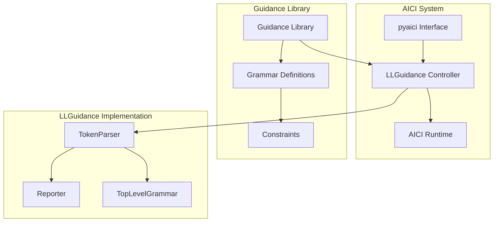
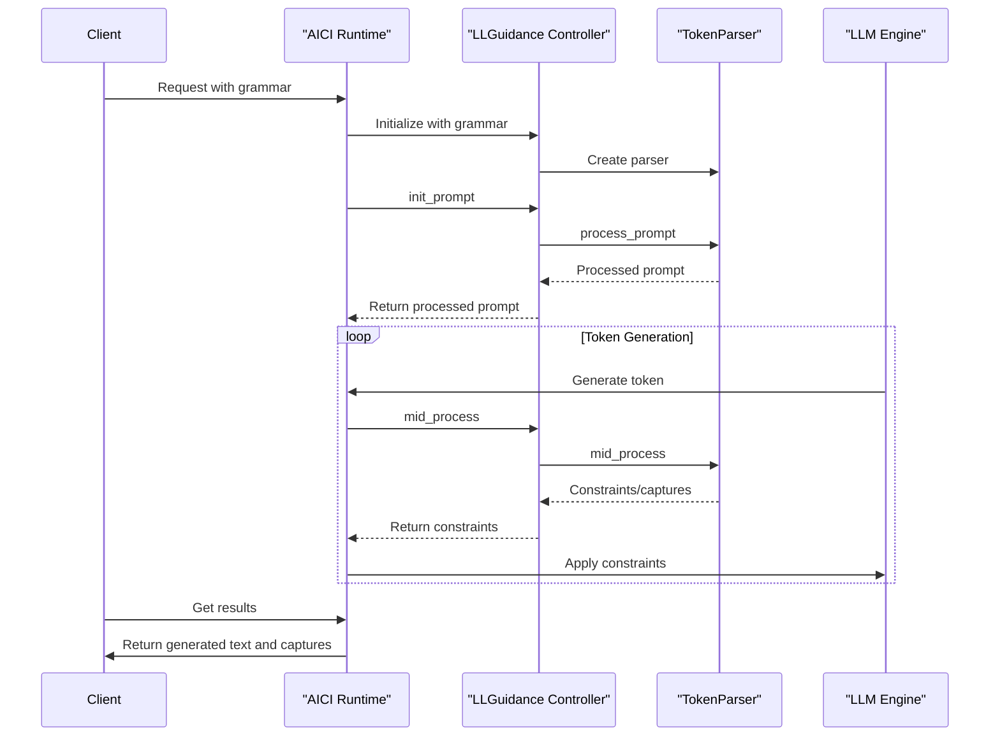
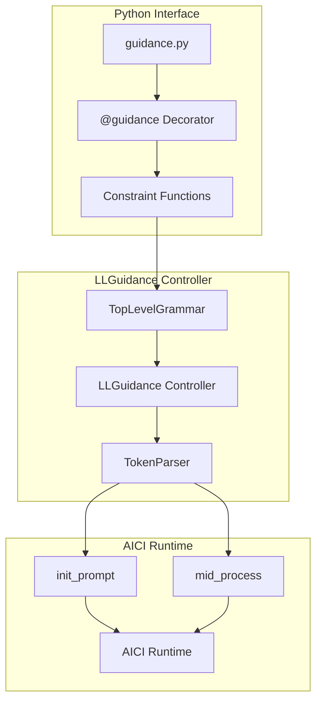
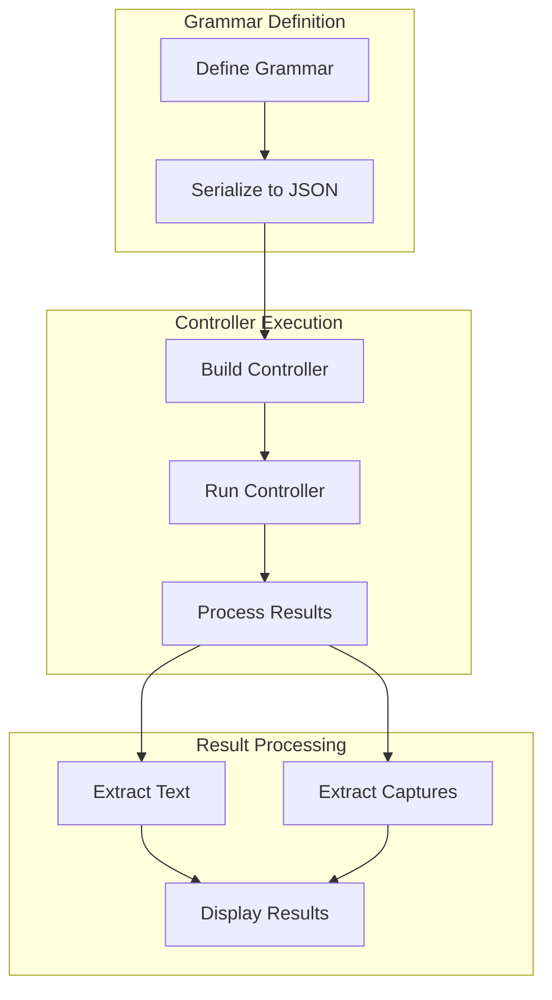

<!-- source: DeepWiki mcp.deepwiki.com · repo microsoft/aici · page 3.4 LLGuidance Controller · fetched 2026-10-26 -->

# LLGuidance Controller

<details>
<summary>Relevant source files</summary>

The following files were used as context for generating this wiki page:

- [.gitmodules](.gitmodules)
- [controllers/llguidance_ctrl/run_g.py](controllers/llguidance_ctrl/run_g.py)
- [controllers/llguidance_ctrl/src/gctrl.rs](controllers/llguidance_ctrl/src/gctrl.rs)
- [scripts/test-guidance.sh](scripts/test-guidance.sh)

</details>


The LLGuidance Controller is a specialized controller in the AICI (Artificial Intelligence Controller Interface) system that enables grammar-based guidance for controlling token generation in large language models. It integrates with the Guidance library to provide a powerful, declarative way to define constraints and capture generated content.

This document focuses on the implementation and usage of the LLGuidance Controller specifically. For information about other controllers in the AICI system, see [Controllers](#3).

## Overview

The LLGuidance Controller bridges the AICI runtime with the Guidance library, allowing users to define complex grammar-based constraints that guide the token generation process. It leverages the underlying token parsing capabilities of the LLGuidance library to enforce constraints and capture generated content.



Sources: [controllers/llguidance_ctrl/src/gctrl.rs:1-84](), [.gitmodules:21-23]()

## Architecture

The LLGuidance Controller is implemented as a Rust module that interfaces with the AICI runtime through the AICI ABI. It uses the LLGuidance parser library to process grammar definitions and enforce constraints during token generation.



Sources: [controllers/llguidance_ctrl/src/gctrl.rs:22-56](), [controllers/llguidance_ctrl/src/gctrl.rs:63-80]()

### Core Components

The LLGuidance Controller consists of several key components:

1. **Runner**: The main controller class that implements the AICI ABI.
2. **TokenParser**: Processes tokens and enforces grammar constraints.
3. **Reporter**: Collects and reports progress and captures during generation.
4. **TopLevelGrammar**: The grammar definition that guides token generation.

Sources: [controllers/llguidance_ctrl/src/gctrl.rs:22-56]()

## Integration with Guidance Library

The LLGuidance Controller integrates with the Guidance library, which is included as a submodule in the AICI repository. This integration allows users to define grammar-based constraints using the Guidance library's Python API.



Sources: [controllers/llguidance_ctrl/run_g.py:8-21](), [.gitmodules:11-14]()

## Grammar Definition

The Guidance library provides a rich set of functions for defining grammar-based constraints. These include:

- **gen**: Generate tokens with optional constraints
- **select**: Select from a list of options
- **one_or_more**: Match one or more occurrences
- **zero_or_more**: Match zero or more occurrences
- **byte_range**: Match bytes in a specified range
- **char_set**: Match characters in a set
- **capture**: Capture generated content
- **substring**: Match a substring
- **optional**: Match an optional pattern
- **string**: Match a specific string
- **with_temperature**: Set temperature for generation

Sources: [controllers/llguidance_ctrl/run_g.py:8-21]()

### Example Grammar Definition

Here's an example of a grammar definition using the Guidance library:

```python
@guidance(stateless=True, dedent=True)
def character_maker(lm, id, description, valid_weapons):
    lm += f"""\
    The following is a character profile for an RPG game in JSON format.
    ```json
    {{
        "id": "{id}",
        "description": "{description}",
        "name": "{gen('name', stop='"')}",
        "age": {gen('age', regex='[0-9]+', stop=',')},
        "armor": "{select(options=['leather', 'chainmail', 'plate'], name='armor')}",
        "weapon": "{select(options=valid_weapons, name='weapon')}",
        "class": "{gen('class', stop='"')}",
        "mantra": "{gen('mantra', stop='"')}",
        "strength": {gen('strength', regex='[0-9]+', stop=',')},
        "items": ["{gen('item', list_append=True, stop='"')}", "{gen('item', list_append=True, stop='"')}", "{gen('item', list_append=True, stop='"')}"]
    }}```"""
    return lm
```

Sources: [controllers/llguidance_ctrl/run_g.py:171-188]()

## Usage Flow

The typical flow for using the LLGuidance Controller involves:

1. Defining a grammar using the Guidance library
2. Serializing the grammar to JSON
3. Passing the serialized grammar to the LLGuidance Controller
4. Running the controller with the AICI runtime
5. Processing the results, including captured content



Sources: [controllers/llguidance_ctrl/run_g.py:219-278]()

## Implementation Details

### Controller Initialization

The LLGuidance Controller is initialized with a grammar definition in JSON format. The controller creates a `TokenParser` instance with the grammar and sets up a `Reporter` to collect progress and captures.

```rust
pub fn new() -> Self {
    infoln!("building runner...");
    let arg: RunnerArg = serde_json::from_slice(&arg_bytes()).expect("invalid JSON arg");
    let log_level = 2;
    let inf = InferenceCapabilities {
        backtrack: get_config("backtrack") != 0,
        ff_tokens: get_config("ff_tokens") != 0,
        conditional_ff_tokens: get_config("ff_tokens") != 0,
        fork: false,
    };
    let tok_parser = TokenParser::from_llguidance_json(
        Arc::new(aici_abi::WasmTokenizerEnv::default()),
        arg.grammar,
        Logger::new(0, log_level),
        inf,
    )
    .expect("invalid guidance protobuf");

    let reporter = Reporter::new(&tok_parser);
    Runner {
        tok_parser,
        reporter,
    }
}
```

Sources: [controllers/llguidance_ctrl/src/gctrl.rs:32-56]()

### AICI ABI Implementation

The LLGuidance Controller implements the AICI ABI through the `AiciCtrl` trait, which includes the `init_prompt` and `mid_process` methods:

```rust
impl AiciCtrl for Runner {
    fn init_prompt(&mut self, arg: InitPromptArg) -> InitPromptResult {
        InitPromptResult {
            prompt: self.tok_parser.process_prompt(arg.prompt),
        }
    }
    fn mid_process(&mut self, arg: MidProcessArg) -> MidProcessResult {
        let r = self.tok_parser.mid_process(StepArg {
            backtrack: arg.backtrack,
            tokens: arg.tokens,
            sampled: arg.sampled,
        });
        for v in self.reporter.get_progress(&mut self.tok_parser, &r) {
            json_out(&v);
        }
        MidProcessResult::from_branch(r)
    }
}
```

Sources: [controllers/llguidance_ctrl/src/gctrl.rs:63-80]()

## Python Interface

The LLGuidance Controller can be used through the Python interface provided by the `pyaici` module. The following example demonstrates how to build and run the controller:

```python
# Build the controller
mod_id = pyaici.cli.build_rust(".", features=["logging"])

# Tag the module for easier reference
pyaici.rest.tag_module(mod_id, ["llguidance_ctrl-latest", "llguidance"])

# Run the controller
res = pyaici.rest.run_controller(
    prompt=prompt,
    controller=mod_id,
    controller_arg=llguidance_arg,
    temperature=0.0,
    max_tokens=max_tokens,
)
```

Sources: [controllers/llguidance_ctrl/run_g.py:246-260]()

### Processing Results

After running the controller, the results can be processed to extract the generated text and captures:

```python
text = b""
captures = {}
for j in res["json_out"][0]:
    if j["object"] == "text":
        text += binascii.unhexlify(j["hex"])
    elif j["object"] == "capture":
        captures[j["name"]] = binascii.unhexlify(j["hex"]).decode(
            "utf-8", errors="replace")
print("Captures:", json.dumps(captures, indent=2))
print("Final text:\n", text.decode("utf-8", errors="replace"))
```

Sources: [controllers/llguidance_ctrl/run_g.py:269-278]()

## Testing

The LLGuidance Controller includes a testing framework that can generate test cases from the controller's logs. This is useful for debugging and ensuring that the controller behaves as expected.

```python
def testcase_from_logs(logs: str):
    sep = "‧"
    pairs = []
    prev_res = None
    prompt = None
    for line in logs.split("\n"):
        if line.startswith("TEST: "):
            obj = json.loads(line[6:])
            if prompt is None:
                prompt = obj["res_prompt"]
                continue
            if prev_res:
                pairs.append((prev_res, obj["arg"]))
            prev_res = obj["res"]
    # ...
    print("Testcase:", testcase)
```

Sources: [controllers/llguidance_ctrl/run_g.py:282-319]()

The AICI repository also includes a script for running tests specifically for the Guidance integration:

```bash
#!/bin/sh
# ...
function runtest() {
    pytest "$@"
    if [ $? -ne 0 -a $? -ne 5 ] ; then
        :
        exit 1
    fi
}

# quick tests first
runtest tests/unit/test_ll.py "$@"
runtest tests/unit "$@"
runtest --selected_model azure_guidance --durations=10 $FILES "$@"
runtest tests/model_integration "$@"
```

Sources: [scripts/test-guidance.sh:1-49]()

## Conclusion

The LLGuidance Controller provides a powerful way to guide token generation using grammar-based constraints. It integrates with the Guidance library to offer a rich set of constraint types and capture capabilities. By using the LLGuidance Controller, users can create complex, structured outputs from language models while maintaining control over the generation process.

For more information about the AICI system and other controllers, see [Controllers](#3).

---

