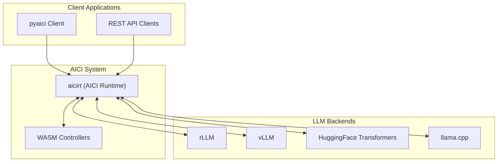
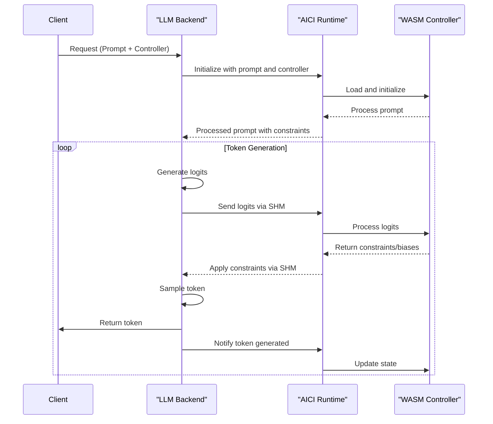
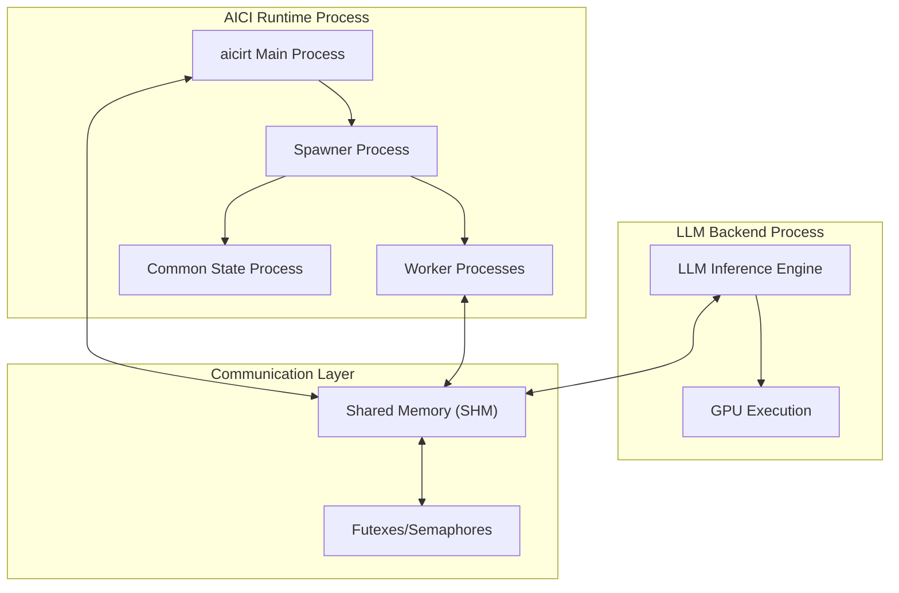
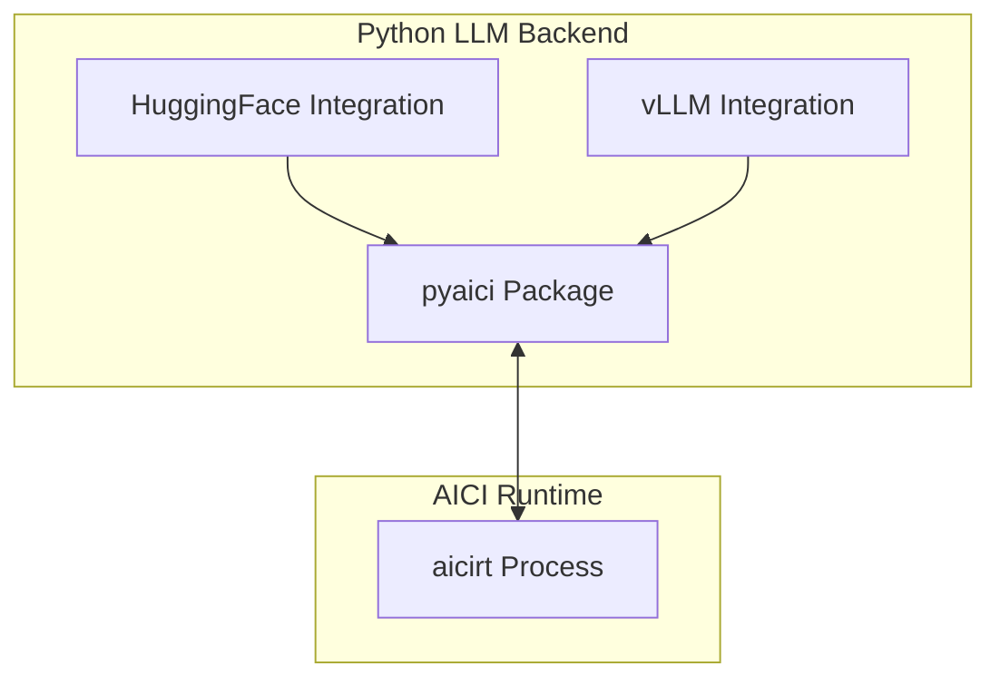
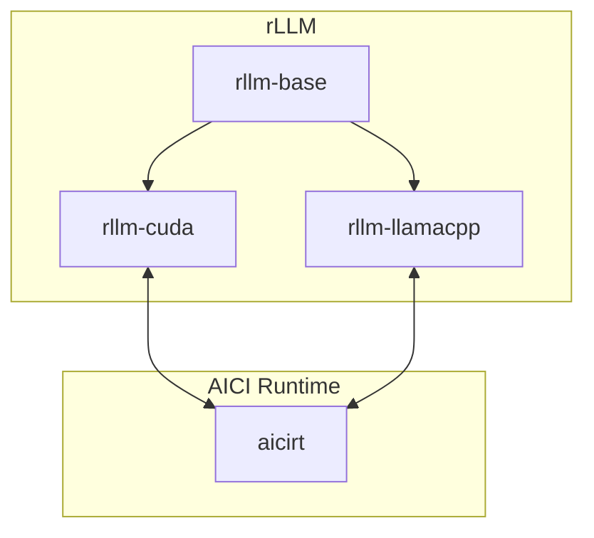

<!-- source: DeepWiki mcp.deepwiki.com · repo microsoft/aici · page 4 LLM Integration · fetched 2026-10-26 -->

# LLM Integration

Relevant source files

The following files were used as context for generating this wiki page:

- [.vscode/settings.json](.vscode/settings.json)
- [README.md](README.md)
- [aicirt/README.md](aicirt/README.md)

This page provides an overview of how the Artificial Intelligence Controller Interface (AICI) integrates with different Large Language Model (LLM) inference engines. AICI is designed to be LLM-agnostic, allowing controllers to work with various LLM backends without modification.

For information about specific LLM integrations, see:
- [vLLM Integration](#4.1)
- [HuggingFace Integration](#4.2)
- [rLLM Integration](#4.3)
- [llama.cpp Integration](#4.4)

## Architecture Overview

AICI is designed to sit between client applications and LLM inference engines, providing a standardized interface for controlling token generation. The system uses a multi-process architecture with shared memory for efficient communication between components.

Sources: [README.md:303-328]()

## Communication Protocol

AICI uses a standardized protocol for communication between the runtime and LLM backends. This protocol is based on POSIX shared memory (SHM) and allows for efficient exchange of token logits, constraints, and other information during the generation process.

Sources: [aicirt/README.md:17-36]()

## Supported LLM Backends

AICI currently supports integration with the following LLM backends:

| Backend | Description | Status |
|---------|-------------|--------|
| rLLM | Custom LLM inference engine with CUDA and llama.cpp backends | Stable |
| vLLM | High-performance inference engine with PagedAttention | In progress |
| HuggingFace Transformers | Python-based LLM framework | Stable |
| llama.cpp | C++ inference engine for LLMs | Stable via rLLM |

Sources: [README.md:17](), [README.md:289-291]()

## Integration Architecture

The AICI runtime (`aicirt`) communicates with LLM backends through a well-defined protocol. This allows for a clean separation between the controller logic and the LLM inference engine.

Sources: [aicirt/README.md:38-82]()

## Integration Process Flow

When integrating AICI with an LLM backend, the following process flow is followed:

1. The LLM backend receives a request from a client
2. The LLM backend initializes the AICI runtime with the prompt and controller
3. The AICI runtime loads and initializes the controller
4. The controller processes the prompt and returns any initial constraints
5. The LLM backend generates logits for the next token
6. The logits are sent to the AICI runtime via shared memory
7. The AICI runtime passes the logits to the controller
8. The controller processes the logits and returns constraints or biases
9. The AICI runtime sends the constraints back to the LLM backend
10. The LLM backend applies the constraints and samples the next token
11. The process repeats until generation is complete

Sources: [aicirt/README.md:17-36]()

## Python Integration with pyaici

For Python-based LLM backends, AICI provides the `pyaici` package that simplifies integration. This package handles the communication with the AICI runtime and provides a Python-friendly interface for controlling token generation.

Sources: [README.md:330-334]()

## rLLM Integration

rLLM is a custom LLM inference engine that comes with AICI and provides two backends:

1. `rllm-cuda`: A CUDA-based backend for high-performance inference on NVIDIA GPUs
2. `rllm-llamacpp`: A backend based on llama.cpp for CPU-based inference or GPUs without CUDA support

rLLM is tightly integrated with AICI and serves as the reference implementation for AICI integration.

Sources: [README.md:100-107](), [README.md:289-291]()

## Implementing New LLM Integrations

To add AICI support to a new LLM inference engine, you need to implement the LLM-side of the protocol that communicates with the AICI runtime. This involves:

1. Setting up shared memory for communication
2. Implementing the protocol for exchanging logits, constraints, and other information
3. Handling controller initialization and token generation flow

The existing integrations (rLLM, HuggingFace, etc.) can serve as reference implementations for new integrations.

Sources: [README.md:296-298]()

## Performance Considerations

When integrating AICI with an LLM backend, it's important to consider the performance implications. AICI is designed to minimize overhead during token generation, with most of the computation occurring on the CPU in parallel with logit generation on the GPU.

The typical overhead for AICI is around 0.3ms per generation step when executing 10 sequences in parallel, which is well within the 20-50ms budget for token generation on modern GPUs.

Sources: [README.md:350-386]()

## Security Considerations

AICI provides a secure environment for running controllers by:

1. Running the AICI runtime in a separate process from the LLM engine
2. Sandboxing WebAssembly modules using Wasmtime
3. Limiting access to system resources (filesystem, network, etc.)
4. Running each WebAssembly module in a separate process for isolation

These security measures ensure that controllers cannot access sensitive resources or interfere with the LLM engine.

Sources: [README.md:338-349]()

---

