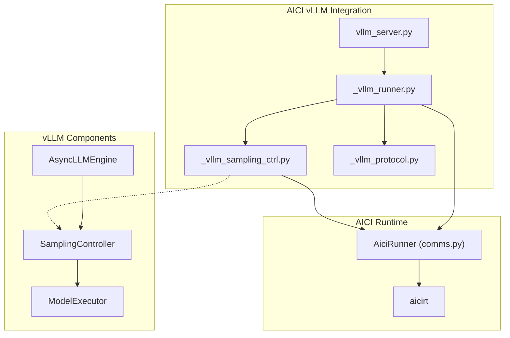
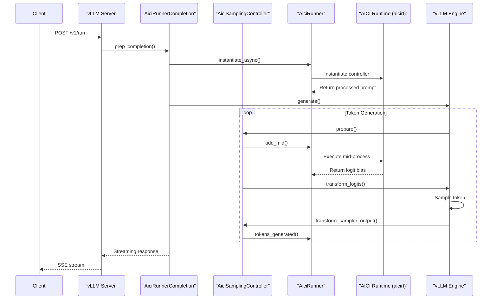
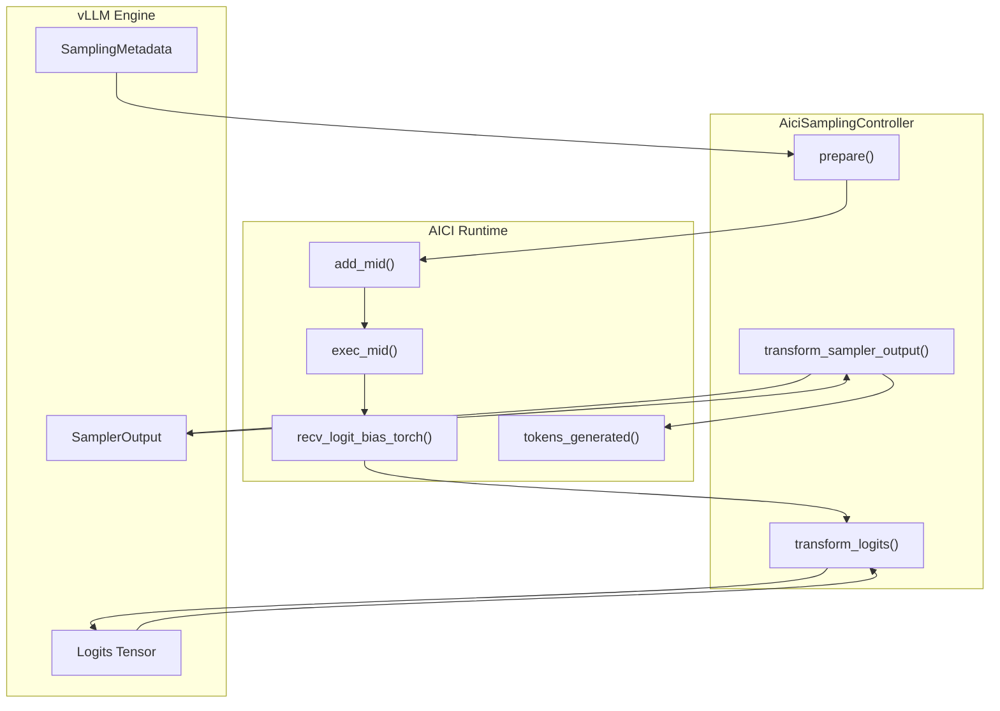

<!-- source: DeepWiki mcp.deepwiki.com · repo microsoft/aici · page 4.1 vLLM Integration · fetched 2026-10-26 -->

# vLLM Integration

<details>
<summary>Relevant source files</summary>

The following files were used as context for generating this wiki page:

- [py/pyaici/_vllm_protocol.py](py/pyaici/_vllm_protocol.py)
- [py/pyaici/_vllm_runner.py](py/pyaici/_vllm_runner.py)
- [py/pyaici/_vllm_sampling_ctrl.py](py/pyaici/_vllm_sampling_ctrl.py)
- [py/pyaici/comms.py](py/pyaici/comms.py)
- [py/pyaici/vllm_server.py](py/pyaici/vllm_server.py)
- [scripts/vllm-server.sh](scripts/vllm-server.sh)

</details>


This document describes how AICI (Artificial Intelligence Controller Interface) integrates with vLLM, a high-performance inference engine for Large Language Models. The integration enables AICI controllers to guide and constrain token generation in vLLM-powered models.

For information about other LLM integrations, see [LLM Integration](#4), [HuggingFace Integration](#4.2), [rLLM Integration](#4.3), and [llama.cpp Integration](#4.4).

## Overview

The vLLM integration allows AICI controllers to be used with vLLM's high-performance inference engine. This integration is implemented as a server that exposes a REST API for running AICI controllers with vLLM models.



Sources: [py/pyaici/vllm_server.py:1-142](), [py/pyaici/_vllm_runner.py:1-256](), [py/pyaici/_vllm_sampling_ctrl.py:1-143](), [py/pyaici/_vllm_protocol.py:1-33](), [py/pyaici/comms.py:1-813]()

## Architecture

The vLLM integration consists of several key components that work together to enable AICI controllers to guide token generation in vLLM:



Sources: [py/pyaici/vllm_server.py:24-61](), [py/pyaici/_vllm_runner.py:37-255](), [py/pyaici/_vllm_sampling_ctrl.py:13-142](), [py/pyaici/comms.py:327-805]()

### Key Components

1. **vLLM Server**: The entry point for the integration, exposing a REST API for running AICI controllers with vLLM models.
2. **AiciRunnerCompletion**: Handles the integration between vLLM's OpenAI-compatible API and AICI.
3. **AiciSamplingController**: A custom implementation of vLLM's `SamplingController` that integrates with AICI.
4. **AiciRunner**: Manages communication with the AICI runtime.

Sources: [py/pyaici/vllm_server.py:15-16](), [py/pyaici/_vllm_runner.py:37-255](), [py/pyaici/_vllm_sampling_ctrl.py:13-142](), [py/pyaici/comms.py:327-805]()

## Implementation Details

### vLLM Server

The vLLM server is implemented in `vllm_server.py` and provides the following endpoints:

| Endpoint | Method | Description |
|----------|--------|-------------|
| `/v1/controllers` | POST | Upload an AICI controller module |
| `/v1/run` | POST | Run an AICI controller with a vLLM model |
| `/v1/controllers/tags` | POST | Set tags for a controller module |
| `/v1/controllers/tags` | GET | Get all available controller module tags |

The server initializes the vLLM engine and AICI runtime, then sets up the integration between them.

Sources: [py/pyaici/vllm_server.py:24-61](), [py/pyaici/vllm_server.py:91-141]()

### AiciRunnerCompletion

`AiciRunnerCompletion` extends vLLM's `OpenAIServing` class to integrate AICI controllers with vLLM's OpenAI-compatible API. It handles:

1. Preparing completions by instantiating AICI controllers
2. Processing prompts through AICI controllers
3. Managing the token generation process
4. Streaming results back to clients

Sources: [py/pyaici/_vllm_runner.py:37-255]()

### AiciSamplingController

`AiciSamplingController` is a custom implementation of vLLM's `SamplingController` that integrates with AICI. It has three main responsibilities:

1. **Preparation**: Setting up AICI for the current batch of sequences
2. **Logit Transformation**: Applying logit biases from AICI controllers
3. **Output Transformation**: Processing sampled tokens and handling fast-forward tokens



Sources: [py/pyaici/_vllm_sampling_ctrl.py:13-142]()

#### Logit Transformation

The `transform_logits` method applies logit biases from AICI controllers to vLLM's logits tensor:

```python
def transform_logits(self, logits: torch.Tensor) -> torch.Tensor:
    # ...
    resp, bias = self.runner.recv_logit_bias_torch()
    bias = bias.to(logits.device, non_blocking=True)
    # ...
    for seq_id, mid_res in resp.items():
        if mid_res.branches:
            branch = mid_res.branches[0]
            mask = branch.mask
            if mask is not None and seq_id in sampling_map:
                logits[sampling_map[seq_id], :] += bias[mask, 0:vocab_size]
            if branch.temperature is not None and seq_id in params_map:
                params_map[seq_id].temperature = max(
                    branch.temperature, EPSILON_TEMP)
    return logits
```

Sources: [py/pyaici/_vllm_sampling_ctrl.py:69-90]()

#### Output Transformation

The `transform_sampler_output` method processes sampled tokens and handles fast-forward tokens:

```python
def transform_sampler_output(self, output: SamplerOutput) -> SamplerOutput:
    # ...
    for out in output.outputs:
        for sample in out.samples:
            seq_id = sample.parent_seq_id
            # ...
            mid_res = runner.mid_status(seq_id)
            # ...
            br = mid_res.branches[0]
            splice = br.find_splice(sample.output_token)
            if splice is not None:
                # Handle fast-forward tokens
                bt = splice.backtrack
                tokens = splice.ff_tokens[:]
                # ...
                sample.fast_forward_tokens = tokens[:]
            # ...
            runner.tokens_generated(seq_id, tokens, backtrack=0, sampled=sampled)
    return output
```

Sources: [py/pyaici/_vllm_sampling_ctrl.py:92-142]()

### Communication with AICI Runtime

The `AiciRunner` class in `comms.py` handles communication with the AICI runtime. It uses shared memory and message channels to efficiently communicate with the AICI runtime process.

Key methods used in the vLLM integration:

| Method | Description |
|--------|-------------|
| `instantiate_async` | Instantiates an AICI controller |
| `add_mid` | Adds a sequence for mid-processing |
| `exec_mid` | Executes mid-processing for all added sequences |
| `recv_logit_bias_torch` | Receives logit biases from AICI |
| `tokens_generated` | Informs AICI that tokens have been generated |

Sources: [py/pyaici/comms.py:327-805]()

## Deployment

The vLLM integration can be deployed using the `vllm-server.sh` script, which sets up the necessary environment and starts the vLLM server with AICI integration:

```bash
RUST_LOG=info,tokenizers=error,aicirt=info \
RUST_BACKTRACE=1 \
PYTHONPATH=py:py/vllm \
python3 -m pyaici.vllm_server \
    --enforce-eager \
    --use-v2-block-manager \
    --enable-chunked-prefill \
    --served-model-name=model \
    --aici-rt ./target/release/aicirt \
    -A--wasm-timer-resolution-us=10 \
    --model <model_name> \
    --port 4242 --host 127.0.0.1
```

Sources: [scripts/vllm-server.sh:1-36]()

## API Usage

To use the vLLM integration, clients can make requests to the `/v1/run` endpoint with the following parameters:

```json
{
  "model": "model",
  "prompt": "Hello, world!",
  "controller": "<controller_module_id>",
  "controller_arg": {"key": "value"},
  "temperature": 0.0,
  "top_p": 1.0,
  "top_k": -1,
  "max_tokens": 100
}
```

The response is a server-sent events (SSE) stream with the following format:

```
data: {"object":"initial-run","id":"run-123","created":1234567890,"model":"model"}

data: {"object":"run","forks":[{"index":0,"finish_reason":null,"text":"Hello","error":"","logs":"","storage":[]}],"usage":{"sampled_tokens":1,"ff_tokens":0,"cost":2}}

data: [DONE]
```

Sources: [py/pyaici/_vllm_protocol.py:8-29](), [py/pyaici/_vllm_runner.py:163-255]()

## Performance Considerations

The vLLM integration is designed to be efficient, with the following performance optimizations:

1. **Shared Memory Communication**: Uses shared memory for efficient communication between the vLLM server and AICI runtime.
2. **Batched Processing**: Processes multiple sequences in a single batch.
3. **Fast-Forward Tokens**: Supports fast-forwarding tokens to reduce the number of inference steps.

Sources: [py/pyaici/comms.py:47-135](), [py/pyaici/_vllm_sampling_ctrl.py:92-142]()

## Limitations

The current vLLM integration has the following limitations:

1. **Limited Backtracking Support**: Backtracking is not fully supported in the current implementation.
2. **Single Branch**: Only the first branch from AICI controllers is used.
3. **Temperature Handling**: Very low temperatures (close to 0) require special handling to ensure deterministic behavior.

Sources: [py/pyaici/_vllm_sampling_ctrl.py:115-117](), [py/pyaici/_vllm_sampling_ctrl.py:121-134](), [py/pyaici/_vllm_protocol.py:6-6]()

---

