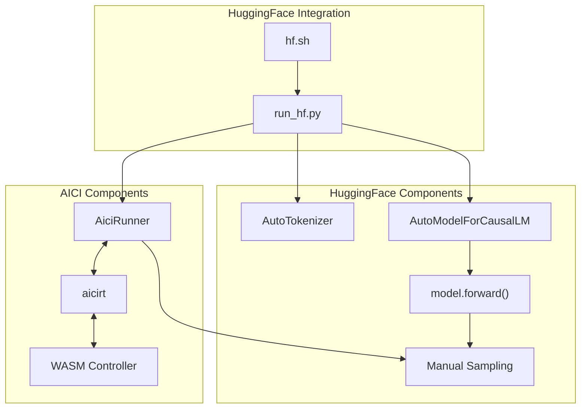
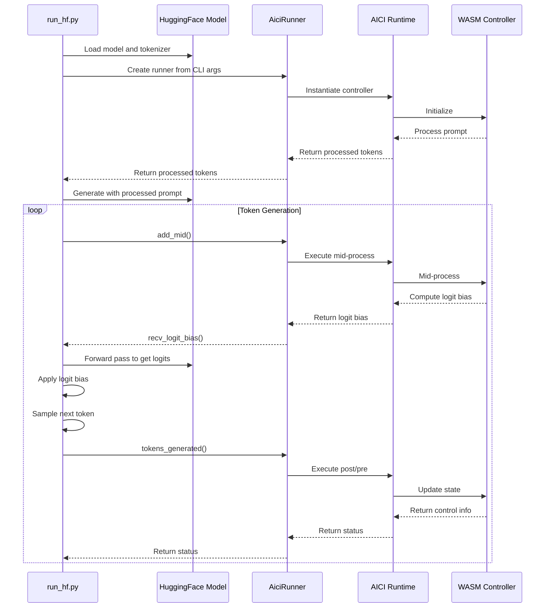
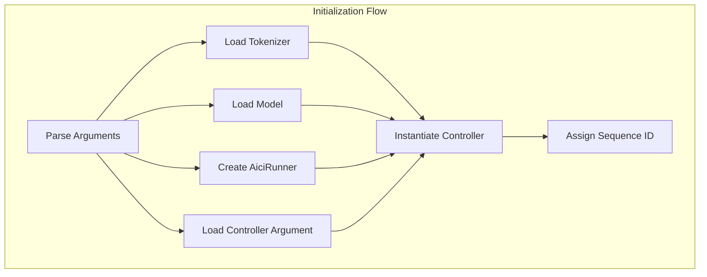

<!-- source: DeepWiki mcp.deepwiki.com · repo microsoft/aici · page 4.2 HuggingFace Integration · fetched 2026-10-26 -->

# HuggingFace Integration

<details>
<summary>Relevant source files</summary>

The following files were used as context for generating this wiki page:

- [scripts/hf.sh](scripts/hf.sh)
- [scripts/py/run_hf.py](scripts/py/run_hf.py)

</details>


This document describes how AICI (Artificial Intelligence Controller Interface) integrates with HuggingFace Transformers, allowing users to control token generation with AICI controllers while using HuggingFace models for inference. For information about other LLM integrations, see [vLLM Integration](#4.1), [rLLM Integration](#4.3), or [llama.cpp Integration](#4.4).

## Overview

The HuggingFace integration enables AICI to work with any model supported by the HuggingFace Transformers library. This integration is implemented as a Python script that loads a HuggingFace model and tokenizer, then connects them to the AICI runtime to enable controlled token generation.



Sources: [scripts/py/run_hf.py:1-5](), [scripts/hf.sh:1-14]()

## Architecture

The HuggingFace integration follows a specific flow for token generation that combines HuggingFace's model inference with AICI's token control mechanisms.



Sources: [scripts/py/run_hf.py:31-173]()

## Implementation Details

### Setup and Initialization

The integration starts by loading a HuggingFace model and tokenizer, then initializing the AICI runtime with a specified controller.



Sources: [scripts/py/run_hf.py:37-71]()

The initialization process includes:

1. Loading the tokenizer and model from HuggingFace
2. Creating an AICI runner from command-line arguments
3. Loading the controller argument (if specified)
4. Instantiating the controller with the AICI runtime
5. Assigning a sequence ID for token generation

### Token Generation Loop

The core of the integration is the token generation loop, which:

1. Executes the mid-process step of the controller
2. Performs a forward pass with the HuggingFace model
3. Applies logit biases from the controller
4. Samples the next token
5. Updates the controller with the generated token
6. Handles any control flow instructions (backtracking, fast-forward tokens)

Sources: [scripts/py/run_hf.py:83-169]()

### Key Components

| Component | Description |
|-----------|-------------|
| `AutoTokenizer` | HuggingFace tokenizer for converting text to tokens |
| `AutoModelForCausalLM` | HuggingFace model for generating text |
| `AiciRunner` | Interface to the AICI runtime |
| `add_mid()` | Prepares for mid-process execution |
| `exec_mid()` | Executes the mid-process step |
| `recv_logit_bias()` | Receives logit biases from the controller |
| `tokens_generated()` | Informs the controller about generated tokens |
| `exec_post_pre()` | Executes post-process and pre-process steps |

Sources: [scripts/py/run_hf.py:12-22](), [scripts/py/run_hf.py:85-131]()

## Supported Features

The HuggingFace integration supports most AICI features, with some limitations:

| Feature | Support Status | Notes |
|---------|---------------|-------|
| Logit Biasing | ✅ Supported | Full support for controller-based logit biasing |
| Backtracking | ✅ Supported | Implemented but requires careful KV-cache management |
| Fast-Forward Tokens | ✅ Supported | Controller can inject tokens directly |
| Forking | ❌ Not Supported | The integration does not support forking sequences |
| Stopping Generation | ✅ Supported | Controller can signal to stop generation |

Sources: [scripts/py/run_hf.py:104-106](), [scripts/py/run_hf.py:156-158]()

## Usage

The HuggingFace integration is provided as a Python script that can be run directly or through a shell script wrapper.

### Command-Line Arguments

The script accepts the following command-line arguments:

| Argument | Description |
|----------|-------------|
| `--model` | HuggingFace model to use (required) |
| `--tokenizer` | HuggingFace tokenizer to use (defaults to model name) |
| `--aici-rt` | Path to AICI runtime executable |
| `--controller` | Controller to use (e.g., `gh:microsoft/aici/pyctrl`) |
| `--controller-arg` | Path to controller argument file |
| `--aici-tokenizer` | Tokenizer name for AICI |

Sources: [scripts/py/run_hf.py:176-186](), [scripts/hf.sh:6-13]()

### Example Usage

The repository includes a shell script (`hf.sh`) that demonstrates how to use the HuggingFace integration:

```bash
RUST_LOG=info,tokenizers=error,rllm=debug,aicirt=info \
PYTHONPATH=py \
python3 scripts/py/run_hf.py \
    --aici-rt ./target/release/aicirt \
    --controller gh:microsoft/aici/pyctrl \
    --controller-arg controllers/pyctrl/samples/test.py  \
    --aici-tokenizer phi \
    --model microsoft/phi-2
```

This example runs the AICI runtime with a Python controller (`pyctrl`) using the Microsoft Phi-2 model from HuggingFace.

Sources: [scripts/hf.sh:6-13]()

## Implementation Challenges

### KV-Cache Management

When implementing backtracking, the integration needs to carefully manage the key-value cache of the transformer model. This is done by truncating the cache to the appropriate length when tokens are removed during backtracking.

```python
if "past_key_values" in model_kwargs:
    m = model_kwargs["past_key_values"]
    if m is not None and backtrack > 0:
        m = [
            (
                q[0][:, :, 0:computed_kv_len, :],
                q[1][:, :, 0:computed_kv_len, :],
            )
            for q in m
        ]
        model_kwargs["past_key_values"] = m
```

Sources: [scripts/py/run_hf.py:142-154]()

### Logit Bias Application

The integration applies logit biases from the controller to the model's output logits before sampling:

```python
bias_tensor = torch.from_numpy(bias_tensor).to(scores.device).to(scores.dtype)
vocab_size = bias_tensor.shape[1]
scores = scores[:, 0:vocab_size]
scores += bias_tensor
scores /= temperature
```

Sources: [scripts/py/run_hf.py:107-117]()

## Limitations

The current HuggingFace integration has several limitations:

1. **No Forking Support**: The integration does not support forking sequences, which is a feature available in other AICI integrations.
2. **Limited Parallelism**: The integration processes one token at a time, which may be less efficient than batch processing.
3. **Model Compatibility**: Some models may have vocabulary size mismatches that require special handling.

Sources: [scripts/py/run_hf.py:104-106](), [scripts/py/run_hf.py:156-158]()

## Conclusion

The HuggingFace integration provides a flexible way to use AICI controllers with any model supported by the HuggingFace Transformers library. While it has some limitations compared to other AICI integrations, it offers broad model compatibility and supports most core AICI features.

For more advanced features or better performance, consider using the [vLLM Integration](#4.1) or [rLLM Integration](#4.3).

---

