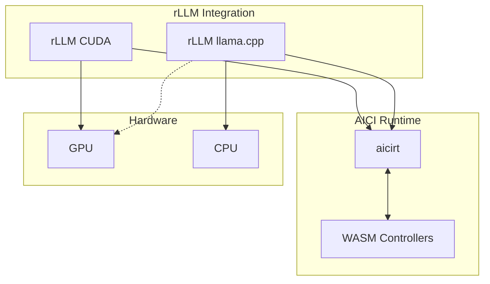
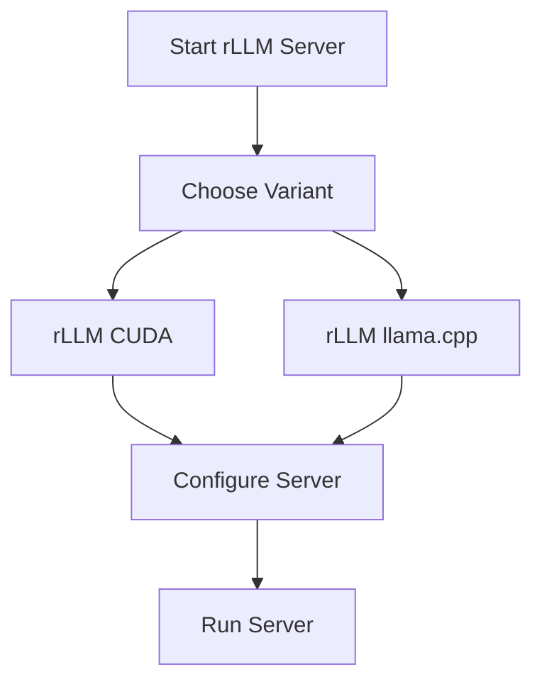
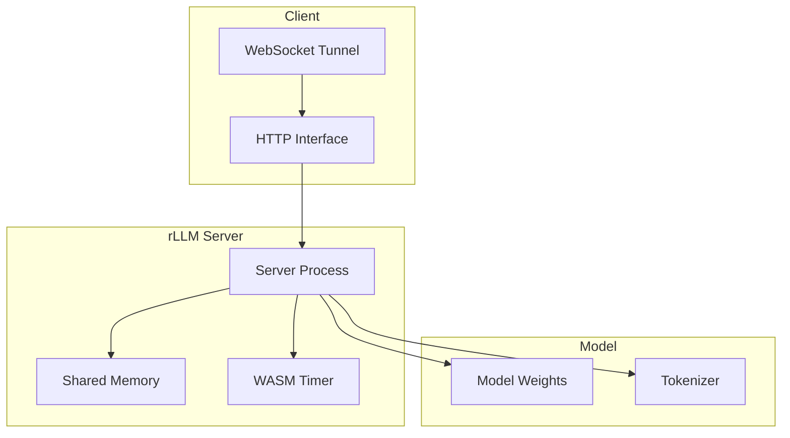
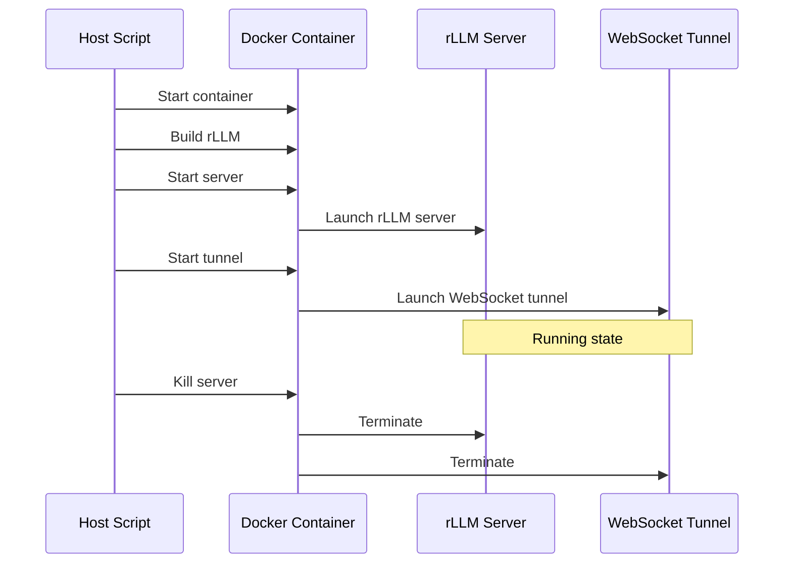
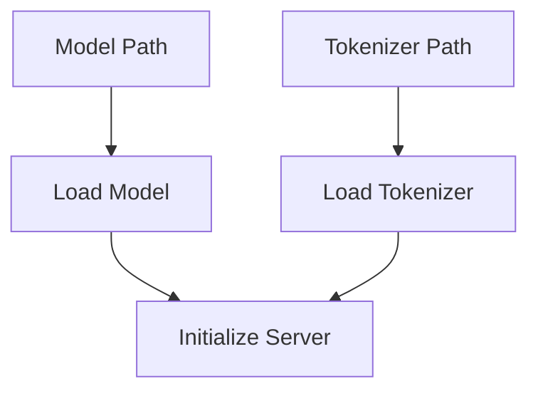
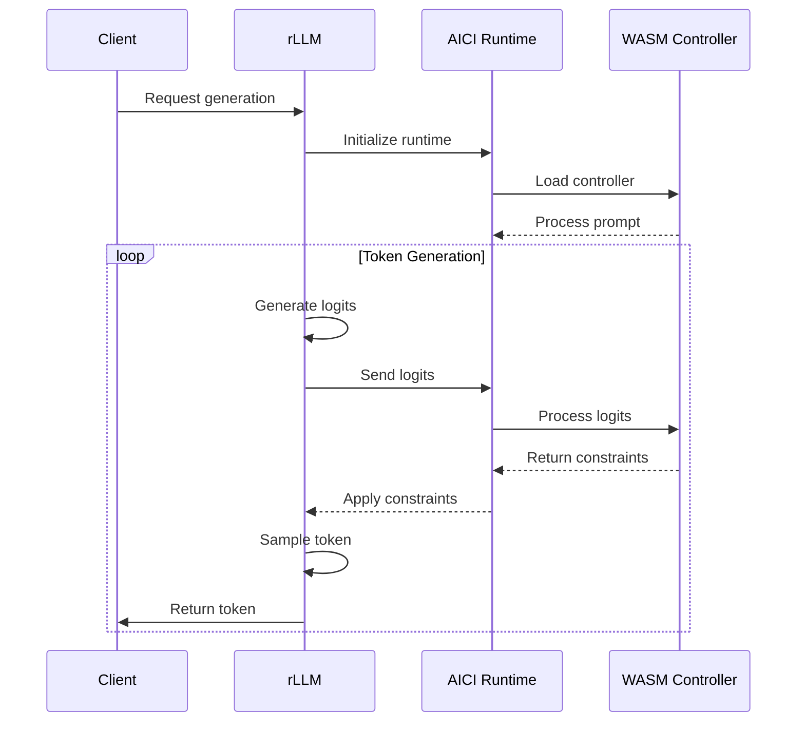
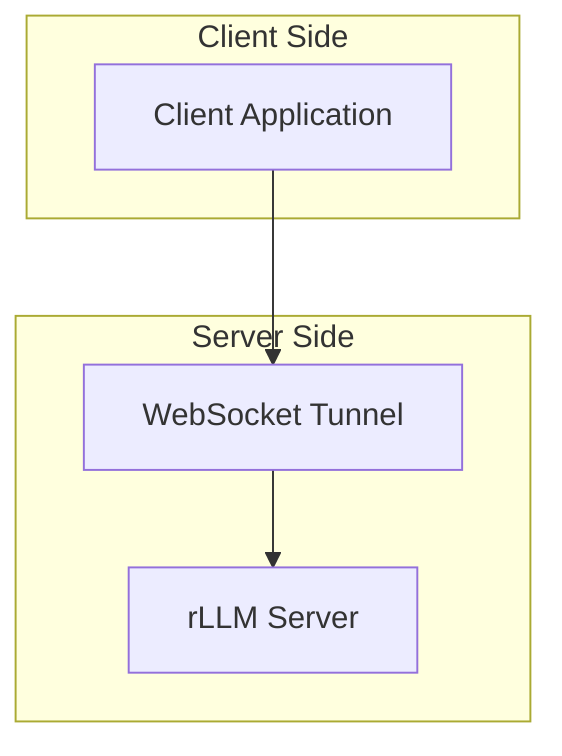
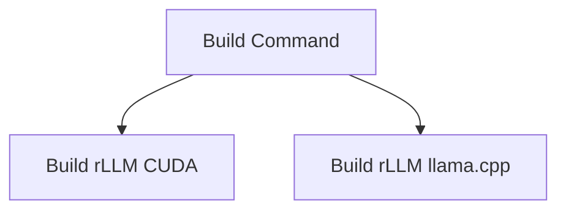
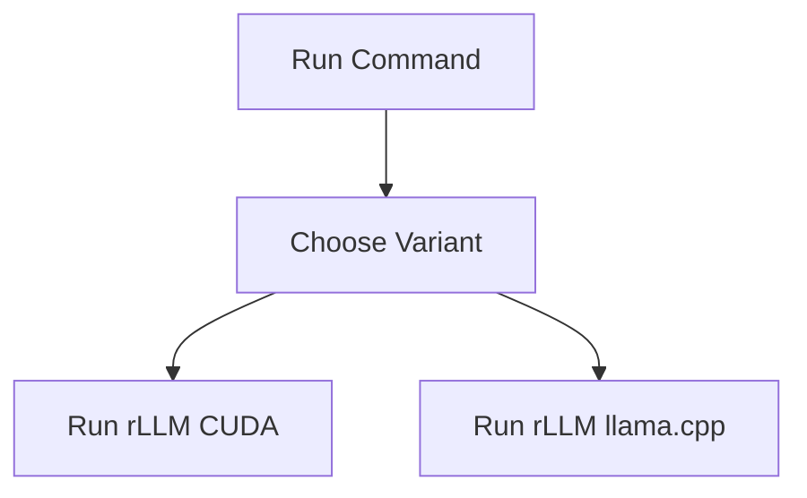

<!-- source: DeepWiki mcp.deepwiki.com · repo microsoft/aici · page 4.3 rLLM Integration · fetched 2026-10-26 -->

# rLLM Integration

Relevant source files

The following files were used as context for generating this wiki page:

- [scripts/host.sh](scripts/host.sh)
- [scripts/kill-rt.sh](scripts/kill-rt.sh)
- [scripts/kill-server.sh](scripts/kill-server.sh)

This document describes the rLLM (Rust LLM) inference engine and how it integrates with the AICI (Artificial Intelligence Controller Interface) system. rLLM provides a high-performance, Rust-based implementation for running large language models with AICI controllers.

For information about other LLM integrations, see:
- [vLLM Integration](#4.1)
- [HuggingFace Integration](#4.2)
- [llama.cpp Integration](#4.4)

## Overview

rLLM is a native Rust implementation of an LLM inference engine designed specifically for the AICI system. It provides two main variants:

1. **rLLM CUDA** - A CUDA-based implementation for GPU acceleration
2. **rLLM llama.cpp** - An integration with the llama.cpp library

Both variants implement the AICI runtime interface, allowing for controlled token generation with WASM-based controllers.

Sources: [scripts/host.sh:107-110]()

## Architecture

The rLLM integration follows the overall AICI architecture, where the inference engine communicates with controllers through the AICI runtime.

Sources: [scripts/host.sh:105-110]()

## Deployment Options

rLLM can be deployed in different configurations depending on the hardware and performance requirements.

### Server Deployment

The rLLM server can be started with various configuration options:

Key configuration parameters include:
- Port number
- Shared memory prefix
- WASM timer resolution
- CUDA device selection

Sources: [scripts/host.sh:104-110]()

## Server Components

The rLLM server consists of several components that work together to provide LLM inference with AICI control.

Sources: [scripts/host.sh:92-98](), [scripts/host.sh:105-110]()

## Server Lifecycle Management

The rLLM server lifecycle is managed through scripts that handle starting, stopping, and monitoring the server.

Sources: [scripts/host.sh:42-111](), [scripts/kill-server.sh:1-12](), [scripts/kill-rt.sh:1-9]()

## Server Configuration

The rLLM server can be configured with various parameters to control its behavior.

### Command Line Arguments

The server accepts several command-line arguments:

| Argument | Description |
|----------|-------------|
| `--port` | Port number for the server to listen on |
| `--shm-prefix` | Prefix for shared memory segments |
| `--wasm-timer-resolution-us` | Resolution of the WASM timer in microseconds |
| `--loop` | Run the server in a loop, restarting if it crashes |
| `--cuda` | (llama.cpp variant) Enable CUDA acceleration |

Sources: [scripts/host.sh:105-110]()

### Environment Variables

The server behavior can also be controlled through environment variables:

| Variable | Description |
|----------|-------------|
| `CUDA_VISIBLE_DEVICES` | Specifies which GPUs to use |
| `FWD_PORT` | Port number for the server |

Sources: [scripts/host.sh:91-92](), [scripts/host.sh:104-105]()

## Model Loading

rLLM loads models from a specified path and can use a separate tokenizer configuration.

Sources: [scripts/host.sh:96-98]()

## Integration with AICI Runtime

rLLM integrates with the AICI runtime to provide controlled token generation.

Sources: [scripts/host.sh:105-110]()

## WebSocket Tunnel

To facilitate communication with the rLLM server, a WebSocket tunnel is used to forward HTTP requests.

The tunnel is implemented in Node.js and is started alongside the rLLM server.

Sources: [scripts/host.sh:65-79]()

## Building and Running

The rLLM server can be built and run using the provided scripts.

### Building

Sources: [scripts/host.sh:162-164]()

### Running

Sources: [scripts/host.sh:104-110]()

## Troubleshooting

Common issues with rLLM and their solutions:

| Issue | Solution |
|-------|----------|
| Server not starting | Check GPU availability with `nvidia-smi` |
| Connection refused | Verify port configuration and firewall settings |
| Out of memory | Reduce model size or batch size |
| Server crashes | Check logs for error messages |

To stop a running server, use the kill scripts:

Sources: [scripts/kill-server.sh:1-12](), [scripts/kill-rt.sh:1-9]()

## Performance Considerations

When using rLLM, consider the following performance factors:

1. **GPU Memory** - Larger models require more GPU memory
2. **Shared Memory** - Configure sufficient shared memory for inter-process communication
3. **WASM Timer Resolution** - Lower values provide more precise control but may impact performance

Sources: [scripts/host.sh:90-98](), [scripts/host.sh:105-110]()

## Conclusion

rLLM provides a high-performance inference engine for the AICI system, with support for both CUDA and llama.cpp backends. It integrates seamlessly with the AICI runtime to enable controlled token generation with WASM-based controllers.

For more information on other LLM integrations, refer to the related wiki pages mentioned at the beginning of this document.

---

