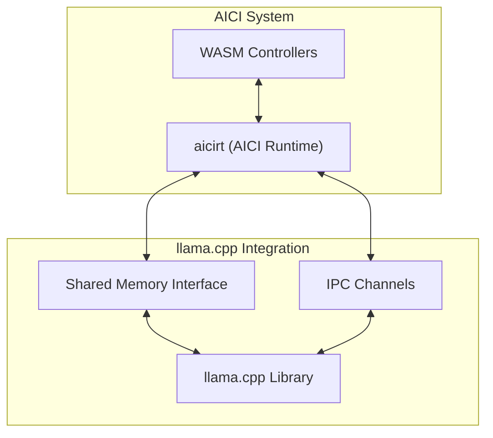
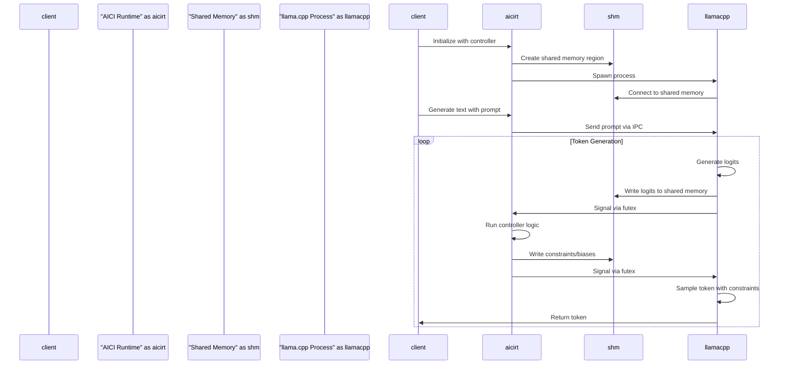
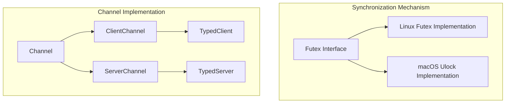
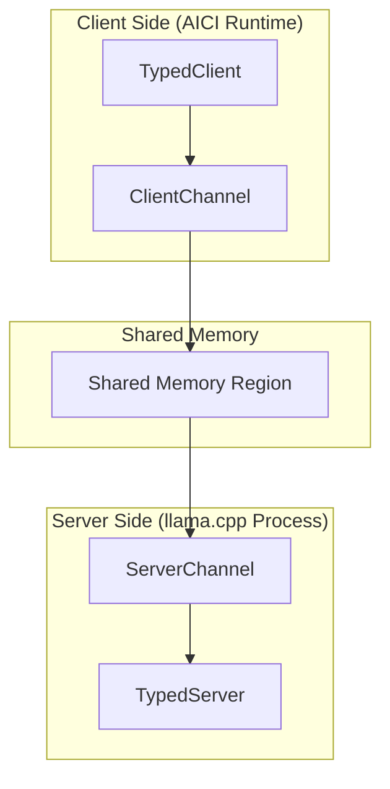
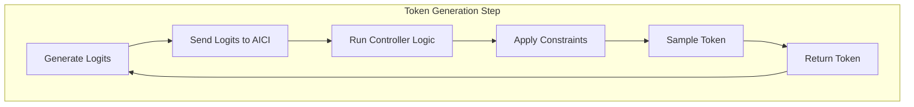
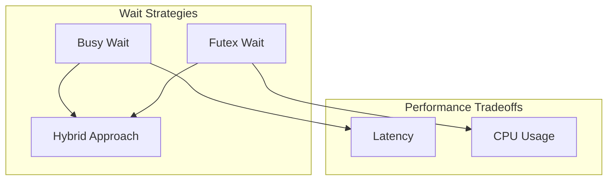

<!-- source: DeepWiki mcp.deepwiki.com · repo microsoft/aici · page 4.4 llama.cpp Integration · fetched 2026-10-26 -->

# llama.cpp Integration

<details>
<summary>Relevant source files</summary>

The following files were used as context for generating this wiki page:

- [aicirt/src/futexshm.rs](aicirt/src/futexshm.rs)
- [aicirt/src/macos.rs](aicirt/src/macos.rs)

</details>


This document describes how AICI (Artificial Intelligence Controller Interface) integrates with llama.cpp to provide controlled token generation capabilities on CPU-based inference. llama.cpp is a popular C++ implementation of LLaMA models that focuses on efficiency and can run on consumer hardware without requiring a GPU.

For information about other LLM integrations, see:
- [vLLM Integration](#4.1)
- [HuggingFace Integration](#4.2)
- [rLLM Integration](#4.3)

## Overview

The llama.cpp integration allows AICI to control token generation in llama.cpp-based inference, enabling features like constraint-based generation, backtracking, and forking. This integration is particularly useful for users who want to run controlled inference on CPU hardware or in environments where GPU resources are limited.



Sources: [aicirt/src/futexshm.rs:1-326]()

## Architecture

The llama.cpp integration uses a multi-process architecture with shared memory for efficient communication between the AICI runtime and the llama.cpp inference engine. This design allows for isolation between the controller logic and the inference engine while maintaining performance.



Sources: [aicirt/src/futexshm.rs:20-170]()

## Inter-Process Communication

The llama.cpp integration uses a custom IPC (Inter-Process Communication) mechanism based on shared memory and futexes/semaphores for synchronization. This allows for efficient communication between the AICI runtime and the llama.cpp process.

### Shared Memory Channels

The integration uses bidirectional communication channels implemented on top of shared memory. Each channel consists of two parts:
- A writer length field (futex)
- A reader length field (futex)

These channels are used to pass messages between the AICI runtime and the llama.cpp process, including:
- Prompts and generation parameters
- Logits for token prediction
- Constraints and biases from controllers
- Generated tokens

Sources: [aicirt/src/futexshm.rs:25-170]()

### Platform-Specific Synchronization

The integration supports both Linux and macOS platforms:
- On Linux, it uses the native futex system call for synchronization
- On macOS, it uses the ulock API for similar functionality



Sources: [aicirt/src/futexshm.rs:10-19](), [aicirt/src/macos.rs:1-79]()

## Message Passing Protocol

The llama.cpp integration uses a typed message passing protocol for communication between the AICI runtime and the llama.cpp process. This protocol is implemented using the `TypedClient` and `TypedServer` abstractions.

### Client-Server Communication

The communication follows a request-response pattern:
1. The client (AICI runtime) sends a request to the server (llama.cpp process)
2. The server processes the request and sends a response back
3. The client waits for the response with an optional timeout



Sources: [aicirt/src/futexshm.rs:173-325]()

### Message Serialization

Messages are serialized using bincode, a binary serialization format for Rust. This allows for efficient serialization and deserialization of complex data structures.

The `TypedClient` and `TypedServer` abstractions provide type-safe interfaces for sending and receiving messages:
- `TypedClient::send_req` serializes a command and sends it to the server
- `TypedClient::recv_resp` receives a response from the server and deserializes it
- `TypedServer::recv_req` receives a request from the client and deserializes it
- `TypedServer::send_resp` serializes a response and sends it to the client

Sources: [aicirt/src/futexshm.rs:235-296]()

## Token Generation Flow

The token generation flow in the llama.cpp integration follows these steps:

1. The client initializes the AICI runtime with a controller
2. The AICI runtime spawns a llama.cpp process
3. The client sends a prompt to the AICI runtime
4. The AICI runtime forwards the prompt to the llama.cpp process
5. For each token generation step:
   - llama.cpp generates logits for the next token
   - The logits are sent to the AICI runtime via shared memory
   - The AICI runtime runs the controller logic to apply constraints or biases
   - The constraints are sent back to llama.cpp
   - llama.cpp samples a token based on the constraints
   - The token is returned to the client



Sources: [aicirt/src/futexshm.rs:148-170](), [aicirt/src/futexshm.rs:212-228]()

## Performance Considerations

The llama.cpp integration is designed for efficiency, but there are some performance considerations to keep in mind:

### Busy Waiting vs. Futex Waiting

The integration supports both busy waiting and futex waiting for message reception:
- Busy waiting spins in a loop, checking for messages
- Futex waiting puts the thread to sleep until a message arrives

The choice between these approaches depends on the specific use case:
- Busy waiting provides lower latency but consumes CPU resources
- Futex waiting conserves CPU resources but may introduce additional latency



Sources: [aicirt/src/futexshm.rs:109-146]()

### Message Size Limitations

The shared memory channels have a maximum message size, which is determined by the size of the shared memory region:

```
max_msg_size = shm.size / 2 - 16
```

If a message exceeds this size, an error will be returned. It's important to consider this limitation when designing the communication protocol.

Sources: [aicirt/src/futexshm.rs:44-57]()

## Usage Example

Here's a high-level example of how to use the llama.cpp integration:

1. Initialize the AICI runtime with a controller
2. Create a shared memory region for communication
3. Spawn a llama.cpp process
4. Send a prompt to the llama.cpp process
5. Receive generated tokens

The integration handles the details of communication between the AICI runtime and the llama.cpp process, allowing the client to focus on the high-level task of text generation.

Sources: [aicirt/src/futexshm.rs:299-325]()

## Conclusion

The llama.cpp integration provides a way to use AICI controllers with llama.cpp-based inference, enabling controlled token generation on CPU hardware. The integration uses a multi-process architecture with shared memory for efficient communication, allowing for isolation between the controller logic and the inference engine while maintaining performance.

For more information about other aspects of the AICI system, see:
- [AICI Runtime (aicirt)](#2)
- [Controllers](#3)
- [Python Interface (pyaici)](#5)

---

