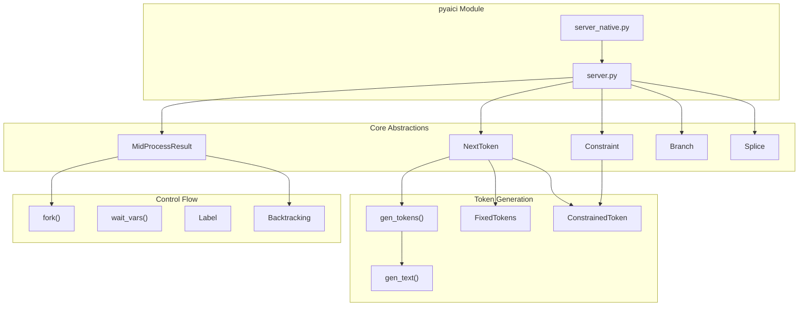
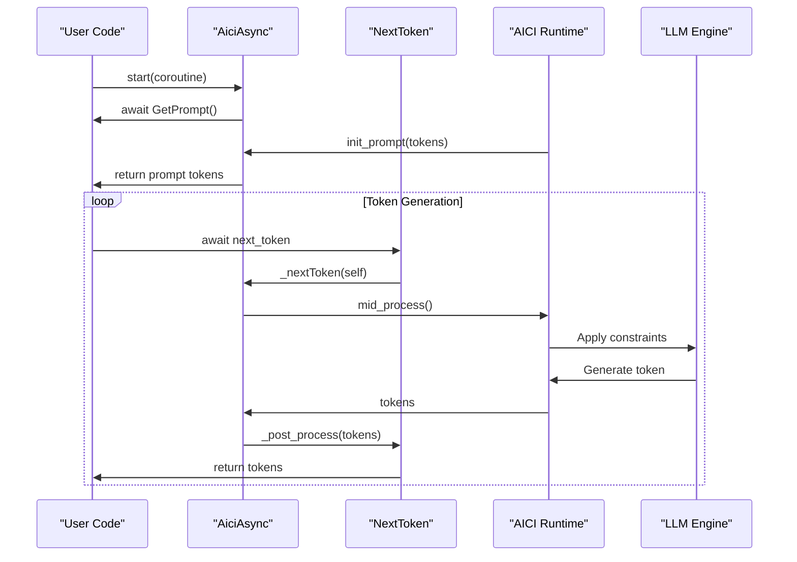
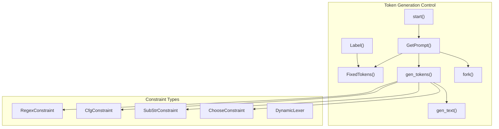
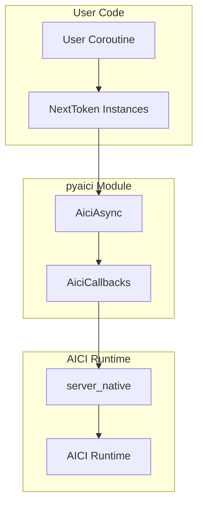
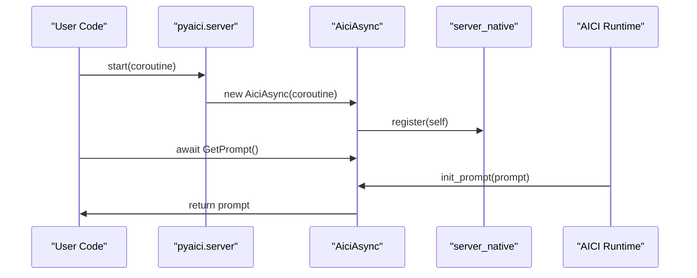

<!-- source: DeepWiki mcp.deepwiki.com · repo microsoft/aici · page 5 Python Interface (pyaici) · fetched 2026-10-26 -->

# Python Interface (pyaici)

<details>
<summary>Relevant source files</summary>

The following files were used as context for generating this wiki page:

- [controllers/jsctrl/samples/aici-types.d.ts](controllers/jsctrl/samples/aici-types.d.ts)
- [controllers/jsctrl/ts/aici.ts](controllers/jsctrl/ts/aici.ts)
- [controllers/jsctrl/ts/native.d.ts](controllers/jsctrl/ts/native.d.ts)
- [controllers/llguidance_ctrl/text_req.py](controllers/llguidance_ctrl/text_req.py)
- [controllers/pyctrl/samples/idents.py](controllers/pyctrl/samples/idents.py)
- [controllers/pyctrl/samples/test.py](controllers/pyctrl/samples/test.py)
- [py/pyaici/jssrc.py](py/pyaici/jssrc.py)
- [py/pyaici/server.py](py/pyaici/server.py)
- [py/pyaici/server_native.py](py/pyaici/server_native.py)

</details>


The Python Interface (`pyaici`) provides a high-level API for controlling and interacting with the AICI (Artificial Intelligence Controller Interface) system. It enables developers to write Python-based controllers that can guide and constrain token generation from large language models (LLMs).

This page focuses on the Python client interface for AICI. For information about Python controllers specifically, see [Python Controller (pyctrl)](#3.1).

## Overview

The `pyaici` module serves as the primary interface for Python developers to interact with the AICI runtime. It provides:

1. A coroutine-based API for controlling token generation
2. Constraint mechanisms for guiding LLM outputs
3. Variable storage for maintaining state across generation steps
4. Utilities for tokenization and detokenization
5. Support for advanced features like backtracking and forking



Sources: [py/pyaici/server.py:1-633](), [py/pyaici/server_native.py:1-246]()

## Core Concepts

### Asynchronous Control Flow

The `pyaici` interface uses Python's asynchronous programming model with coroutines and the `await` keyword. The main entry point is the `start()` function, which takes a coroutine and manages its execution within the AICI runtime.



Sources: [py/pyaici/server.py:353-477]()

### Token Generation Control

The `pyaici` module provides several mechanisms to control token generation:

1. **Fixed Tokens**: Force the LLM to generate specific tokens
2. **Constrained Tokens**: Apply constraints to guide token generation
3. **Backtracking**: Rewind generation to a previous point
4. **Forking**: Split generation into multiple parallel paths



Sources: [py/pyaici/server.py:35-162](), [py/pyaici/server.py:500-520](), [py/pyaici/server.py:553-612]()

## Key Components

### NextToken

The `NextToken` class is the base class for all token generation mechanisms. It provides methods for controlling token generation through the `mid_process()` and `post_process()` methods.

```python
class NextToken:
    def mid_process(self) -> MidProcessResult:
        # Control token generation
        return MidProcessResult.bias(all_tokens())
        
    def post_process(self, backtrack: int, tokens: List[int]):
        # Process generated tokens
        pass
```

Sources: [py/pyaici/server.py:138-198]()

### MidProcessResult

The `MidProcessResult` class represents the result of the `mid_process()` method. It can be used to:

1. Bias token generation with a `TokenSet`
2. Splice the generation by backtracking and fast-forwarding
3. Stop generation early
4. Create multiple branches for forking

```python
class MidProcessResult:
    @classmethod
    def bias(cls, bias: TokenSet):
        # Bias token generation
        return cls([Branch(sample_mask=bias)])
        
    @classmethod
    def splice(cls, backtrack: int, ff_tokens: List[Token]):
        # Backtrack and fast-forward
        return cls([Branch(splices=[Splice(backtrack=backtrack, ff_tokens=ff_tokens)])])
        
    @classmethod
    def stop(cls):
        # Stop generation
        return cls([])
```

Sources: [py/pyaici/server.py:98-135]()

### Constraint System

The constraint system allows for fine-grained control over token generation. The `pyaici` module provides several built-in constraint types:

| Constraint Type | Description | Example Usage |
|-----------------|-------------|--------------|
| `RegexConstraint` | Constrains tokens to match a regular expression | `gen_tokens(regex=r"\d+")` |
| `CfgConstraint` | Constrains tokens to match a context-free grammar | `gen_tokens(yacc="expr: term '+' term")` |
| `SubStrConstraint` | Constrains tokens to be substrings of a template | `gen_tokens(substring="template", substring_end='"')` |
| `ChooseConstraint` | Constrains tokens to be one of a set of options | `gen_tokens(options=["option1", "option2"])` |
| `DynamicLexer` | Constrains tokens to be valid identifiers | `dyn_lex = DynamicLexer(""); dyn_lex.add("id")` |

Sources: [py/pyaici/server.py:522-551](), [py/pyaici/server_native.py:123-215]()

## Usage Patterns

### Basic Token Generation

The most common pattern is to use the `gen_tokens()` or `gen_text()` functions to generate tokens with constraints:

```python
# Generate tokens matching a regex
tokens = await gen_tokens(regex=r"\d+", max_tokens=5)

# Generate text with options
text = await gen_text(options=["option1", "option2"])

# Generate text until a stop string
text = await gen_text(max_tokens=20, stop_at="\n")
```

Sources: [py/pyaici/server.py:553-612]()

### Fixed Token Insertion

The `FixedTokens` class allows inserting specific tokens into the generation:

```python
# Insert fixed tokens
await FixedTokens("The answer is: ")

# Create a label for backtracking
label = Label()
await FixedTokens("First attempt")

# Replace text after the label
await FixedTokens("Second attempt", following=label)
```

Sources: [py/pyaici/server.py:211-234](), [py/pyaici/server.py:500-520]()

### Forking and Variable Sharing

The `fork()` function allows splitting generation into multiple branches, and variables can be shared between branches:

```python
# Fork into 3 branches
branch_id = await fork(3)

if branch_id == 0:
    # Wait for variables from other branches
    var1, var2 = await wait_vars("var1", "var2")
    await FixedTokens(f"Variables: {var1}, {var2}")
elif branch_id == 1:
    # Set a variable for other branches
    await gen_text(regex=r"\d+", store_var="var1")
elif branch_id == 2:
    # Set another variable
    await gen_text(regex=r"[a-z]+", store_var="var2")
```

Sources: [py/pyaici/server.py:297-322](), [py/pyaici/server.py:340-350]()

## Example Workflows

### Interactive Question Answering

```python
async def question_answering():
    # Get the prompt from the user
    prompt = await GetPrompt()
    
    # Determine if the prompt is a question or statement
    await FixedTokens("This is a ")
    prompt_type = await gen_text(options=[" question", " statement"])
    
    if prompt_type == " question":
        await FixedTokens(". The answer is: ")
        await gen_text(max_tokens=30)
    else:
        await FixedTokens(". Here's more information: ")
        await gen_text(max_tokens=30)
```

Sources: [controllers/pyctrl/samples/test.py:201-213]()

### Structured Data Extraction

```python
async def extract_data():
    await FixedTokens("Extract drug names from the following text: ")
    
    # Create a label for the current position
    pos = Label()
    
    # Generate text with a specific format
    await gen_tokens(regex=r"<drug>[^<]+</drug>", store_var="drug1")
    
    # Extract more entities
    await gen_text(max_tokens=20, stop_at="<drug>")
    
    # Store the entire generated text
    extracted_text = pos.text_since()
    set_var("extracted_data", extracted_text)
```

Sources: [controllers/pyctrl/samples/test.py:98-145]()

## Integration with AICI Runtime

The `pyaici` module integrates with the AICI runtime through the `AiciAsync` class, which implements the `AiciCallbacks` interface:



Sources: [py/pyaici/server.py:353-477](), [py/pyaici/server_native.py:8-12]()

### Initialization Flow



Sources: [py/pyaici/server.py:479-485](), [py/pyaici/server.py:426-435]()

## JavaScript Interface Compatibility

The `pyaici` module's API is designed to be compatible with the JavaScript interface (`jsctrl`). Both interfaces share similar concepts and patterns:

| Python Interface | JavaScript Interface |
|------------------|----------------------|
| `await FixedTokens("text")` | `await fixed("text")` or `` await $`text` `` |
| `await gen_text(options=["a", "b"])` | `await gen({options: ["a", "b"]})` |
| `await gen_tokens(regex=r"\d+")` | `await genTokens({regex: /\d+/})` |
| `await fork(3)` | `await fork(3)` |
| `await wait_vars("var1", "var2")` | `await waitVars("var1", "var2")` |

Sources: [py/pyaici/jssrc.py:560-566](), [controllers/jsctrl/ts/aici.ts:304-322](), [controllers/jsctrl/ts/aici.ts:742-806]()

## Advanced Features

### Backtracking

Backtracking allows rewinding generation to a previous point and taking a different path:

```python
# Create a label
label = Label()

# Generate some text
await FixedTokens("First attempt")
await gen_tokens(regex=r"\d+", store_var="first")

# Backtrack to the label and try a different approach
await FixedTokens("Second attempt", following=label)
await gen_tokens(regex=r"[a-z]+", store_var="second")
```

Sources: [controllers/pyctrl/samples/test.py:9-18](), [controllers/pyctrl/samples/test.py:40-47]()

### Variable Storage

Variables can be used to store and retrieve data across different parts of the generation:

```python
# Store generated text in a variable
await gen_text(regex=r"\d+", store_var="number")

# Retrieve the variable
number = get_var("number").decode()

# Check variable values
check_vars({"number": "42"})
```

Sources: [py/pyaici/server.py:615-632](), [controllers/pyctrl/samples/test.py:87-95]()

## Performance Considerations

When using the `pyaici` interface, keep in mind the following performance considerations:

1. The `mid_process()` method has a time limit of ~20ms
2. The `post_process()` method has a stricter time limit of ~1ms
3. Code before the first `await GetPrompt()` has a longer time limit (~1000ms) for initialization
4. Avoid complex computations in token generation loops

Sources: [py/pyaici/server.py:142-146](), [py/pyaici/server.py:151-155]()

## Error Handling

The `pyaici` module provides basic error handling through assertions and checks:

```python
# Check if a feature is supported
if not fork_supported():
    print("Forking is not supported")
    
# Check variable values
try:
    check_var("result", "expected")
except AssertionError as e:
    print(f"Variable check failed: {e}")
```

Sources: [py/pyaici/server.py:297-302](), [py/pyaici/server.py:615-632]()

## Summary

The Python Interface (`pyaici`) provides a powerful and flexible way to control LLM token generation through the AICI system. Its coroutine-based API, constraint system, and advanced features like backtracking and forking enable developers to create sophisticated controllers for guiding LLM outputs.

For more information on specific aspects of the `pyaici` module, refer to:

- [Constraint System](#5.1) for details on token generation constraints
- [Async Control Flow](#5.2) for more on the asynchronous programming model
- [Variable Storage](#5.3) for information on maintaining state across generation steps

---

