<!-- source: DeepWiki mcp.deepwiki.com · repo microsoft/aici · page 5.1 Constraint System · fetched 2026-10-26 -->

# Constraint System

<details>
<summary>Relevant source files</summary>

The following files were used as context for generating this wiki page:

- [controllers/aici_abi/src/cfg.rs](controllers/aici_abi/src/cfg.rs)
- [controllers/aici_abi/src/dlex.rs](controllers/aici_abi/src/dlex.rs)
- [controllers/aici_abi/src/host.rs](controllers/aici_abi/src/host.rs)
- [controllers/aici_abi/src/lib.rs](controllers/aici_abi/src/lib.rs)
- [controllers/declctrl/src/declctrl.rs](controllers/declctrl/src/declctrl.rs)
- [controllers/jsctrl/samples/aici-types.d.ts](controllers/jsctrl/samples/aici-types.d.ts)
- [controllers/jsctrl/src/jsctrl.rs](controllers/jsctrl/src/jsctrl.rs)
- [controllers/jsctrl/ts/aici.ts](controllers/jsctrl/ts/aici.ts)
- [controllers/jsctrl/ts/native.d.ts](controllers/jsctrl/ts/native.d.ts)
- [controllers/llguidance_ctrl/text_req.py](controllers/llguidance_ctrl/text_req.py)
- [controllers/pyctrl/samples/idents.py](controllers/pyctrl/samples/idents.py)
- [controllers/pyctrl/samples/test.py](controllers/pyctrl/samples/test.py)
- [controllers/pyctrl/src/pyctrl.rs](controllers/pyctrl/src/pyctrl.rs)
- [py/pyaici/jssrc.py](py/pyaici/jssrc.py)
- [py/pyaici/server.py](py/pyaici/server.py)
- [py/pyaici/server_native.py](py/pyaici/server_native.py)

</details>


The AICI Constraint System provides mechanisms to control token generation during LLM inference. It allows controllers to specify which tokens are allowed at each step of the generation process, enabling precise control over the output format and content.

This page focuses on the core constraint abstractions and implementations in the AICI system. For information about the async control flow that uses these constraints, see [Async Control Flow](#5.2).

## Overview of the Constraint System

The constraint system is a fundamental part of AICI's token generation control mechanism. It allows controllers to define rules that determine which tokens are valid at each step of the generation process.

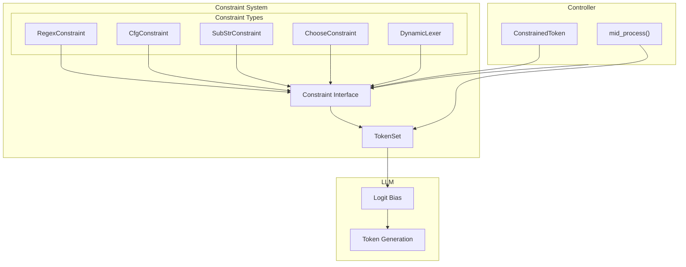

Sources:
- [controllers/aici_abi/src/lib.rs:1-239]()
- [py/pyaici/server.py:1-633]()

## Core Components

### TokenSet

The `TokenSet` is a fundamental data structure that represents a set of allowed tokens. It's essentially a bit vector where each position corresponds to a token ID, and the value (true/false) indicates whether that token is allowed.

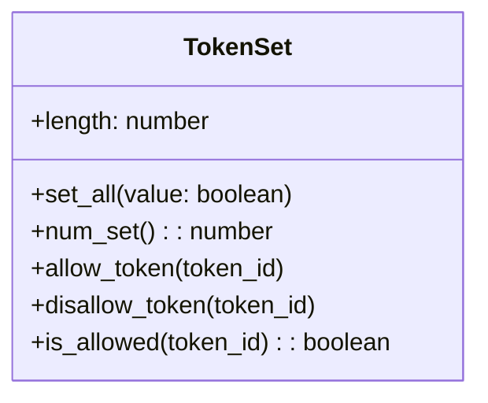

In Python, the `TokenSet` is exposed as a sequence-like object that can be indexed and modified. In JavaScript, it's exposed as a class with methods like `add()`, `delete()`, and `has()`.

Sources:
- [controllers/pyctrl/src/pyctrl.rs:272-359]()
- [controllers/jsctrl/src/jsctrl.rs:114-176]()
- [py/pyaici/server_native.py:87-122]()

### Constraint Interface

The `Constraint` interface defines the core methods that all constraint implementations must provide:

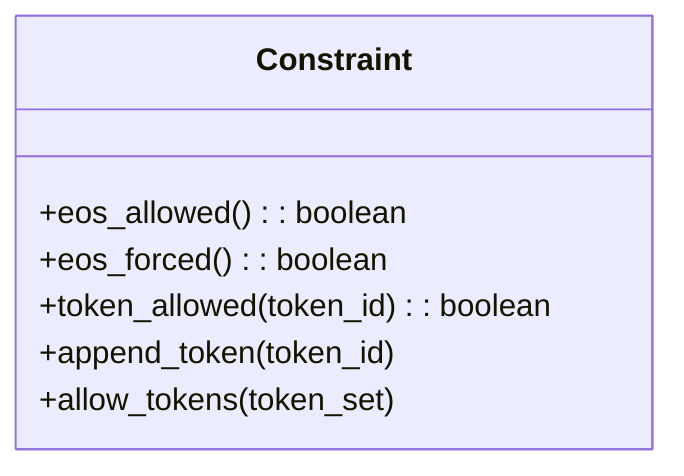

These methods allow the constraint to:
1. Check if the end-of-sequence token is allowed or forced
2. Check if a specific token is allowed
3. Update its internal state when a token is appended
4. Populate a `TokenSet` with all allowed tokens

Sources:
- [controllers/pyctrl/src/pyctrl.rs:453-485]()
- [controllers/jsctrl/src/jsctrl.rs:178-222]()
- [py/pyaici/server_native.py:124-160]()

## Constraint Types

AICI provides several built-in constraint types to handle common use cases:

### RegexConstraint

The `RegexConstraint` allows only tokens that, when combined, match a specified regular expression pattern. The regex is implicitly anchored at the start and end of the generation.

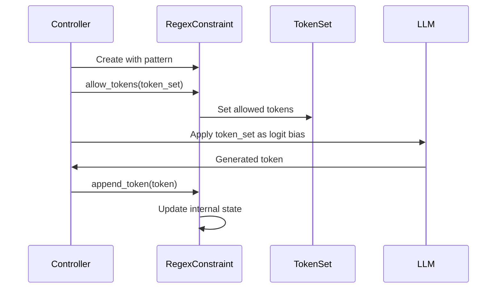

Example usage in Python:
```python
# Generate a token that matches a digit
constraint = RegexConstraint(r"\d")
```

Sources:
- [controllers/aici_abi/src/rx.rs]()
- [controllers/pyctrl/src/pyctrl.rs:241-247]()
- [controllers/jsctrl/src/jsctrl.rs:416-424]()

### CfgConstraint

The `CfgConstraint` allows only tokens that match a specified context-free grammar in YACC-like syntax. This is particularly useful for generating structured text like code or JSON.

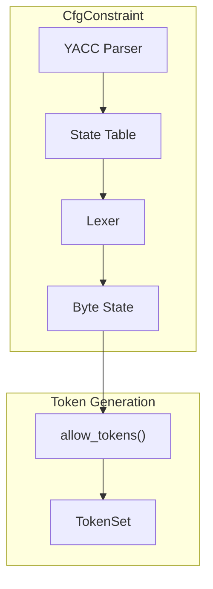

Example usage in Python:
```python
# Generate a token that matches a simple arithmetic expression
constraint = CfgConstraint("""
%start expr
%%
expr : NUMBER
     | expr '+' expr
     | expr '*' expr
     ;
""")
```

Sources:
- [controllers/aici_abi/src/cfg.rs:1-413]()
- [controllers/pyctrl/src/pyctrl.rs:248-255]()
- [controllers/jsctrl/src/jsctrl.rs:426-432]()

### SubStrConstraint

The `SubStrConstraint` allows only tokens that form valid substrings of a given template string. This is useful for generating text that must be a substring of a predefined text.

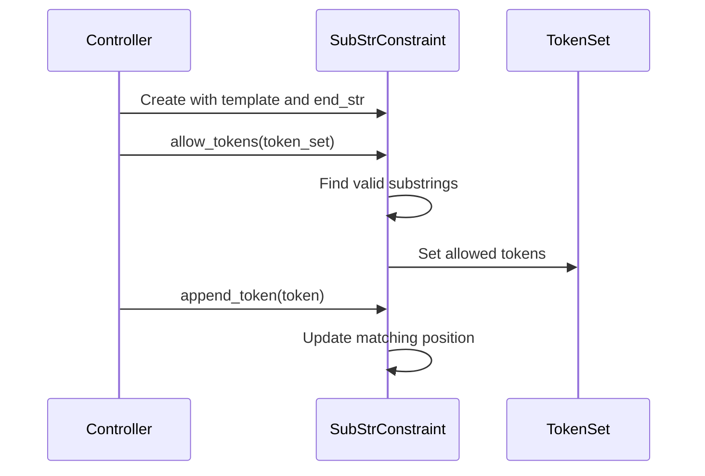

Example usage in Python:
```python
# Generate a token that is part of a JSON string
constraint = SubStrConstraint('{"name": "John", "age": 30}', '"')
```

Sources:
- [controllers/aici_abi/src/substring.rs]()
- [controllers/pyctrl/src/pyctrl.rs:256-260]()
- [controllers/jsctrl/src/jsctrl.rs:434-438]()

### ChooseConstraint

The `ChooseConstraint` allows only tokens that form one of a predefined set of options. This is useful for forcing the model to choose from a specific set of responses.

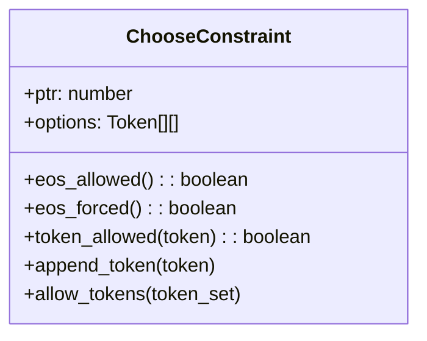

Example usage in Python:
```python
# Force the model to generate either "yes" or "no"
constraint = ChooseConstraint(["yes", "no"])
```

Sources:
- [py/pyaici/server.py:522-551]()
- [controllers/jsctrl/ts/aici.ts:513-543]()

### DynamicLexer

The `DynamicLexer` provides a constraint that only allows valid identifiers from a predefined set. This is particularly useful for controlling the generation of programming language identifiers.

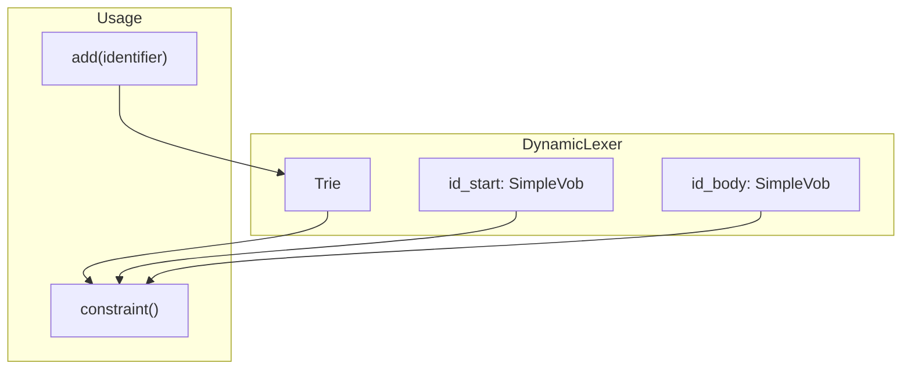

Example usage in Python:
```python
# Create a lexer that only allows specific Python identifiers
lexer = DynamicLexer("")  # No additional identifier chars
for id in ["def", "if", "return", "print"]:
    lexer.add(id)
constraint = lexer.constraint()
```

Sources:
- [controllers/aici_abi/src/dlex.rs:1-266]()
- [controllers/pyctrl/src/pyctrl.rs:202-239]()
- [py/pyaici/server_native.py:190-214]()
- [controllers/pyctrl/samples/idents.py:1-29]()

## Using Constraints in Controllers

Constraints are typically used through the `ConstrainedToken` class, which is a subclass of `NextToken` that applies a constraint to token generation.

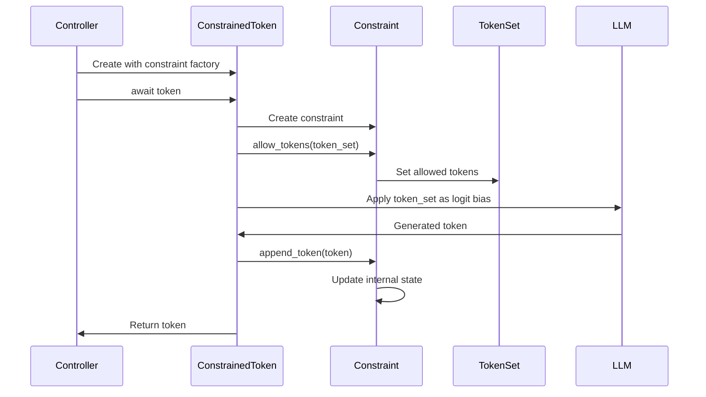

Example usage in Python:
```python
# Generate a token that matches a digit
next_token = ConstrainedToken(lambda: RegexConstraint(r"\d"))
token = await next_token
```

Sources:
- [py/pyaici/server.py:252-286]()
- [controllers/jsctrl/ts/aici.ts:375-406]()

## High-Level Generation Functions

For convenience, AICI provides high-level functions that use constraints internally:

### gen_tokens / genTokens

These functions generate a sequence of tokens that match specified constraints:

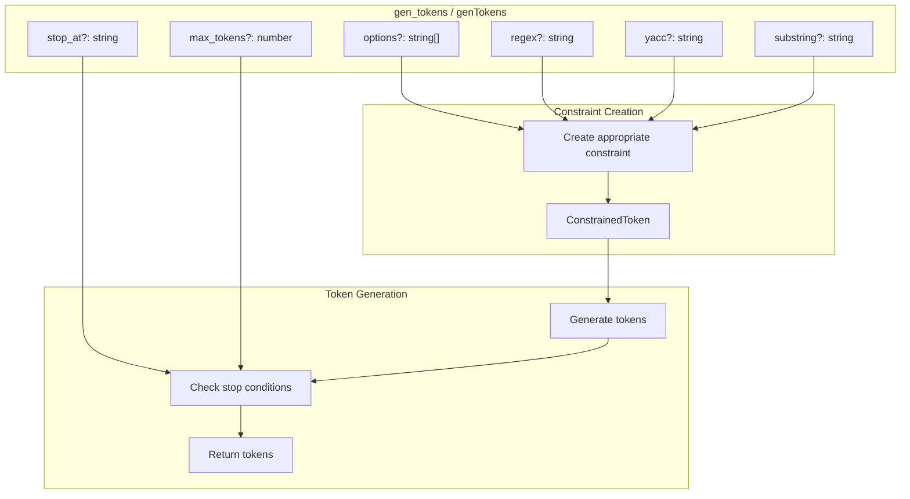

Example usage in Python:
```python
# Generate a sequence of digits
tokens = await gen_tokens(regex=r"\d+", max_tokens=5)
```

Sources:
- [py/pyaici/server.py:553-604]()
- [controllers/jsctrl/ts/aici.ts:544-547]()

### gen / gen

These functions are similar to `gen_tokens` / `genTokens` but return the generated text as a string:

```python
# Generate a sequence of digits as a string
text = await gen_text(regex=r"\d+", max_tokens=5)
```

Sources:
- [py/pyaici/server.py:607-612]()
- [controllers/jsctrl/ts/aici.ts:544-547]()

## Integration with the AICI System

The constraint system integrates with the broader AICI system through the `mid_process` method of controllers:

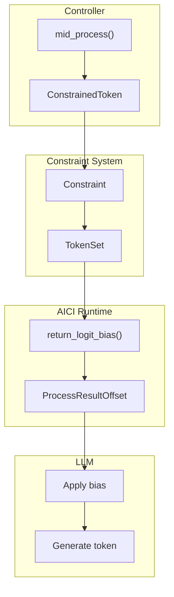

The flow is as follows:
1. The controller's `mid_process` method is called
2. If using constraints, it creates a `ConstrainedToken`
3. The constraint populates a `TokenSet` with allowed tokens
4. The `TokenSet` is converted to a logit bias tensor
5. The LLM applies the bias during token generation

Sources:
- [controllers/aici_abi/src/lib.rs:129-176]()
- [py/pyaici/server.py:98-136]()
- [controllers/jsctrl/ts/aici.ts:181-232]()

## Example: Regex Constraint in Action

Here's a complete example of using a regex constraint to generate a number:

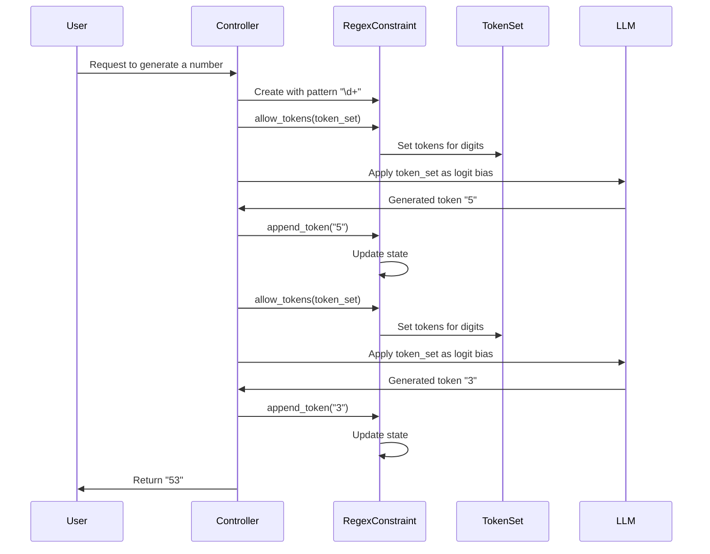

Python code example:
```python
import pyaici.server as aici

async def generate_number():
    # Generate a number with 2-3 digits
    number = await aici.gen_text(regex=r"\d{2,3}")
    print(f"Generated number: {number}")

aici.start(generate_number)
```

JavaScript code example:
```javascript
async function generateNumber() {
    // Generate a number with 2-3 digits
    const number = await gen({ regex: /\d{2,3}/ });
    console.log(`Generated number: ${number}`);
}

start(generateNumber);
```

Sources:
- [controllers/pyctrl/samples/test.py:50-61]()
- [controllers/jsctrl/ts/aici.ts:560-566]()

## Advanced Usage: Combining Constraints

While AICI doesn't directly support combining constraints, you can achieve similar effects by:

1. Using more powerful constraints (like CFG)
2. Sequencing constraints
3. Using inner constraints in the Gen step

Example of sequencing constraints in Python:
```python
# First generate a number
await gen_tokens(regex=r"\d+", store_var="number")
# Then generate a word
await gen_tokens(regex=r"[a-zA-Z]+", store_var="word")
```

Example of inner constraints in declarative controller:
```json
{
  "steps": [
    {
      "Gen": {
        "rx": "\\w+",
        "inner": [
          {
            "after": "The answer is ",
            "options": ["yes", "no", "maybe"]
          }
        ]
      }
    }
  ]
}
```

Sources:
- [controllers/declctrl/src/declctrl.rs:174-232]()
- [controllers/pyctrl/samples/test.py:63-95]()

## Conclusion

The AICI Constraint System provides a powerful mechanism for controlling token generation in LLMs. By defining which tokens are allowed at each step, controllers can guide the model to produce text in specific formats or with specific content, while still leveraging the model's knowledge and capabilities.

The system offers a range of constraint types to handle different use cases, from simple regex patterns to complex context-free grammars, and provides high-level functions for common generation tasks.

---

