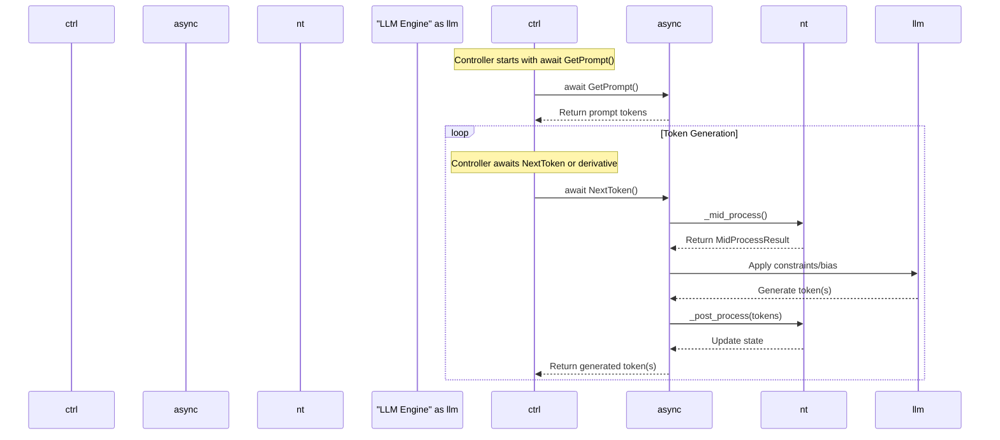
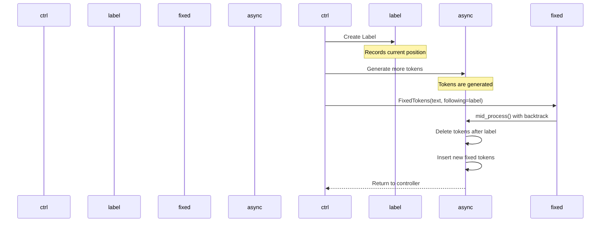
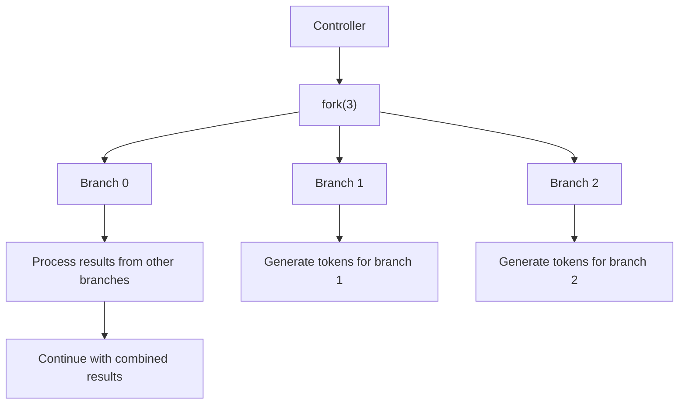
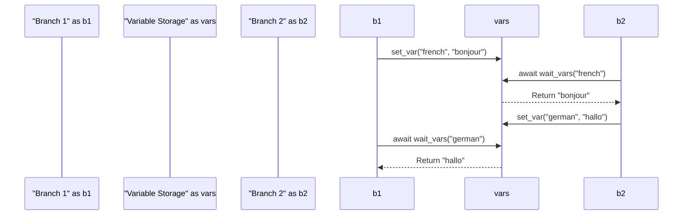
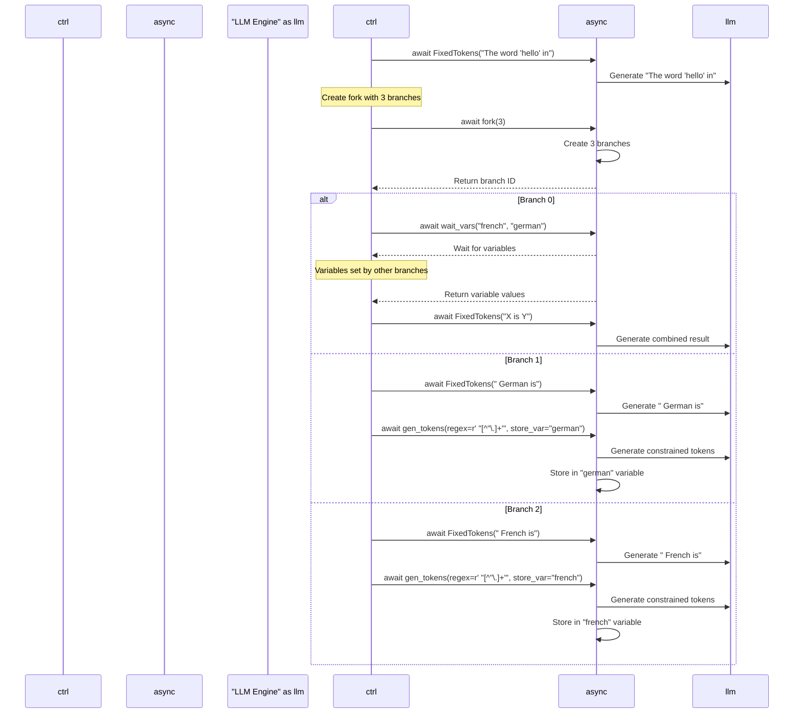
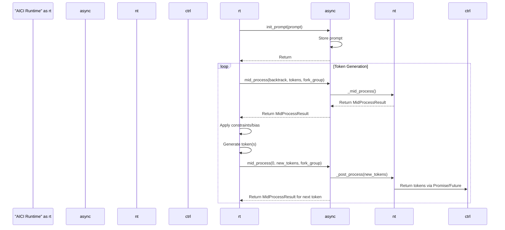

<!-- source: DeepWiki mcp.deepwiki.com · repo microsoft/aici · page 5.2 Async Control Flow · fetched 2026-10-26 -->

# Async Control Flow

<details>
<summary>Relevant source files</summary>

The following files were used as context for generating this wiki page:

- [controllers/jsctrl/samples/aici-types.d.ts](controllers/jsctrl/samples/aici-types.d.ts)
- [controllers/jsctrl/ts/aici.ts](controllers/jsctrl/ts/aici.ts)
- [controllers/jsctrl/ts/native.d.ts](controllers/jsctrl/ts/native.d.ts)
- [controllers/llguidance_ctrl/text_req.py](controllers/llguidance_ctrl/text_req.py)
- [controllers/pyctrl/samples/idents.py](controllers/pyctrl/samples/idents.py)
- [controllers/pyctrl/samples/test.py](controllers/pyctrl/samples/test.py)
- [py/pyaici/jssrc.py](py/pyaici/jssrc.py)
- [py/pyaici/server.py](py/pyaici/server.py)
- [py/pyaici/server_native.py](py/pyaici/server_native.py)

</details>


This page documents the asynchronous control flow mechanisms in the AICI (Artificial Intelligence Controller Interface) system, focusing on how token generation is managed through an asynchronous programming model. The async control flow enables controllers to influence token generation in a non-blocking manner, allowing for complex operations like backtracking, forking, and fast-forwarding tokens.

For information about the constraint system used to control token generation, see [Constraint System](#5.1). For details on maintaining state across generation steps, see [Variable Storage](#5.3).

## Overview of Async Control Flow

The AICI system uses an asynchronous programming model based on coroutines to manage token generation. This allows controllers to:

1. Await the prompt from the user
2. Generate tokens with constraints
3. Insert fixed tokens
4. Backtrack and modify previously generated tokens
5. Fork execution into multiple branches
6. Wait for variables to be set by other branches

The core of this system is the `NextToken` class and its derivatives, which represent different ways to control token generation.

Sources: [py/pyaici/server.py:138-162](), [py/pyaici/server.py:479-485]()

## Token Generation Flow

The following diagram illustrates the flow of token generation in the AICI system:



Sources: [py/pyaici/server.py:383-485](), [controllers/jsctrl/ts/aici.ts:234-303]()

## Core Components

### AiciAsync

The `AiciAsync` class is the central component that manages the asynchronous control flow. It:

1. Initializes the controller with the prompt
2. Manages the execution of `NextToken` instances
3. Handles backtracking and fast-forwarding
4. Coordinates forking and variable sharing

```mermaid
classDiagram
    class "AiciAsync" {
        +instance: AiciAsync
        -_tokens: List[Token]
        -_prompt_len: int
        -_coro: Coroutine
        -_cb: NextToken
        -_prompt_cb: GetPrompt
        -_went_ahead: bool
        -fork_group: List[SeqId]
        +init_prompt(prompt)
        +mid_process(backtrack, tokens, fork_group)
        -_apply_tokens(backtrack, tokens)
        -_mid_process_with_skip()
        -step()
    }
    
    class "AiciCallbacks" {
        +init_prompt(prompt)
        +mid_process(backtrack, tokens, fork_group)
    }
    
    class "NextToken" {
        +finished: bool
        +curr_tokens: List[Token]
        +mid_process()
        +post_process(backtrack, tokens)
        +is_fixed()
        -_mid_process()
        -_post_process(backtrack, tokens)
        -_reset()
    }
    
    class "GetPrompt" {
        +prompt: List[Token]
    }
    
    AiciAsync --|> AiciCallbacks
    AiciAsync --> NextToken
    AiciAsync --> GetPrompt
```

Sources: [py/pyaici/server.py:353-477](), [controllers/jsctrl/ts/aici.ts:464-647]()

### NextToken and Derivatives

The `NextToken` class is the base class for all token generation mechanisms. It provides methods for:

1. Controlling token generation through `mid_process()`
2. Processing generated tokens through `post_process()`
3. Indicating when generation should stop through the `finished` flag

The following diagram shows the hierarchy of `NextToken` derivatives:

```mermaid
classDiagram
    class "NextToken" {
        +finished: bool
        +curr_tokens: List[Token]
        +mid_process()
        +post_process(backtrack, tokens)
        +is_fixed()
    }
    
    class "FixedTokens" {
        +fixed_tokens: List[Token]
        +following: Label
        +is_fixed()
        +mid_process()
    }
    
    class "ConstrainedToken" {
        +mk_constraint: Callable
        -_constraint: Constraint
        +mid_process()
        +post_process(backtrack, tokens)
    }
    
    class "StopToken" {
        +mid_process()
        +post_process()
    }
    
    class "Noop" {
        +mid_process()
    }
    
    class "_Fork" {
        +forks: List[Branch]
        +mid_process()
    }
    
    class "_WaitVars" {
        +vars: List[str]
        +values: List[bytes]
        +mid_process()
    }
    
    NextToken <|-- FixedTokens
    NextToken <|-- ConstrainedToken
    NextToken <|-- StopToken
    NextToken <|-- Noop
    NextToken <|-- _Fork
    NextToken <|-- _WaitVars
```

Sources: [py/pyaici/server.py:138-250](), [controllers/jsctrl/ts/aici.ts:240-369]()

## Control Flow Mechanisms

### Fixed Token Generation

The `FixedTokens` class allows controllers to insert specific tokens into the generation:

```python
await aici.FixedTokens("The answer is 42")
```

This forces the LLM to generate exactly the specified text. It can also be used with a `Label` to replace previously generated tokens:

```python
label = aici.Label()
await aici.FixedTokens("some text")
# ... more generation ...
await aici.FixedTokens("different text", following=label)
```

Sources: [py/pyaici/server.py:211-234](), [controllers/jsctrl/ts/aici.ts:328-352]()

### Constrained Token Generation

The `ConstrainedToken` class allows controllers to generate tokens that satisfy specific constraints:

```python
await aici.gen_tokens(regex=r"\d+")  # Generate digits
await aici.gen_text(options=["yes", "no"])  # Choose between options
```

Under the hood, these functions use `ConstrainedToken` with different constraint types.

Sources: [py/pyaici/server.py:252-286](), [controllers/jsctrl/ts/aici.ts:375-406]()

### Backtracking

Backtracking allows controllers to go back and modify previously generated tokens. This is implemented through the `Label` class and the `following` parameter of `FixedTokens`:



Sources: [py/pyaici/server.py:500-520](), [controllers/jsctrl/ts/aici.ts:669-700]()

### Forking

Forking allows controllers to split execution into multiple branches, each generating different tokens:



The `fork()` function returns a branch index, allowing the controller to execute different code in each branch:

```python
branch_id = await aici.fork(3)
if branch_id == 0:
    # Process results from other branches
    french, german = await aici.wait_vars("french", "german")
elif branch_id == 1:
    # Generate tokens for branch 1
    await aici.gen_text(store_var="french")
elif branch_id == 2:
    # Generate tokens for branch 2
    await aici.gen_text(store_var="german")
```

Sources: [py/pyaici/server.py:287-322](), [controllers/jsctrl/ts/aici.ts:407-442]()

### Variable Sharing

Variables can be shared between branches using the `set_var()`, `get_var()`, and `wait_vars()` functions:



Sources: [py/pyaici/server.py:324-350](), [controllers/jsctrl/ts/aici.ts:443-472]()

## MidProcessResult and Branch

The `MidProcessResult` class represents the result of the `mid_process()` method of a `NextToken` instance. It can:

1. Bias token generation through a `TokenSet`
2. Splice the token sequence through backtracking and fast-forwarding
3. Stop generation entirely
4. Create multiple branches for forking

```mermaid
classDiagram
    class "MidProcessResult" {
        +skip_me: bool
        +branches: List[Branch]
        +is_splice()
        +static bias(TokenSet)
        +static splice(backtrack, ff_tokens)
        +static stop()
        +static noop()
        +static skip()
    }
    
    class "Branch" {
        +splices: List[Splice]
        +sample_mask: TokenSet
        +is_splice()
        +static noop()
    }
    
    class "Splice" {
        +when_sampled: List[Token]
        +backtrack: int
        +ff_tokens: List[Token]
        +add_splice(Splice)
    }
    
    MidProcessResult --> Branch
    Branch --> Splice
```

Sources: [py/pyaici/server.py:49-136](), [controllers/jsctrl/ts/aici.ts:128-232]()

## Python and JavaScript Implementations

The async control flow is implemented in both Python and JavaScript, with similar APIs:

| Python | JavaScript | Description |
|--------|------------|-------------|
| `aici.GetPrompt()` | `getPrompt()` | Get the prompt from the user |
| `aici.FixedTokens(text)` | `fixed(text)` or `` $`text` `` | Insert fixed tokens |
| `aici.gen_tokens(...)` | `genTokens(...)` | Generate tokens with constraints |
| `aici.gen_text(...)` | `gen(...)` | Generate text with constraints |
| `aici.fork(n)` | `fork(n)` | Fork execution into n branches |
| `aici.wait_vars(...)` | `waitVars(...)` | Wait for variables to be set |
| `aici.Label()` | `new Label()` | Create a label for backtracking |

Sources: [py/pyaici/server.py:1-633](), [controllers/jsctrl/ts/aici.ts:1-864]()

## Example: Backtracking and Forking

Here's an example that demonstrates backtracking and forking:



Sources: [controllers/pyctrl/samples/test.py:21-38]()

## Time Limits and Performance Considerations

The async control flow has different time limits for different phases:

1. Before `await GetPrompt()`: Long time limit (~1000ms) for initialization
2. During `mid_process()`: Medium time limit (~20ms) for constraint construction
3. During `post_process()`: Short time limit (~1ms) for token processing

Controllers should be designed with these time limits in mind to ensure smooth operation.

Sources: [py/pyaici/server.py:142-149](), [controllers/jsctrl/ts/aici.ts:375-406]()

## Integration with AICI Runtime

The async control flow integrates with the AICI runtime through the `AiciCallbacks` interface:



Sources: [py/pyaici/server.py:353-477](), [controllers/jsctrl/ts/aici.ts:464-647]()

## Conclusion

The async control flow in AICI provides a powerful and flexible way to control token generation. By using asynchronous programming patterns, controllers can influence token generation in complex ways while maintaining a clean and readable code structure.

---

