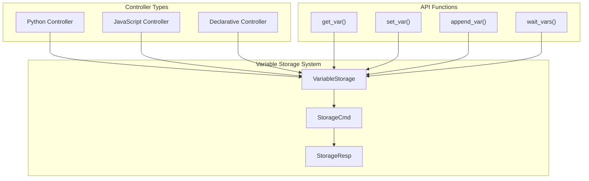
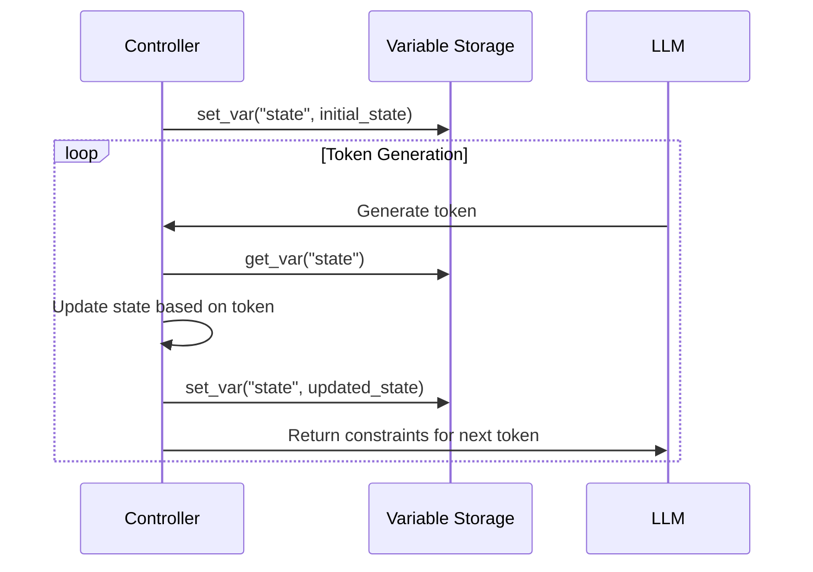
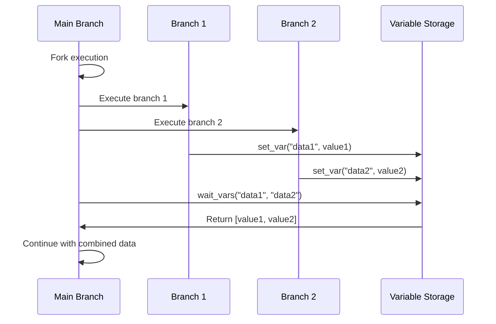
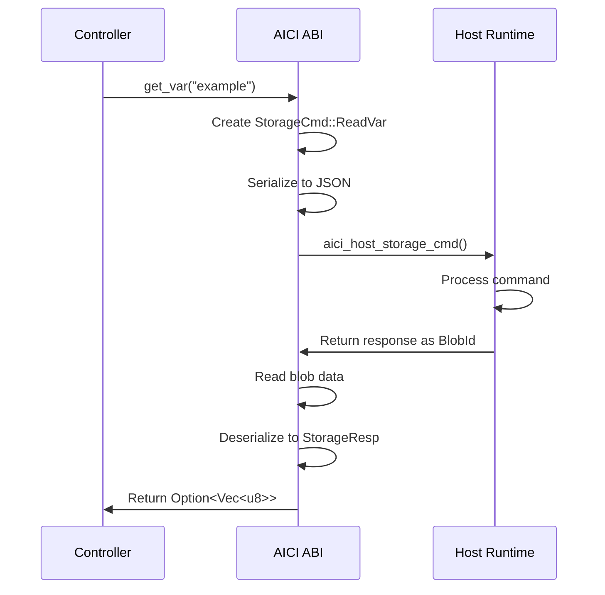
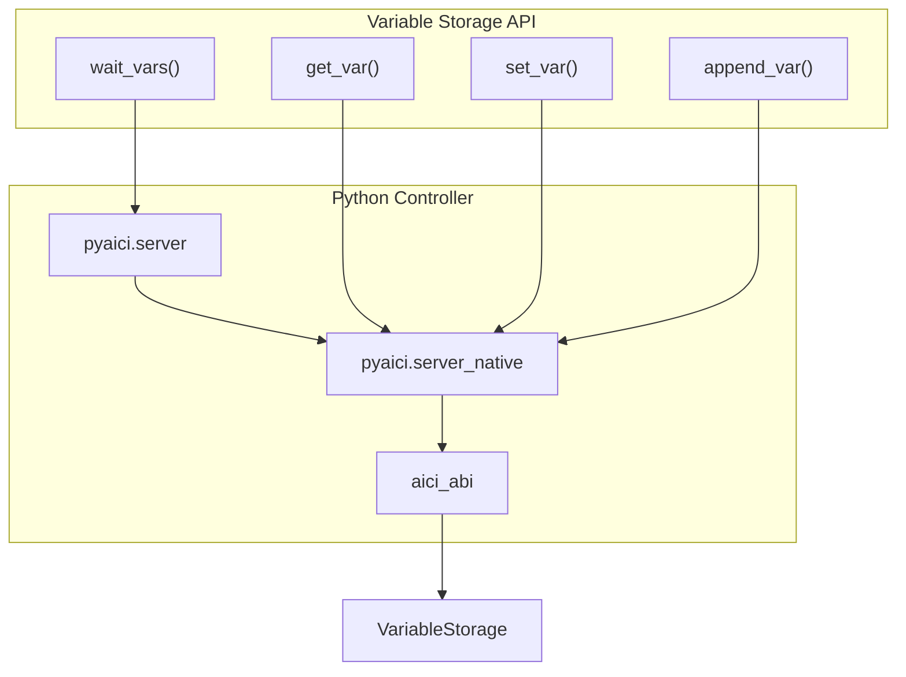
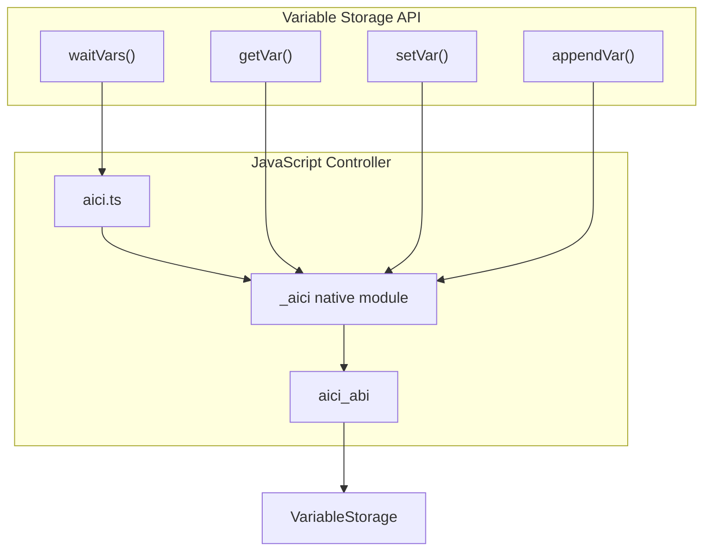
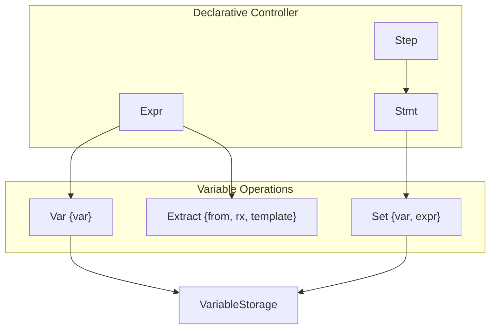
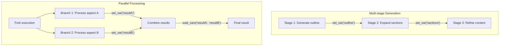

<!-- source: DeepWiki mcp.deepwiki.com · repo microsoft/aici · page 5.3 Variable Storage · fetched 2026-10-26 -->

# Variable Storage

<details>
<summary>Relevant source files</summary>

The following files were used as context for generating this wiki page:

- [controllers/aici_abi/src/cfg.rs](controllers/aici_abi/src/cfg.rs)
- [controllers/aici_abi/src/dlex.rs](controllers/aici_abi/src/dlex.rs)
- [controllers/aici_abi/src/host.rs](controllers/aici_abi/src/host.rs)
- [controllers/aici_abi/src/lib.rs](controllers/aici_abi/src/lib.rs)
- [controllers/declctrl/src/declctrl.rs](controllers/declctrl/src/declctrl.rs)
- [controllers/jsctrl/samples/aici-types.d.ts](controllers/jsctrl/samples/aici-types.d.ts)
- [controllers/jsctrl/src/jsctrl.rs](controllers/jsctrl/src/jsctrl.rs)
- [controllers/jsctrl/ts/aici.ts](controllers/jsctrl/ts/aici.ts)
- [controllers/jsctrl/ts/native.d.ts](controllers/jsctrl/ts/native.d.ts)
- [controllers/llguidance_ctrl/text_req.py](controllers/llguidance_ctrl/text_req.py)
- [controllers/pyctrl/samples/idents.py](controllers/pyctrl/samples/idents.py)
- [controllers/pyctrl/samples/test.py](controllers/pyctrl/samples/test.py)
- [controllers/pyctrl/src/pyctrl.rs](controllers/pyctrl/src/pyctrl.rs)
- [py/pyaici/jssrc.py](py/pyaici/jssrc.py)
- [py/pyaici/server.py](py/pyaici/server.py)
- [py/pyaici/server_native.py](py/pyaici/server_native.py)

</details>


This document describes the variable storage system in AICI (Artificial Intelligence Controller Interface), which allows controllers to maintain state across generation steps. The variable storage system provides a way to store and retrieve data during token generation, enabling complex workflows such as forking execution paths and sharing data between different branches.

For information about the constraint system used to control token generation, see [Constraint System](#5.1). For information about async control flow, see [Async Control Flow](#5.2).

## Overview

The AICI variable storage system provides a simple key-value store that persists throughout the lifetime of a controller. It allows controllers to:

1. Store arbitrary data as byte arrays under string keys
2. Retrieve previously stored data
3. Append to existing data
4. Share data between different execution branches when using forking

This functionality is essential for implementing complex control flows, such as gathering information from multiple parallel branches or maintaining state across backtracking operations.



Sources:
- [controllers/aici_abi/src/host.rs:232-308]()
- [controllers/aici_abi/src/host.rs:312-358]()
- [py/pyaici/server.py:52-67]()
- [py/pyaici/server.py:323-350]()

## Core Implementation

The variable storage system is implemented in the AICI ABI (Application Binary Interface) and exposed to controllers through a set of functions. The core implementation consists of:

1. `VariableStorage` - A struct that provides the interface for storing and retrieving variables
2. `StorageCmd` - An enum representing commands to operate on variables
3. `StorageResp` - An enum representing responses from variable operations

```mermaid
classDiagram
    class VariableStorage {
        +new() VariableStorage
        +get(name: &str) Option~Vec~u8~~
        +set(name: &str, value: Vec~u8~) void
        +append(name: &str, value: Vec~u8~) void
        -write_var(name: &str, value: Vec~u8~, op: StorageOp) u64
        -get_with_version(name: &str) Option~(u64, Vec~u8~)~
    }
    
    class StorageCmd {
        <<enum>>
        +ReadVar {name: String}
        +WriteVar {name: String, value: Vec~u8~, op: StorageOp, when_version_is: Option~u64~}
    }
    
    class StorageResp {
        <<enum>>
        +ReadVar {version: u64, value: Vec~u8~}
        +VariableMissing {}
        +WriteVar {version: u64}
    }
    
    class StorageOp {
        <<enum>>
        +Set
        +Append
    }
    
    VariableStorage --> StorageCmd: uses
    StorageCmd --> StorageResp: returns
    StorageCmd --> StorageOp: uses
```

Sources:
- [controllers/aici_abi/src/host.rs:232-308]()
- [controllers/aici_abi/src/host.rs:312-358]()

### Storage Commands and Operations

The variable storage system uses a command-based interface with versioning support:

1. `ReadVar` - Retrieves the value of a variable
2. `WriteVar` - Writes a value to a variable, with optional version checking
3. `StorageOp` - Specifies the type of write operation (Set or Append)

Each variable has an associated version number that increments with each write operation. This allows for optimistic concurrency control when needed.

Sources:
- [controllers/aici_abi/src/host.rs:232-308]()

### Variable Storage Interface

The `VariableStorage` struct provides a simplified interface for controllers to interact with the storage system:

```
pub struct VariableStorage {
    // no fields (yet?)
}

impl VariableStorage {
    pub fn new() -> Self { ... }
    pub fn get(&self, name: &str) -> Option<Vec<u8>> { ... }
    pub fn set(&self, name: &str, value: Vec<u8>) { ... }
    pub fn append(&self, name: &str, value: Vec<u8>) { ... }
    fn write_var(&self, name: &str, value: Vec<u8>, op: StorageOp) -> u64 { ... }
    fn get_with_version(&self, name: &str) -> Option<(u64, Vec<u8>)> { ... }
}
```

Sources:
- [controllers/aici_abi/src/host.rs:312-358]()

## Language-Specific Interfaces

The variable storage system is exposed to different controller types through language-specific interfaces.

### Python Interface

In Python controllers, the variable storage system is accessed through the following functions:

```python
def get_var(name: str) -> Optional[bytes]:
    """Get the value of a shared variable."""
    ...

def set_var(name: str, value: Union[str, bytes]) -> None:
    """Set the value of a shared variable."""
    ...

def append_var(name: str, value: Union[str, bytes]) -> None:
    """Append to the value of a shared variable."""
    ...

async def wait_vars(*vars: str) -> List[bytes]:
    """Suspends execution until all variables are available."""
    ...
```

The `wait_vars` function is particularly useful in forked execution paths, allowing a branch to wait for variables to be set by other branches.

Sources:
- [py/pyaici/server.py:52-67]()
- [py/pyaici/server.py:323-350]()
- [py/pyaici/server_native.py:52-70]()

### JavaScript Interface

JavaScript controllers access the variable storage system through similar functions:

```javascript
function getVar(name: string): Buffer | null;
function setVar(name: string, value: string | Buffer): void;
function appendVar(name: string, value: string | Buffer): void;
async function waitVars(...vars: string[]): Promise<Buffer[]>;
```

Sources:
- [controllers/jsctrl/ts/aici.ts:24-27]()
- [controllers/jsctrl/ts/aici.ts:442-467]()
- [controllers/jsctrl/ts/native.d.ts:169-182]()

## Usage Patterns

The variable storage system enables several important usage patterns in AICI controllers.

### State Persistence

Variables can be used to maintain state across generation steps, allowing controllers to build up complex data structures or track progress through a generation task.



Sources:
- [controllers/pyctrl/samples/test.py:64-95]()

### Data Sharing in Forked Execution

Variables can be used to share data between different execution branches when using forking:



Sources:
- [controllers/pyctrl/samples/test.py:21-37]()

### Example: Language Translation

A common pattern is to use forking to generate content in multiple languages and then combine the results:

```python
async def translate_example():
    await fixed("The word 'hello' in")
    id = await fork(3)
    if id == 0:
        french, german = await wait_vars("french", "german")
        await fixed(f"{french} is the same as {german}.")
    elif id == 1:
        await fixed(" German is")
        await gen_tokens(regex=r' "[^"\.]+"', store_var="german")
    elif id == 2:
        await fixed(" French is")
        await gen_tokens(regex=r' "[^"\.]+"', store_var="french")
```

Sources:
- [controllers/pyctrl/samples/test.py:21-37]()

## Implementation Details

### Storage Command Processing

When a controller calls a variable storage function, the following process occurs:

1. The function creates a `StorageCmd` with the appropriate parameters
2. The command is serialized to JSON and sent to the host
3. The host processes the command and returns a `StorageResp`
4. The response is deserialized and processed by the controller



Sources:
- [controllers/aici_abi/src/host.rs:303-308]()
- [controllers/aici_abi/src/host.rs:349-357]()

### Variable Waiting Mechanism

The `wait_vars` function uses a special `NextToken` implementation called `_WaitVars` that:

1. Checks if all requested variables are available
2. If not, returns a no-op result to continue to the next token
3. If all variables are available, returns a skip result to continue execution without consuming a token

```python
class _WaitVars(NextToken):
    def __init__(self, vars: List[str]):
        super().__init__()
        self.vars = vars
        self.values: List[bytes] = []

    def mid_process(self) -> MidProcessResult:
        values = [get_var(v) for v in self.vars]
        if None in values:
            return MidProcessResult.noop()
        self.values = values  # type: ignore
        return MidProcessResult.skip()
```

Sources:
- [py/pyaici/server.py:325-337]()
- [py/pyaici/server.py:340-350]()

## Integration with Controller Types

Each controller type integrates with the variable storage system in a slightly different way.

### Python Controller Integration

In Python controllers, the variable storage is accessed through the `pyaici.server` module, which provides a high-level interface to the underlying ABI functions.



Sources:
- [controllers/pyctrl/src/pyctrl.rs:120-138]()
- [py/pyaici/server.py:52-67]()
- [py/pyaici/server.py:323-350]()

### JavaScript Controller Integration

JavaScript controllers access the variable storage through the `_aici` native module, which is wrapped by the `aici` module to provide a more ergonomic interface.



Sources:
- [controllers/jsctrl/src/jsctrl.rs:298-318]()
- [controllers/jsctrl/ts/aici.ts:24-27]()
- [controllers/jsctrl/ts/aici.ts:442-467]()

### Declarative Controller Integration

The declarative controller uses variables extensively to implement its expression evaluation system, allowing for complex data manipulation within the declarative specification.



Sources:
- [controllers/declctrl/src/declctrl.rs:26-158]()

## Advanced Usage

### Variable Storage in Complex Workflows

The variable storage system can be used to implement complex workflows, such as:

1. **Multi-stage generation**: Store intermediate results and use them in later stages
2. **Parallel processing**: Fork execution, process different aspects in parallel, and combine results
3. **Conditional execution**: Make decisions based on stored variables
4. **Data extraction**: Extract and store specific information from generated text



Sources:
- [controllers/pyctrl/samples/test.py:21-37]()
- [controllers/pyctrl/samples/test.py:98-145]()

### Example: Drug Extraction Workflow

This example shows how to use variable storage to extract drug names from medical notes and then generate structured information about each drug:

```python
async def drug_extraction_workflow():
    # First generate a list of drugs
    await fixed("List specific drug names in the following doctor's notes.")
    s = await gen_text(max_tokens=30)
    drugs = re.findall(r"<drug>([^<]*)</drug>", "<drug>" + s)
    
    # Then generate information about each drug
    await fixed("Make a list of each drug along with time to take it")
    pos = Label()
    await gen_tokens(options=[d + "</drug>" for d in drugs])
    
    # Store the generated information
    aici.set_var("times", "<drug>" + pos.text_since())
```

Sources:
- [controllers/pyctrl/samples/test.py:98-145]()

## Best Practices

When using the variable storage system, consider the following best practices:

1. **Use descriptive variable names**: Choose names that clearly indicate the purpose of the variable
2. **Handle missing variables**: Always check if a variable exists before using it
3. **Use binary data carefully**: Remember that variables store raw bytes, so handle encoding/decoding appropriately
4. **Consider versioning**: For complex applications, use the versioning capabilities to avoid race conditions
5. **Clean up unused variables**: Set variables to empty when they're no longer needed to free up memory

### Variable Naming Conventions

A common convention is to use lowercase names with underscores for variables, similar to Python's naming convention:

```
user_input
generated_response
translation_result
extracted_data
```

Sources:
- [controllers/pyctrl/samples/test.py:64-95]()

## Conclusion

The AICI variable storage system provides a flexible and powerful way to maintain state and share data during token generation. By understanding how to effectively use variables, you can implement complex control flows and build sophisticated applications with AICI controllers.

For more information about related systems, see:
- [Constraint System](#5.1) for controlling token generation
- [Async Control Flow](#5.2) for managing the flow of token generation

---

