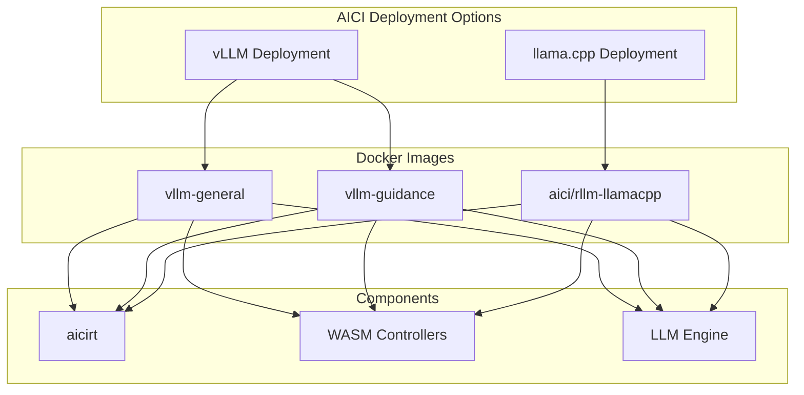
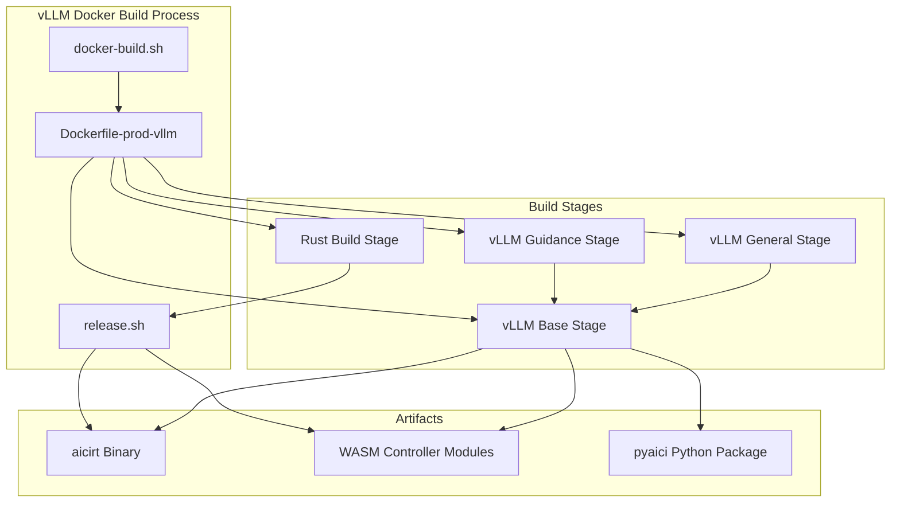
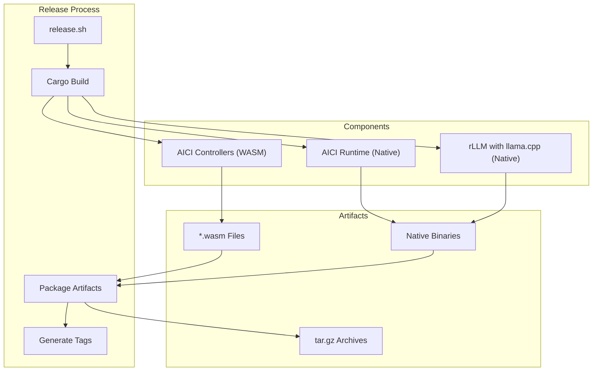
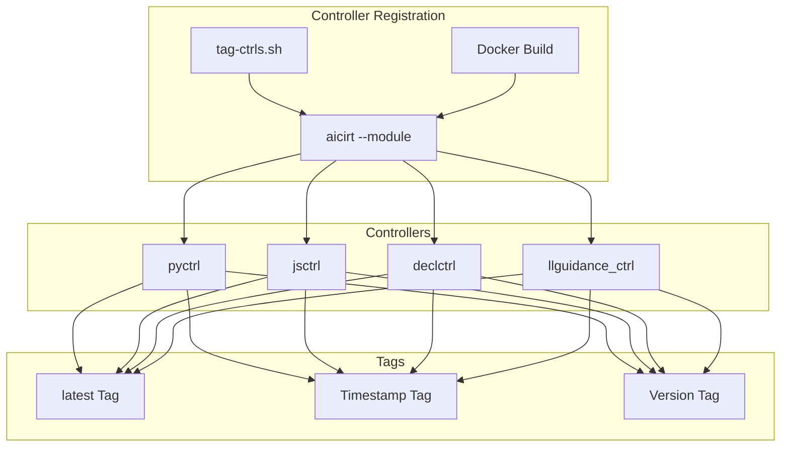
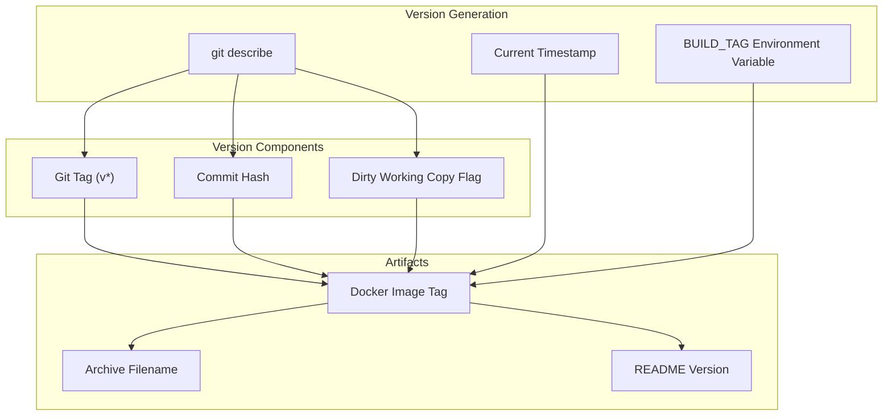

<!-- source: DeepWiki mcp.deepwiki.com · repo microsoft/aici · page 6 Deployment · fetched 2026-10-26 -->

# Deployment

<details>
<summary>Relevant source files</summary>

The following files were used as context for generating this wiki page:

- [.devcontainer/Dockerfile-prod-cpp](.devcontainer/Dockerfile-prod-cpp)
- [.devcontainer/Dockerfile-prod-vllm](.devcontainer/Dockerfile-prod-vllm)
- [.gitattributes](.gitattributes)
- [scripts/docker-build.sh](scripts/docker-build.sh)
- [scripts/docker-cpp-run.sh](scripts/docker-cpp-run.sh)
- [scripts/docker-run.sh](scripts/docker-run.sh)
- [scripts/docker-vllm-build.sh](scripts/docker-vllm-build.sh)
- [scripts/release.sh](scripts/release.sh)
- [scripts/tag-ctrls.sh](scripts/tag-ctrls.sh)

</details>


This page provides an overview of the deployment options for the AICI (Artificial Intelligence Controller Interface) system. It covers how to build, package, and run AICI with different LLM backends in production environments.

For information about server configuration, see [Server Configuration](#6.2).

## Deployment Architecture

AICI supports multiple deployment configurations depending on the LLM backend you want to use. The primary deployment options are:

1. vLLM-based deployment (GPU-accelerated)
2. llama.cpp-based deployment (CPU-optimized)



Sources: [.devcontainer/Dockerfile-prod-vllm:34-73](), [.devcontainer/Dockerfile-prod-cpp:1-27]()

## Building Docker Images

AICI provides Docker-based deployment for both vLLM and llama.cpp backends. The build process compiles the AICI runtime (`aicirt`), controllers, and packages them into Docker images.

### vLLM Docker Image

The vLLM Docker image is built using the `Dockerfile-prod-vllm` and includes:
- AICI runtime (`aicirt`)
- WASM controllers (pyctrl, jsctrl, llguidance_ctrl)
- vLLM integration with OpenAI-compatible API



Sources: [.devcontainer/Dockerfile-prod-vllm:1-73](), [scripts/docker-build.sh:1-39](), [scripts/release.sh:1-178]()

### llama.cpp Docker Image

The llama.cpp Docker image is built using the `Dockerfile-prod-cpp` and includes:
- AICI runtime (`aicirt`)
- rLLM with llama.cpp integration
- WASM controllers

Sources: [.devcontainer/Dockerfile-prod-cpp:1-27]()

## Building AICI Components

The build process for AICI components is managed by the `release.sh` script, which:
1. Compiles the AICI runtime and controllers
2. Packages them into distributable archives
3. Generates metadata and checksums



Sources: [scripts/release.sh:1-178]()

## Controller Tagging and Registration

Controllers are tagged and registered with the AICI runtime during the build process. This allows them to be referenced by name in API calls.



Sources: [scripts/tag-ctrls.sh:1-16](), [.devcontainer/Dockerfile-prod-vllm:66-72]()

## Running AICI Deployments

AICI provides scripts to run the Docker containers for both vLLM and llama.cpp deployments.

### Running vLLM Deployment

The `docker-run.sh` script provides options for running the vLLM Docker container:

```
./scripts/docker-run.sh [--orca|--folder <path>|--shell] [additional args]
```

Options:
- `--orca`: Use the Microsoft Orca-2-13b model
- `--folder <path>`: Mount a local folder containing a model
- `--shell`: Start a shell in the container instead of the server

By default, the server runs on port 4242 and exposes an OpenAI-compatible API.

Sources: [scripts/docker-run.sh:1-44]()

### Running llama.cpp Deployment

The `docker-cpp-run.sh` script provides options for running the llama.cpp Docker container:

```
./scripts/docker-cpp-run.sh [--phi2|--folder <path>|--shell] [additional args]
```

Options:
- `--phi2`: Use the Phi-2 model (GGUF format)
- `--folder <path>`: Mount a local folder containing a model
- `--shell`: Start a shell in the container instead of the server

Sources: [scripts/docker-cpp-run.sh:1-36]()

## Docker Image Variants

AICI provides multiple Docker image variants for different use cases:

| Image Tag | Description | Controllers |
|-----------|-------------|-------------|
| vllm-general | Full vLLM deployment with all controllers | pyctrl, jsctrl, llguidance_ctrl |
| vllm-guidance | Minimal vLLM deployment with only llguidance controller | llguidance_ctrl |
| aici/rllm-llamacpp | CPU-optimized deployment with llama.cpp | Configurable |

Sources: [.devcontainer/Dockerfile-prod-vllm:64-72](), [.devcontainer/Dockerfile-prod-cpp:1-27]()

## Building Custom Docker Images

To build a custom Docker image with specific controllers or configurations:

1. Use the `docker-build.sh` script:
   ```
   ./scripts/docker-build.sh [target] [dockerfile]
   ```

2. Optionally push the image to a registry:
   ```
   DOCKER_PUSH=myregistry/myimage DOCKER_TAG=v1 ./scripts/docker-build.sh
   ```

The build process uses Docker BuildKit for efficient layer caching and parallel builds.

Sources: [scripts/docker-build.sh:1-39]()

## Deployment Environment Variables

The following environment variables can be used to configure AICI deployments:

| Variable | Description | Default |
|----------|-------------|---------|
| RUST_LOG | Log level for the AICI runtime | info,tokenizers=error |
| PORT | Port for the API server | 4242 |
| DOCKER_TARGET | Docker image target to build/run | vllm-general |
| DOCKER_PUSH | Registry to push Docker images to | (none) |
| DOCKER_TAG | Tag for pushed Docker images | v{timestamp} |

Sources: [.devcontainer/Dockerfile-prod-vllm:60-62](), [scripts/docker-build.sh:1-39](), [scripts/docker-run.sh:1-44]()

## Versioning and Tagging

AICI uses Git-based versioning for releases. The build process extracts version information from Git tags and commits, and includes it in the built artifacts.



Sources: [scripts/release.sh:16-23](), [scripts/docker-build.sh:15-16]()

## API Endpoints

When deployed, AICI exposes an OpenAI-compatible API endpoint that can be used with standard OpenAI client libraries. The API supports specifying AICI controllers and their parameters.

For more details on the API and server configuration, see [Server Configuration](#6.2).

---

