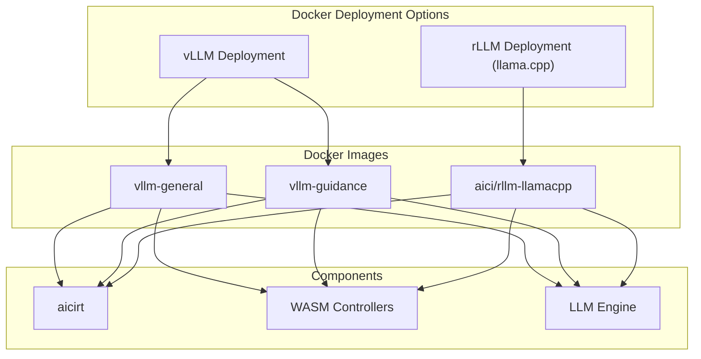
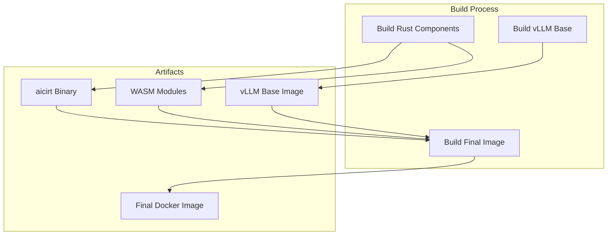
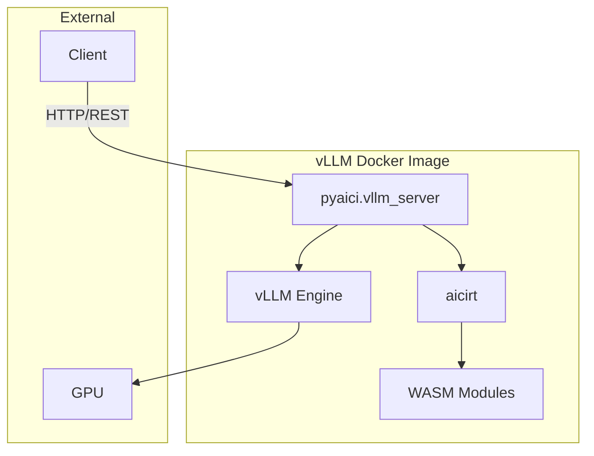
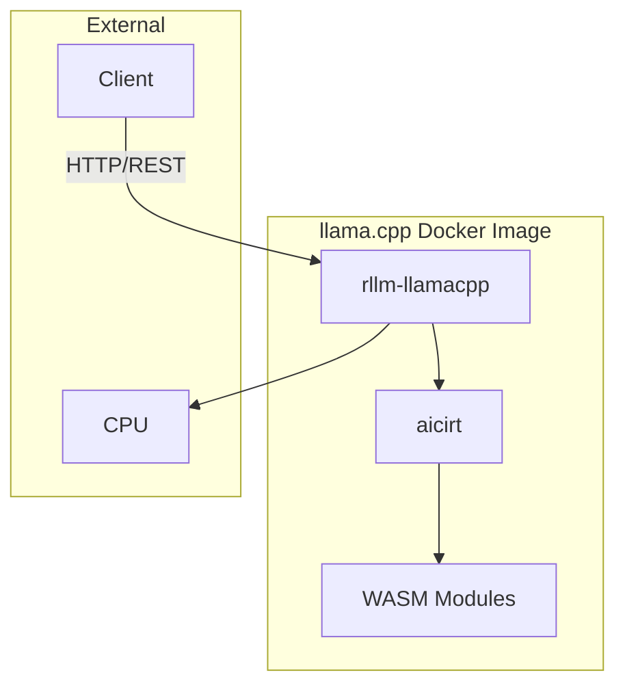
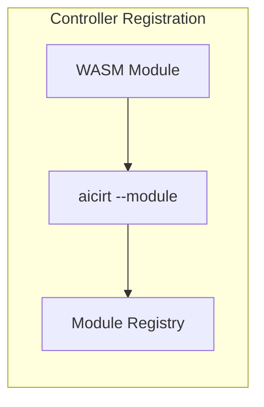

<!-- source: DeepWiki mcp.deepwiki.com · repo microsoft/aici · page 6.1 Docker Deployment · fetched 2026-10-26 -->

# Docker Deployment

<details>
<summary>Relevant source files</summary>

The following files were used as context for generating this wiki page:

- [.devcontainer/Dockerfile-prod-cpp](.devcontainer/Dockerfile-prod-cpp)
- [.devcontainer/Dockerfile-prod-vllm](.devcontainer/Dockerfile-prod-vllm)
- [.gitattributes](.gitattributes)
- [scripts/docker-build.sh](scripts/docker-build.sh)
- [scripts/docker-cpp-run.sh](scripts/docker-cpp-run.sh)
- [scripts/docker-run.sh](scripts/docker-run.sh)
- [scripts/docker-vllm-build.sh](scripts/docker-vllm-build.sh)
- [scripts/release.sh](scripts/release.sh)
- [scripts/tag-ctrls.sh](scripts/tag-ctrls.sh)

</details>


This page explains how to deploy the AICI system using Docker. It covers the available Docker images, build processes, and runtime configurations for different deployment scenarios.

For information about server configuration options, see [Server Configuration](#6.2).

## Overview

AICI provides Docker-based deployment options for different LLM backends. The system uses a multi-stage build process to create optimized containers that include the AICI runtime (`aicirt`), controllers, and integration with specific LLM engines.



Sources: [.devcontainer/Dockerfile-prod-vllm](), [.devcontainer/Dockerfile-prod-cpp](), [scripts/docker-build.sh]()

## Docker Images

AICI provides several pre-configured Docker images for different deployment scenarios:

| Image | Description | Base | Controllers |
|-------|-------------|------|------------|
| `vllm-general` | vLLM with all controllers | vLLM | pyctrl, jsctrl, llguidance |
| `vllm-guidance` | vLLM with guidance controller only | vLLM | llguidance |
| `aici/rllm-llamacpp` | CPU-only deployment with llama.cpp | minideb | (configurable) |

Sources: [.devcontainer/Dockerfile-prod-vllm:63-73](), [.devcontainer/Dockerfile-prod-cpp:1-26]()

## Building Docker Images

### vLLM-based Images

The vLLM-based images are built using a multi-stage process that:
1. Compiles the AICI runtime and controllers
2. Packages them with a vLLM base image
3. Registers the WASM controllers with the runtime



To build a vLLM-based image:

```bash
./scripts/docker-build.sh vllm-general
```

Or for the minimal guidance-only image:

```bash
./scripts/docker-build.sh vllm-guidance
```

Sources: [scripts/docker-build.sh:1-38](), [.devcontainer/Dockerfile-prod-vllm:1-73]()

### llama.cpp-based Images

The llama.cpp-based image is built similarly but uses the `rllm-llamacpp` binary instead of vLLM:

```bash
# First build the binaries
./scripts/release.sh

# Then build the Docker image
docker build . -f .devcontainer/Dockerfile-prod-cpp -t aici/rllm-llamacpp
```

Sources: [.devcontainer/Dockerfile-prod-cpp:1-26](), [scripts/release.sh:1-177]()

## Running Docker Containers

### vLLM Deployment

The `docker-run.sh` script provides a convenient way to run vLLM-based containers:

```bash
# Run with default settings (port 4242)
./scripts/docker-run.sh

# Run with a specific model from a local folder
./scripts/docker-run.sh --folder /path/to/model

# Get a shell in the container
./scripts/docker-run.sh --shell
```

The script supports several options:
- `--orca`: Use Microsoft Orca-2-13b model
- `--folder PATH`: Mount a local model folder
- `--shell`: Start a shell instead of the server

Sources: [scripts/docker-run.sh:1-44]()

### llama.cpp Deployment

For CPU-only deployment with llama.cpp:

```bash
# Run with default settings
./scripts/docker-cpp-run.sh

# Run with Phi-2 model
./scripts/docker-cpp-run.sh --phi2

# Run with a local model
./scripts/docker-cpp-run.sh --folder /path/to/model
```

Sources: [scripts/docker-cpp-run.sh:1-36]()

## Docker Image Architecture

### vLLM-based Images

The vLLM-based Docker images have the following architecture:



The entry point is the `pyaici.vllm_server` module, which:
1. Initializes the vLLM engine
2. Starts the AICI runtime (`aicirt`)
3. Exposes an HTTP/REST API for clients

Sources: [.devcontainer/Dockerfile-prod-vllm:34-62]()

### llama.cpp-based Images

The llama.cpp-based Docker image has a simpler architecture:



The entry point is the `rllm-llamacpp` binary, which:
1. Loads the model using llama.cpp
2. Starts the AICI runtime (`aicirt`)
3. Exposes an HTTP/REST API for clients

Sources: [.devcontainer/Dockerfile-prod-cpp:26]()

## Controller Registration

WASM controllers are registered with the AICI runtime during the Docker build process. This makes them available for use in inference requests.



For example, in the `vllm-general` image, the following controllers are registered:

```bash
aicirt --module wasm/aici_llguidance_ctrl.wasm --tag llguidance
aicirt --module wasm/aici_pyctrl.wasm --tag pyctrl --gh-module gh:microsoft/aici/pyctrl
aicirt --module wasm/aici_jsctrl.wasm --tag jsctrl --gh-module gh:microsoft/aici/jsctrl
```

Sources: [.devcontainer/Dockerfile-prod-vllm:66-72](), [scripts/tag-ctrls.sh:1-16]()

## Environment Variables and Configuration

The Docker images support various environment variables for configuration:

| Variable | Description | Default |
|----------|-------------|---------|
| `RUST_LOG` | Logging level for Rust components | `info,tokenizers=error` |
| `PORT` | HTTP server port | `4242` |

Additional configuration options can be passed as command-line arguments to the container.

Sources: [.devcontainer/Dockerfile-prod-vllm:60](), [scripts/docker-run.sh:3]()

## Building Custom Images

To build a custom Docker image with specific controllers:

1. Build the AICI runtime and controllers:
   ```bash
   ./scripts/release.sh
   ```

2. Create a Dockerfile based on the provided examples:
   ```dockerfile
   FROM vllm/vllm-openai as vllm-base
   
   # Install pyaici
   RUN pip install posix_ipc ujson
   COPY py/setup.py /tmp/pyaici/
   COPY py/pyaici /tmp/pyaici/pyaici
   RUN cd /tmp/pyaici && pip install .
   
   # Copy aicirt and controllers
   COPY target/dist/aicirt/aicirt /usr/bin/aicirt
   COPY target/dist/aici_*.wasm /vllm-workspace/wasm/
   
   # Register controllers
   RUN aicirt --module wasm/aici_mycontroller.wasm --tag mycontroller
   
   ENTRYPOINT ["python3", "-m", "pyaici.vllm_server"]
   ```

3. Build the Docker image:
   ```bash
   docker build . -f my-dockerfile -t my-aici-image
   ```

Sources: [.devcontainer/Dockerfile-prod-vllm:34-62](), [scripts/docker-build.sh:1-38]()

## Pushing Images to a Registry

The `docker-build.sh` script supports pushing images to a Docker registry:

```bash
DOCKER_PUSH=myregistry/aici DOCKER_TAG=v1.0 ./scripts/docker-build.sh vllm-general
```

This will:
1. Build the `vllm-general` image
2. Tag it as `myregistry/aici:v1.0`
3. Push it to the registry

Sources: [scripts/docker-build.sh:27-38]()

## Troubleshooting

Common issues and their solutions:

1. **GPU not detected**: Ensure the `--gpus=all` flag is passed to Docker
2. **Shared memory errors**: Increase shared memory with `--shm-size=8g`
3. **Controller not found**: Verify the controller is properly registered with `aicirt`

Sources: [scripts/docker-run.sh:33-35]()

---

