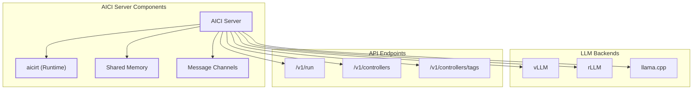
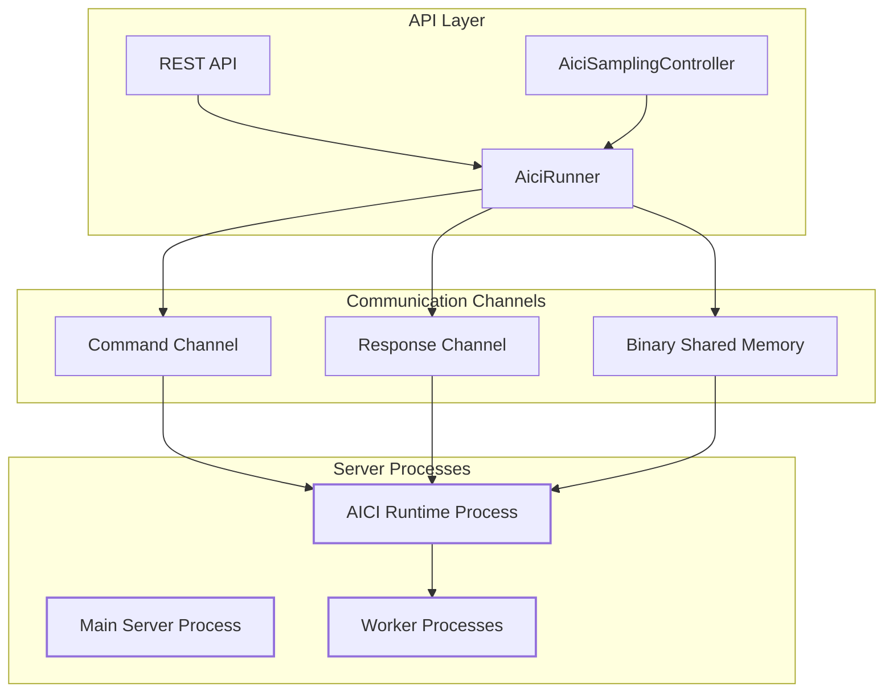
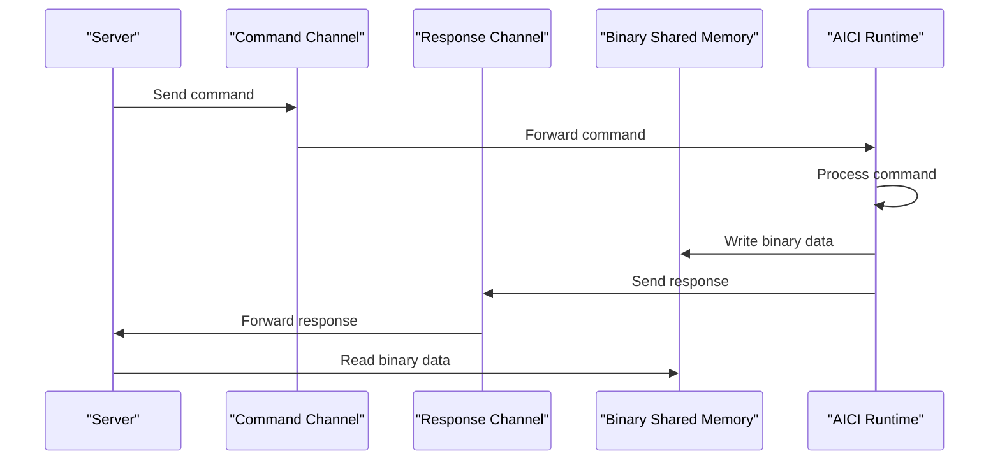
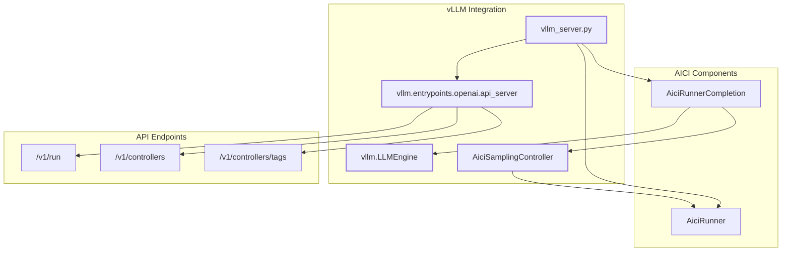
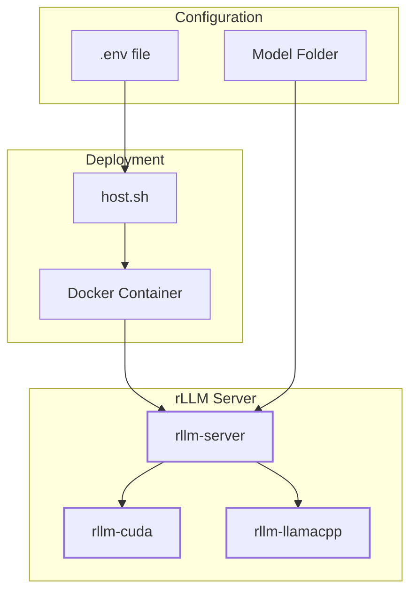
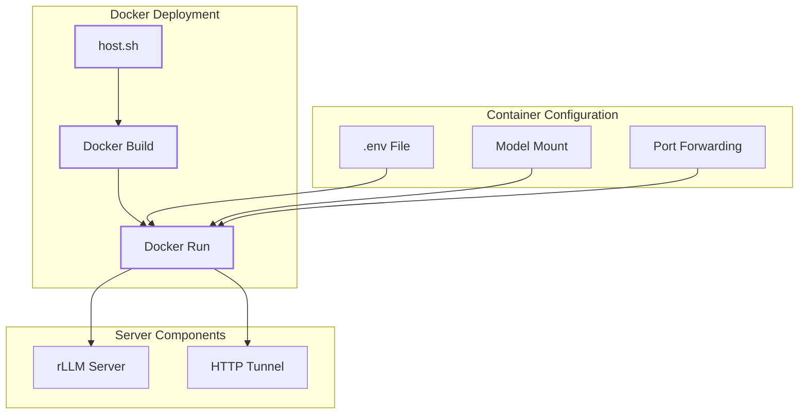
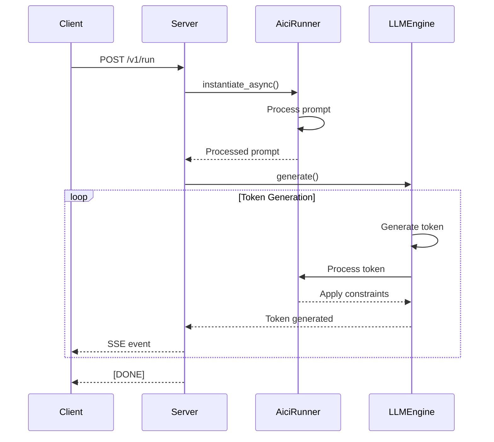
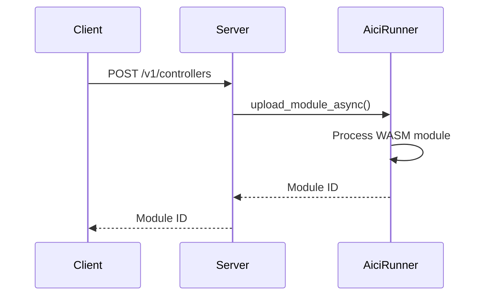
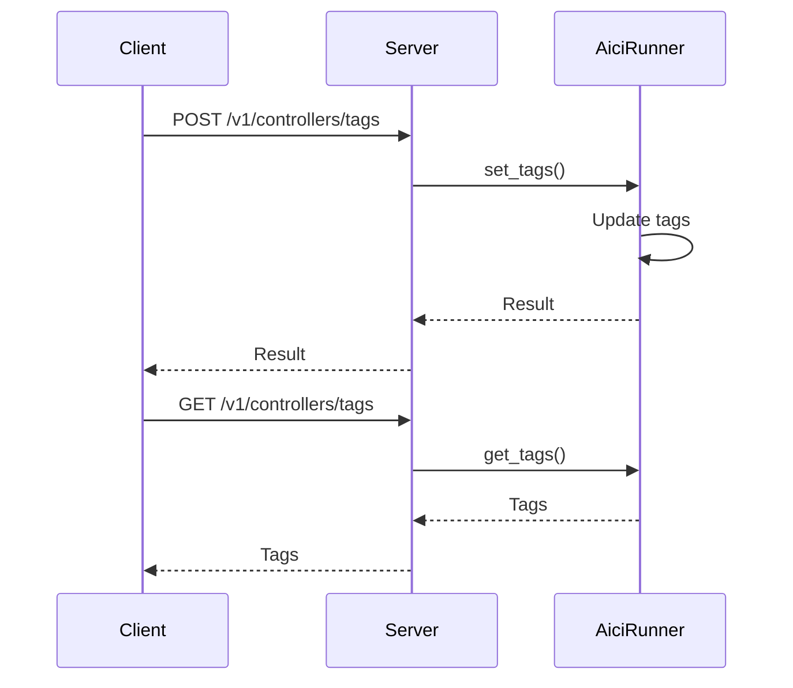

<!-- source: DeepWiki mcp.deepwiki.com · repo microsoft/aici · page 6.2 Server Configuration · fetched 2026-10-26 -->

# Server Configuration

<details>
<summary>Relevant source files</summary>

The following files were used as context for generating this wiki page:

- [py/pyaici/_vllm_protocol.py](py/pyaici/_vllm_protocol.py)
- [py/pyaici/_vllm_runner.py](py/pyaici/_vllm_runner.py)
- [py/pyaici/_vllm_sampling_ctrl.py](py/pyaici/_vllm_sampling_ctrl.py)
- [py/pyaici/comms.py](py/pyaici/comms.py)
- [py/pyaici/vllm_server.py](py/pyaici/vllm_server.py)
- [scripts/host.sh](scripts/host.sh)
- [scripts/kill-rt.sh](scripts/kill-rt.sh)
- [scripts/kill-server.sh](scripts/kill-server.sh)
- [scripts/vllm-server.sh](scripts/vllm-server.sh)

</details>


This document describes how to configure and deploy the AICI (Artificial Intelligence Controller Interface) server. It covers server startup options, runtime parameters, and deployment configurations for different LLM backends.

For information about Docker-based deployment, see [Docker Deployment](#6.1).

## Overview

The AICI server provides a REST API for interacting with LLM models through AICI controllers. The server configuration involves setting up the runtime environment, configuring communication channels, and specifying model parameters.



Sources:
- [py/pyaici/vllm_server.py:1-142]()
- [scripts/vllm-server.sh:1-36]()

## Server Startup Options

The AICI server can be started with various command-line options to configure its behavior. The main server script is `vllm_server.py` for vLLM integration, with similar scripts for other backends.

### Common Parameters

| Parameter | Description | Default |
|-----------|-------------|---------|
| `--port` | Port to listen on | 4242 |
| `--host` | Host address to bind to | 127.0.0.1 |
| `--model` | Path or name of the model to load | - |
| `--aici-rt` | Path to the AICI runtime binary | ./target/release/aicirt |
| `--shm-prefix` | Prefix for shared memory segments | /aici0- |
| `--json-size` | Size of JSON message channels in MB | 128 |
| `--bin-size` | Size of binary shared memory in MB | 128 |
| `--bias-dtype` | Data type for logit biases (f32, f16, bf16) | f32 |

Sources:
- [scripts/vllm-server.sh:17-29]()
- [py/pyaici/comms.py:330-368]()

### Runtime Arguments

Additional arguments can be passed to the AICI runtime using the `-A` prefix:

| Parameter | Description | Default |
|-----------|-------------|---------|
| `--wasm-timer-resolution-us` | WASM timer resolution in microseconds | 10 |
| `--wasm-max-step-time` | Maximum time for a WASM step in milliseconds | 50 |
| `--wasm-max-pre-step-time` | Maximum time for WASM pre-step in milliseconds | 2 |
| `--wasm-max-init-time` | Maximum time for WASM initialization in milliseconds | 1000 |
| `--wasm-max-memory` | Maximum memory for WASM modules in MB | 64 |

Sources:
- [scripts/vllm-server.sh:26-35]()
- [py/pyaici/comms.py:397-412]()

## Server Architecture

The AICI server uses a multi-process architecture with shared memory for efficient communication between processes.



Sources:
- [py/pyaici/comms.py:157-258]()
- [py/pyaici/comms.py:327-435]()

## Communication Channels

The AICI server uses several communication channels to interact with the runtime:

1. **Command Channel**: Used to send commands to the runtime
2. **Response Channel**: Used to receive responses from the runtime
3. **Binary Shared Memory**: Used for efficient transfer of large binary data like logit biases

These channels are implemented using POSIX shared memory and semaphores.



Sources:
- [py/pyaici/comms.py:62-135]()
- [py/pyaici/comms.py:157-258]()

### Shared Memory Configuration

The shared memory configuration is critical for server performance. The size of the shared memory segments can be configured using the `--json-size` and `--bin-size` parameters.

| Parameter | Description | Default | Notes |
|-----------|-------------|---------|-------|
| `--json-size` | Size of JSON message channels in MB | 128 | Increase for complex controllers with large state |
| `--bin-size` | Size of binary shared memory in MB | 128 | Increase for large vocabulary models |
| `--shm-prefix` | Prefix for shared memory segments | /aici0- | Must be unique per server instance |

Sources:
- [py/pyaici/comms.py:22-22]()
- [py/pyaici/comms.py:330-368]()

## LLM Backend Integration

The AICI server can integrate with different LLM backends. The most common is vLLM, but it also supports rLLM and llama.cpp.

### vLLM Integration

The vLLM integration is implemented in `vllm_server.py` and uses the vLLM OpenAI-compatible API server as a base.



Sources:
- [py/pyaici/vllm_server.py:1-142]()
- [py/pyaici/_vllm_runner.py:1-256]()
- [py/pyaici/_vllm_sampling_ctrl.py:1-143]()

### rLLM Integration

The rLLM integration is implemented in the `rllm` directory and provides a custom LLM backend optimized for AICI.



Sources:
- [scripts/host.sh:1-175]()

## Server Deployment

The AICI server can be deployed in various configurations, depending on the requirements.

### Local Deployment

For local development and testing, the server can be started directly using the `vllm-server.sh` script:

```bash
./scripts/vllm-server.sh --model microsoft/Phi-3-mini-128k-instruct --trust-remote-code
```

Sources:
- [scripts/vllm-server.sh:1-36]()

### Docker Deployment

For production deployment, the server can be deployed using Docker. The `host.sh` script provides a convenient way to manage Docker-based deployments.



Sources:
- [scripts/host.sh:1-175]()

### Environment Configuration

The server can be configured using environment variables in a `.env` file. This is particularly useful for Docker deployments.

| Variable | Description | Example |
|----------|-------------|---------|
| `MODEL` | Model name or path | microsoft/Phi-3-mini-128k-instruct |
| `MODEL_FOLDER` | Path to model folder | /path/to/model |
| `FWD_PORT` | Port to forward | 4242 |
| `CUDA_VISIBLE_DEVICES` | GPU devices to use | 0 |
| `IMAGE` | Docker image to use | rllm-server:latest |

Sources:
- [scripts/host.sh:21-29]()
- [scripts/host.sh:80-98]()

## API Endpoints

The AICI server exposes several REST API endpoints for interacting with the system.

### Run Endpoint

The `/v1/run` endpoint is used to run a prompt through a controller.



Sources:
- [py/pyaici/vllm_server.py:34-42]()
- [py/pyaici/_vllm_runner.py:163-255]()

### Controllers Endpoint

The `/v1/controllers` endpoint is used to upload WASM controller modules.



Sources:
- [py/pyaici/vllm_server.py:24-31]()
- [py/pyaici/comms.py:475-478]()

### Tags Endpoint

The `/v1/controllers/tags` endpoint is used to manage tags for controller modules.



Sources:
- [py/pyaici/vllm_server.py:45-61]()
- [py/pyaici/comms.py:484-493]()

## Server Management

The AICI server can be managed using several utility scripts.

### Starting the Server

The server can be started using the `vllm-server.sh` script for vLLM integration or the `host.sh` script for Docker-based deployments.

```bash
# Start vLLM server
./scripts/vllm-server.sh --model microsoft/Phi-3-mini-128k-instruct --trust-remote-code

# Start Docker-based server
./scripts/host.sh --env tmp/models/phi3/.env
```

Sources:
- [scripts/vllm-server.sh:1-36]()
- [scripts/host.sh:1-175]()

### Stopping the Server

The server can be stopped using the `kill-server.sh` script.

```bash
# Stop all AICI servers
./scripts/kill-server.sh

# Stop only AICI runtime processes
./scripts/kill-rt.sh
```

Sources:
- [scripts/kill-server.sh:1-12]()
- [scripts/kill-rt.sh:1-9]()

## Performance Tuning

The AICI server performance can be tuned by adjusting various parameters.

### Memory Configuration

The shared memory size can be adjusted to optimize performance:

| Parameter | Description | When to Increase |
|-----------|-------------|------------------|
| `--json-size` | Size of JSON message channels | Large controller state, complex prompts |
| `--bin-size` | Size of binary shared memory | Large vocabulary models, many masks |

Sources:
- [py/pyaici/comms.py:330-368]()

### WASM Runtime Configuration

The WASM runtime can be tuned for performance and safety:

| Parameter | Description | When to Adjust |
|-----------|-------------|----------------|
| `--wasm-max-step-time` | Maximum time for a step | Complex controllers that need more processing time |
| `--wasm-max-memory` | Maximum memory for WASM | Memory-intensive controllers |
| `--wasm-timer-resolution-us` | Timer resolution | Fine-grained timing control |

Sources:
- [scripts/vllm-server.sh:26-35]()
- [py/pyaici/comms.py:397-412]()

## Troubleshooting

Common issues and their solutions:

| Issue | Possible Cause | Solution |
|-------|----------------|----------|
| Server fails to start | Port already in use | Change port with `--port` |
| Out of memory errors | Insufficient shared memory | Increase `--json-size` and `--bin-size` |
| Controller timeouts | WASM time limits too low | Increase `--wasm-max-step-time` |
| Multiple servers conflict | Shared memory name collision | Use different `--shm-prefix` |

Sources:
- [py/pyaici/comms.py:330-368]()
- [py/pyaici/comms.py:397-412]()

---

