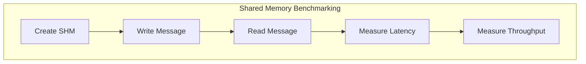
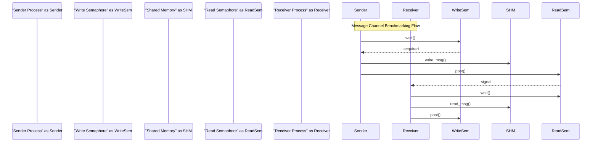
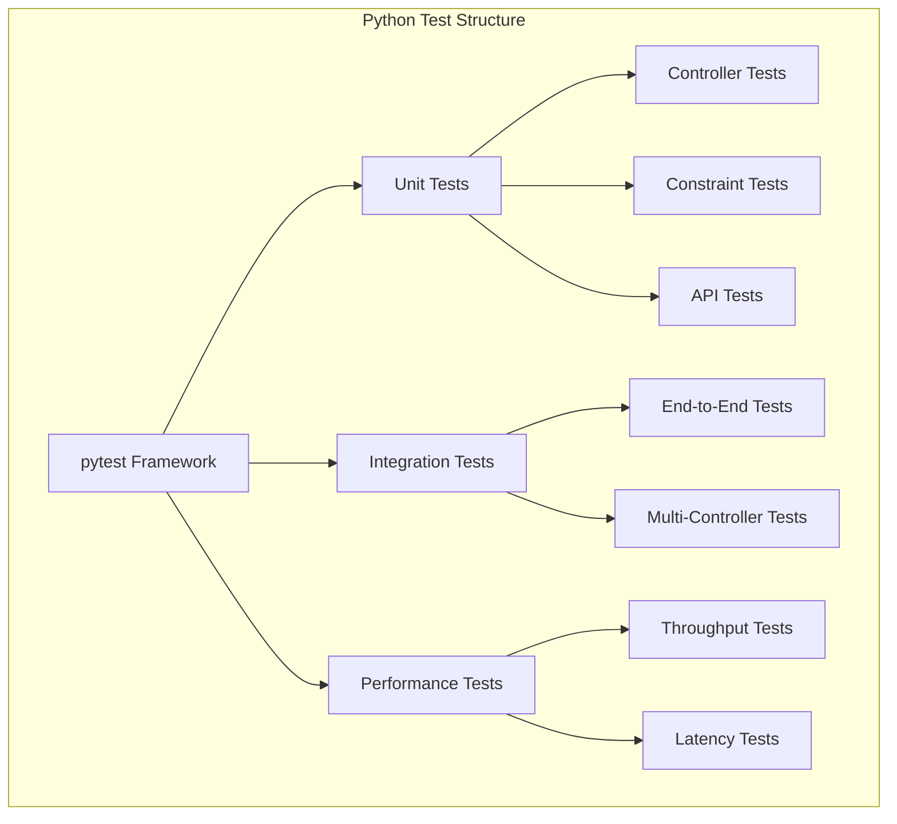
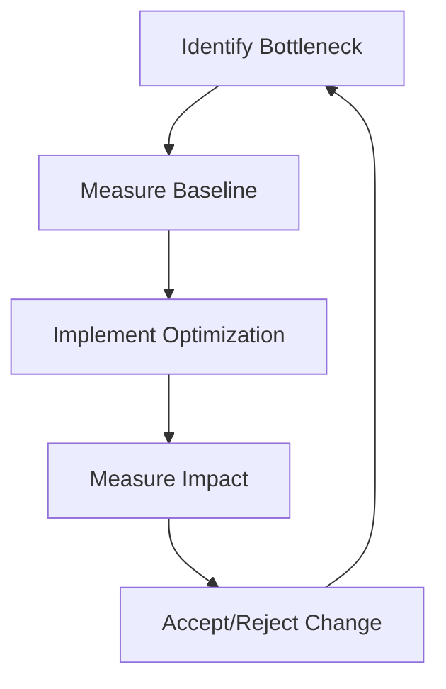

<!-- source: DeepWiki mcp.deepwiki.com · repo microsoft/aici · page 7 Testing and Benchmarking · fetched 2026-10-26 -->

# Testing and Benchmarking

<details>
<summary>Relevant source files</summary>

The following files were used as context for generating this wiki page:

- [aicirt/src/bench.rs](aicirt/src/bench.rs)
- [aicirt/src/msgchannel.rs](aicirt/src/msgchannel.rs)
- [aicirt/src/semaphore.rs](aicirt/src/semaphore.rs)
- [aicirt/src/shm.rs](aicirt/src/shm.rs)
- [pytest.ini](pytest.ini)

</details>


This document provides an overview of the testing and benchmarking tools available in the AICI (Artificial Intelligence Controller Interface) system. It covers the performance measurement utilities, testing frameworks, and benchmarking methodologies used to evaluate and ensure the reliability and efficiency of AICI components.

For information about deploying AICI, see [Deployment](#6).

## Overview

The AICI system includes built-in utilities for measuring performance and testing the functionality of various components. These tools are essential for:

1. Measuring the performance impact of controllers on token generation
2. Benchmarking inter-process communication mechanisms
3. Testing the correctness of constraint implementations
4. Evaluating system stability under various loads

## Performance Measurement Infrastructure

AICI includes a built-in benchmarking system that allows for precise timing measurements of different operations within the system.

### TimerSet System

The core of AICI's performance measurement is the `TimerSet` system, which provides hierarchical timing capabilities with parent-child relationships between timers.

```mermaid
classDiagram
    class "TimerSet" {
        +new()
        +new_timer(name: str)
        +reset()
        +pp()
    }
    
    class "TimerRef" {
        +start()
        +stop()
        +with(f: Function)
    }
    
    class "TimerImpl" {
        -name: String
        -state: TimerState
        -start: Instant
        -elapsed: Duration
        -parent: Option<u32>
        -num: u32
        +new(name: str)
        +start()
        +stop()
        +reset()
    }
    
    "TimerSet" --> "TimerRef" : creates
    "TimerRef" --> "TimerSet" : references
    "TimerSet" --> "TimerImpl" : contains
```

Sources: [aicirt/src/bench.rs:14-171]()

The `TimerSet` system allows for:

1. Creating hierarchical timers with parent-child relationships
2. Measuring elapsed time for specific operations
3. Calculating average execution times
4. Generating formatted reports with timing statistics

Example usage:

```rust
let timers = TimerSet::new();
let token_gen_timer = timers.new_timer("token_generation");
let constraint_timer = timers.new_timer("token_generation.constraint_check");

// Timing a specific operation
token_gen_timer.start();
// ... operation ...
token_gen_timer.stop();

// Or using the with() method
constraint_timer.with(|| {
    // ... operation to time ...
});

// Print timing report
println!("{}", timers.pp());
```

The `with_timer!` macro provides a convenient way to time code blocks:

```rust
with_timer!(my_timer, {
    // Code to time
});
```

Sources: [aicirt/src/bench.rs:221-235]()

## Inter-Process Communication Benchmarking

AICI's architecture relies heavily on inter-process communication (IPC) mechanisms. The system includes utilities for benchmarking these mechanisms to ensure efficient communication between processes.

### Shared Memory Performance

The `Shm` (Shared Memory) implementation provides the foundation for IPC in AICI. Benchmarking tools measure the performance of shared memory operations:



Sources: [aicirt/src/shm.rs:8-153]()

### Message Channel Performance

The `MessageChannel` implementation builds on shared memory and semaphores to provide a reliable message-passing mechanism. Benchmarking tools measure:

1. Message sending latency
2. Message receiving latency
3. Throughput under various message sizes
4. Contention handling with multiple senders/receivers



Sources: [aicirt/src/msgchannel.rs:5-89](), [aicirt/src/semaphore.rs:8-82]()

## Test Suite

AICI includes a comprehensive test suite to verify the correctness and performance of various components.

### Unit Tests

Unit tests cover individual components of the AICI system:

1. Shared memory operations
2. Semaphore functionality
3. Message channel reliability
4. Controller initialization and execution
5. Token generation and constraint application

### Integration Tests

Integration tests verify the interaction between different components:

1. Controller-LLM communication
2. Multi-process coordination
3. Error handling and recovery
4. Resource management

### Python Tests

Python tests are organized using pytest and focus on testing the Python interface to AICI:



Sources: [pytest.ini:1-4]()

## Benchmarking Methodology

AICI employs a structured approach to benchmarking to ensure consistent and reliable performance measurements.

### Metrics

Key metrics measured during benchmarking include:

| Metric | Description | Unit |
|--------|-------------|------|
| Token Generation Throughput | Number of tokens generated per second | tokens/sec |
| Controller Overhead | Additional time added by controller processing | ms/token |
| IPC Latency | Time for a message to travel between processes | ms |
| Memory Usage | Peak memory consumption during operation | MB |
| Initialization Time | Time to initialize controllers and LLM | ms |

### Benchmark Scenarios

Standard benchmark scenarios include:

1. **Baseline Performance**: LLM performance without controllers
2. **Simple Constraint**: Performance with basic regex constraints
3. **Complex Constraint**: Performance with nested, multi-condition constraints
4. **Backtracking**: Performance when backtracking is triggered
5. **Multi-Controller**: Performance with multiple controllers active
6. **High Throughput**: Performance under high request volume

### Performance Reporting

Benchmark results are reported using the hierarchical timer system, which provides:

1. Total execution time
2. Average time per operation
3. Percentage of time spent in each component
4. Number of executions for each timed operation

Example output format:

```
  8.3ms (x1) token_generation
    12.5%  1.0ms (x10) constraint_check
    80.2%  6.7ms (x10) token_sampling
      15.3%  1.0ms (x10) logit_processing
      84.7%  5.7ms (x10) sampling_algorithm
    7.3%  0.6ms (x1) initialization
```

## Performance Optimization

The benchmarking tools help identify performance bottlenecks in the AICI system:

1. **Shared Memory Optimization**: Minimizing data copying and ensuring proper alignment
2. **Semaphore Usage**: Using busy-wait with timeouts for low-latency operations
3. **Controller Efficiency**: Optimizing controller code for minimal processing overhead
4. **Message Size Optimization**: Tuning message sizes for optimal throughput



## Conclusion

The testing and benchmarking infrastructure in AICI provides essential tools for ensuring system reliability and performance. By systematically measuring and optimizing various components, AICI maintains efficient operation even with complex controllers and constraints.

For detailed information about specific performance measurement techniques, see [Performance Measurement](#7.1).

For information about the test suite structure and execution, see [Test Suite](#7.2).

---

