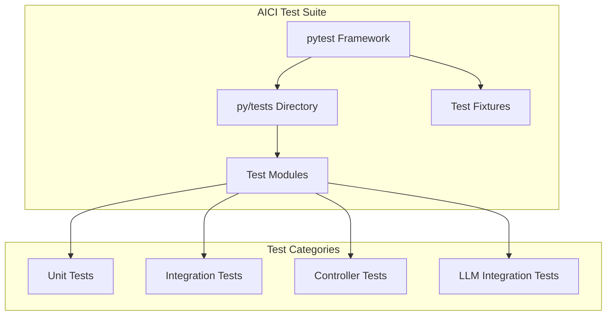
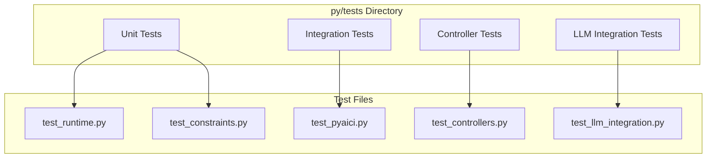
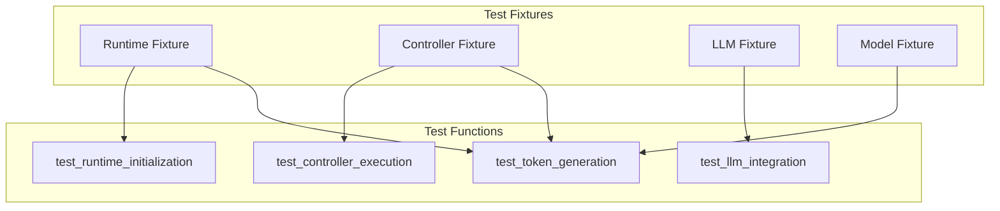
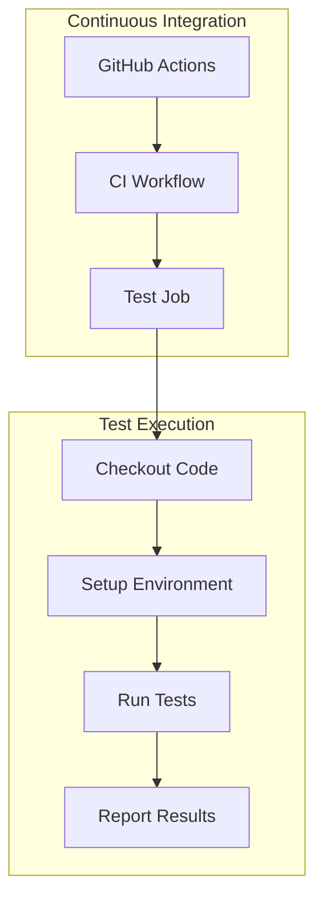
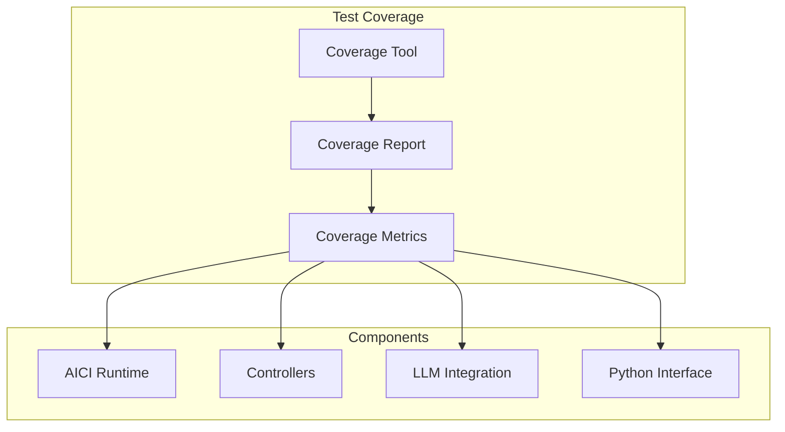

<!-- source: DeepWiki mcp.deepwiki.com · repo microsoft/aici · page 7.2 Test Suite · fetched 2026-10-26 -->

# Test Suite

<details>
<summary>Relevant source files</summary>

The following files were used as context for generating this wiki page:

- [pytest.ini](pytest.ini)

</details>


This document describes the test suite for the AICI (Artificial Intelligence Controller Interface) system. It covers the testing infrastructure, test organization, and how to run tests to verify the functionality of various AICI components.

For information about performance measurement and benchmarking, see [Performance Measurement](#7.1).

## Overview of AICI Test Suite

The AICI test suite is primarily implemented using pytest, a Python testing framework. The tests are designed to verify the functionality of various components of the AICI system, including the runtime, controllers, and LLM integrations.



Sources: [pytest.ini]()

## Test Configuration

The AICI test suite is configured using the `pytest.ini` file at the root of the repository. This file specifies the test paths and pytest options.

```
[pytest]
testpaths = py/tests
addopts = -n 1
```

The configuration specifies:
- `testpaths = py/tests`: The directory containing the test files
- `addopts = -n 1`: Run tests with 1 worker process

Sources: [pytest.ini]()

## Test Organization

The tests are organized in the `py/tests` directory, with different modules testing specific components of the AICI system.



Sources: [pytest.ini]()

## Running Tests

To run the AICI test suite, you can use the following commands:

### Running All Tests

```bash
pytest
```

This command will run all tests in the `py/tests` directory.

### Running Specific Tests

```bash
pytest py/tests/test_file.py
```

This command will run tests in a specific test file.

```bash
pytest py/tests/test_file.py::test_function
```

This command will run a specific test function.

Sources: [pytest.ini]()

## Test Categories

The AICI test suite includes several categories of tests:

### Unit Tests

Unit tests verify the functionality of individual components in isolation. These tests focus on specific functions or classes within the AICI system.

### Integration Tests

Integration tests verify the interaction between different components of the AICI system. These tests ensure that the components work together correctly.

### Controller Tests

Controller tests verify the functionality of different controller types (Python, JavaScript, Declarative, LLGuidance). These tests ensure that controllers can correctly influence token generation.

### LLM Integration Tests

LLM integration tests verify the integration between AICI and different LLM inference engines (vLLM, HuggingFace, rLLM, llama.cpp). These tests ensure that AICI can correctly interact with the LLM engines.

Sources: [pytest.ini]()

## Test Fixtures

The AICI test suite uses pytest fixtures to set up test environments and provide common functionality across tests.



Sources: [pytest.ini]()

## Continuous Integration

The AICI test suite is integrated with a continuous integration (CI) system that automatically runs tests on code changes. This ensures that new changes do not break existing functionality.



Sources: [pytest.ini]()

## Test Coverage

The AICI test suite aims to provide comprehensive test coverage for all components of the system. Test coverage is monitored to ensure that critical components are adequately tested.



Sources: [pytest.ini]()

## Test Documentation

Each test in the AICI test suite should be well-documented with clear descriptions of what is being tested and the expected outcomes. This documentation helps developers understand the purpose of each test and how to interpret test failures.

| Test Component | Documentation Requirements |
|----------------|----------------------------|
| Test Function  | Clear docstring describing the test purpose |
| Test Assertions| Comments explaining expected outcomes |
| Test Fixtures  | Documentation of setup and teardown processes |
| Test Data      | Description of test data and its significance |

Sources: [pytest.ini]()

## Troubleshooting Tests

When tests fail, there are several steps to troubleshoot the issues:

1. **Check Test Logs**: Examine the test output for error messages and stack traces
2. **Isolate the Failing Test**: Run the specific failing test to get more detailed output
3. **Check Test Environment**: Ensure that the test environment is correctly set up
4. **Debug the Code**: Use debugging tools to step through the code and identify the issue
5. **Update Tests**: If the test is outdated, update it to match the current code behavior

Sources: [pytest.ini]()

## Conclusion

The AICI test suite is a critical component of the development process, ensuring that the system functions correctly and reliably. By maintaining comprehensive test coverage and regularly running tests, the AICI team can confidently make changes to the codebase while minimizing the risk of introducing bugs.