# Page: Overview

# Overview

<details>
<summary>Relevant source files</summary>

The following files were used as context for generating this wiki page:

- [.vscode/settings.json](.vscode/settings.json)
- [README.md](README.md)
- [aicirt/README.md](aicirt/README.md)
- [aicirt/src/api.rs](aicirt/src/api.rs)
- [aicirt/src/hostimpl.rs](aicirt/src/hostimpl.rs)
- [aicirt/src/main.rs](aicirt/src/main.rs)
- [aicirt/src/moduleinstance.rs](aicirt/src/moduleinstance.rs)
- [aicirt/src/worker.rs](aicirt/src/worker.rs)

</details>


The Artificial Intelligence Controller Interface (AICI) is a system that enables fine-grained control over large language model (LLM) inference. It provides a framework for building Controllers that can constrain and direct the output of LLMs in real-time during the token generation process.

This document introduces the core architecture of AICI, its key components, and how they interact to provide controlled text generation. For detailed information about specific components, please refer to their respective wiki pages.

## What is AICI?

AICI is designed to be a layer in the LLM inference stack that separates the control logic from the inference engine. It allows developers to implement custom Controllers that can:

- Constrain token generation using various methods (regex, grammars, etc.)
- Maintain state during generation
- Backtrack to previous states
- Fork generation into multiple branches
- Fast-forward tokens when they are known in advance

Sources: [README.md:4-17](), [README.md:303-316]()

## System Architecture

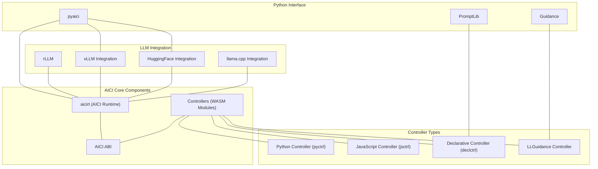

Sources: [README.md:303-316](), [README.md:317-328]()

## AICI Runtime Architecture

The AICI Runtime (`aicirt`) is the central component that manages the execution of WebAssembly (WASM) controllers and communicates with LLM inference engines. It uses a multi-process architecture for isolation and security.

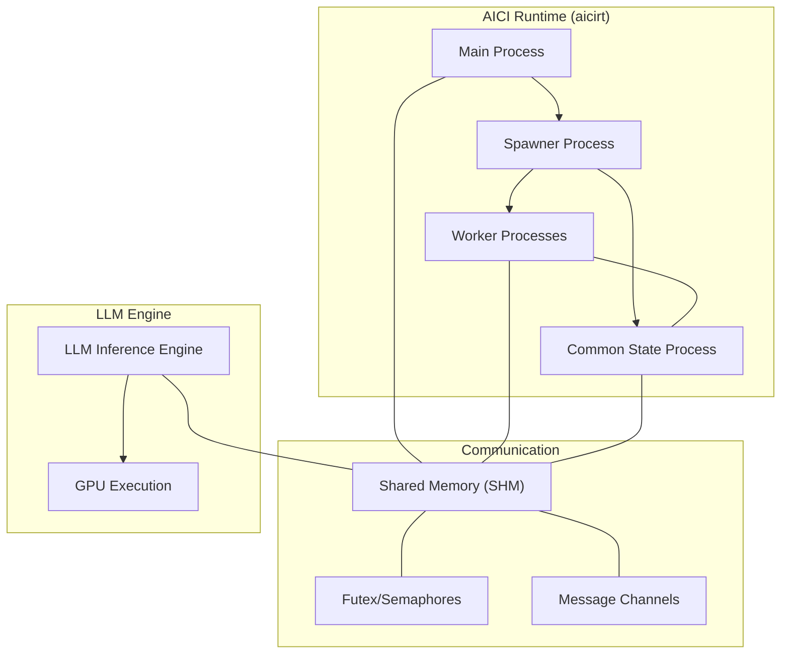

Sources: [aicirt/README.md:1-36](), [aicirt/src/main.rs:39-47]()

## Token Generation Flow

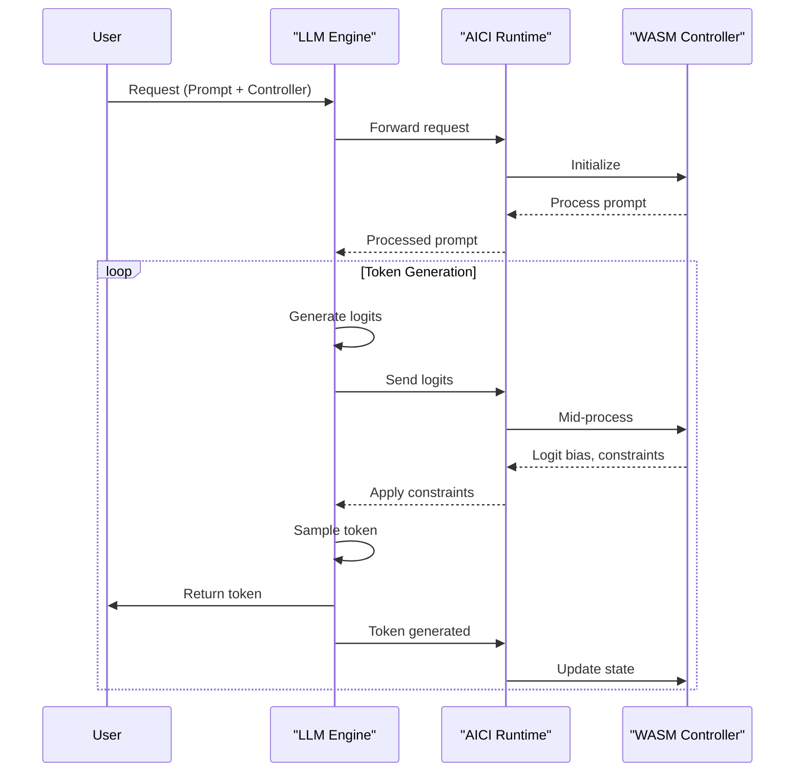

Sources: [aicirt/README.md:17-36](), [aicirt/src/main.rs:637-903]()

## Key Components

### AICI Runtime (aicirt)

The AICI Runtime is a multi-threaded runner for AICI Controllers, built on top of Wasmtime. It manages the lifecycle of controller instances, handles communication between the LLM and controllers, and provides isolation between different user requests.

Key features:
- Multi-process architecture for security and isolation
- Shared memory communication for efficiency
- Support for forking, backtracking, and fast-forwarding

Sources: [aicirt/README.md:1-16](), [aicirt/src/main.rs:5-18]()

### Controllers

Controllers are WebAssembly modules that implement custom logic for controlling token generation. They can be written in any language that compiles to WebAssembly (Rust, C, C++, etc.) or be interpreted inside WebAssembly (Python, JavaScript, etc.).

AICI provides several built-in controller types:
- **Python Controller (pyctrl)**: Allows writing controllers in Python
- **JavaScript Controller (jsctrl)**: Allows writing controllers in JavaScript
- **Declarative Controller (declctrl)**: Uses declarative specifications
- **LLGuidance Controller**: Grammar-based guidance

Sources: [README.md:19-26](), [README.md:145-147]()

### AICI ABI

The AICI Application Binary Interface (ABI) defines how controllers interact with the runtime. It provides functions for:
- Tokenization and detokenization
- Logit biasing
- State management
- Communication between controller instances

Sources: [aicirt/src/hostimpl.rs:418-539]()

### Module Registry

The Module Registry manages WASM modules, including their storage, compilation, and instantiation. It provides functions for:
- Creating and storing modules
- Tagging modules for easy reference
- Instantiating modules for execution

Sources: [aicirt/src/main.rs:173-447]()

## Process Model

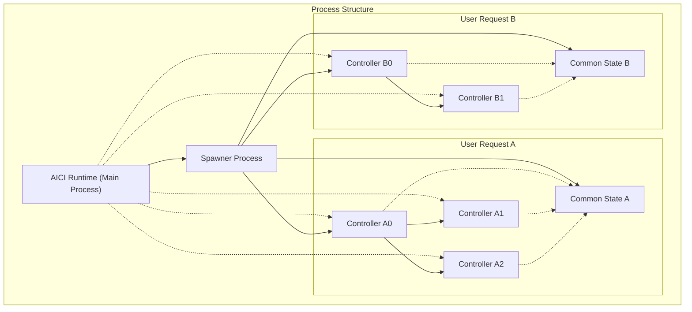

Sources: [aicirt/README.md:38-82](), [aicirt/src/worker.rs:559-691]()

## Security Model

AICI is designed with security in mind:

- `aicirt` runs in a separate process from the LLM engine
- WebAssembly modules are sandboxed by Wasmtime
- Controllers only have access to explicitly exposed host functions
- Each WebAssembly module runs in a separate process for Spectre/Meltdown mitigation
- Controllers cannot access the filesystem, network, or other resources

Sources: [README.md:337-349](), [aicirt/src/moduleinstance.rs:30-98]()

## Performance Considerations

AICI is designed to be efficient:

- Most computation in Controllers occurs on the CPU, in parallel with logit generation on the GPU
- The generation process is divided into steps, with each step taking about 20-50ms on modern GPUs
- WebAssembly provides near-native performance (less than 2x overhead compared to native code)
- Constraints like regular expressions, grammars, and substring matching are highly optimized

Sources: [README.md:350-388](), [aicirt/src/main.rs:40-46]()

## Integration with LLM Engines

AICI can integrate with various LLM inference engines:

- rLLM (custom tch-based LLM inference engine)
- llama.cpp
- HuggingFace Transformers
- vLLM (in development)

The integration is done through a shared memory interface, allowing efficient communication between the LLM engine and AICI runtime.

Sources: [README.md:17-18](), [README.md:323-328]()

## Conclusion

AICI provides a flexible and efficient framework for controlling LLM generation. By separating the control logic from the inference engine, it enables developers to implement complex control strategies without modifying the underlying LLM code. The WebAssembly-based architecture ensures security, portability, and performance.

For more detailed information about specific components, please refer to their respective wiki pages:
- [AICI Runtime (aicirt)](#2)
- [Controllers](#3)
- [LLM Integration](#4)
- [Python Interface (pyaici)](#5)

---

# Page: Key Concepts

# Key Concepts

<details>
<summary>Relevant source files</summary>

The following files were used as context for generating this wiki page:

- [.vscode/settings.json](.vscode/settings.json)
- [README.md](README.md)
- [aicirt/README.md](aicirt/README.md)
- [controllers/aici_abi/src/cfg.rs](controllers/aici_abi/src/cfg.rs)
- [controllers/aici_abi/src/dlex.rs](controllers/aici_abi/src/dlex.rs)
- [controllers/aici_abi/src/host.rs](controllers/aici_abi/src/host.rs)
- [controllers/aici_abi/src/lib.rs](controllers/aici_abi/src/lib.rs)
- [controllers/declctrl/src/declctrl.rs](controllers/declctrl/src/declctrl.rs)
- [controllers/jsctrl/src/jsctrl.rs](controllers/jsctrl/src/jsctrl.rs)
- [controllers/pyctrl/src/pyctrl.rs](controllers/pyctrl/src/pyctrl.rs)

</details>


This page introduces the core concepts of the Artificial Intelligence Controller Interface (AICI) system. AICI enables fine-grained control over Large Language Model (LLM) token generation through WebAssembly-based controllers that can constrain and direct LLM output in real-time.

For system requirements, see [System Requirements](#1.2). For details on the AICI runtime implementation, see [AICI Runtime](#2).

## AICI System Overview

AICI is designed to provide a layer between LLM inference engines and control libraries, allowing for flexible and efficient control over token generation while maintaining compatibility across different LLM backends.

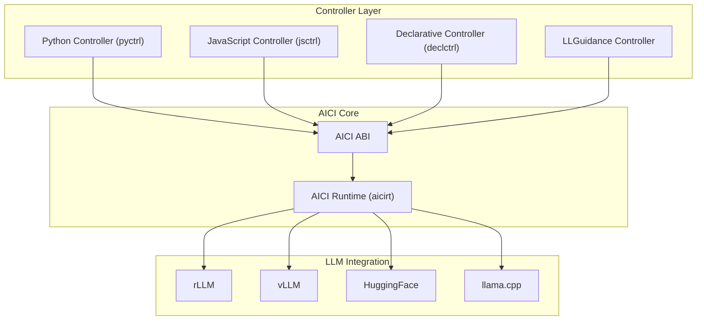

Sources: [README.md:1-18](), [README.md:303-328]()

## Controllers and the ABI

Controllers are WebAssembly modules that implement the AICI Application Binary Interface (ABI). They can influence token generation through various mechanisms:

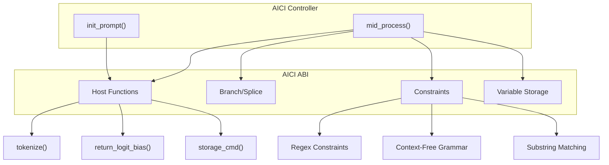

The core interface that controllers implement is defined in [controllers/aici_abi/src/lib.rs:135-176]():

```
pub trait AiciCtrl {
    /// Called with the initial prompt. ~1000ms time limit.
    fn init_prompt(&mut self, arg: InitPromptArg) -> InitPromptResult {
        InitPromptResult::from_arg(arg)
    }

    /// This is the main entry point for the module. ~20ms time limit.
    fn mid_process(&mut self, arg: MidProcessArg) -> MidProcessResult;
}
```

Sources: [controllers/aici_abi/src/lib.rs:135-176](), [controllers/aici_abi/src/host.rs:102-118]()

## Token Generation Flow

The token generation process in AICI follows a specific flow that allows controllers to influence each step:

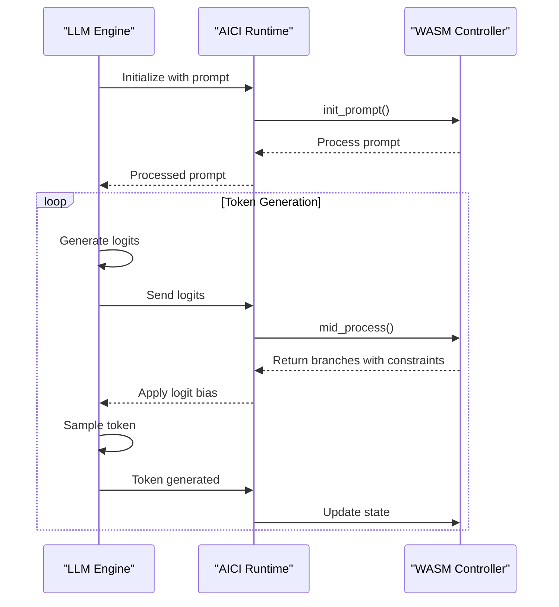

During each token generation step:

1. The LLM computes logits (token probabilities)
2. The controller is called via `mid_process()` to influence token selection
3. The controller returns a `MidProcessResult` containing branches with constraints
4. The AICI runtime applies these constraints to the LLM's token selection
5. The LLM samples a token based on the modified probabilities
6. The process repeats for the next token

Sources: [controllers/aici_abi/src/lib.rs:81-127](), [README.md:160-172]()

## Constraint System

AICI provides several types of constraints that controllers can use to restrict token generation:

| Constraint Type | Description | Implementation |
|----------------|-------------|----------------|
| Regex | Regular expression patterns | `RecRx` in [controllers/aici_abi/src/rx.rs]() |
| Context-Free Grammar | YACC-style grammars | `CfgParser` in [controllers/aici_abi/src/cfg.rs]() |
| Substring | Match specific substrings | `SubStrMatcher` in [controllers/aici_abi/src/substring.rs]() |
| Dynamic Lexer | Token-based lexical analysis | `DynamicLexer` in [controllers/aici_abi/src/dlex.rs]() |

All constraint types implement the `Recognizer` trait, which provides a common interface for determining which tokens are allowed at each step of generation.

Sources: [controllers/aici_abi/src/cfg.rs:459-501](), [controllers/aici_abi/src/dlex.rs:228-266]()

## Controller Types

AICI supports multiple controller implementations to accommodate different programming models:

### Python Controller (pyctrl)

Allows writing controllers in Python, which is interpreted inside the WebAssembly environment:

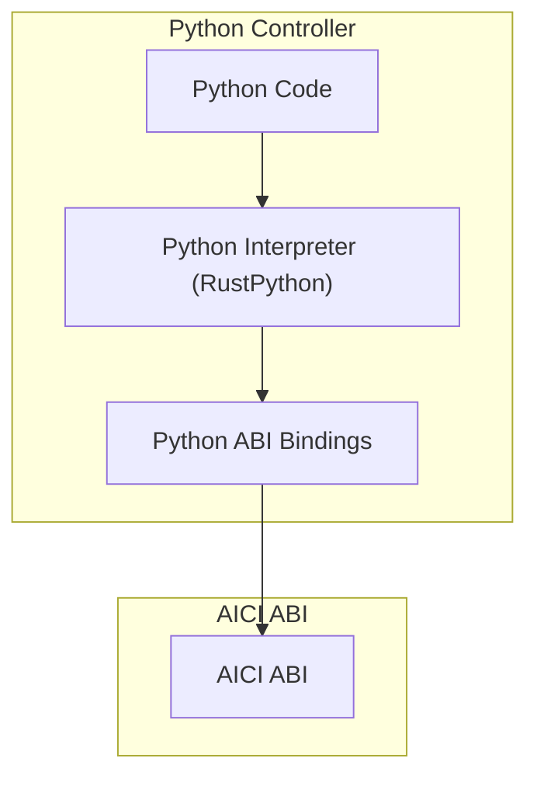

Sources: [controllers/pyctrl/src/pyctrl.rs:608-616](), [controllers/pyctrl/src/pyctrl.rs:46-360]()

### JavaScript Controller (jsctrl)

Similar to the Python controller but uses JavaScript:

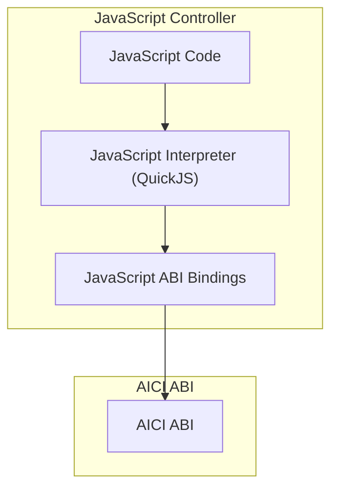

Sources: [controllers/jsctrl/src/jsctrl.rs:547-570](), [controllers/jsctrl/src/jsctrl.rs:247-439]()

### Declarative Controller (declctrl)

Provides a JSON-based declarative specification for controlling token generation:

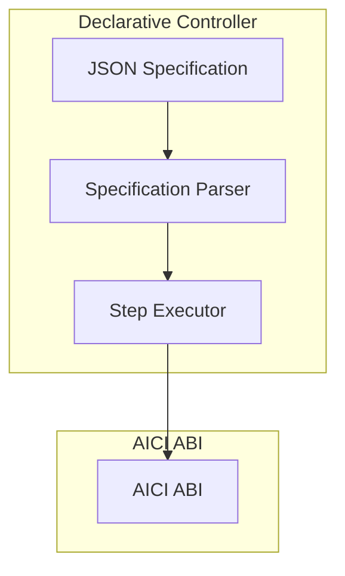

The declarative controller uses a structured JSON format to define steps for token generation, including fixed text, choices, regex constraints, and more.

Sources: [controllers/declctrl/src/declctrl.rs:50-370]()

## Advanced Features

### Branching and Forking

AICI supports branching and forking to explore multiple generation paths simultaneously:

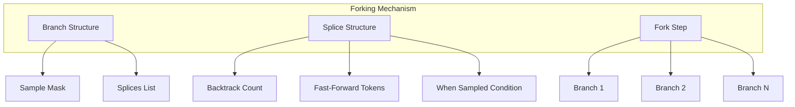

The `Branch` structure in [controllers/aici_abi/src/lib.rs:82-92]() allows controllers to:
- Specify a mask of allowed tokens
- Backtrack to a previous state
- Fast-forward multiple tokens at once
- Fork into multiple parallel generation paths

Sources: [controllers/aici_abi/src/lib.rs:82-127](), [controllers/declctrl/src/declctrl.rs:243-250]()

### Variable Storage

AICI provides a shared variable storage system that allows controllers to maintain state across generation steps and communicate between different controller instances:

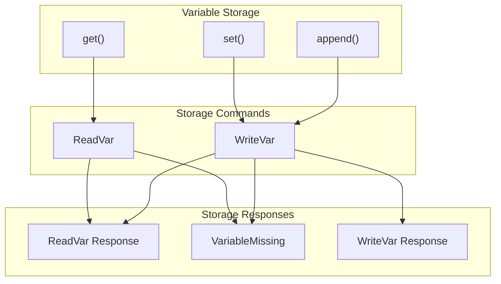

The variable storage system is implemented in [controllers/aici_abi/src/host.rs:269-358]() and provides:
- Reading and writing named variables
- Appending to existing variables
- Version tracking for concurrent access

Sources: [controllers/aici_abi/src/host.rs:269-358]()

## AICI Runtime Architecture

The AICI Runtime (aicirt) is responsible for managing the execution of controllers and communicating with LLM inference engines:

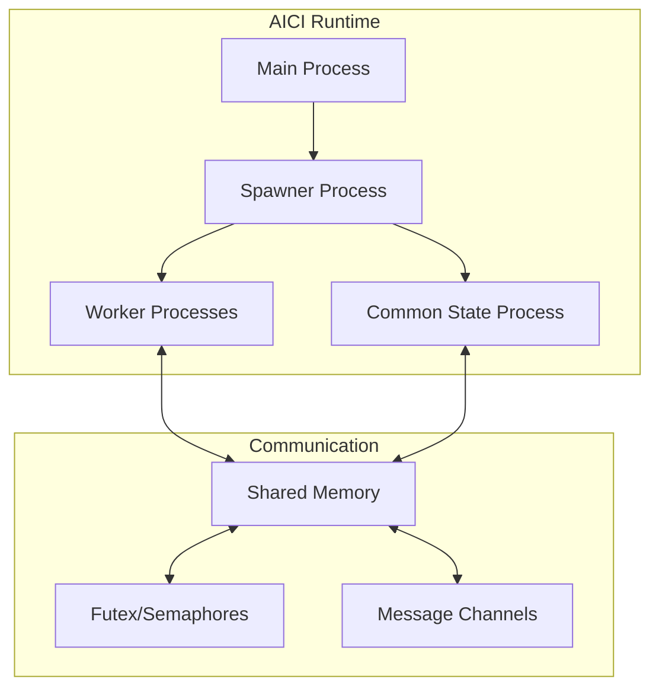

The runtime uses a multi-process architecture for isolation and security:
- Main process handles communication with the LLM engine
- Spawner process creates worker processes for each controller instance
- Worker processes execute the WebAssembly controllers
- Common state process manages shared state between controller instances

Sources: [aicirt/README.md:1-82](), [README.md:338-348]()

## Security Model

AICI implements a strong security model to ensure that controllers cannot access unauthorized resources:

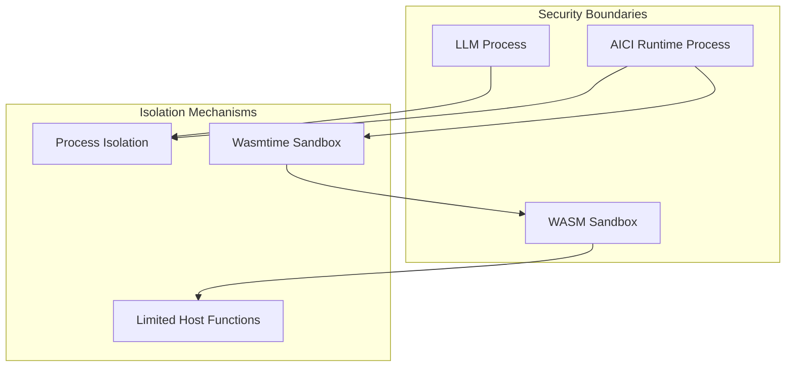

Key security features include:
- Process isolation between the LLM engine and AICI runtime
- WebAssembly sandboxing via Wasmtime
- Limited host functions exposed to controllers
- No filesystem or network access from controllers
- Process-level resource limits

Sources: [README.md:338-348]()

## Performance Considerations

AICI is designed to minimize overhead during token generation:

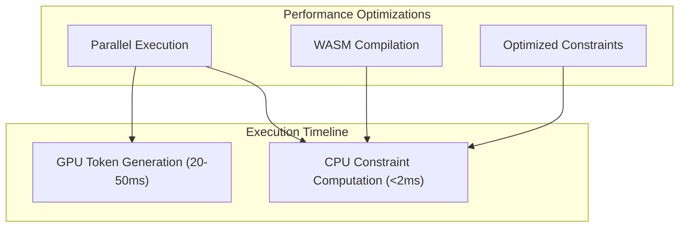

Performance characteristics:
- Controllers run on CPU in parallel with GPU token generation
- Typical GPU token generation takes 20-50ms per step
- Constraint computation typically takes <2ms
- WebAssembly execution is only ~2x slower than native code
- Multiple sequences can be processed in parallel on multi-core systems

Sources: [README.md:350-387]()

## Integration with LLM Engines

AICI can integrate with various LLM inference engines:

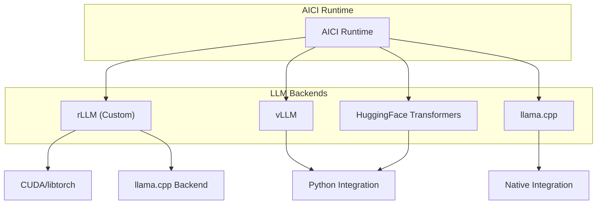

Integration methods:
- Direct integration via shared memory for rLLM
- Python-based integration for vLLM and HuggingFace
- Native integration for llama.cpp

Sources: [README.md:16-17](), [README.md:323-335]()

---

# Page: System Requirements

# System Requirements

<details>
<summary>Relevant source files</summary>

The following files were used as context for generating this wiki page:

- [.gitignore](.gitignore)
- [.vscode/settings.json](.vscode/settings.json)
- [Cargo.lock](Cargo.lock)
- [Cargo.toml](Cargo.toml)
- [README.md](README.md)
- [aicirt/README.md](aicirt/README.md)
- [controllers/aici_native/src/bintokens.rs](controllers/aici_native/src/bintokens.rs)

</details>


This document outlines the hardware and software requirements for running the Artificial Intelligence Controller Interface (AICI) system. It covers the minimum specifications needed for both development and deployment environments.

For information about the overall AICI architecture, see [Overview](#1).

## Hardware Requirements

AICI is designed to work with various hardware configurations, with specific requirements depending on the LLM backend being used.

### GPU Requirements

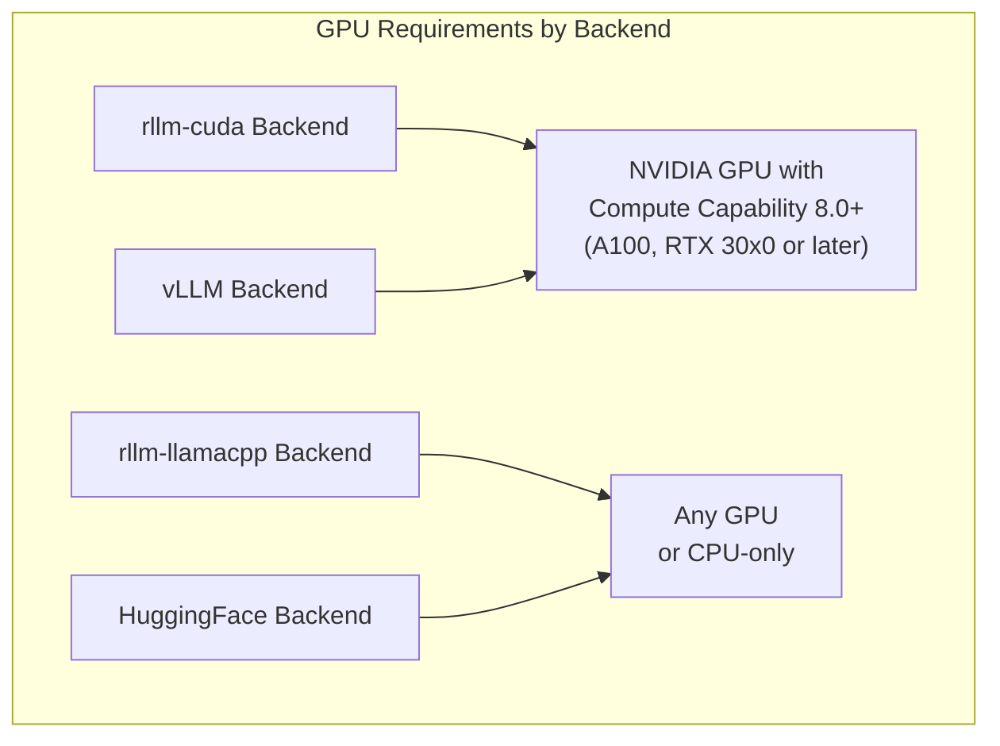

Sources: [README.md:100-107]()

### Memory Requirements

Memory requirements vary based on the model size and the number of parallel sequences being processed:

| Component | Minimum | Recommended | For Large Models |
|-----------|---------|-------------|-----------------|
| System RAM | 8GB | 16GB | 32GB+ |
| GPU VRAM | 8GB | 24GB | 80GB |

For optimal batch throughput, the model and KV caches should utilize a major fraction of the GPU memory. Reading the whole memory takes about 40ms on an A100 GPU with 80GB VRAM.

Sources: [README.md:356-358]()

### CPU Requirements

AICI controllers run on CPU while the LLM inference runs on GPU. For optimal performance:

| Scenario | CPU Recommendation |
|----------|-------------------|
| Development | 4+ cores |
| Production | 8+ cores |
| High-throughput | 16+ cores |

Each controller instance runs in a separate process, so having more CPU cores than the number of parallel sequences is beneficial for performance.

Sources: [README.md:371-373]()

## Software Requirements

### Operating System Support

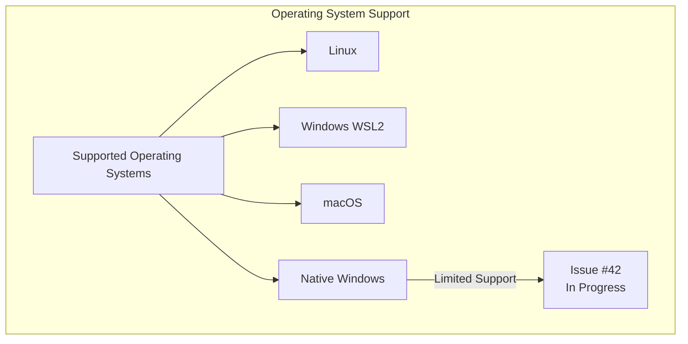

Sources: [README.md:59-62]()

### Development Environment

For compiling AICI components, you need:

1. **Rust and Cargo**:
   - Latest stable version
   - wasm32-wasi target

2. **Build Tools**:
   - git
   - cmake
   - ccache
   - pkg-config (Linux)
   - libssl-dev (Linux)
   - libclang-dev (Linux)
   - clang (Linux)
   - llvm-dev (Linux)
   - git-lfs

3. **Python Requirements** (for Python controllers and scripts):
   - Python 3.11 or later
   - pytest
   - pytest-forked
   - ujson
   - posix_ipc
   - numpy
   - requests

Sources: [README.md:54-96]()

### System Dependencies

#### Linux (Ubuntu/Debian)

```bash
sudo apt-get install --assume-yes --no-install-recommends \
    build-essential cmake ccache pkg-config libssl-dev libclang-dev clang llvm-dev git-lfs
```

#### macOS

```bash
brew install git cmake ccache
```

Additionally, macOS users need to have XCode command line tools installed:

```bash
xcode-select --install
```

Sources: [README.md:72-78]()

## LLM Backend Requirements

AICI supports multiple LLM backends, each with specific requirements:

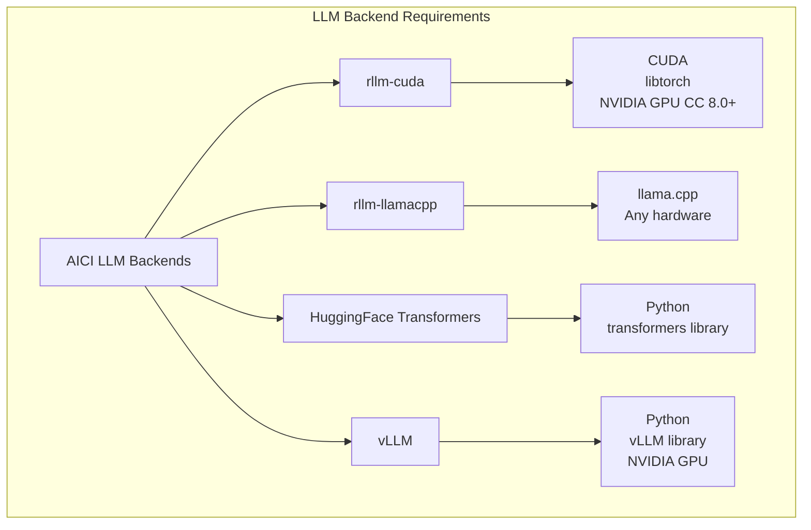

Sources: [README.md:17](), [README.md:100-107]()

### rllm-cuda Backend

The `rllm-cuda` backend requires:
- NVIDIA GPU with compute capability 8.0 or later (A100, RTX 30x0 series or newer)
- CUDA toolkit
- libtorch with specific configuration (recommended to use the included devcontainer)

Sources: [README.md:100-107]()

### rllm-llamacpp Backend

The `rllm-llamacpp` backend is more flexible and can run on:
- Any NVIDIA GPU
- AMD GPUs
- CPU-only mode

It requires the llama.cpp library, which is included in the AICI repository.

Sources: [README.md:100-107](), [README.md:121-122]()

### HuggingFace and vLLM Backends

These backends require:
- Python 3.11+
- Respective Python libraries (transformers, vLLM)
- For vLLM: NVIDIA GPU

Sources: [README.md:17](), [README.md:330-334]()

## Deployment Requirements

### Docker Support

AICI provides Docker-based deployment options for all backends. Using the included devcontainer is recommended, especially for the `rllm-cuda` backend which requires specific libtorch setup.

Sources: [README.md:64]()

### Network Requirements

The AICI system exposes HTTP interfaces for configuration and request processing:

| Component | Default Port | Protocol |
|-----------|--------------|----------|
| rLLM Server | 4242 | HTTP |
| AICI Runtime | Internal | POSIX SHM |

Sources: [README.md:125-139](), [aicirt/README.md:11]()

### Storage Requirements

Storage requirements depend on the models being used:

| Component | Storage Requirement |
|-----------|---------------------|
| AICI Codebase | ~500MB |
| Each LLM Model | 2GB - 100GB |
| Runtime Cache | ~1GB |

## Performance Considerations

### Token Generation Performance

AICI is designed to have minimal impact on token generation performance:

- Each step of generation takes approximately 20-50ms on an A100 GPU
- Computing allowed token sets takes:
  - ~2.0ms for a Yacc grammar of the C programming language
  - ~0.3ms for a regular expression
  - ~0.2ms for a substring constraint from a 4kB string

These operations run in parallel with GPU token generation and typically do not affect overall generation time.

Sources: [README.md:357-376]()

### Overhead

There is some overhead in the critical path of sampling:
- ~0.3ms per generation step when executing 10 sequences in parallel
- ~0.7ms for 40 sequences

WebAssembly execution is typically less than 2x slower than native code when running optimized Rust code in Wasmtime.

Sources: [README.md:377-387]()

## Security Requirements

AICI implements several security measures:

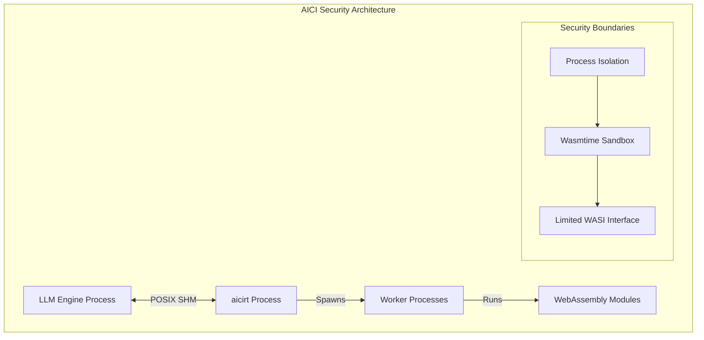

Security requirements include:
- `aicirt` runs in a separate process from the LLM engine
- WebAssembly modules are sandboxed by Wasmtime
- Modules only have access to `aici_host_*` functions
- Limited WASI interface (only stdout/stderr for debugging)
- Each WebAssembly module runs in a separate process for Spectre/Meltdown mitigation
- No filesystem, network, or other resource access for WebAssembly modules
- No threading or timer access for WebAssembly modules

Sources: [README.md:338-349]()

## Tokenizer Requirements

AICI supports multiple tokenizers for different models:

```mermaid
flowchart TD
    subgraph "Supported Tokenizers"
        tokenizers["AICI Tokenizers"]
        
        tokenizers --> gpt4["gpt4<br>(cl100k_base)"]
        tokenizers --> llama["llama<br>(CodeLlama, etc.)"]
        tokenizers --> llama16["llama16<br>(CodeLlama-13b)"]
        tokenizers --> llama70["llama70<br>(CodeLlama-70b)"]
        tokenizers --> orca["orca<br>(Microsoft/Orca)"]
        tokenizers --> falcon["falcon<br>(Falcon 7b, 40b)"]
        tokenizers --> mistral["mistral<br>(Mistral, Mixtral)"]
        tokenizers --> mpt["mpt<br>(MPT)"]
        tokenizers --> phi["phi<br>(Phi 1.5, Phi 2)"]
        tokenizers --> gpt2["gpt2<br>(GPT-2)"]
    end
```

Tokenizers can be specified by name, HuggingFace model path, or local file path.

Sources: [controllers/aici_native/src/bintokens.rs:13-76]()

## Controller Requirements

Controllers are implemented as WebAssembly modules and can be written in:
- Any language that compiles to WebAssembly (Rust, C, C++, etc.)
- Interpreted languages running inside WebAssembly (Python, JavaScript)

The repository provides several pre-built controllers:
- PyCtrl (Python)
- JsCtrl (JavaScript)
- DeclCtrl (Declarative)
- LLGuidance Controller

Sources: [README.md:21-22](), [README.md:275-282]()

---

# Page: AICI Runtime (aicirt)

# AICI Runtime (aicirt)

<details>
<summary>Relevant source files</summary>

The following files were used as context for generating this wiki page:

- [aicirt/Cargo.toml](aicirt/Cargo.toml)
- [aicirt/src/api.rs](aicirt/src/api.rs)
- [aicirt/src/hostimpl.rs](aicirt/src/hostimpl.rs)
- [aicirt/src/lib.rs](aicirt/src/lib.rs)
- [aicirt/src/main.rs](aicirt/src/main.rs)
- [aicirt/src/moduleinstance.rs](aicirt/src/moduleinstance.rs)
- [aicirt/src/worker.rs](aicirt/src/worker.rs)

</details>


The AICI Runtime (aicirt) is the core execution environment for the Artificial Intelligence Controller Interface (AICI) system. It manages the lifecycle of WebAssembly (WASM) controllers, facilitates communication between controllers and LLM inference engines, and provides a secure, isolated execution environment for controlling token generation.

For information about the overall AICI system architecture, see [Overview](#1). For details on specific controller implementations, see [Controllers](#3).

## Purpose and Architecture

The AICI Runtime serves as the bridge between LLM inference engines and WASM controllers. It provides:

1. A multi-process architecture for security and isolation
2. Shared memory communication for efficient data transfer
3. A module registry for managing WASM controllers
4. Process management for controller execution
5. Token processing and logit bias application

```mermaid
flowchart TD
    subgraph "AICI Runtime Components"
        main["Main Process"]
        spawner["Spawner Process"]
        worker["Worker Processes"]
        comms["Common State Process"]
        registry["Module Registry"]
    end
    
    subgraph "External Interfaces"
        llm["LLM Engine"]
        client["Client (pyaici)"]
    end
    
    subgraph "Communication"
        shm["Shared Memory"]
        futex["Futex/Semaphores"]
    end
    
    client -- "Requests" --> main
    main -- "Commands" --> spawner
    spawner -- "Instantiate" --> worker
    spawner -- "Create" --> comms
    worker <-- "Storage Operations" --> comms
    
    worker -- "Logit Biases" --> shm
    llm -- "Tokens/Logits" --> main
    main -- "Results" --> llm
    
    registry -- "Load Modules" --> worker
    
    main <-- "IPC" --> shm
    worker <-- "IPC" --> shm
    comms <-- "IPC" --> shm
    
    shm -- "Synchronization" --> futex
```

Sources: [aicirt/src/main.rs:1-157](), [aicirt/src/moduleinstance.rs:1-39]()

## Process Model

The AICI Runtime uses a multi-process architecture to provide isolation and security. This design prevents controllers from interfering with each other and ensures that failures in one controller don't affect others.

### Process Hierarchy

```mermaid
flowchart TD
    main["Main Process\n(Command Dispatcher)"]
    forker["Forker Process\n(WorkerForker)"]
    seq["Sequence Worker\n(SeqCtx)"]
    comms["Common State Process\n(GroupCtx)"]
    
    main -- "fork()" --> forker
    forker -- "fork()" --> seq
    seq -- "fork()" --> comms
    
    main -- "CmdRespChannel" --> forker
    forker -- "ProcessHandle" --> seq
    seq -- "GroupHandle" --> comms
    
    classDef process stroke-width:2px;
    class main,forker,seq,comms process;
```

Sources: [aicirt/src/worker.rs:560-635](), [aicirt/src/main.rs:635-643]()

The process hierarchy consists of:

1. **Main Process**: Handles client requests, dispatches commands, and manages the module registry
2. **Forker Process**: Creates worker processes for each controller instance
3. **Sequence Worker**: Executes the WASM controller code and processes tokens
4. **Common State Process**: Manages shared state between controller instances (e.g., variables)

Each process has specific responsibilities:

| Process | Responsibility | Implementation |
|---------|----------------|----------------|
| Main | Command dispatch, module registry | `ModuleRegistry`, `Exec` trait |
| Forker | Worker creation, compilation | `WorkerForker` |
| Sequence Worker | WASM execution, token processing | `SeqCtx`, `ModuleInstance` |
| Common State | Variable storage, shared state | `GroupCtx`, `Variables` |

Sources: [aicirt/src/worker.rs:446-554](), [aicirt/src/main.rs:159-207]()

## Inter-Process Communication

The AICI Runtime uses shared memory and synchronization primitives for efficient inter-process communication.

### Communication Channels

```mermaid
sequenceDiagram
    participant Client
    participant Main as Main Process
    participant Forker as Forker Process
    participant Worker as Worker Process
    participant Comms as Common State Process
    
    Client->>Main: Request
    Main->>Forker: ForkerCmd
    Forker->>Worker: Create
    Worker->>Comms: Create
    
    Worker->>Comms: GroupCmd (Storage)
    Comms-->>Worker: GroupResp
    
    Main->>Worker: SeqCmd
    Worker-->>Main: SeqResp
    
    Main-->>Client: Response
```

Sources: [aicirt/src/worker.rs:34-54](), [aicirt/src/main.rs:1026-1057]()

The runtime uses two primary communication mechanisms:

1. **Shared Memory (SHM)**: Used for bulk data transfer, including logit biases
2. **Message Channels**: Used for command and response passing between processes

Communication is implemented through:

- `CmdRespChannel`: Abstracts over different IPC mechanisms (semaphores or futexes)
- `ProcessHandle`: Represents a handle to a child process with typed command/response channels
- `TypedServer`/`TypedClient`: Typed message passing over shared memory

Sources: [aicirt/src/main.rs:1026-1057](), [aicirt/src/worker.rs:204-286]()

### Shared Memory Management

The runtime uses shared memory for efficient data transfer, particularly for logit biases which can be large. The `ShmAllocator` manages allocation and deallocation of shared memory regions.

Key shared memory operations:

1. Allocation of memory for logit biases
2. Transfer of token data between processes
3. Synchronization of state between processes

Sources: [aicirt/src/hostimpl.rs:462-485](), [aicirt/src/main.rs:898-904]()

## Module Registry

The Module Registry manages WASM modules, including their storage, compilation, and instantiation.

### Module Lifecycle

```mermaid
stateDiagram-v2
    [*] --> Missing: New Module
    Missing --> Locked: Upload Request
    Locked --> Ready: Compilation Success
    Locked --> Missing: Compilation Failure
    Ready --> [*]: Module Used
```

Sources: [aicirt/src/main.rs:165-169](), [aicirt/src/main.rs:209-238]()

The Module Registry handles:

1. **Module Upload**: Receiving and storing WASM modules
2. **Compilation**: Compiling WASM to native code for faster execution
3. **Tagging**: Associating human-readable tags with module IDs
4. **GitHub Integration**: Downloading modules from GitHub repositories

Sources: [aicirt/src/main.rs:301-365](), [aicirt/src/main.rs:449-573]()

### Module Storage

Modules are stored on disk with several associated files:

| File | Purpose |
|------|---------|
| `{module_id}.wasm` | Original WASM binary |
| `{module_id}.elf` | Compiled native code |
| `{module_id}-sys.json` | Metadata about the module |
| `tags/{tagname}.json` | Tag information linking to module ID |

Sources: [aicirt/src/main.rs:240-260](), [aicirt/src/main.rs:402-422]()

## Controller Execution

The AICI Runtime executes WASM controllers in a controlled environment with resource limits and security boundaries.

### Execution Flow

```mermaid
sequenceDiagram
    participant Client
    participant Registry as Module Registry
    participant Worker as Worker Process
    participant WASM as WASM Controller
    
    Client->>Registry: Instantiate Request
    Registry->>Worker: Create Worker
    Worker->>WASM: Load Module
    Worker->>WASM: aici_init()
    Worker->>WASM: aici_init_prompt()
    WASM-->>Worker: InitPromptResult
    Worker-->>Registry: Result
    Registry-->>Client: Response
    
    loop Token Generation
        Client->>Worker: MidProcess Request
        Worker->>WASM: aici_mid_process()
        WASM-->>Worker: ProcessResultOffset
        Worker-->>Client: Result
    end
```

Sources: [aicirt/src/moduleinstance.rs:224-321](), [aicirt/src/worker.rs:517-531]()

### Resource Limits

The runtime enforces several resource limits on controllers:

| Limit | Purpose | Default |
|-------|---------|---------|
| `wasm_max_memory` | Maximum WASM memory size | 64 MB |
| `wasm_max_step_time` | Maximum execution time per step | 25 ms |
| `wasm_max_timeout_steps` | Maximum consecutive timeouts | 10 |
| `wasm_max_init_time` | Maximum initialization time | 1000 ms |
| `wasm_max_forks` | Maximum concurrent forks | 16 |

Sources: [aicirt/src/main.rs:130-148](), [aicirt/src/hostimpl.rs:20-36]()

## Token Processing

The AICI Runtime processes tokens and applies logit biases during token generation.

### Mid-Process Flow

```mermaid
flowchart TD
    subgraph "Token Generation"
        logits["LLM Generates Logits"]
        mid["Controller Mid-Process"]
        bias["Apply Logit Biases"]
        sample["Sample Token"]
        update["Update Controller State"]
    end
    
    logits --> mid
    mid --> bias
    bias --> sample
    sample --> update
    update --> logits
```

Sources: [aicirt/src/main.rs:637-926](), [aicirt/src/moduleinstance.rs:264-321]()

The mid-process step allows controllers to:

1. Examine generated tokens
2. Apply constraints through logit biases
3. Request backtracking when needed
4. Fork execution to explore multiple paths
5. Fast-forward tokens to skip generation

Sources: [aicirt/src/main.rs:774-864](), [aicirt/src/api.rs:35-54]()

### Logit Bias Application

Logit biases are applied through shared memory for efficiency. The runtime supports several bias types:

| Bias Type | Description | Memory Usage |
|-----------|-------------|--------------|
| `f32` | 32-bit floating point | 4 bytes per token |
| `f16` | 16-bit floating point | 2 bytes per token |
| `bf16` | Brain floating point | 2 bytes per token |
| `bool` | Boolean mask | 1 bit per token |

Sources: [aicirt/src/api.rs:172-276](), [aicirt/src/hostimpl.rs:462-485]()

## Host Functions

The AICI Runtime provides several host functions that controllers can call:

| Function | Purpose |
|----------|---------|
| `aici_host_read_blob` | Read data from host memory |
| `aici_host_tokenize` | Tokenize text using the host tokenizer |
| `aici_host_return_logit_bias` | Apply logit biases |
| `aici_host_storage_cmd` | Access variable storage |
| `aici_host_return_process_result` | Return processing result |

Sources: [aicirt/src/hostimpl.rs:418-535]()

These functions allow controllers to interact with the host environment in a controlled manner.

## Command Line Interface

The AICI Runtime can be configured through command line arguments:

```
aicirt [OPTIONS]
```

Key options include:

| Option | Purpose | Default |
|--------|---------|---------|
| `--tokenizer` | Tokenizer to use | llama |
| `--module` | Path to WASM module | None |
| `--server` | Run with POSIX shared memory interface | false |
| `--cap-fork` | Allow fork() in controllers | false |
| `--cap-backtrack` | Allow backtracking in controllers | false |
| `--cap-ff-tokens` | Allow fast-forward tokens | false |
| `--wasm-max-memory` | Maximum WASM memory in MB | 64 |
| `--wasm-max-step-time` | Maximum step time in ms | 25 |

Sources: [aicirt/src/main.rs:52-156]()

## Integration with LLM Engines

The AICI Runtime integrates with various LLM engines through a standardized interface. For more details on specific integrations, see [LLM Integration](#4).

```mermaid
flowchart LR
    subgraph "AICI Runtime"
        rt["aicirt"]
    end
    
    subgraph "LLM Engines"
        vllm["vLLM"]
        rllm["rLLM"]
        hf["HuggingFace"]
        llamacpp["llama.cpp"]
    end
    
    rt <--> vllm
    rt <--> rllm
    rt <--> hf
    rt <--> llamacpp
```

Sources: [aicirt/src/main.rs:1-50](), [aicirt/Cargo.toml:1-35]()

## Conclusion

The AICI Runtime (aicirt) provides a secure, efficient execution environment for WASM controllers to guide LLM token generation. Its multi-process architecture ensures isolation and security, while its shared memory communication enables high-performance token processing.

For more information on writing controllers that run in the AICI Runtime, see [Controllers](#3).

---

# Page: Process Model

# Process Model

<details>
<summary>Relevant source files</summary>

The following files were used as context for generating this wiki page:

- [aicirt/src/api.rs](aicirt/src/api.rs)
- [aicirt/src/hostimpl.rs](aicirt/src/hostimpl.rs)
- [aicirt/src/main.rs](aicirt/src/main.rs)
- [aicirt/src/moduleinstance.rs](aicirt/src/moduleinstance.rs)
- [aicirt/src/worker.rs](aicirt/src/worker.rs)

</details>


This document explains the multi-process architecture of the AICI Runtime (aicirt), including the spawner, worker, and common state processes. It details how these processes are created, managed, and communicate with each other to enable controlled LLM inference.

For information about inter-process communication mechanisms, see [Inter-Process Communication](#2.2).

## Overview

The AICI Runtime uses a multi-process architecture to isolate different components of the system, providing security, stability, and clean resource management. This approach allows for controlled execution of WebAssembly (WASM) modules that implement custom logic for token generation.

The process model consists of several key components:
- A main process that manages the overall system
- A spawner process that creates and manages worker processes
- Worker processes that execute WASM modules
- Common state processes that maintain shared state between workers

Sources: [aicirt/src/main.rs:1-50](), [aicirt/src/worker.rs:1-30]()

## Process Hierarchy

```mermaid
flowchart TD
    subgraph "Process Hierarchy"
        main["Main Process"]
        spawner["Spawner Process (WorkerForker)"]
        seq["Sequence Worker (SeqWorkerHandle)"]
        comms["Common State Process (GroupCtx)"]
    end

    main --> spawner
    spawner --> seq
    seq --> comms

    main -- "fork()" --> spawner
    spawner -- "fork()" --> seq
    seq -- "fork()" --> comms
```

The AICI Runtime uses a hierarchical process structure where each level forks to create the next level. This allows for clean isolation and resource management.

Sources: [aicirt/src/worker.rs:556-692](), [aicirt/src/main.rs:159-169]()

## Process Types and Responsibilities

### Main Process

The main process is the entry point for the AICI Runtime. It:
- Parses command-line arguments
- Sets up the tokenizer and other global resources
- Creates the module registry
- Forks to create the spawner process
- Handles incoming requests and dispatches them to appropriate handlers

Sources: [aicirt/src/main.rs:52-157]()

### Spawner Process (WorkerForker)

The spawner process, implemented as `WorkerForker`, is responsible for:
- Creating worker processes on demand
- Managing the lifecycle of worker processes
- Handling compilation of WASM modules
- Cleaning up terminated worker processes to prevent zombies

```mermaid
sequenceDiagram
    participant Main as "Main Process"
    participant Spawner as "WorkerForker"
    participant Worker as "SeqWorkerHandle"
    
    Main->>Spawner: Create via fork()
    Main->>Spawner: instantiate(req, module_path)
    Spawner->>Spawner: fork_child()
    Spawner->>Worker: Create via fork()
    Worker->>Worker: fork_child()
    Worker->>Worker: Create comms process
    Spawner-->>Main: Return worker handle
```

Sources: [aicirt/src/worker.rs:556-692](), [aicirt/src/worker.rs:671-758]()

### Sequence Worker Process (SeqWorkerHandle)

The sequence worker process, represented by `SeqWorkerHandle`, is responsible for:
- Loading and executing WASM modules
- Processing token generation requests
- Handling mid-process operations
- Managing forking and backtracking operations
- Communicating with the common state process

Sources: [aicirt/src/worker.rs:474-532](), [aicirt/src/worker.rs:429-445]()

### Common State Process (GroupCtx)

The common state process, implemented as `GroupCtx`, maintains shared state between worker processes:
- Manages variable storage
- Processes storage commands
- Provides a communication channel for workers to access shared state

Sources: [aicirt/src/worker.rs:447-554]()

## Process Creation Flow

```mermaid
sequenceDiagram
    participant Client
    participant Main as "Main Process"
    participant Registry as "ModuleRegistry"
    participant Forker as "WorkerForker"
    participant Seq as "SeqWorkerHandle"
    participant Comms as "GroupCtx"
    
    Client->>Main: Request (instantiate)
    Main->>Registry: instantiate(req)
    Registry->>Forker: instantiate(req, module_path)
    Forker->>Forker: fork_child() for seq worker
    
    alt Parent Process
        Forker-->>Registry: Return worker handle
    else Child Process
        Forker->>Seq: Create SeqCtx
        Seq->>Seq: fork_child() for comms
        
        alt Parent Process (Seq)
            Seq->>Seq: Set up query handle
            Seq->>Seq: Enter dispatch loop
        else Child Process (Comms)
            Seq->>Comms: Create GroupCtx
            Comms->>Comms: Enter dispatch loop
        end
    end
    
    Registry-->>Main: Return result
    Main-->>Client: Response
```

The process creation flow involves multiple fork operations to establish the process hierarchy. Each process has a specific role and communicates with others through defined channels.

Sources: [aicirt/src/worker.rs:584-634](), [aicirt/src/main.rs:584-600]()

## Process Communication Model

Processes in the AICI Runtime communicate through a combination of:
- Shared memory for data exchange
- Message channels for command/response patterns
- Futexes and semaphores for synchronization

```mermaid
flowchart LR
    subgraph "Process Communication"
        main["Main Process"]
        spawner["WorkerForker"]
        seq["SeqWorkerHandle"]
        comms["GroupCtx"]
    end
    
    subgraph "Communication Channels"
        cmd_ch["Command Channel"]
        resp_ch["Response Channel"]
        shm["Shared Memory"]
    end
    
    main <--> cmd_ch
    cmd_ch --> spawner
    spawner <--> seq
    seq <--> comms
    
    seq --> resp_ch
    resp_ch --> main
    
    main <--> shm
    seq <--> shm
    comms <--> shm
```

The communication model uses typed channels to ensure type safety when passing messages between processes.

Sources: [aicirt/src/main.rs:1026-1057](), [aicirt/src/worker.rs:204-286]()

## Command Execution Flow

When a command is received by the main process, it follows this execution flow:

```mermaid
sequenceDiagram
    participant Client
    participant Main as "Main Process"
    participant Registry as "ModuleRegistry"
    participant Worker as "SeqWorkerHandle"
    participant WASM as "WASM Module"
    
    Client->>Main: Command
    Main->>Registry: dispatch_loop()
    Registry->>Registry: exec_wrapped()
    
    alt Module Registry Command
        Registry->>Registry: exec()
        Registry->>Worker: send command
        Worker->>WASM: Execute operation
        WASM-->>Worker: Result
        Worker-->>Registry: Response
    else Stepper Command
        Registry->>Registry: aici_mid_process()
        Registry->>Worker: start_process()
        Worker->>WASM: Execute mid-process
        WASM-->>Worker: Result
        Worker-->>Registry: Response
    end
    
    Registry-->>Main: Response
    Main-->>Client: Response
```

The command execution flow involves dispatching commands to the appropriate handler, executing them in worker processes, and returning the results.

Sources: [aicirt/src/main.rs:602-634](), [aicirt/src/main.rs:944-956]()

## Process Lifecycle Management

The AICI Runtime carefully manages the lifecycle of processes to ensure proper resource cleanup:

1. **Process Creation**: Processes are created using `fork()` and initialized with appropriate context
2. **Process Execution**: Processes execute their specific tasks in a loop
3. **Process Termination**: Processes are terminated when no longer needed or on error
4. **Zombie Prevention**: The spawner process periodically waits for child processes to prevent zombies

```mermaid
stateDiagram-v2
    [*] --> Created
    Created --> Running: fork() successful
    Running --> Processing: Receive command
    Processing --> Running: Command completed
    Running --> Terminated: Error or shutdown
    Terminated --> [*]: Parent reaps
    
    Created --> Failed: fork() error
    Failed --> [*]
```

Sources: [aicirt/src/worker.rs:566-583](), [aicirt/src/worker.rs:637-646]()

## Error Handling and Process Recovery

The AICI Runtime includes mechanisms for handling errors and recovering from process failures:

- **Timeout Handling**: Worker processes have configurable timeouts to prevent infinite loops
- **Error Propagation**: Errors are propagated back to the client with appropriate context
- **Process Isolation**: Process isolation ensures that failures in one process don't affect others
- **Clean Shutdown**: Signal handlers ensure clean shutdown of processes

Sources: [aicirt/src/worker.rs:637-646](), [aicirt/src/main.rs:796-903]()

## Process Resource Limits

The AICI Runtime enforces resource limits on processes to ensure stability and security:

| Resource | Limit | Configuration |
|----------|-------|--------------|
| Memory | Configurable | `--wasm-max-memory` |
| Execution Time | Configurable | `--wasm-max-step-time` |
| Number of Forks | Configurable | `--wasm-max-forks` |
| Timeout Steps | Configurable | `--wasm-max-timeout-steps` |
| Initialization Time | Configurable | `--wasm-max-init-time` |

These limits are enforced at various levels of the system to prevent resource exhaustion.

Sources: [aicirt/src/main.rs:52-157](), [aicirt/src/hostimpl.rs:21-36]()

## Process Model Implementation Details

### Process Forking

The AICI Runtime uses a custom `fork_child` function to create new processes with appropriate communication channels:

```mermaid
flowchart TD
    subgraph "fork_child Function"
        start["fork_child()"]
        create_shm["Create shared memory"]
        fork["Call libc::fork()"]
        parent["Parent process path"]
        child["Child process path"]
        setup_client["Set up client channel"]
        setup_server["Set up server channel"]
        return_parent["Return ForkResult::Parent"]
        return_child["Return ForkResult::Child"]
    end
    
    start --> create_shm
    create_shm --> fork
    fork --> parent
    fork --> child
    parent --> setup_client
    parent --> return_parent
    child --> setup_server
    child --> return_child
```

The `fork_child` function creates shared memory before forking to ensure both parent and child have access to it.

Sources: [aicirt/src/worker.rs:88-120]()

### Process Context

Each process type has its own context structure that contains the state and resources needed for that process:

- **ModuleRegistry**: Contains the registry of WASM modules and handles module-related operations
- **SeqCtx**: Contains the state for a sequence worker process
- **GroupCtx**: Contains the state for a common state process

Sources: [aicirt/src/main.rs:172-181](), [aicirt/src/worker.rs:447-462](), [aicirt/src/worker.rs:453-462]()

### Process Dispatch Loops

Each process type has its own dispatch loop that receives commands, processes them, and sends responses:

```mermaid
flowchart TD
    subgraph "Dispatch Loops"
        main_loop["ModuleRegistry::dispatch_loop()"]
        seq_loop["SeqCtx::dispatch_loop()"]
        group_loop["GroupCtx::dispatch_loop()"]
    end
    
    main_loop --> recv_main["Receive command"]
    recv_main --> exec_main["Execute command"]
    exec_main --> resp_main["Send response"]
    resp_main --> main_loop
    
    seq_loop --> recv_seq["Receive command"]
    recv_seq --> exec_seq["Execute command"]
    exec_seq --> resp_seq["Send response"]
    resp_seq --> seq_loop
    
    group_loop --> recv_group["Receive command"]
    recv_group --> exec_group["Execute command"]
    exec_group --> resp_group["Send response"]
    resp_group --> group_loop
```

These dispatch loops run continuously, processing commands as they arrive.

Sources: [aicirt/src/main.rs:602-634](), [aicirt/src/worker.rs:429-445](), [aicirt/src/worker.rs:547-554]()

## Conclusion

The AICI Runtime's multi-process architecture provides a robust foundation for executing WASM modules in a controlled environment. By isolating different components of the system into separate processes, it ensures stability, security, and clean resource management. The process model enables complex operations like forking and backtracking while maintaining a clean separation of concerns.

---

# Page: Inter-Process Communication

# Inter-Process Communication

<details>
<summary>Relevant source files</summary>

The following files were used as context for generating this wiki page:

- [aicirt/src/bench.rs](aicirt/src/bench.rs)
- [aicirt/src/futexshm.rs](aicirt/src/futexshm.rs)
- [aicirt/src/macos.rs](aicirt/src/macos.rs)
- [aicirt/src/msgchannel.rs](aicirt/src/msgchannel.rs)
- [aicirt/src/semaphore.rs](aicirt/src/semaphore.rs)
- [aicirt/src/shm.rs](aicirt/src/shm.rs)

</details>


This document describes the inter-process communication (IPC) mechanisms used in the AICI runtime system. It covers the shared memory, futexes, semaphores, and message channels that enable efficient communication between the various processes in the AICI architecture.

For information about the overall process model architecture, see [Process Model](#2.1).

## Overview

The AICI runtime uses a multi-process architecture for isolation and security. These processes need to communicate efficiently with minimal overhead. The system implements several IPC mechanisms:

1. **Shared Memory (SHM)** - Fast, direct memory access shared between processes
2. **Futexes/Semaphores** - Synchronization primitives for coordinating access to shared resources
3. **Message Channels** - Higher-level abstractions for passing messages between processes

```mermaid
graph TD
    subgraph "AICI Runtime Processes"
        main["Main Process"]
        spawner["Spawner Process"]
        worker["Worker Processes"]
        common["Common State Process"]
    end

    subgraph "IPC Mechanisms"
        shm["Shared Memory (Shm)"]
        futex["Futexes/Semaphores"]
        msgchannel["Message Channels"]
    end

    main <--> shm
    spawner <--> shm
    worker <--> shm
    common <--> shm
    
    shm --- futex
    shm --- msgchannel
    
    worker <--> msgchannel
    common <--> msgchannel
```

Sources: [aicirt/src/shm.rs:8-11](), [aicirt/src/futexshm.rs:20-23](), [aicirt/src/msgchannel.rs:5-9]()

## Shared Memory (SHM)

Shared memory is the foundation of AICI's IPC system, providing a way for processes to directly access the same memory region. This avoids the overhead of copying data between processes.

### Core Implementation

The `Shm` struct represents a shared memory region:

```mermaid
classDiagram
    class Shm {
        +addr: *mut u8
        +size: usize
        +new(name: &str, size: usize, unlink: Unlink) -> Result<Self>
        +anon(size: usize) -> Result<Self>
        +slice_at_byte_offset<T>(&self, off: usize, num_elts: usize) -> &'static mut [T]
        +ptr_at(&self, off: usize) -> *mut u8
        +write_msg(&self, msg: &[u8]) -> Result<()>
        +read_msg(&self) -> Result<Vec<u8>>
    }
    
    class Unlink {
        <<enumeration>>
        None
        Pre
        Post
    }
    
    Shm --> Unlink
```

Sources: [aicirt/src/shm.rs:8-11](), [aicirt/src/shm.rs:16-21](), [aicirt/src/shm.rs:23-56](), [aicirt/src/shm.rs:58-81]()

### Creating Shared Memory

Shared memory can be created in two ways:

1. **Named Shared Memory** - Created with a name that other processes can use to access it
2. **Anonymous Shared Memory** - Created without a name, typically for use within a single process

The `Unlink` enum controls when the shared memory object is unlinked from the filesystem:
- `None`: Never unlink
- `Pre`: Unlink before creating (useful for cleaning up previous instances)
- `Post`: Unlink after creating (the memory remains accessible to processes that have already opened it)

Sources: [aicirt/src/shm.rs:16-21](), [aicirt/src/shm.rs:24-28](), [aicirt/src/shm.rs:58-81]()

### Memory Operations

The `Shm` struct provides methods for:

1. **Direct Memory Access** - Using `ptr_at` and `slice_at_byte_offset` to access specific regions
2. **Message Passing** - Using `write_msg` and `read_msg` for simple message passing

```mermaid
sequenceDiagram
    participant Process1 as "Process 1"
    participant SHM as "Shared Memory"
    participant Process2 as "Process 2"
    
    Process1->>SHM: write_msg(data)
    Note over SHM: Data stored with length prefix
    Process2->>SHM: read_len()
    Process2->>SHM: read_msg()
    Note over Process2: Process data
```

Sources: [aicirt/src/shm.rs:88-93](), [aicirt/src/shm.rs:95-97](), [aicirt/src/shm.rs:106-117](), [aicirt/src/shm.rs:119-144]()

### Memory Allocation

The `ShmAllocator` provides a simple allocation system on top of shared memory, allowing processes to allocate and free blocks of memory within the shared region.

```mermaid
classDiagram
    class ShmAllocator {
        +shm: Shm
        +new(shm: Shm, elt_size: usize, elt_type: u32) -> Self
        +alloc(&self, client_id: u32) -> Result<usize>
        +free(&self, max_offset: usize, condition: impl Fn(u32) -> bool)
    }
    
    class ShmAllocatorHeader {
        +magic: u32
        +elt_size: u32
        +num_elts: u32
        +elt_type: u32
    }
    
    ShmAllocator --> Shm
    ShmAllocator --> ShmAllocatorHeader
```

Sources: [aicirt/src/shm.rs:155-157](), [aicirt/src/shm.rs:159-165](), [aicirt/src/shm.rs:172-184](), [aicirt/src/shm.rs:251-270]()

## Synchronization Primitives

AICI uses two types of synchronization primitives:

1. **Semaphores** - POSIX-style semaphores for process synchronization
2. **Futexes** - Fast user-space mutexes for efficient thread synchronization

### Semaphores

Semaphores provide a way to control access to shared resources. The `Semaphore` struct wraps the POSIX semaphore API:

```mermaid
classDiagram
    class Semaphore {
        -sem: *mut libc::sem_t
        +new(name: &str, initial_value: u32, unlink: bool) -> Result<Self>
        +wait() -> Result<()>
        +busy_wait(&self, wait_duration: &Duration) -> Result<()>
        +post() -> Result<()>
    }
```

The semaphore implementation supports:
- **Named semaphores** - Created with a name that other processes can use to access it
- **Busy waiting** - Spinning for a short duration before blocking, which can reduce latency

Sources: [aicirt/src/semaphore.rs:8-10](), [aicirt/src/semaphore.rs:17-32](), [aicirt/src/semaphore.rs:34-73]()

### Futexes

Futexes (Fast User-space Mutexes) provide a more efficient synchronization mechanism than semaphores for many use cases. The implementation differs between Linux and macOS:

```mermaid
classDiagram
    class Futex {
        +value: AtomicU32
        +wait(&self, expected_value: u32) -> Result<()>
        +wait_for(&self, expected_value: u32, timeout: Duration) -> Result<()>
        +wake(&self, n: i32) -> i32
    }
    
    class AsFutex {
        <<trait>>
        +as_futex(&self) -> &Futex
    }
    
    AsFutex <|.. AtomicU32
```

The `AsFutex` trait allows converting an `AtomicU32` into a futex, enabling atomic operations and efficient waiting.

Sources: [aicirt/src/futexshm.rs:10-18](), [aicirt/src/macos.rs:7-17](), [aicirt/src/macos.rs:19-79]()

## Message Channels

Message channels provide a higher-level abstraction for passing messages between processes. AICI implements two types of message channels:

1. **MessageChannel** - A simple channel using shared memory and semaphores
2. **FutexShm Channels** - More efficient channels using futexes for synchronization

### MessageChannel

The `MessageChannel` combines shared memory with semaphores to create a synchronized message passing channel:

```mermaid
classDiagram
    class MessageChannel {
        -shm: Shm
        -write_sem: Semaphore
        -read_sem: Semaphore
        +new(name: &str, size: usize) -> Result<Self>
        +send(&self, msg: &[u8]) -> Result<()>
        +recv(&self, busy_wait_duration: &Duration) -> Result<Vec<u8>>
    }
    
    MessageChannel --> Shm
    MessageChannel --> Semaphore
```

The message flow in a `MessageChannel` is:

```mermaid
sequenceDiagram
    participant Sender
    participant WriteSem as "Write Semaphore"
    participant SHM as "Shared Memory"
    participant ReadSem as "Read Semaphore"
    participant Receiver
    
    Sender->>WriteSem: wait()
    Note over WriteSem: Ensures exclusive access
    Sender->>SHM: write_msg(data)
    Sender->>ReadSem: post()
    Note over ReadSem: Signals data is available
    
    Receiver->>ReadSem: wait()
    Note over ReadSem: Waits for data
    Receiver->>SHM: read_msg()
    Receiver->>WriteSem: post()
    Note over WriteSem: Signals buffer is free
```

Sources: [aicirt/src/msgchannel.rs:5-9](), [aicirt/src/msgchannel.rs:22-42](), [aicirt/src/msgchannel.rs:44-50](), [aicirt/src/msgchannel.rs:83-88]()

### FutexShm Channels

The `futexshm` module implements more efficient channels using futexes instead of semaphores:

```mermaid
classDiagram
    class Channel {
        -wr_len: &'static Futex
        -rd_len: &'static Futex
        -shm: Shm
        +write_msg(&mut self, msg: &[u8]) -> Result<()>
        +read_msg(&mut self, spin_duration: Duration, futex_duration: Option<Duration>) -> Option<Vec<u8>>
    }
    
    class ClientChannel {
        -channel: Channel
        +send_req(&mut self, msg: &[u8]) -> Result<()>
        +recv_resp(&mut self, timeout: Duration) -> Option<Vec<u8>>
    }
    
    class ServerChannel {
        -channel: Channel
        +recv_req(&mut self, busy_spin: Duration) -> Vec<u8>
        +send_resp(&mut self, msg: &[u8]) -> Result<()>
    }
    
    ClientChannel --> Channel
    ServerChannel --> Channel
    Channel --> Futex
    Channel --> Shm
```

These channels are optimized for client-server communication patterns and support:
- **Typed channels** - For serializing and deserializing structured data
- **Efficient waiting** - Using a combination of spinning and futex waiting to minimize latency

Sources: [aicirt/src/futexshm.rs:25-171](), [aicirt/src/futexshm.rs:173-199](), [aicirt/src/futexshm.rs:201-233]()

### Typed Channels

For higher-level communication, AICI provides typed channels that automatically handle serialization and deserialization:

```mermaid
classDiagram
    class TypedServer~Cmd, Resp~ {
        -channel: ServerChannel
        +recv_req(&mut self, busy_spin: Duration) -> Cmd
        +send_resp(&mut self, resp: Resp)
    }
    
    class TypedClient~Cmd, Resp~ {
        -channel: ClientChannel
        +send_req(&mut self, cmd: Cmd) -> Result<()>
        +recv_resp(&mut self, timeout: Duration) -> Option<Resp>
    }
    
    TypedServer --> ServerChannel
    TypedClient --> ClientChannel
```

These typed channels use the `bincode` serialization format to convert between Rust types and raw bytes.

Sources: [aicirt/src/futexshm.rs:235-262](), [aicirt/src/futexshm.rs:264-296](), [aicirt/src/futexshm.rs:299-325]()

## Performance Considerations

The AICI IPC system is designed for high performance with several optimizations:

1. **Busy Waiting** - Short spin loops before blocking to reduce latency
2. **Memory Layout** - Careful alignment and padding to avoid false sharing
3. **Minimal Copying** - Direct access to shared memory where possible

The system includes benchmarking tools to measure and optimize IPC performance:

```mermaid
classDiagram
    class TimerSet {
        +new() -> TimerSet
        +new_timer(&self, name: &str) -> TimerRef
        +reset(&self)
        +pp(&self) -> String
    }
    
    class TimerRef {
        +start(&self)
        +stop(&self)
        +with<F, R>(&self, f: F) -> R
    }
    
    TimerRef --> TimerSet
```

Sources: [aicirt/src/bench.rs:14-83](), [aicirt/src/bench.rs:20-24](), [aicirt/src/bench.rs:134-161]()

## Platform Compatibility

The IPC system is designed to work on both Linux and macOS, with platform-specific implementations where necessary:

- **Linux** - Uses native Linux futexes
- **macOS** - Uses a custom implementation based on ulock primitives

This abstraction ensures consistent behavior across platforms while leveraging platform-specific optimizations.

Sources: [aicirt/src/futexshm.rs:10-18](), [aicirt/src/macos.rs:7-17](), [aicirt/src/macos.rs:19-79]()

## Usage Patterns

The IPC mechanisms are used in several key patterns throughout the AICI system:

### Client-Server Communication

```mermaid
sequenceDiagram
    participant Client
    participant TypedClient as "TypedClient<Cmd, Resp>"
    participant SHM as "Shared Memory"
    participant TypedServer as "TypedServer<Cmd, Resp>"
    participant Server
    
    Client->>TypedClient: send_req(cmd)
    TypedClient->>SHM: write serialized command
    TypedServer->>SHM: read serialized command
    TypedServer->>Server: recv_req() -> deserialized command
    
    Server->>TypedServer: send_resp(resp)
    TypedServer->>SHM: write serialized response
    TypedClient->>SHM: read serialized response
    TypedClient->>Client: recv_resp() -> deserialized response
```

### Worker Coordination

```mermaid
sequenceDiagram
    participant Main as "Main Process"
    participant Spawner as "Spawner Process"
    participant Worker1 as "Worker Process 1"
    participant Worker2 as "Worker Process 2"
    participant Common as "Common State Process"
    
    Main->>Spawner: Create workers (via SHM)
    Spawner->>Worker1: Initialize (via SHM)
    Spawner->>Worker2: Initialize (via SHM)
    Spawner->>Common: Initialize (via SHM)
    
    Worker1->>Common: Request state update (via MessageChannel)
    Common->>Worker1: Send state (via MessageChannel)
    
    Worker2->>Common: Request state update (via MessageChannel)
    Common->>Worker2: Send state (via MessageChannel)
```

Sources: [aicirt/src/futexshm.rs:235-262](), [aicirt/src/futexshm.rs:264-296](), [aicirt/src/msgchannel.rs:44-50](), [aicirt/src/msgchannel.rs:83-88]()

## Summary

The AICI inter-process communication system provides a robust and efficient foundation for the multi-process architecture of the AICI runtime. By combining shared memory with appropriate synchronization primitives, it enables high-performance communication between processes while maintaining isolation and security.

Key components include:
- **Shared Memory (Shm)** - For direct memory access between processes
- **Semaphores and Futexes** - For synchronization
- **Message Channels** - For structured communication
- **Typed Channels** - For type-safe serialized communication

These components work together to support the complex interactions required by the AICI controller system while minimizing overhead.

---

# Page: Module Registry

# Module Registry

<details>
<summary>Relevant source files</summary>

The following files were used as context for generating this wiki page:

- [aicirt/src/api.rs](aicirt/src/api.rs)
- [aicirt/src/hostimpl.rs](aicirt/src/hostimpl.rs)
- [aicirt/src/main.rs](aicirt/src/main.rs)
- [aicirt/src/moduleinstance.rs](aicirt/src/moduleinstance.rs)
- [aicirt/src/worker.rs](aicirt/src/worker.rs)

</details>


The Module Registry is a core component of the AICI (Artificial Intelligence Controller Interface) system that manages WebAssembly (WASM) modules. It handles the storage, compilation, tagging, and instantiation of WASM controllers that are used to guide LLM token generation.

This document focuses on how WASM modules are stored, tagged, and instantiated within the AICI runtime. For information about the WASM controllers themselves, see [Controllers](#3).

Sources: [aicirt/src/main.rs:159-573]()

## Overview

The Module Registry maintains a repository of compiled WASM modules that can be loaded and instantiated to control LLM token generation. It provides functionality for:

1. Uploading and compiling WASM modules
2. Tagging modules with human-readable names
3. Resolving GitHub module references
4. Instantiating modules for use in token generation

The registry stores modules in a local cache directory, identified by their SHA-256 hash, and maintains metadata about each module.

Sources: [aicirt/src/main.rs:170-181](), [aicirt/src/main.rs:209-220]()

## Architecture

### Module Registry Structure

```mermaid
classDiagram
    class "ModuleRegistry" {
        +wasm_ctx: Arc<WasmContext>
        +cache_path: PathBuf
        +modules: Arc<Mutex<HashMap<String, ModuleStatus>>>
        +req_instances: Arc<Mutex<HashMap<String, SeqWorkerHandle>>>
        +forker: Arc<Mutex<WorkerForker>>
        +new(wasm_ctx, shm): ModuleRegistry
        +create_module(wasm_bytes, auth): MkModuleResp
        +set_tags(req, auth): Value
        +instantiate(req): Value
        +resolve_gh_module(module_id, wasm_override): String
    }

    class "ModuleStatus" {
        <<enumeration>>
        Missing
        Locked
        Ready
    }

    class "WasmContext" {
        +engine: wasmtime::Engine
        +linker: Arc<wasmtime::Linker<ModuleData>>
        +globals: GlobalInfo
        +limits: AiciLimits
        +timers: TimerSet
        +deserialize_module(path): wasmtime::Module
    }

    class "WorkerForker" {
        +limits: AiciLimits
        +fork_worker: ForkerHandle
        +instantiate(req, module_path): (SeqWorkerHandle, SequenceResult)
        +compile(wasm): Vec<u8>
    }

    "ModuleRegistry" --> "ModuleStatus" : tracks status
    "ModuleRegistry" --> "WasmContext" : uses
    "ModuleRegistry" --> "WorkerForker" : uses for instantiation
```

Sources: [aicirt/src/main.rs:172-181](), [aicirt/src/moduleinstance.rs:20-98](), [aicirt/src/worker.rs:556-781]()

### Module Lifecycle

```mermaid
sequenceDiagram
    participant Client
    participant "ModuleRegistry" as Registry
    participant "WorkerForker" as Forker
    participant "FileSystem" as FS
    
    Client->>Registry: Upload WASM module
    Registry->>Registry: Calculate SHA-256 hash
    Registry->>FS: Store WASM binary
    Registry->>Forker: Compile module
    Forker-->>Registry: Return compiled ELF
    Registry->>FS: Store compiled ELF
    Registry-->>Client: Return module_id (hash)
    
    Client->>Registry: Set tags for module
    Registry->>FS: Store tag information
    Registry-->>Client: Confirm tags set
    
    Client->>Registry: Instantiate module
    Registry->>Registry: Resolve module_id (tag or GitHub reference)
    Registry->>FS: Load compiled module
    Registry->>Forker: Create instance
    Forker->>Forker: Fork worker process
    Forker-->>Registry: Return worker handle
    Registry-->>Client: Return instance handle
```

Sources: [aicirt/src/main.rs:300-365](), [aicirt/src/main.rs:574-592](), [aicirt/src/worker.rs:671-758]()

## Key Components

### Module Storage

The Module Registry stores modules in a local cache directory with the following structure:

- `{cache_path}/{module_id}.wasm` - Original WASM binary
- `{cache_path}/{module_id}.elf` - Compiled module (serialized Wasmtime module)
- `{cache_path}/{module_id}-sys.json` - Module metadata
- `{cache_path}/tags/{tag_name}.json` - Tag information

Where `module_id` is the SHA-256 hash of the WASM binary content.

Sources: [aicirt/src/main.rs:240-260]()

### Module Status Tracking

The registry tracks the status of each module using a thread-safe hash map with the following states:

- `Missing`: Module is not in the registry
- `Locked`: Module is being compiled
- `Ready`: Module is compiled and ready for use

This status tracking prevents concurrent compilation of the same module and ensures thread safety.

Sources: [aicirt/src/main.rs:165-169](), [aicirt/src/main.rs:223-238]()

### Module Compilation

When a new module is uploaded or requested, the registry:

1. Checks if the module exists in the cache
2. If not, compiles the WASM module to a serialized Wasmtime module
3. Stores the compiled module in the cache

Compilation is performed in a separate process to isolate memory usage and prevent crashes.

Sources: [aicirt/src/main.rs:262-284](), [aicirt/src/worker.rs:759-781]()

## Module Operations

### Module Upload

```mermaid
flowchart TD
    A["mk_module()"] --> B["create_module()"]
    B --> C["Calculate SHA-256 hash"]
    C --> D{"Module exists?"}
    D -->|"No"| E["write_and_compile()"]
    D -->|"Yes"| F["Return module info"]
    E --> G["Store WASM binary"]
    G --> H["Store metadata"]
    H --> I["Compile module"]
    I --> F
```

Sources: [aicirt/src/main.rs:300-372]()

### Module Tagging

The registry supports tagging modules with human-readable names. Tags are stored as JSON files in the `tags` subdirectory of the cache. Each tag file contains:

- The module ID it points to
- When it was updated
- Who updated it
- Size information

Tags allow users to reference modules by name instead of their hash.

Sources: [aicirt/src/main.rs:374-447]()

### GitHub Module Resolution

The registry supports referencing modules hosted on GitHub using the format:

```
gh:owner/repo/selector[/version]
```

Where:
- `owner` is the GitHub username or organization
- `repo` is the repository name
- `selector` is used to filter WASM files in the release
- `version` is optional and can be "latest" or a version tag like "v1.0"

The registry will download the module from GitHub, cache it locally, and return the module ID.

Sources: [aicirt/src/main.rs:449-573]()

### Module Instantiation

```mermaid
flowchart TD
    A["instantiate()"] --> B["resolve_gh_module()"]
    B --> C{"Is tag?"}
    C -->|"Yes"| D["read_tag()"]
    C -->|"No"| E{"Is GitHub reference?"}
    D --> F["Get module_id from tag"]
    E -->|"Yes"| G["Download from GitHub"]
    E -->|"No"| H["Use as module_id"]
    G --> H
    F --> H
    H --> I["ensure_module_in_fs()"]
    I --> J["forker.instantiate()"]
    J --> K["Return instance handle"]
```

Sources: [aicirt/src/main.rs:574-592](), [aicirt/src/worker.rs:694-758]()

## Implementation Details

### Module Compilation Process

The compilation process is isolated in a separate process to prevent memory issues:

1. The main process forks a worker process
2. The worker process compiles the WASM module using Wasmtime
3. The compiled module is serialized and stored in the cache
4. The worker process exits

This isolation prevents memory fragmentation and crashes in the main process.

Sources: [aicirt/src/worker.rs:759-781](), [aicirt/src/worker.rs:585-635]()

### Thread Safety

The Module Registry uses several synchronization mechanisms to ensure thread safety:

- `Arc<Mutex<HashMap<...>>>` for the modules status map
- `Arc<Mutex<HashMap<...>>>` for request instances
- `Arc<Mutex<WorkerForker>>` for the worker forker

These ensure that concurrent operations on the registry are properly synchronized.

Sources: [aicirt/src/main.rs:172-181]()

### Error Handling

The registry implements robust error handling:

- Compilation errors are captured and reported
- Missing modules trigger appropriate error responses
- Permission checks are enforced for module uploads and tagging
- Network errors during GitHub module resolution are handled gracefully

Sources: [aicirt/src/main.rs:285-299](), [aicirt/src/main.rs:961-1024]()

## API

### Module Creation

```
POST /api/mk_module
{
  "binary": "<base64-encoded WASM binary>"
}
```

Response:
```
{
  "module_id": "<SHA-256 hash>",
  "wasm_size": <size in bytes>,
  "compiled_size": <size in bytes>,
  "time": <compilation time in ms>
}
```

Sources: [aicirt/src/main.rs:367-372](), [aicirt/src/api.rs:99-110]()

### Tag Management

```
POST /api/set_tags
{
  "module_id": "<module_id>",
  "tags": ["tag1", "tag2", ...]
}
```

Response:
```
{
  "tags": [
    {
      "tag": "tag1",
      "module_id": "<module_id>",
      "updated_at": <unix timestamp>,
      "updated_by": "<username>",
      "wasm_size": <size in bytes>,
      "compiled_size": <size in bytes>
    },
    ...
  ]
}
```

Sources: [aicirt/src/main.rs:374-423](), [aicirt/src/api.rs:113-131]()

### Module Instantiation

```
POST /api/instantiate
{
  "req_id": "<request_id>",
  "prompt": "<prompt text>" or [<token_ids>],
  "module_id": "<module_id or tag or gh:reference>",
  "module_arg": <JSON argument to pass to module>
}
```

Response:
```
{
  "result": <initialization result>,
  "error": "<error message if any>",
  "storage": <storage commands>,
  "logs": "<module logs>",
  "micros": <execution time in microseconds>
}
```

Sources: [aicirt/src/main.rs:574-592](), [aicirt/src/api.rs:133-141](), [aicirt/src/api.rs:56-97]()

## Security Considerations

The Module Registry implements several security measures:

1. Module uploads can be restricted with the `--restricted` flag
2. GitHub downloads can be disabled
3. Tag names are validated and users can only set tags with their own prefix
4. Modules are executed in isolated processes with memory limits
5. Execution time limits are enforced

Sources: [aicirt/src/main.rs:374-400](), [aicirt/src/main.rs:490-497](), [aicirt/src/moduleinstance.rs:184-223]()

## Integration with AICI Runtime

The Module Registry is a core component of the AICI runtime and integrates with other components:

- It uses the `WasmContext` for module compilation and execution
- It interacts with the `WorkerForker` to create isolated worker processes
- It provides module instances to the `Stepper` for token generation control

Sources: [aicirt/src/main.rs:637-927](), [aicirt/src/worker.rs:671-693]()

---

# Page: Controllers

# Controllers

<details>
<summary>Relevant source files</summary>

The following files were used as context for generating this wiki page:

- [controllers/aici_abi/src/cfg.rs](controllers/aici_abi/src/cfg.rs)
- [controllers/aici_abi/src/dlex.rs](controllers/aici_abi/src/dlex.rs)
- [controllers/aici_abi/src/host.rs](controllers/aici_abi/src/host.rs)
- [controllers/aici_abi/src/lib.rs](controllers/aici_abi/src/lib.rs)
- [controllers/declctrl/src/declctrl.rs](controllers/declctrl/src/declctrl.rs)
- [controllers/jsctrl/src/jsctrl.rs](controllers/jsctrl/src/jsctrl.rs)
- [controllers/pyctrl/src/pyctrl.rs](controllers/pyctrl/src/pyctrl.rs)

</details>


This page provides an overview of the controller system in AICI (Artificial Intelligence Controller Interface). Controllers are WebAssembly modules that implement custom logic for controlling token generation during LLM inference. They allow for fine-grained control over the generation process through constraints, backtracking, and other mechanisms.

For information about the AICI Runtime that executes these controllers, see [AICI Runtime (aicirt)](#2).

## Controller Architecture

Controllers in AICI are WebAssembly (WASM) modules that implement the `AiciCtrl` trait defined in the AICI ABI. This trait defines the interface that all controllers must implement to interact with the AICI runtime.

```mermaid
classDiagram
    class "AiciCtrl" {
        +init_prompt(arg: InitPromptArg) -> InitPromptResult
        +mid_process(arg: MidProcessArg) -> MidProcessResult
    }
    
    class "Controller" {
        +WebAssembly Module
        +Implements AiciCtrl
    }
    
    class "AICI Runtime" {
        +Loads controllers
        +Manages execution
        +Communicates with LLM
    }
    
    "Controller" --|> "AiciCtrl" : implements
    "AICI Runtime" --> "Controller" : executes
```

Sources: [controllers/aici_abi/src/lib.rs:135-176]()

The `AiciCtrl` trait defines two main methods:

1. `init_prompt`: Called with the initial prompt tokens. This allows the controller to modify the prompt before it's sent to the LLM.
2. `mid_process`: Called during token generation. This is where the controller can influence the generation process by applying constraints, biasing logits, or performing other operations.

## Controller Types

AICI supports several types of controllers, each with its own implementation approach and use cases.

```mermaid
graph TD
    subgraph "Controller Types"
        pyctrl["Python Controller (pyctrl)"]
        jsctrl["JavaScript Controller (jsctrl)"]
        declctrl["Declarative Controller (declctrl)"]
    end
    
    subgraph "AICI ABI"
        abi["AiciCtrl Trait"]
    end
    
    pyctrl --> abi : implements
    jsctrl --> abi : implements
    declctrl --> abi : implements
    
    subgraph "Features"
        constraints["Constraint System"]
        backtracking["Backtracking"]
        forking["Forking"]
        storage["Variable Storage"]
    end
    
    pyctrl --> constraints
    pyctrl --> backtracking
    pyctrl --> forking
    pyctrl --> storage
    
    jsctrl --> constraints
    jsctrl --> backtracking
    jsctrl --> forking
    jsctrl --> storage
    
    declctrl --> constraints
    declctrl --> backtracking
    declctrl --> forking
    declctrl --> storage
```

Sources: [controllers/pyctrl/src/pyctrl.rs:1-50](), [controllers/jsctrl/src/jsctrl.rs:1-50](), [controllers/declctrl/src/declctrl.rs:1-50]()

### Python Controller (pyctrl)

The Python controller allows writing control logic in Python. It embeds a Python interpreter (RustPython) and exposes an API for controlling token generation.

Key components:
- `Runner`: Implements the `AiciCtrl` trait and manages the Python interpreter
- `_aici` module: Exposes AICI functionality to Python code
- Constraint system: Allows defining constraints for token generation

Sources: [controllers/pyctrl/src/pyctrl.rs:384-669]()

### JavaScript Controller (jsctrl)

The JavaScript controller allows writing control logic in JavaScript. It embeds a JavaScript engine (QuickJS) and exposes an API similar to the Python controller.

Key components:
- `Runner`: Implements the `AiciCtrl` trait and manages the JavaScript engine
- `aici_mod` module: Exposes AICI functionality to JavaScript code
- Similar constraint system to the Python controller

Sources: [controllers/jsctrl/src/jsctrl.rs:477-577]()

### Declarative Controller (declctrl)

The declarative controller allows defining generation logic using a declarative JSON specification. It's designed for simpler use cases where a full programming language isn't needed.

Key components:
- JSON-based specification language
- Support for regex and context-free grammar constraints
- Variable storage and manipulation
- Backtracking and forking capabilities

Sources: [controllers/declctrl/src/declctrl.rs:1146-1252]()

## Controller Lifecycle

Controllers follow a specific lifecycle during LLM inference, with different methods called at different stages of the generation process.

```mermaid
sequenceDiagram
    participant "AICI Runtime" as Runtime
    participant "Controller" as Controller
    participant "LLM" as LLM
    
    Runtime->>Controller: init_prompt(InitPromptArg)
    Controller-->>Runtime: InitPromptResult
    Runtime->>LLM: Forward modified prompt
    
    loop Token Generation
        LLM->>Runtime: Generate logits
        Runtime->>Controller: mid_process(MidProcessArg)
        Controller-->>Runtime: MidProcessResult
        Runtime->>LLM: Apply constraints/biases
        LLM->>Runtime: Sample token
    end
```

Sources: [controllers/aici_abi/src/lib.rs:31-127]()

1. **Initialization**: The controller's `init_prompt` method is called with the initial prompt tokens. The controller can modify the prompt before it's sent to the LLM.

2. **Token Generation**: For each token generation step:
   - The controller's `mid_process` method is called with information about the current state
   - The controller returns a `MidProcessResult` containing constraints, biases, or other operations
   - The AICI runtime applies these constraints/biases to the LLM's logits
   - The LLM samples a token based on the modified logits

3. **Termination**: The generation process continues until the controller returns a stop signal or the LLM generates an EOS token.

## Controller ABI

The AICI ABI (Application Binary Interface) defines the interface between controllers and the AICI runtime. It provides structures and functions for controllers to interact with the runtime.

### Key Structures

```mermaid
classDiagram
    class "InitPromptArg" {
        +prompt: Vec<TokenId>
    }
    
    class "InitPromptResult" {
        +prompt: Vec<TokenId>
    }
    
    class "MidProcessArg" {
        +backtrack: u32
        +tokens: Vec<TokenId>
        +sampled: Option<TokenId>
        +fork_group: Vec<SeqId>
    }
    
    class "MidProcessResult" {
        +branches: Vec<Branch<SimpleVob>>
    }
    
    class "Branch" {
        +sample_mask: Option<SimpleVob>
        +temperature: Option<f32>
        +splices: Vec<Splice>
    }
    
    class "Splice" {
        +when_sampled: Vec<TokenId>
        +backtrack: u32
        +ff_tokens: Vec<TokenId>
    }
    
    MidProcessResult --> Branch : contains
    Branch --> Splice : contains
```

Sources: [controllers/aici_abi/src/lib.rs:31-127]()

### Host Interface

The AICI ABI provides a host interface for controllers to interact with the runtime. This includes functions for:

- Tokenization and detokenization
- Variable storage
- Configuration access
- Logit bias manipulation

```mermaid
classDiagram
    class "HostInterface" {
        +arg_bytes() -> Vec<u8>
        +trie_bytes() -> Vec<u8>
        +return_logit_bias(vob: &SimpleVob) -> u32
        +process_arg_bytes() -> Vec<u8>
        +return_process_result(res: &[u8])
        +storage_cmd(cmd: StorageCmd) -> StorageResp
        +tokenize_bytes(s: &[u8]) -> Vec<TokenId>
        +self_seq_id() -> SeqId
        +eos_token() -> TokenId
        +get_config(name: &str) -> i32
        +stop() -> !
    }
    
    class "WasmHost" {
        +Implements HostInterface for WASM
    }
    
    class "VariableStorage" {
        +get(name: &str) -> Option<Vec<u8>>
        +set(name: &str, value: Vec<u8>)
        +append(name: &str, value: Vec<u8>)
    }
    
    WasmHost --|> HostInterface : implements
    HostInterface --> VariableStorage : uses
```

Sources: [controllers/aici_abi/src/host.rs:106-118](), [controllers/aici_abi/src/host.rs:312-358]()

## Constraint System

One of the key features of AICI controllers is the constraint system, which allows controlling which tokens can be generated at each step.

### Constraint Types

```mermaid
graph TD
    subgraph "Constraint Types"
        regex["Regex Constraints"]
        cfg["Context-Free Grammar"]
        substring["Substring Matching"]
        dynamic["Dynamic Lexer"]
    end
    
    subgraph "Implementation"
        recognizer["Recognizer Trait"]
        stackrec["StackRecognizer"]
    end
    
    regex --> recognizer : implements
    cfg --> recognizer : implements
    substring --> recognizer : implements
    dynamic --> recognizer : implements
    
    recognizer --> stackrec : used by
```

Sources: [controllers/aici_abi/src/lib.rs:9-20](), [controllers/aici_abi/src/cfg.rs:459-501](), [controllers/aici_abi/src/dlex.rs:228-266]()

1. **Regex Constraints**: Allow defining valid token sequences using regular expressions.
2. **Context-Free Grammar**: Allow defining valid token sequences using context-free grammars in YACC format.
3. **Substring Matching**: Allow matching specific substrings in the generated text.
4. **Dynamic Lexer**: Allow building a lexer dynamically for token recognition.

### Constraint Application

Constraints are applied during the `mid_process` method call. The controller can:

1. Create a constraint object based on a regex, grammar, or other specification
2. Apply the constraint to the current token generation step
3. Return a `MidProcessResult` with the constraint applied

## Variable Storage

AICI controllers can store and retrieve variables, allowing them to maintain state across token generation steps.

```mermaid
classDiagram
    class "VariableStorage" {
        +get(name: &str) -> Option<Vec<u8>>
        +set(name: &str, value: Vec<u8>)
        +append(name: &str, value: Vec<u8>)
    }
    
    class "StorageCmd" {
        +ReadVar { name: String }
        +WriteVar { name: String, value: Vec<u8>, op: StorageOp, when_version_is: Option<u64> }
    }
    
    class "StorageResp" {
        +ReadVar { version: u64, value: Vec<u8> }
        +VariableMissing {}
        +WriteVar { version: u64 }
    }
    
    class "StorageOp" {
        +Set
        +Append
    }
    
    VariableStorage --> StorageCmd : uses
    StorageCmd --> StorageOp : uses
    StorageCmd --> StorageResp : receives
```

Sources: [controllers/aici_abi/src/host.rs:232-308]()

The variable storage system provides:
- Key-value storage for arbitrary binary data
- Versioning to detect concurrent modifications
- Set and append operations
- Access from any controller type

## Advanced Features

### Backtracking

Controllers can backtrack to previous states in the generation process. This is useful for exploring alternative generation paths or correcting errors.

```mermaid
sequenceDiagram
    participant "Controller" as Controller
    participant "AICI Runtime" as Runtime
    participant "LLM" as LLM
    
    LLM->>Runtime: Generate tokens [A, B, C]
    Runtime->>Controller: mid_process(tokens=[A, B, C])
    Controller-->>Runtime: MidProcessResult(backtrack=2, tokens=[D, E])
    Runtime->>LLM: Backtrack 2 tokens, generate [A, D, E]
```

Sources: [controllers/aici_abi/src/lib.rs:52-79]()

Backtracking is implemented using the `backtrack` field in the `MidProcessArg` structure and the `Splice` mechanism in `Branch`.

### Forking

Controllers can fork the generation process into multiple branches, each with its own state and constraints.

```mermaid
graph TD
    subgraph "Forking Process"
        start["Initial State"]
        fork["Fork Point"]
        branch1["Branch 1"]
        branch2["Branch 2"]
        branch3["Branch 3"]
    end
    
    start --> fork
    fork --> branch1
    fork --> branch2
    fork --> branch3
```

Sources: [controllers/declctrl/src/declctrl.rs:1239-1245]()

Forking is implemented using the `branches` field in the `MidProcessResult` structure and the `fork_group` field in `MidProcessArg`.

## Controller Development

To develop a new controller, you need to:

1. Choose a controller type (Python, JavaScript, or Declarative)
2. Implement the `AiciCtrl` trait methods
3. Compile to WebAssembly
4. Register the controller with the AICI runtime

### Example: Python Controller

```python
import pyaici.server as aici

class MyController:
    def init_prompt(self, prompt):
        # Modify prompt if needed
        return prompt
    
    def mid_process(self, backtrack, tokens, fork_group):
        # Apply constraints or other operations
        result = aici.MidProcessResult()
        branch = aici.Branch()
        # Set up constraints
        result.branches.append(branch)
        return result

aici.register(MyController())
```

Sources: [controllers/pyctrl/src/pyctrl.rs:608-616]()

## Integration with AICI Runtime

Controllers are loaded and executed by the AICI runtime. The runtime:

1. Loads the WebAssembly module
2. Calls the controller's methods at appropriate times
3. Applies the controller's constraints and operations to the LLM's logits
4. Manages the controller's state across token generation steps

For more details on the AICI runtime, see [AICI Runtime (aicirt)](#2).

---

# Page: Python Controller (pyctrl)

# Python Controller (pyctrl)

<details>
<summary>Relevant source files</summary>

The following files were used as context for generating this wiki page:

- [controllers/aici_abi/src/cfg.rs](controllers/aici_abi/src/cfg.rs)
- [controllers/aici_abi/src/dlex.rs](controllers/aici_abi/src/dlex.rs)
- [controllers/aici_abi/src/host.rs](controllers/aici_abi/src/host.rs)
- [controllers/aici_abi/src/lib.rs](controllers/aici_abi/src/lib.rs)
- [controllers/declctrl/src/declctrl.rs](controllers/declctrl/src/declctrl.rs)
- [controllers/jsctrl/samples/aici-types.d.ts](controllers/jsctrl/samples/aici-types.d.ts)
- [controllers/jsctrl/src/jsctrl.rs](controllers/jsctrl/src/jsctrl.rs)
- [controllers/jsctrl/ts/aici.ts](controllers/jsctrl/ts/aici.ts)
- [controllers/jsctrl/ts/native.d.ts](controllers/jsctrl/ts/native.d.ts)
- [controllers/llguidance_ctrl/text_req.py](controllers/llguidance_ctrl/text_req.py)
- [controllers/pyctrl/samples/idents.py](controllers/pyctrl/samples/idents.py)
- [controllers/pyctrl/samples/test.py](controllers/pyctrl/samples/test.py)
- [controllers/pyctrl/src/pyctrl.rs](controllers/pyctrl/src/pyctrl.rs)
- [py/pyaici/jssrc.py](py/pyaici/jssrc.py)
- [py/pyaici/server.py](py/pyaici/server.py)
- [py/pyaici/server_native.py](py/pyaici/server_native.py)

</details>


The Python Controller (pyctrl) is a WebAssembly-based controller for the AICI (Artificial Intelligence Controller Interface) system that allows users to write token generation control logic in Python. It enables fine-grained control over LLM token generation through an asynchronous programming model.

For information about other controller types, see [Controllers](#3) or the specific implementations: [JavaScript Controller](#3.2), [Declarative Controller](#3.3), and [LLGuidance Controller](#3.4).

## Architecture Overview

The Python Controller embeds a Python interpreter (RustPython) within a WebAssembly module, allowing Python code to interact with the AICI runtime through a well-defined interface.

```mermaid
graph TD
    subgraph "AICI Runtime"
        aicirt["AICI Runtime"]
        abi["AICI ABI"]
    end
    
    subgraph "Python Controller"
        pyctrl["pyctrl.rs"]
        rustpython["RustPython VM"]
        server_py["server.py"]
        server_native["server_native.py"]
    end
    
    subgraph "User Code"
        user_code["User Python Code"]
    end
    
    aicirt <--> abi
    abi <--> pyctrl
    pyctrl --> rustpython
    rustpython --> server_py
    rustpython --> server_native
    user_code --> server_py
    
    classDef runtime stroke-width:2px;
    classDef controller stroke-width:2px;
    classDef user stroke-width:2px;
    
    class aicirt,abi runtime;
    class pyctrl,rustpython,server_py,server_native controller;
    class user_code user;
```

Sources:
- [controllers/pyctrl/src/pyctrl.rs:1-669]()
- [py/pyaici/server.py:1-633]()
- [py/pyaici/server_native.py:1-246]()

## Core Components

### RustPython Integration

The Python Controller uses RustPython, a Python interpreter implemented in Rust, to execute Python code within the WebAssembly environment. This allows Python code to be compiled to WebAssembly and run in the AICI runtime.

```mermaid
graph TD
    subgraph "Python Controller Core"
        runner["Runner"]
        global_state["GLOBAL_STATE"]
        aici_module["_aici Module"]
        vm["RustPython VM"]
    end
    
    subgraph "Python API"
        server_py["server.py"]
        server_native["server_native.py"]
    end
    
    subgraph "AICI Interface"
        aici_ctrl["AiciCtrl Trait"]
        init_prompt["init_prompt()"]
        mid_process["mid_process()"]
    end
    
    runner --> vm
    runner --> global_state
    vm --> aici_module
    aici_module --> global_state
    
    runner --> aici_ctrl
    aici_ctrl --> init_prompt
    aici_ctrl --> mid_process
    
    vm --> server_py
    vm --> server_native
    
    classDef core stroke-width:2px;
    classDef api stroke-width:1px;
    classDef interface stroke-width:2px;
    
    class runner,global_state,aici_module,vm core;
    class server_py,server_native api;
    class aici_ctrl,init_prompt,mid_process interface;
```

Sources:
- [controllers/pyctrl/src/pyctrl.rs:10-18]()
- [controllers/pyctrl/src/pyctrl.rs:384-450]()
- [controllers/pyctrl/src/pyctrl.rs:608-662]()

### Python API

The Python Controller provides a Python API through two main modules:

1. `pyaici.server` - The main module that user code interacts with
2. `pyaici.server_native` - A native module implemented in Rust that provides low-level functionality

These modules provide classes and functions for controlling token generation, including:

- Token constraints (regex, CFG, substring matching)
- Variable storage for sharing data between controller instances
- Backtracking and forking capabilities
- Asynchronous control flow

Sources:
- [py/pyaici/server.py:1-633]()
- [py/pyaici/server_native.py:1-246]()
- [controllers/pyctrl/src/pyctrl.rs:46-360]()

## Programming Model

The Python Controller uses an asynchronous programming model based on Python's `async`/`await` syntax. This allows for a natural expression of token generation control logic.

```mermaid
sequenceDiagram
    participant User as "User Code"
    participant Server as "pyaici.server"
    participant Native as "server_native"
    participant Runner as "Runner"
    participant AICI as "AICI Runtime"
    
    User->>Server: start(async_function)
    Server->>Native: register(AiciAsync)
    Native->>Runner: store callback object
    
    AICI->>Runner: init_prompt(prompt)
    Runner->>Server: call init_prompt
    Server->>User: await GetPrompt()
    User-->>Server: continue execution
    
    loop Token Generation
        AICI->>Runner: mid_process(tokens)
        Runner->>Server: call mid_process
        Server->>User: await NextToken
        User-->>Server: return constraints/actions
        Server-->>Runner: return MidProcessResult
        Runner-->>AICI: return branches
        AICI->>AICI: generate next token(s)
        AICI->>Runner: mid_process with new token(s)
    end
```

Sources:
- [py/pyaici/server.py:367-497]()
- [controllers/pyctrl/src/pyctrl.rs:608-662]()

### Asynchronous Control Flow

The Python Controller uses a coroutine-based approach where the user provides an asynchronous function that uses `await` to control token generation. The main components of this flow are:

1. `GetPrompt` - Used to receive the initial prompt
2. `NextToken` - Base class for token generation control
3. `FixedTokens` - Forces specific tokens to be generated
4. `ConstrainedToken` - Generates tokens that satisfy constraints

Example flow:

```mermaid
graph TD
    subgraph "User Code Flow"
        start["start(async_function)"]
        get_prompt["await GetPrompt()"]
        fixed_tokens["await FixedTokens(text)"]
        gen_tokens["await gen_tokens(regex=...)"]
        more_tokens["More token generation..."]
    end
    
    start --> get_prompt
    get_prompt --> fixed_tokens
    fixed_tokens --> gen_tokens
    gen_tokens --> more_tokens
    
    classDef flow stroke-width:2px;
    class start,get_prompt,fixed_tokens,gen_tokens,more_tokens flow;
```

Sources:
- [py/pyaici/server.py:367-497]()
- [py/pyaici/server.py:138-162]()
- [py/pyaici/server.py:209-246]()
- [py/pyaici/server.py:252-286]()

## Key Classes and Functions

### Core Classes

| Class | Purpose |
|-------|---------|
| `Runner` | Implements the `AiciCtrl` trait and manages the Python VM |
| `AiciAsync` | Manages the asynchronous execution of user code |
| `NextToken` | Base class for token generation control |
| `FixedTokens` | Forces specific tokens to be generated |
| `ConstrainedToken` | Generates tokens that satisfy constraints |
| `TokenSet` | Represents a set of allowed tokens |
| `Constraint` | Base class for token constraints |

Sources:
- [controllers/pyctrl/src/pyctrl.rs:384-450]()
- [py/pyaici/server.py:367-497]()
- [py/pyaici/server.py:138-162]()
- [py/pyaici/server.py:209-246]()
- [py/pyaici/server.py:252-286]()

### Constraint Types

The Python Controller provides several types of constraints for controlling token generation:

| Constraint Type | Purpose |
|-----------------|---------|
| `RegexConstraint` | Constrains tokens to match a regular expression |
| `CfgConstraint` | Constrains tokens to match a context-free grammar |
| `SubStrConstraint` | Constrains tokens to be substrings of a template |
| `ChooseConstraint` | Constrains tokens to one of several options |
| `DynamicLexer` | Constrains tokens to be valid identifiers |

Sources:
- [controllers/pyctrl/src/pyctrl.rs:153-271]()
- [controllers/aici_abi/src/dlex.rs:1-266]()
- [controllers/aici_abi/src/cfg.rs:1-413]()
- [py/pyaici/server.py:522-552]()

### Key Functions

| Function | Purpose |
|----------|---------|
| `start(async_function)` | Starts the AICI loop with the given async function |
| `gen_tokens(...)` | Generates tokens with the given constraints |
| `gen_text(...)` | Generates text with the given constraints |
| `fixed(text)` | Forces next tokens to be exactly the given text |
| `fork(num_forks)` | Forks execution into multiple branches |
| `wait_vars(*vars)` | Waits for variables to be set |

Sources:
- [py/pyaici/server.py:479-497]()
- [py/pyaici/server.py:553-612]()
- [py/pyaici/server.py:309-323]()
- [py/pyaici/server.py:340-350]()

## Variable Storage

The Python Controller provides a variable storage system for sharing data between controller instances, particularly useful with forking.

```mermaid
graph TD
    subgraph "Variable Storage"
        get_var["get_var(name)"]
        set_var["set_var(name, value)"]
        append_var["append_var(name, value)"]
        wait_vars["wait_vars(*vars)"]
        storage["VariableStorage"]
    end
    
    subgraph "Usage Patterns"
        fork_pattern["Fork branches"]
        share_data["Share data between branches"]
        collect_results["Collect results"]
    end
    
    get_var --> storage
    set_var --> storage
    append_var --> storage
    wait_vars --> get_var
    
    fork_pattern --> set_var
    set_var --> share_data
    wait_vars --> collect_results
    
    classDef storage stroke-width:2px;
    classDef pattern stroke-width:1px;
    
    class get_var,set_var,append_var,wait_vars,storage storage;
    class fork_pattern,share_data,collect_results pattern;
```

Sources:
- [controllers/aici_abi/src/host.rs:312-358]()
- [controllers/pyctrl/src/pyctrl.rs:120-138]()
- [py/pyaici/server.py:340-350]()

## Advanced Features

### Backtracking

The Python Controller supports backtracking, which allows for modifying previously generated tokens. This is implemented through the `following` parameter of `FixedTokens`.

```mermaid
graph TD
    subgraph "Backtracking Flow"
        label["Label()"]
        generate1["Generate tokens"]
        fixed["FixedTokens(text, following=label)"]
        generate2["Generate more tokens"]
    end
    
    label --> generate1
    generate1 --> fixed
    fixed --> generate2
    
    classDef flow stroke-width:2px;
    class label,generate1,fixed,generate2 flow;
```

Sources:
- [py/pyaici/server.py:209-234]()
- [py/pyaici/server.py:500-520]()
- [controllers/pyctrl/samples/test.py:9-18]()

### Forking

The Python Controller supports forking, which allows for exploring multiple generation paths in parallel. This is implemented through the `fork` function.

```mermaid
graph TD
    subgraph "Forking Flow"
        start_fork["fork(num_branches)"]
        branch_id["branch_id = await fork(...)"]
        branch1["Branch 1 logic"]
        branch2["Branch 2 logic"]
        branch3["Branch 3 logic"]
        wait["wait_vars(...)"]
        combine["Combine results"]
    end
    
    start_fork --> branch_id
    branch_id --> branch1
    branch_id --> branch2
    branch_id --> branch3
    branch1 --> set_var1["set_var(var1, ...)"]
    branch2 --> set_var2["set_var(var2, ...)"]
    branch3 --> set_var3["set_var(var3, ...)"]
    set_var1 --> wait
    set_var2 --> wait
    set_var3 --> wait
    wait --> combine
    
    classDef flow stroke-width:2px;
    class start_fork,branch_id,branch1,branch2,branch3,wait,combine,set_var1,set_var2,set_var3 flow;
```

Sources:
- [py/pyaici/server.py:309-323]()
- [controllers/pyctrl/samples/test.py:21-37]()

## Usage Examples

### Basic Example

```python
import pyaici.server as aici

async def main():
    # Get the initial prompt
    prompt = await aici.GetPrompt()
    
    # Generate fixed text
    await aici.FixedTokens("The answer is: ")
    
    # Generate text matching a regex
    answer = await aici.gen_text(regex=r"\d+")
    
    # Generate more fixed text
    await aici.FixedTokens(f"\nThe answer plus one is: {int(answer) + 1}")

# Start the AICI loop
aici.start(main())
```

Sources:
- [controllers/pyctrl/samples/test.py:177-212]()

### Constraint Example

```python
import pyaici.server as aici

async def main():
    await aici.FixedTokens("Here's a list of prime numbers: ")
    
    # Use regex constraint to generate numbers
    await aici.gen_tokens(regex=r"\d+(, \d+)*", max_tokens=20)
    
    # Use options constraint to choose from specific options
    await aici.FixedTokens("\nMy favorite number is ")
    await aici.gen_text(options=["42", "7", "3.14159"])

aici.start(main())
```

Sources:
- [controllers/pyctrl/samples/test.py:177-212]()

### Backtracking Example

```python
import pyaici.server as aici

async def main():
    await aici.FixedTokens("3+")
    
    # Create a label at the current position
    label = aici.Label()
    
    # Generate "2" and then a calculation result
    await aici.FixedTokens("2")
    await aici.gen_tokens(regex=r"=\d+\.", store_var="result1")
    
    # Backtrack to the label and generate "4" instead
    await aici.FixedTokens("4", following=label)
    await aici.gen_tokens(regex=r"=\d+\.", store_var="result2")

aici.start(main())
```

Sources:
- [controllers/pyctrl/samples/test.py:9-18]()

### Forking Example

```python
import pyaici.server as aici

async def main():
    await aici.FixedTokens("The word 'hello' in")
    
    # Fork into 3 branches
    branch_id = await aici.fork(3)
    
    if branch_id == 0:
        # Wait for variables from other branches
        french, german = await aici.wait_vars("french", "german")
        await aici.FixedTokens(f"{french} is the same as {german}.")
    elif branch_id == 1:
        # Generate German translation
        await aici.FixedTokens(" German is")
        await aici.gen_tokens(regex=r' "[^"\.]+"', store_var="german")
    elif branch_id == 2:
        # Generate French translation
        await aici.FixedTokens(" French is")
        await aici.gen_tokens(regex=r' "[^"\.]+"', store_var="french")

aici.start(main())
```

Sources:
- [controllers/pyctrl/samples/test.py:21-37]()

## Implementation Details

### AICI ABI Integration

The Python Controller implements the `AiciCtrl` trait from the AICI ABI, which defines the interface between controllers and the AICI runtime.

```mermaid
graph TD
    subgraph "AICI ABI"
        aici_ctrl["AiciCtrl Trait"]
        init_prompt["init_prompt()"]
        mid_process["mid_process()"]
    end
    
    subgraph "Python Controller"
        runner["Runner"]
        vm["RustPython VM"]
        callback["Python Callback Object"]
    end
    
    aici_ctrl --> init_prompt
    aici_ctrl --> mid_process
    
    runner --> aici_ctrl
    runner --> vm
    vm --> callback
    
    init_prompt --> runner
    mid_process --> runner
    runner --> callback
    
    classDef abi stroke-width:2px;
    classDef controller stroke-width:2px;
    
    class aici_ctrl,init_prompt,mid_process abi;
    class runner,vm,callback controller;
```

Sources:
- [controllers/aici_abi/src/lib.rs:135-176]()
- [controllers/pyctrl/src/pyctrl.rs:608-662]()

### Python VM Initialization

The Python Controller initializes the RustPython VM with the necessary modules and code:

1. Adds the native module `pyaici.server_native`
2. Adds the frozen module `pyaici.server`
3. Compiles and executes the user's Python code
4. Registers the callback object for AICI integration

Sources:
- [controllers/pyctrl/src/pyctrl.rs:384-450]()

### Token Generation Flow

The token generation flow in the Python Controller involves several steps:

1. The AICI runtime calls `mid_process` on the Runner
2. The Runner calls the Python callback object's `mid_process` method
3. The Python code processes the tokens and returns a `MidProcessResult`
4. The Runner converts the Python result to an AICI `MidProcessResult`
5. The AICI runtime uses the result to guide token generation

Sources:
- [controllers/pyctrl/src/pyctrl.rs:608-662]()
- [py/pyaici/server.py:444-467]()

## Limitations and Considerations

1. **Performance**: The Python Controller has higher overhead compared to other controllers due to the Python interpreter.
2. **Memory Usage**: The embedded Python VM requires more memory than native controllers.
3. **API Compatibility**: The Python API is designed to be similar to the JavaScript API, but there may be subtle differences.
4. **Error Handling**: Python exceptions are caught and printed, but may not provide detailed stack traces.
5. **Debugging**: Debugging Python code running in the WebAssembly environment can be challenging.

Sources:
- [controllers/pyctrl/src/pyctrl.rs:510-522]()
- [controllers/pyctrl/src/pyctrl.rs:443-447]()

## Conclusion

The Python Controller (pyctrl) provides a powerful and flexible way to control LLM token generation using Python. Its asynchronous programming model makes it intuitive to express complex token generation logic, while its integration with the AICI runtime enables fine-grained control over the generation process.

Key features include:
- Asynchronous control flow with `async`/`await`
- Various constraint types (regex, CFG, substring, options)
- Backtracking and forking capabilities
- Variable storage for sharing data between controller instances

For more complex use cases, consider using the Python Controller in combination with other AICI features like the [Declarative Controller](#3.3) or [LLGuidance Controller](#3.4).

---

# Page: JavaScript Controller (jsctrl)

# JavaScript Controller (jsctrl)

<details>
<summary>Relevant source files</summary>

The following files were used as context for generating this wiki page:

- [controllers/aici_abi/src/cfg.rs](controllers/aici_abi/src/cfg.rs)
- [controllers/aici_abi/src/dlex.rs](controllers/aici_abi/src/dlex.rs)
- [controllers/aici_abi/src/host.rs](controllers/aici_abi/src/host.rs)
- [controllers/aici_abi/src/lib.rs](controllers/aici_abi/src/lib.rs)
- [controllers/declctrl/src/declctrl.rs](controllers/declctrl/src/declctrl.rs)
- [controllers/jsctrl/samples/aici-types.d.ts](controllers/jsctrl/samples/aici-types.d.ts)
- [controllers/jsctrl/src/jsctrl.rs](controllers/jsctrl/src/jsctrl.rs)
- [controllers/jsctrl/ts/aici.ts](controllers/jsctrl/ts/aici.ts)
- [controllers/jsctrl/ts/native.d.ts](controllers/jsctrl/ts/native.d.ts)
- [controllers/llguidance_ctrl/text_req.py](controllers/llguidance_ctrl/text_req.py)
- [controllers/pyctrl/samples/idents.py](controllers/pyctrl/samples/idents.py)
- [controllers/pyctrl/samples/test.py](controllers/pyctrl/samples/test.py)
- [controllers/pyctrl/src/pyctrl.rs](controllers/pyctrl/src/pyctrl.rs)
- [py/pyaici/jssrc.py](py/pyaici/jssrc.py)
- [py/pyaici/server.py](py/pyaici/server.py)
- [py/pyaici/server_native.py](py/pyaici/server_native.py)

</details>


The JavaScript Controller (jsctrl) is a WebAssembly-based controller for the AICI (Artificial Intelligence Controller Interface) system that allows developers to write token generation constraints in JavaScript. It provides a TypeScript/JavaScript API similar to the Python Controller (pyctrl) but with JavaScript syntax and semantics.

For information about other controller types, see:
- Python Controller [Python Controller (pyctrl)](#3.1)
- Declarative Controller [Declarative Controller (declctrl)](#3.3)
- LLGuidance Controller [LLGuidance Controller](#3.4)

## Overview

The JavaScript Controller enables fine-grained control over LLM token generation using JavaScript code. It compiles JavaScript/TypeScript code into a WebAssembly module that interfaces with the AICI runtime to guide token generation through constraints, token biasing, and direct token manipulation.

```mermaid
graph TD
    subgraph "JavaScript Controller Architecture"
        jsSource["JavaScript Source Code"]
        tsCompiler["TypeScript Compiler"]
        jsctrlRuntime["jsctrl Runtime"]
        wasmModule["WASM Module"]
        aiciAbi["AICI ABI"]
    end

    subgraph "AICI System"
        aiciRuntime["AICI Runtime"]
        llmEngine["LLM Engine"]
    end

    jsSource --> tsCompiler
    tsCompiler --> jsctrlRuntime
    jsctrlRuntime --> wasmModule
    wasmModule <--> aiciAbi
    aiciAbi <--> aiciRuntime
    aiciRuntime <--> llmEngine

    classDef default fill:#f9f9f9,stroke:#333,stroke-width:1px;
```

Sources: [controllers/jsctrl/src/jsctrl.rs:1-576](), [controllers/jsctrl/ts/aici.ts:1-1000]()

## Core Components

The JavaScript Controller consists of several key components:

```mermaid
graph TD
    subgraph "JavaScript Controller Components"
        jsctrlRuntime["jsctrl Runtime"]
        quickjs["QuickJS Engine"]
        nativeBindings["Native Bindings"]
        aiciModule["AICI Module"]
        typeDefs["TypeScript Definitions"]
    end

    subgraph "Developer Interface"
        jsAPI["JavaScript API"]
        tsTypes["TypeScript Types"]
        constraints["Constraint System"]
    end

    jsctrlRuntime --> quickjs
    jsctrlRuntime --> nativeBindings
    nativeBindings --> aiciModule
    aiciModule --> jsAPI
    typeDefs --> tsTypes
    tsTypes --> jsAPI
    jsAPI --> constraints

    classDef default fill:#f9f9f9,stroke:#333,stroke-width:1px;
```

Sources: [controllers/jsctrl/src/jsctrl.rs:1-100](), [controllers/jsctrl/ts/aici.ts:1-100](), [py/pyaici/jssrc.py:1-100]()

### QuickJS Engine

The JavaScript Controller uses the QuickJS JavaScript engine (via the rquickjs Rust bindings) to execute JavaScript code within the WebAssembly environment. This lightweight JavaScript engine provides ECMAScript 2020 compatibility while maintaining a small footprint suitable for embedding in WebAssembly.

Sources: [controllers/jsctrl/src/jsctrl.rs:11-14](), [controllers/jsctrl/src/jsctrl.rs:489-492]()

### Native Bindings

The controller provides native bindings to the AICI ABI through the `_aici` module, which exposes functionality for token manipulation, constraint creation, and variable storage.

Sources: [controllers/jsctrl/src/jsctrl.rs:247-438]()

### TypeScript Definitions

TypeScript type definitions provide code completion and type checking for developers writing JavaScript controllers. These definitions are automatically generated and included in the controller environment.

Sources: [py/pyaici/jssrc.py:22-558](), [controllers/jsctrl/samples/aici-types.d.ts:1-291]()

## JavaScript API

The JavaScript Controller provides an API similar to the Python Controller but with JavaScript syntax and idioms.

### Core Functions

| Function | Description |
|----------|-------------|
| `start(f)` | Starts the AICI loop with the provided async function |
| `fixed(text)` | Forces next tokens to be exactly the given text |
| `$(strings, ...values)` | Template literal for forcing exact tokens |
| `gen(options)` | Generates text matching constraints |
| `genTokens(options)` | Generates tokens matching constraints |
| `fork(numForks)` | Forks execution into multiple branches |
| `waitVars(...vars)` | Suspends execution until variables are available |

Sources: [controllers/jsctrl/ts/aici.ts:304-322](), [controllers/jsctrl/ts/aici.ts:424-447](), [controllers/jsctrl/ts/aici.ts:509-513]()

### Constraint System

The JavaScript Controller provides a constraint system for controlling token generation:

```mermaid
graph TD
    subgraph "Constraint Types"
        constraint["Constraint Base Class"]
        regexConstraint["Regex Constraint"]
        cfgConstraint["CFG Constraint"]
        substrConstraint["Substring Constraint"]
        chooseConstraint["Choose Constraint"]
    end

    subgraph "Token Control"
        tokenSet["TokenSet"]
        constrainedToken["ConstrainedToken"]
    end

    constraint --> regexConstraint
    constraint --> cfgConstraint
    constraint --> substrConstraint
    constraint --> chooseConstraint
    
    constrainedToken --> tokenSet
    regexConstraint --> tokenSet
    cfgConstraint --> tokenSet
    substrConstraint --> tokenSet
    chooseConstraint --> tokenSet

    classDef default fill:#f9f9f9,stroke:#333,stroke-width:1px;
```

Sources: [controllers/jsctrl/src/jsctrl.rs:178-222](), [controllers/jsctrl/ts/aici.ts:374-406](), [controllers/jsctrl/src/jsctrl.rs:417-438]()

## Token Generation Flow

The JavaScript Controller follows a specific flow for token generation:

```mermaid
sequenceDiagram
    participant JS as "JavaScript Code"
    participant Runner as "jsctrl Runner"
    participant AICI as "AICI Runtime"
    participant LLM as "LLM Engine"

    JS->>Runner: start(asyncFunction)
    Runner->>AICI: init_prompt(prompt)
    AICI->>LLM: Initialize with prompt
    
    loop Token Generation
        LLM->>AICI: Generate logits
        AICI->>Runner: mid_process(tokens, backtrack, fork_group)
        Runner->>JS: Call midProcess() on NextToken
        JS->>Runner: Return MidProcessResult
        Runner->>AICI: Return branches/constraints
        AICI->>LLM: Apply constraints
        LLM->>AICI: Generate token
        AICI->>Runner: mid_process with new token
        Runner->>JS: Call postProcess() on NextToken
        JS->>Runner: Process token
    end
```

Sources: [controllers/jsctrl/src/jsctrl.rs:547-568](), [controllers/jsctrl/ts/aici.ts:466-503]()

## Implementation Details

### Runner Class

The `Runner` struct is the core of the JavaScript Controller implementation. It initializes the JavaScript environment, loads the controller code, and handles communication with the AICI runtime.

```mermaid
graph TD
    subgraph "Runner Implementation"
        runner["Runner"]
        context["QuickJS Context"]
        moduleState["ModuleState"]
        aiciCtrl["AiciCtrl Trait"]
    end

    runner --> context
    runner --> moduleState
    runner --> aiciCtrl
    
    subgraph "State Management"
        trie["TokTrie"]
        vars["VariableStorage"]
        midProcessResult["MidProcessResult"]
    end
    
    moduleState --> trie
    moduleState --> vars
    moduleState --> midProcessResult

    classDef default fill:#f9f9f9,stroke:#333,stroke-width:1px;
```

Sources: [controllers/jsctrl/src/jsctrl.rs:477-545](), [controllers/jsctrl/src/jsctrl.rs:16-30]()

### AiciCtrl Implementation

The JavaScript Controller implements the `AiciCtrl` trait to interface with the AICI runtime:

```rust
impl AiciCtrl for Runner {
    fn init_prompt(&mut self, arg: InitPromptArg) -> InitPromptResult {
        // Initialize with prompt
    }

    fn mid_process(&mut self, arg: MidProcessArg) -> MidProcessResult {
        // Process tokens and apply constraints
    }
}
```

Sources: [controllers/jsctrl/src/jsctrl.rs:547-568]()

### JavaScript Runtime Environment

The JavaScript runtime environment is set up with:

1. The QuickJS engine for executing JavaScript code
2. Native bindings to the AICI ABI through the `_aici` module
3. The AICI JavaScript library loaded from `aici.js`
4. The user's JavaScript code loaded and executed

Sources: [controllers/jsctrl/src/jsctrl.rs:486-508]()

## JavaScript API Details

### NextToken Class

The `NextToken` class is the core abstraction for token generation:

```typescript
export class NextToken {
    // Awaiting this will return generated token(s)
    run(): Promise<Token[]>;
    
    // Override to return bias, fast-forward tokens, backtrack, etc.
    midProcess(): MidProcessResult;
    
    // Override to process generated tokens
    postProcess(backtrack: number, tokens: Token[]): void;
    
    // If true, this is a fixed token generator
    isFixed(): boolean;
}
```

Sources: [controllers/jsctrl/ts/aici.ts:240-302]()

### Constraint Classes

Constraints control which tokens can be generated:

```typescript
// Base constraint class
class Constraint {
    eosAllowed(): boolean;
    eosForced(): boolean;
    tokenAllowed(t: Token): boolean;
    appendToken(t: Token): void;
    allowTokens(ts: TokenSet): void;
}

// Regex constraint
function regexConstraint(pattern: string): Constraint;

// Context-free grammar constraint
function cfgConstraint(yacc_grammar: string): Constraint;

// Substring constraint
function substrConstraint(template: string, stop_at: string): Constraint;
```

Sources: [controllers/jsctrl/src/jsctrl.rs:178-222](), [controllers/jsctrl/src/jsctrl.rs:417-438]()

### TokenSet Class

The `TokenSet` class represents a set of allowed tokens:

```typescript
class TokenSet {
    constructor();
    add(t: number): void;
    delete(t: number): void;
    has(t: number): boolean;
    clear(): void;
    setAll(value: boolean): void;
    numSet(): number;
    length: number;
}
```

Sources: [controllers/jsctrl/src/jsctrl.rs:114-176]()

## Usage Examples

### Basic Example

```javascript
async function main() {
    await $`Ultimate answer is to the life, universe and everything is `
    await gen({ regex: /\d\d/ })
}

start(main)
```

Sources: [py/pyaici/jssrc.py:560-566]()

### Constraint Example

```javascript
async function main() {
    // Force exact text
    await fixed("The word 'hello' in French is");
    
    // Generate text matching a regex
    const french = await gen({ regex: /' "[^"]+"/' });
    
    // Store in a variable
    setVar("french", french);
    
    await fixed(" and in German");
    
    // Generate one of the options
    await gen({ options: [" pounds", " euros", " dollars"] });
}

start(main)
```

Sources: [controllers/pyctrl/samples/test.py:177-200]() (adapted to JavaScript)

### Forking Example

```javascript
async function main() {
    await fixed("The word 'hello' in");
    
    const id = await fork(3);
    
    if (id === 0) {
        const [french, german] = await waitVars("french", "german");
        await fixed(`${french} is the same as ${german}.`);
    } else if (id === 1) {
        await fixed(" German is");
        await gen({ regex: /' "[^"]+"/', storeVar: "german" });
    } else if (id === 2) {
        await fixed(" French is");
        await gen({ regex: /' "[^"]+"/', storeVar: "french" });
    }
}

start(main)
```

Sources: [controllers/pyctrl/samples/test.py:21-37]() (adapted to JavaScript)

## Integration with AICI System

The JavaScript Controller integrates with the AICI system through the AICI ABI:

```mermaid
graph TD
    subgraph "JavaScript Controller"
        jsCode["JavaScript Code"]
        jsctrlRuntime["jsctrl Runtime"]
        runner["Runner"]
    end
    
    subgraph "AICI ABI"
        aiciCtrl["AiciCtrl Trait"]
        initPrompt["init_prompt()"]
        midProcess["mid_process()"]
    end
    
    subgraph "AICI Runtime"
        tokenGeneration["Token Generation"]
        constraints["Constraint Application"]
        variableStorage["Variable Storage"]
    end
    
    jsCode --> jsctrlRuntime
    jsctrlRuntime --> runner
    runner --> aiciCtrl
    aiciCtrl --> initPrompt
    aiciCtrl --> midProcess
    initPrompt --> tokenGeneration
    midProcess --> constraints
    constraints --> tokenGeneration
    runner --> variableStorage

    classDef default fill:#f9f9f9,stroke:#333,stroke-width:1px;
```

Sources: [controllers/aici_abi/src/lib.rs:135-176](), [controllers/jsctrl/src/jsctrl.rs:547-568]()

## Comparison with Python Controller

The JavaScript Controller provides functionality similar to the Python Controller but with JavaScript syntax and semantics:

| Feature | JavaScript Controller | Python Controller |
|---------|----------------------|-------------------|
| Language | JavaScript/TypeScript | Python |
| Runtime | QuickJS | RustPython |
| API Style | Promise-based async/await | Coroutine-based async/await |
| Constraint System | Similar constraint types | Similar constraint types |
| Variable Storage | Same underlying implementation | Same underlying implementation |
| Forking | Supported | Supported |
| Backtracking | Supported | Supported |

Sources: [controllers/jsctrl/src/jsctrl.rs:1-576](), [controllers/pyctrl/src/pyctrl.rs:1-669]()

## Development and Deployment

### TypeScript Support

The JavaScript Controller includes TypeScript definitions for better development experience:

1. Type checking for API functions
2. Code completion in IDEs
3. Documentation through JSDoc comments

Sources: [py/pyaici/jssrc.py:3-20](), [controllers/jsctrl/samples/aici-types.d.ts:1-291]()

### Building JavaScript Controllers

JavaScript controllers are compiled to WebAssembly modules that can be loaded by the AICI runtime:

1. Write JavaScript/TypeScript code
2. Compile with TypeScript compiler (if using TypeScript)
3. Package with the JavaScript Controller runtime
4. Deploy to the AICI system

Sources: [py/pyaici/jssrc.py:1-566]()

## Conclusion

The JavaScript Controller (jsctrl) provides a powerful way to control LLM token generation using JavaScript code. It offers similar capabilities to the Python Controller but with JavaScript syntax and semantics, making it accessible to developers familiar with JavaScript/TypeScript.

---

# Page: Declarative Controller (declctrl)

# Declarative Controller (declctrl)

<details>
<summary>Relevant source files</summary>

The following files were used as context for generating this wiki page:

- [controllers/aici_abi/src/cfg.rs](controllers/aici_abi/src/cfg.rs)
- [controllers/aici_abi/src/dlex.rs](controllers/aici_abi/src/dlex.rs)
- [controllers/aici_abi/src/host.rs](controllers/aici_abi/src/host.rs)
- [controllers/aici_abi/src/lib.rs](controllers/aici_abi/src/lib.rs)
- [controllers/declctrl/src/declctrl.rs](controllers/declctrl/src/declctrl.rs)
- [controllers/jsctrl/src/jsctrl.rs](controllers/jsctrl/src/jsctrl.rs)
- [controllers/pyctrl/src/pyctrl.rs](controllers/pyctrl/src/pyctrl.rs)

</details>


The Declarative Controller (declctrl) is a component of the AICI (Artificial Intelligence Controller Interface) system that allows users to control LLM token generation through declarative specifications. Unlike the Python and JavaScript controllers ([Python Controller](#3.1) and [JavaScript Controller](#3.2)), which require writing code, the Declarative Controller uses a JSON-based specification language to define generation constraints, token manipulation, and control flow.

## Overview

The Declarative Controller provides a way to define complex token generation patterns without writing code. It uses a JSON-based AST (Abstract Syntax Tree) to describe a sequence of steps that control how tokens are generated, manipulated, and constrained.

```mermaid
graph TD
    subgraph "Declarative Controller Components"
        declSpec["JSON Specification"]
        program["Program"]
        steps["Steps"]
        expr["Expressions"]
        constraints["Constraints"]
    end

    subgraph "Step Types"
        fixed["Fixed"]
        choose["Choose"]
        gen["Gen"]
        fork["Fork"]
        wait["Wait"]
        stop["Stop"]
    end

    subgraph "Constraint Types"
        regex["Regex"]
        yacc["YACC Grammar"]
        inner["Inner Constraints"]
    end

    declSpec --> program
    program --> steps
    steps --> fixed
    steps --> choose
    steps --> gen
    steps --> fork
    steps --> wait
    steps --> stop
    
    gen --> constraints
    constraints --> regex
    constraints --> yacc
    constraints --> inner
    
    expr --> steps
```

Sources: [controllers/declctrl/src/declctrl.rs:25-250](), [controllers/declctrl/src/declctrl.rs:366-369]()

## Architecture

The Declarative Controller is implemented as a WebAssembly module that interprets a JSON specification and controls token generation. It implements the AICI ABI (Application Binary Interface) to interact with the AICI runtime.

```mermaid
graph TD
    subgraph "AICI Runtime"
        aicirt["AICI Runtime"]
        abi["AICI ABI"]
    end

    subgraph "Declarative Controller"
        runner["Runner"]
        program["Program"]
        stepState["StepState"]
        runnerCtx["RunnerCtx"]
    end

    subgraph "Constraint System"
        regex["Regex Constraints"]
        cfg["CFG Parser"]
        inner["Inner Constraints"]
    end

    aicirt <--> abi
    abi <--> runner
    runner --> program
    runner --> stepState
    runner --> runnerCtx
    
    stepState --> regex
    stepState --> cfg
    stepState --> inner
```

Sources: [controllers/declctrl/src/declctrl.rs:489-577](), [controllers/declctrl/src/declctrl.rs:1146-1289]()

## JSON Specification

The Declarative Controller uses a JSON-based specification language to define a program consisting of steps. Each step controls how tokens are generated, manipulated, and constrained.

### Program Structure

A program consists of a sequence of steps:

```json
{
  "steps": [
    { /* Step 1 */ },
    { /* Step 2 */ },
    /* ... */
  ]
}
```

Sources: [controllers/declctrl/src/declctrl.rs:366-369]()

### Step Types

The Declarative Controller supports several types of steps:

| Step Type | Description |
|-----------|-------------|
| `Fixed`   | Generate exactly the provided string |
| `Choose`  | Generate exactly one of the provided strings |
| `Gen`     | Generate text with constraints (regex, grammar, etc.) |
| `Fork`    | Generate one sequence for each branch |
| `Wait`    | Wait for variables to be set |
| `Stop`    | Stop the sequence |

Sources: [controllers/declctrl/src/declctrl.rs:182-250]()

#### Fixed Step

The `Fixed` step generates exactly the provided string:

```json
{
  "text": "Hello, world!",
  "following": "label_name",
  "label": "my_label",
  "tag": "greeting"
}
```

- `text`: The text to generate (can be an expression)
- `following` (optional): Backtrack to this label before generating
- `label` (optional): Label for this step
- `tag` (optional): Tag for attention masking

Sources: [controllers/declctrl/src/declctrl.rs:182-194]()

#### Choose Step

The `Choose` step generates exactly one of the provided strings:

```json
{
  "options": ["Option 1", "Option 2", "Option 3"],
  "label": "choice_label",
  "tag": "choice"
}
```

- `options`: List of options to choose from (can be an expression)
- `label` (optional): Label for this step
- `tag` (optional): Tag for attention masking

Sources: [controllers/declctrl/src/declctrl.rs:196-204]()

#### Gen Step

The `Gen` step generates text with constraints:

```json
{
  "rx": "\\d+",
  "yacc": "grammar { ... }",
  "inner": [
    { "after": ":", "options": ["A", "B", "C"] }
  ],
  "stop_at": "END",
  "max_tokens": 100,
  "max_words": 20,
  "max_bytes": 1000,
  "mask_tags": ["tag1", "tag2"],
  "label": "gen_label",
  "tag": "generation"
}
```

- `rx` (optional): Regex constraint
- `yacc` (optional): YACC grammar constraint
- `inner` (optional): Inner constraints
- `stop_at` (optional): Stop generation at this string
- `max_tokens` (optional): Maximum number of tokens
- `max_words` (optional): Maximum number of words
- `max_bytes` (optional): Maximum number of bytes
- `mask_tags` (optional): Tags to mask for attention
- `label` (optional): Label for this step
- `tag` (optional): Tag for attention masking

Sources: [controllers/declctrl/src/declctrl.rs:206-238]()

#### Fork Step

The `Fork` step generates one sequence for each branch:

```json
{
  "branches": [
    [{ /* Step 1.1 */ }, { /* Step 1.2 */ }],
    [{ /* Step 2.1 */ }, { /* Step 2.2 */ }]
  ]
}
```

Sources: [controllers/declctrl/src/declctrl.rs:243-243]()

#### Wait Step

The `Wait` step waits for variables to be set:

```json
{
  "vars": ["var1", "var2"]
}
```

Sources: [controllers/declctrl/src/declctrl.rs:246-246]()

#### Stop Step

The `Stop` step stops the sequence:

```json
{
  "Stop": {}
}
```

Sources: [controllers/declctrl/src/declctrl.rs:249-249]()

### Expressions

Expressions are used to compute values in steps. They can be literals, variables, or complex expressions:

| Expression Type | Description |
|-----------------|-------------|
| `String`        | Literal string |
| `Var`           | Variable reference |
| `Current`       | Current step result |
| `Concat`        | Concatenate expressions |
| `IfEq`          | Conditional expression |
| `Extract`       | Extract using regex |

Sources: [controllers/declctrl/src/declctrl.rs:50-83]()

#### String Expression

```json
{
  "String": { "str": "Hello, world!" }
}
```

Sources: [controllers/declctrl/src/declctrl.rs:52-52]()

#### Variable Expression

```json
{
  "Var": { "var": "variable_name" }
}
```

Sources: [controllers/declctrl/src/declctrl.rs:54-54]()

#### Current Expression

```json
{
  "Current": {}
}
```

Sources: [controllers/declctrl/src/declctrl.rs:56-56]()

#### Concat Expression

```json
{
  "Concat": {
    "parts": [
      { "String": { "str": "Hello, " } },
      { "Var": { "var": "name" } }
    ],
    "list": false
  }
}
```

Sources: [controllers/declctrl/src/declctrl.rs:57-63]()

#### IfEq Expression

```json
{
  "IfEq": {
    "a": { "Var": { "var": "x" } },
    "b": { "String": { "str": "value" } },
    "eq": { "String": { "str": "Equal" } },
    "neq": { "String": { "str": "Not Equal" } }
  }
}
```

Sources: [controllers/declctrl/src/declctrl.rs:64-70]()

#### Extract Expression

```json
{
  "Extract": {
    "from": { "Var": { "var": "text" } },
    "rx": "\\d+",
    "template": "$1",
    "list": false
  }
}
```

Sources: [controllers/declctrl/src/declctrl.rs:71-82]()

### Statements

Statements are used to manipulate variables:

```json
{
  "Set": {
    "var": "variable_name",
    "expr": { "String": { "str": "value" } }
  }
}
```

Sources: [controllers/declctrl/src/declctrl.rs:146-156]()

## Implementation Details

### Runner

The `Runner` struct is the main entry point for the Declarative Controller. It implements the `AiciCtrl` trait to interact with the AICI runtime.

```mermaid
graph TD
    subgraph "Runner Implementation"
        runner["Runner"]
        ctx["RunnerCtx"]
        states["Vec<StepState>"]
        program["Program"]
    end

    subgraph "AiciCtrl Interface"
        initPrompt["init_prompt()"]
        midProcess["mid_process()"]
    end

    runner --> ctx
    runner --> states
    runner --> program
    
    runner --> initPrompt
    runner --> midProcess
```

Sources: [controllers/declctrl/src/declctrl.rs:489-577](), [controllers/declctrl/src/declctrl.rs:1146-1289]()

### Step State

The `StepState` struct represents the state of a step during execution. It tracks the progress of the step and applies constraints to token generation.

```mermaid
graph TD
    subgraph "StepState"
        ast["ast: Step"]
        specific["specific: StepSpecific"]
        following["following: Option<LabelName>"]
        stopAt["stop_at: Option<String>"]
        maxTokens["max_tokens: usize"]
        maxWords["max_words: usize"]
        maxBytes["max_bytes: usize"]
        maskTags["mask_tags: Vec<TagName>"]
        attrs["attrs: StepAttributes"]
        numTokens["num_tokens: usize"]
        numBytes["num_bytes: usize"]
        numWords["num_words: usize"]
    end

    subgraph "StepSpecific"
        options["Options"]
        expandOptions["ExpandOptions"]
        inner["Inner"]
        rx["Rx"]
        cfg["Cfg"]
        fork["Fork"]
        wait["Wait"]
        stop["Stop"]
    end

    ast --> specific
    specific --> options
    specific --> expandOptions
    specific --> inner
    specific --> rx
    specific --> cfg
    specific --> fork
    specific --> wait
    specific --> stop
```

Sources: [controllers/declctrl/src/declctrl.rs:371-397](), [controllers/declctrl/src/declctrl.rs:381-397]()

### Runner Context

The `RunnerCtx` struct maintains the context for the runner, including the token trie, variables, tokens, and bytes.

```mermaid
graph TD
    subgraph "RunnerCtx"
        trie["trie: TokTrie"]
        vars["vars: VariableStorage"]
        tokens["tokens: Vec<TokenInfo>"]
        bytes["bytes: Vec<u8>"]
    end

    subgraph "Methods"
        stringPosition["string_position()"]
        expand["expand()"]
        expandWithCurr["expand_with_curr()"]
    end

    trie --> stringPosition
    vars --> expand
    tokens --> expandWithCurr
    bytes --> stringPosition
```

Sources: [controllers/declctrl/src/declctrl.rs:410-416](), [controllers/declctrl/src/declctrl.rs:417-487]()

### Constraint System

The Declarative Controller supports several types of constraints:

1. **Regex Constraints**: Using the `rx` field in a `Gen` step
2. **YACC Grammar Constraints**: Using the `yacc` field in a `Gen` step
3. **Inner Constraints**: Using the `inner` field in a `Gen` step

```mermaid
graph TD
    subgraph "Constraint System"
        genStep["Gen Step"]
        rx["Regex Constraint"]
        yacc["YACC Grammar"]
        inner["Inner Constraints"]
    end

    subgraph "Implementation"
        rxRec["RxStackRecognizer"]
        cfgParser["CfgParser"]
        innerConstraint["InnerConstraint"]
    end

    genStep --> rx
    genStep --> yacc
    genStep --> inner
    
    rx --> rxRec
    yacc --> cfgParser
    inner --> innerConstraint
```

Sources: [controllers/declctrl/src/declctrl.rs:206-238](), [controllers/declctrl/src/declctrl.rs:173-179](), [controllers/aici_abi/src/cfg.rs:34-45]()

#### Regex Constraints

Regex constraints use the `rx` field in a `Gen` step to restrict token generation to match a regular expression.

Sources: [controllers/declctrl/src/declctrl.rs:210-210](), [controllers/aici_abi/src/rx.rs]()

#### YACC Grammar Constraints

YACC grammar constraints use the `yacc` field in a `Gen` step to restrict token generation to match a context-free grammar.

Sources: [controllers/declctrl/src/declctrl.rs:213-213](), [controllers/aici_abi/src/cfg.rs:34-45]()

#### Inner Constraints

Inner constraints use the `inner` field in a `Gen` step to apply constraints in the middle of generation.

```json
{
  "inner": [
    {
      "after": ":",
      "options": ["A", "B", "C"]
    }
  ]
}
```

Sources: [controllers/declctrl/src/declctrl.rs:173-179](), [controllers/declctrl/src/declctrl.rs:216-217]()

## Token Generation Flow

The Declarative Controller controls token generation through a series of steps:

```mermaid
sequenceDiagram
    participant AICI as "AICI Runtime"
    participant Runner as "Runner"
    participant StepState as "StepState"
    participant Constraints as "Constraints"
    
    AICI->>Runner: init_prompt(prompt)
    Runner->>AICI: Return prompt
    
    loop Token Generation
        AICI->>Runner: mid_process(tokens)
        Runner->>StepState: concretize()
        StepState->>Constraints: apply_to(toks)
        Constraints-->>StepState: Return allowed tokens
        StepState-->>Runner: Return allowed tokens
        Runner->>AICI: Return MidProcessResult
        
        AICI->>Runner: mid_process(new_tokens)
        Runner->>StepState: advance(token)
        StepState->>StepState: Update state
        StepState-->>Runner: Return new state
        Runner->>AICI: Return MidProcessResult
    end
```

Sources: [controllers/declctrl/src/declctrl.rs:1146-1252]()

### Initialization

The `init_prompt` method initializes the controller with the prompt tokens:

```rust
fn init_prompt(&mut self, arg: InitPromptArg) -> InitPromptResult {
    println!("prompt: {:?}", arg.prompt);
    for t in &arg.prompt {
        self.ctx.tokens.push(TokenInfo {
            id: *t,
            tag: TagName("prompt".to_string()),
            labels: vec![LabelName("prompt".to_string())],
        })
    }
    InitPromptResult::from_arg(arg)
}
```

Sources: [controllers/declctrl/src/declctrl.rs:1146-1157]()

### Token Processing

The `mid_process` method processes tokens and applies constraints:

```rust
fn mid_process(&mut self, arg: MidProcessArg) -> MidProcessResult {
    // Process tokens
    self.finish_states();
    
    // Handle backtracking
    if arg.backtrack > 0 {
        // ...
    }
    
    // Process new tokens
    for token in arg.tokens {
        self.advance(token);
    }
    
    // Apply constraints
    self.try_backtrack()
}
```

Sources: [controllers/declctrl/src/declctrl.rs:1158-1252]()

## Example Usage

Here's an example of a simple Declarative Controller specification:

```json
{
  "steps": [
    {
      "Fixed": {
        "text": { "String": { "str": "Hello, " } }
      }
    },
    {
      "Choose": {
        "options": [
          { "String": { "str": "world" } },
          { "String": { "str": "AICI" } }
        ]
      }
    },
    {
      "Gen": {
        "rx": "!",
        "max_tokens": 1
      }
    }
  ]
}
```

This specification will generate "Hello, " followed by either "world" or "AICI", followed by an exclamation mark.

## Conclusion

The Declarative Controller provides a powerful way to control LLM token generation using a declarative JSON-based specification language. It supports various types of constraints, including regex, YACC grammar, and inner constraints, as well as control flow mechanisms like forking and backtracking.

---

# Page: LLGuidance Controller

# LLGuidance Controller

<details>
<summary>Relevant source files</summary>

The following files were used as context for generating this wiki page:

- [.gitmodules](.gitmodules)
- [controllers/llguidance_ctrl/run_g.py](controllers/llguidance_ctrl/run_g.py)
- [controllers/llguidance_ctrl/src/gctrl.rs](controllers/llguidance_ctrl/src/gctrl.rs)
- [scripts/test-guidance.sh](scripts/test-guidance.sh)

</details>


The LLGuidance Controller is a specialized controller in the AICI (Artificial Intelligence Controller Interface) system that enables grammar-based guidance for controlling token generation in large language models. It integrates with the Guidance library to provide a powerful, declarative way to define constraints and capture generated content.

This document focuses on the implementation and usage of the LLGuidance Controller specifically. For information about other controllers in the AICI system, see [Controllers](#3).

## Overview

The LLGuidance Controller bridges the AICI runtime with the Guidance library, allowing users to define complex grammar-based constraints that guide the token generation process. It leverages the underlying token parsing capabilities of the LLGuidance library to enforce constraints and capture generated content.

```mermaid
flowchart TD
    subgraph "AICI System"
        aicirt["AICI Runtime"]
        llguidance_ctrl["LLGuidance Controller"]
        pyaici["pyaici Interface"]
    end
    
    subgraph "Guidance Library"
        guidance_lib["Guidance Library"]
        grammar_defs["Grammar Definitions"]
        constraints["Constraints"]
    end
    
    subgraph "LLGuidance Implementation"
        tok_parser["TokenParser"]
        reporter["Reporter"]
        grammar["TopLevelGrammar"]
    end
    
    pyaici --> llguidance_ctrl
    llguidance_ctrl --> aicirt
    
    guidance_lib --> grammar_defs
    grammar_defs --> constraints
    
    llguidance_ctrl --> tok_parser
    tok_parser --> grammar
    tok_parser --> reporter
    
    guidance_lib --> llguidance_ctrl
```

Sources: [controllers/llguidance_ctrl/src/gctrl.rs:1-84](), [.gitmodules:21-23]()

## Architecture

The LLGuidance Controller is implemented as a Rust module that interfaces with the AICI runtime through the AICI ABI. It uses the LLGuidance parser library to process grammar definitions and enforce constraints during token generation.

```mermaid
sequenceDiagram
    participant Client
    participant AICI as "AICI Runtime"
    participant LLGuidance as "LLGuidance Controller"
    participant TokenParser as "TokenParser"
    participant LLM as "LLM Engine"
    
    Client->>AICI: Request with grammar
    AICI->>LLGuidance: Initialize with grammar
    LLGuidance->>TokenParser: Create parser
    
    AICI->>LLGuidance: init_prompt
    LLGuidance->>TokenParser: process_prompt
    TokenParser-->>LLGuidance: Processed prompt
    LLGuidance-->>AICI: Return processed prompt
    
    loop Token Generation
        LLM->>AICI: Generate token
        AICI->>LLGuidance: mid_process
        LLGuidance->>TokenParser: mid_process
        TokenParser-->>LLGuidance: Constraints/captures
        LLGuidance-->>AICI: Return constraints
        AICI->>LLM: Apply constraints
    end
    
    Client->>AICI: Get results
    AICI->>Client: Return generated text and captures
```

Sources: [controllers/llguidance_ctrl/src/gctrl.rs:22-56](), [controllers/llguidance_ctrl/src/gctrl.rs:63-80]()

### Core Components

The LLGuidance Controller consists of several key components:

1. **Runner**: The main controller class that implements the AICI ABI.
2. **TokenParser**: Processes tokens and enforces grammar constraints.
3. **Reporter**: Collects and reports progress and captures during generation.
4. **TopLevelGrammar**: The grammar definition that guides token generation.

Sources: [controllers/llguidance_ctrl/src/gctrl.rs:22-56]()

## Integration with Guidance Library

The LLGuidance Controller integrates with the Guidance library, which is included as a submodule in the AICI repository. This integration allows users to define grammar-based constraints using the Guidance library's Python API.

```mermaid
flowchart TD
    subgraph "Python Interface"
        guidance_py["guidance.py"]
        decorators["@guidance Decorator"]
        constraints["Constraint Functions"]
    end
    
    subgraph "LLGuidance Controller"
        llguidance_ctrl["LLGuidance Controller"]
        tok_parser["TokenParser"]
        grammar["TopLevelGrammar"]
    end
    
    subgraph "AICI Runtime"
        aicirt["AICI Runtime"]
        mid_process["mid_process"]
        init_prompt["init_prompt"]
    end
    
    guidance_py --> decorators
    decorators --> constraints
    
    constraints --> grammar
    grammar --> llguidance_ctrl
    
    llguidance_ctrl --> tok_parser
    tok_parser --> init_prompt
    tok_parser --> mid_process
    
    init_prompt --> aicirt
    mid_process --> aicirt
```

Sources: [controllers/llguidance_ctrl/run_g.py:8-21](), [.gitmodules:11-14]()

## Grammar Definition

The Guidance library provides a rich set of functions for defining grammar-based constraints. These include:

- **gen**: Generate tokens with optional constraints
- **select**: Select from a list of options
- **one_or_more**: Match one or more occurrences
- **zero_or_more**: Match zero or more occurrences
- **byte_range**: Match bytes in a specified range
- **char_set**: Match characters in a set
- **capture**: Capture generated content
- **substring**: Match a substring
- **optional**: Match an optional pattern
- **string**: Match a specific string
- **with_temperature**: Set temperature for generation

Sources: [controllers/llguidance_ctrl/run_g.py:8-21]()

### Example Grammar Definition

Here's an example of a grammar definition using the Guidance library:

```python
@guidance(stateless=True, dedent=True)
def character_maker(lm, id, description, valid_weapons):
    lm += f"""\
    The following is a character profile for an RPG game in JSON format.
    ```json
    {{
        "id": "{id}",
        "description": "{description}",
        "name": "{gen('name', stop='"')}",
        "age": {gen('age', regex='[0-9]+', stop=',')},
        "armor": "{select(options=['leather', 'chainmail', 'plate'], name='armor')}",
        "weapon": "{select(options=valid_weapons, name='weapon')}",
        "class": "{gen('class', stop='"')}",
        "mantra": "{gen('mantra', stop='"')}",
        "strength": {gen('strength', regex='[0-9]+', stop=',')},
        "items": ["{gen('item', list_append=True, stop='"')}", "{gen('item', list_append=True, stop='"')}", "{gen('item', list_append=True, stop='"')}"]
    }}```"""
    return lm
```

Sources: [controllers/llguidance_ctrl/run_g.py:171-188]()

## Usage Flow

The typical flow for using the LLGuidance Controller involves:

1. Defining a grammar using the Guidance library
2. Serializing the grammar to JSON
3. Passing the serialized grammar to the LLGuidance Controller
4. Running the controller with the AICI runtime
5. Processing the results, including captured content

```mermaid
flowchart TD
    subgraph "Grammar Definition"
        define["Define Grammar"]
        serialize["Serialize to JSON"]
    end
    
    subgraph "Controller Execution"
        build["Build Controller"]
        run["Run Controller"]
        process["Process Results"]
    end
    
    define --> serialize
    serialize --> build
    build --> run
    run --> process
    
    subgraph "Result Processing"
        text["Extract Text"]
        captures["Extract Captures"]
        display["Display Results"]
    end
    
    process --> text
    process --> captures
    text --> display
    captures --> display
```

Sources: [controllers/llguidance_ctrl/run_g.py:219-278]()

## Implementation Details

### Controller Initialization

The LLGuidance Controller is initialized with a grammar definition in JSON format. The controller creates a `TokenParser` instance with the grammar and sets up a `Reporter` to collect progress and captures.

```rust
pub fn new() -> Self {
    infoln!("building runner...");
    let arg: RunnerArg = serde_json::from_slice(&arg_bytes()).expect("invalid JSON arg");
    let log_level = 2;
    let inf = InferenceCapabilities {
        backtrack: get_config("backtrack") != 0,
        ff_tokens: get_config("ff_tokens") != 0,
        conditional_ff_tokens: get_config("ff_tokens") != 0,
        fork: false,
    };
    let tok_parser = TokenParser::from_llguidance_json(
        Arc::new(aici_abi::WasmTokenizerEnv::default()),
        arg.grammar,
        Logger::new(0, log_level),
        inf,
    )
    .expect("invalid guidance protobuf");

    let reporter = Reporter::new(&tok_parser);
    Runner {
        tok_parser,
        reporter,
    }
}
```

Sources: [controllers/llguidance_ctrl/src/gctrl.rs:32-56]()

### AICI ABI Implementation

The LLGuidance Controller implements the AICI ABI through the `AiciCtrl` trait, which includes the `init_prompt` and `mid_process` methods:

```rust
impl AiciCtrl for Runner {
    fn init_prompt(&mut self, arg: InitPromptArg) -> InitPromptResult {
        InitPromptResult {
            prompt: self.tok_parser.process_prompt(arg.prompt),
        }
    }
    fn mid_process(&mut self, arg: MidProcessArg) -> MidProcessResult {
        let r = self.tok_parser.mid_process(StepArg {
            backtrack: arg.backtrack,
            tokens: arg.tokens,
            sampled: arg.sampled,
        });
        for v in self.reporter.get_progress(&mut self.tok_parser, &r) {
            json_out(&v);
        }
        MidProcessResult::from_branch(r)
    }
}
```

Sources: [controllers/llguidance_ctrl/src/gctrl.rs:63-80]()

## Python Interface

The LLGuidance Controller can be used through the Python interface provided by the `pyaici` module. The following example demonstrates how to build and run the controller:

```python
# Build the controller
mod_id = pyaici.cli.build_rust(".", features=["logging"])

# Tag the module for easier reference
pyaici.rest.tag_module(mod_id, ["llguidance_ctrl-latest", "llguidance"])

# Run the controller
res = pyaici.rest.run_controller(
    prompt=prompt,
    controller=mod_id,
    controller_arg=llguidance_arg,
    temperature=0.0,
    max_tokens=max_tokens,
)
```

Sources: [controllers/llguidance_ctrl/run_g.py:246-260]()

### Processing Results

After running the controller, the results can be processed to extract the generated text and captures:

```python
text = b""
captures = {}
for j in res["json_out"][0]:
    if j["object"] == "text":
        text += binascii.unhexlify(j["hex"])
    elif j["object"] == "capture":
        captures[j["name"]] = binascii.unhexlify(j["hex"]).decode(
            "utf-8", errors="replace")
print("Captures:", json.dumps(captures, indent=2))
print("Final text:\n", text.decode("utf-8", errors="replace"))
```

Sources: [controllers/llguidance_ctrl/run_g.py:269-278]()

## Testing

The LLGuidance Controller includes a testing framework that can generate test cases from the controller's logs. This is useful for debugging and ensuring that the controller behaves as expected.

```python
def testcase_from_logs(logs: str):
    sep = "‧"
    pairs = []
    prev_res = None
    prompt = None
    for line in logs.split("\n"):
        if line.startswith("TEST: "):
            obj = json.loads(line[6:])
            if prompt is None:
                prompt = obj["res_prompt"]
                continue
            if prev_res:
                pairs.append((prev_res, obj["arg"]))
            prev_res = obj["res"]
    # ...
    print("Testcase:", testcase)
```

Sources: [controllers/llguidance_ctrl/run_g.py:282-319]()

The AICI repository also includes a script for running tests specifically for the Guidance integration:

```bash
#!/bin/sh
# ...
function runtest() {
    pytest "$@"
    if [ $? -ne 0 -a $? -ne 5 ] ; then
        :
        exit 1
    fi
}

# quick tests first
runtest tests/unit/test_ll.py "$@"
runtest tests/unit "$@"
runtest --selected_model azure_guidance --durations=10 $FILES "$@"
runtest tests/model_integration "$@"
```

Sources: [scripts/test-guidance.sh:1-49]()

## Conclusion

The LLGuidance Controller provides a powerful way to guide token generation using grammar-based constraints. It integrates with the Guidance library to offer a rich set of constraint types and capture capabilities. By using the LLGuidance Controller, users can create complex, structured outputs from language models while maintaining control over the generation process.

For more information about the AICI system and other controllers, see [Controllers](#3).

---

# Page: LLM Integration

# LLM Integration

<details>
<summary>Relevant source files</summary>

The following files were used as context for generating this wiki page:

- [.vscode/settings.json](.vscode/settings.json)
- [README.md](README.md)
- [aicirt/README.md](aicirt/README.md)

</details>


This page provides an overview of how the Artificial Intelligence Controller Interface (AICI) integrates with different Large Language Model (LLM) inference engines. AICI is designed to be LLM-agnostic, allowing controllers to work with various LLM backends without modification.

For information about specific LLM integrations, see:
- [vLLM Integration](#4.1)
- [HuggingFace Integration](#4.2)
- [rLLM Integration](#4.3)
- [llama.cpp Integration](#4.4)

## Architecture Overview

AICI is designed to sit between client applications and LLM inference engines, providing a standardized interface for controlling token generation. The system uses a multi-process architecture with shared memory for efficient communication between components.

```mermaid
graph TD
    subgraph "Client Applications"
        pyaici["pyaici Client"]
        rest["REST API Clients"]
    end
    
    subgraph "AICI System"
        aicirt["aicirt (AICI Runtime)"]
        controllers["WASM Controllers"]
    end
    
    subgraph "LLM Backends"
        rllm["rLLM"]
        vllm["vLLM"]
        hf["HuggingFace Transformers"]
        llamacpp["llama.cpp"]
    end
    
    pyaici --> aicirt
    rest --> aicirt
    
    aicirt <--> controllers
    
    aicirt <--> rllm
    aicirt <--> vllm
    aicirt <--> hf
    aicirt <--> llamacpp
```

Sources: [README.md:303-328]()

## Communication Protocol

AICI uses a standardized protocol for communication between the runtime and LLM backends. This protocol is based on POSIX shared memory (SHM) and allows for efficient exchange of token logits, constraints, and other information during the generation process.

```mermaid
sequenceDiagram
    participant Client
    participant LLM as "LLM Backend"
    participant AICI as "AICI Runtime"
    participant Controller as "WASM Controller"
    
    Client->>LLM: Request (Prompt + Controller)
    LLM->>AICI: Initialize with prompt and controller
    AICI->>Controller: Load and initialize
    Controller-->>AICI: Process prompt
    AICI-->>LLM: Processed prompt with constraints
    
    loop Token Generation
        LLM->>LLM: Generate logits
        LLM->>AICI: Send logits via SHM
        AICI->>Controller: Process logits
        Controller-->>AICI: Return constraints/biases
        AICI-->>LLM: Apply constraints via SHM
        LLM->>LLM: Sample token
        LLM->>Client: Return token
        LLM->>AICI: Notify token generated
        AICI->>Controller: Update state
    end
```

Sources: [aicirt/README.md:17-36]()

## Supported LLM Backends

AICI currently supports integration with the following LLM backends:

| Backend | Description | Status |
|---------|-------------|--------|
| rLLM | Custom LLM inference engine with CUDA and llama.cpp backends | Stable |
| vLLM | High-performance inference engine with PagedAttention | In progress |
| HuggingFace Transformers | Python-based LLM framework | Stable |
| llama.cpp | C++ inference engine for LLMs | Stable via rLLM |

Sources: [README.md:17](), [README.md:289-291]()

## Integration Architecture

The AICI runtime (`aicirt`) communicates with LLM backends through a well-defined protocol. This allows for a clean separation between the controller logic and the LLM inference engine.

```mermaid
graph TD
    subgraph "AICI Runtime Process"
        aicirt["aicirt Main Process"]
        spawner["Spawner Process"]
        worker["Worker Processes"]
        comms["Common State Process"]
    end
    
    subgraph "LLM Backend Process"
        llm["LLM Inference Engine"]
        gpu["GPU Execution"]
    end
    
    subgraph "Communication Layer"
        shm["Shared Memory (SHM)"]
        futex["Futexes/Semaphores"]
    end
    
    aicirt --> spawner
    spawner --> worker
    spawner --> comms
    
    aicirt <--> shm
    worker <--> shm
    llm <--> shm
    
    shm <--> futex
    
    llm --> gpu
```

Sources: [aicirt/README.md:38-82]()

## Integration Process Flow

When integrating AICI with an LLM backend, the following process flow is followed:

1. The LLM backend receives a request from a client
2. The LLM backend initializes the AICI runtime with the prompt and controller
3. The AICI runtime loads and initializes the controller
4. The controller processes the prompt and returns any initial constraints
5. The LLM backend generates logits for the next token
6. The logits are sent to the AICI runtime via shared memory
7. The AICI runtime passes the logits to the controller
8. The controller processes the logits and returns constraints or biases
9. The AICI runtime sends the constraints back to the LLM backend
10. The LLM backend applies the constraints and samples the next token
11. The process repeats until generation is complete

Sources: [aicirt/README.md:17-36]()

## Python Integration with pyaici

For Python-based LLM backends, AICI provides the `pyaici` package that simplifies integration. This package handles the communication with the AICI runtime and provides a Python-friendly interface for controlling token generation.

```mermaid
graph TD
    subgraph "Python LLM Backend"
        pyaici["pyaici Package"]
        hf["HuggingFace Integration"]
        vllm_py["vLLM Integration"]
    end
    
    subgraph "AICI Runtime"
        aicirt["aicirt Process"]
    end
    
    pyaici <--> aicirt
    hf --> pyaici
    vllm_py --> pyaici
```

Sources: [README.md:330-334]()

## rLLM Integration

rLLM is a custom LLM inference engine that comes with AICI and provides two backends:

1. `rllm-cuda`: A CUDA-based backend for high-performance inference on NVIDIA GPUs
2. `rllm-llamacpp`: A backend based on llama.cpp for CPU-based inference or GPUs without CUDA support

rLLM is tightly integrated with AICI and serves as the reference implementation for AICI integration.

```mermaid
graph TD
    subgraph "rLLM"
        rllm_base["rllm-base"]
        rllm_cuda["rllm-cuda"]
        rllm_llamacpp["rllm-llamacpp"]
    end
    
    subgraph "AICI Runtime"
        aicirt["aicirt"]
    end
    
    rllm_base --> rllm_cuda
    rllm_base --> rllm_llamacpp
    
    rllm_cuda <--> aicirt
    rllm_llamacpp <--> aicirt
```

Sources: [README.md:100-107](), [README.md:289-291]()

## Implementing New LLM Integrations

To add AICI support to a new LLM inference engine, you need to implement the LLM-side of the protocol that communicates with the AICI runtime. This involves:

1. Setting up shared memory for communication
2. Implementing the protocol for exchanging logits, constraints, and other information
3. Handling controller initialization and token generation flow

The existing integrations (rLLM, HuggingFace, etc.) can serve as reference implementations for new integrations.

Sources: [README.md:296-298]()

## Performance Considerations

When integrating AICI with an LLM backend, it's important to consider the performance implications. AICI is designed to minimize overhead during token generation, with most of the computation occurring on the CPU in parallel with logit generation on the GPU.

The typical overhead for AICI is around 0.3ms per generation step when executing 10 sequences in parallel, which is well within the 20-50ms budget for token generation on modern GPUs.

Sources: [README.md:350-386]()

## Security Considerations

AICI provides a secure environment for running controllers by:

1. Running the AICI runtime in a separate process from the LLM engine
2. Sandboxing WebAssembly modules using Wasmtime
3. Limiting access to system resources (filesystem, network, etc.)
4. Running each WebAssembly module in a separate process for isolation

These security measures ensure that controllers cannot access sensitive resources or interfere with the LLM engine.

Sources: [README.md:338-349]()

---

# Page: vLLM Integration

# vLLM Integration

<details>
<summary>Relevant source files</summary>

The following files were used as context for generating this wiki page:

- [py/pyaici/_vllm_protocol.py](py/pyaici/_vllm_protocol.py)
- [py/pyaici/_vllm_runner.py](py/pyaici/_vllm_runner.py)
- [py/pyaici/_vllm_sampling_ctrl.py](py/pyaici/_vllm_sampling_ctrl.py)
- [py/pyaici/comms.py](py/pyaici/comms.py)
- [py/pyaici/vllm_server.py](py/pyaici/vllm_server.py)
- [scripts/vllm-server.sh](scripts/vllm-server.sh)

</details>


This document describes how AICI (Artificial Intelligence Controller Interface) integrates with vLLM, a high-performance inference engine for Large Language Models. The integration enables AICI controllers to guide and constrain token generation in vLLM-powered models.

For information about other LLM integrations, see [LLM Integration](#4), [HuggingFace Integration](#4.2), [rLLM Integration](#4.3), and [llama.cpp Integration](#4.4).

## Overview

The vLLM integration allows AICI controllers to be used with vLLM's high-performance inference engine. This integration is implemented as a server that exposes a REST API for running AICI controllers with vLLM models.

```mermaid
flowchart TD
    subgraph "AICI vLLM Integration"
        vllm_server["vllm_server.py"]
        vllm_runner["_vllm_runner.py"]
        vllm_sampling_ctrl["_vllm_sampling_ctrl.py"]
        vllm_protocol["_vllm_protocol.py"]
    end

    subgraph "AICI Runtime"
        aicirt["aicirt"]
        comms["AiciRunner (comms.py)"]
    end

    subgraph "vLLM Components"
        llm_engine["AsyncLLMEngine"]
        sampling_controller["SamplingController"]
        model_executor["ModelExecutor"]
    end

    vllm_server --> vllm_runner
    vllm_runner --> vllm_sampling_ctrl
    vllm_runner --> vllm_protocol
    vllm_sampling_ctrl --> comms
    vllm_runner --> comms
    comms --> aicirt
    
    vllm_sampling_ctrl -.-> sampling_controller
    llm_engine --> sampling_controller
    sampling_controller --> model_executor
```

Sources: [py/pyaici/vllm_server.py:1-142](), [py/pyaici/_vllm_runner.py:1-256](), [py/pyaici/_vllm_sampling_ctrl.py:1-143](), [py/pyaici/_vllm_protocol.py:1-33](), [py/pyaici/comms.py:1-813]()

## Architecture

The vLLM integration consists of several key components that work together to enable AICI controllers to guide token generation in vLLM:

```mermaid
sequenceDiagram
    participant Client
    participant VLLMServer as "vLLM Server"
    participant AiciRunnerCompletion as "AiciRunnerCompletion"
    participant AiciSamplingController as "AiciSamplingController"
    participant AiciRunner as "AiciRunner"
    participant AICIRT as "AICI Runtime (aicirt)"
    participant LLMEngine as "vLLM Engine"

    Client->>VLLMServer: POST /v1/run
    VLLMServer->>AiciRunnerCompletion: prep_completion()
    AiciRunnerCompletion->>AiciRunner: instantiate_async()
    AiciRunner->>AICIRT: Instantiate controller
    AICIRT-->>AiciRunner: Return processed prompt
    AiciRunnerCompletion->>LLMEngine: generate()
    
    loop Token Generation
        LLMEngine->>AiciSamplingController: prepare()
        AiciSamplingController->>AiciRunner: add_mid()
        AiciRunner->>AICIRT: Execute mid-process
        AICIRT-->>AiciRunner: Return logit bias
        AiciSamplingController->>LLMEngine: transform_logits()
        LLMEngine->>LLMEngine: Sample token
        LLMEngine->>AiciSamplingController: transform_sampler_output()
        AiciSamplingController->>AiciRunner: tokens_generated()
    end
    
    AiciRunnerCompletion-->>VLLMServer: Streaming response
    VLLMServer-->>Client: SSE stream
```

Sources: [py/pyaici/vllm_server.py:24-61](), [py/pyaici/_vllm_runner.py:37-255](), [py/pyaici/_vllm_sampling_ctrl.py:13-142](), [py/pyaici/comms.py:327-805]()

### Key Components

1. **vLLM Server**: The entry point for the integration, exposing a REST API for running AICI controllers with vLLM models.
2. **AiciRunnerCompletion**: Handles the integration between vLLM's OpenAI-compatible API and AICI.
3. **AiciSamplingController**: A custom implementation of vLLM's `SamplingController` that integrates with AICI.
4. **AiciRunner**: Manages communication with the AICI runtime.

Sources: [py/pyaici/vllm_server.py:15-16](), [py/pyaici/_vllm_runner.py:37-255](), [py/pyaici/_vllm_sampling_ctrl.py:13-142](), [py/pyaici/comms.py:327-805]()

## Implementation Details

### vLLM Server

The vLLM server is implemented in `vllm_server.py` and provides the following endpoints:

| Endpoint | Method | Description |
|----------|--------|-------------|
| `/v1/controllers` | POST | Upload an AICI controller module |
| `/v1/run` | POST | Run an AICI controller with a vLLM model |
| `/v1/controllers/tags` | POST | Set tags for a controller module |
| `/v1/controllers/tags` | GET | Get all available controller module tags |

The server initializes the vLLM engine and AICI runtime, then sets up the integration between them.

Sources: [py/pyaici/vllm_server.py:24-61](), [py/pyaici/vllm_server.py:91-141]()

### AiciRunnerCompletion

`AiciRunnerCompletion` extends vLLM's `OpenAIServing` class to integrate AICI controllers with vLLM's OpenAI-compatible API. It handles:

1. Preparing completions by instantiating AICI controllers
2. Processing prompts through AICI controllers
3. Managing the token generation process
4. Streaming results back to clients

Sources: [py/pyaici/_vllm_runner.py:37-255]()

### AiciSamplingController

`AiciSamplingController` is a custom implementation of vLLM's `SamplingController` that integrates with AICI. It has three main responsibilities:

1. **Preparation**: Setting up AICI for the current batch of sequences
2. **Logit Transformation**: Applying logit biases from AICI controllers
3. **Output Transformation**: Processing sampled tokens and handling fast-forward tokens

```mermaid
flowchart TD
    subgraph "AiciSamplingController"
        prepare["prepare()"]
        transform_logits["transform_logits()"]
        transform_sampler_output["transform_sampler_output()"]
    end

    subgraph "vLLM Engine"
        sampling_metadata["SamplingMetadata"]
        logits["Logits Tensor"]
        sampler_output["SamplerOutput"]
    end

    subgraph "AICI Runtime"
        add_mid["add_mid()"]
        exec_mid["exec_mid()"]
        recv_logit_bias["recv_logit_bias_torch()"]
        tokens_generated["tokens_generated()"]
    end

    sampling_metadata --> prepare
    prepare --> add_mid
    add_mid --> exec_mid
    exec_mid --> recv_logit_bias
    
    logits --> transform_logits
    recv_logit_bias --> transform_logits
    transform_logits --> logits
    
    sampler_output --> transform_sampler_output
    transform_sampler_output --> tokens_generated
    transform_sampler_output --> sampler_output
```

Sources: [py/pyaici/_vllm_sampling_ctrl.py:13-142]()

#### Logit Transformation

The `transform_logits` method applies logit biases from AICI controllers to vLLM's logits tensor:

```python
def transform_logits(self, logits: torch.Tensor) -> torch.Tensor:
    # ...
    resp, bias = self.runner.recv_logit_bias_torch()
    bias = bias.to(logits.device, non_blocking=True)
    # ...
    for seq_id, mid_res in resp.items():
        if mid_res.branches:
            branch = mid_res.branches[0]
            mask = branch.mask
            if mask is not None and seq_id in sampling_map:
                logits[sampling_map[seq_id], :] += bias[mask, 0:vocab_size]
            if branch.temperature is not None and seq_id in params_map:
                params_map[seq_id].temperature = max(
                    branch.temperature, EPSILON_TEMP)
    return logits
```

Sources: [py/pyaici/_vllm_sampling_ctrl.py:69-90]()

#### Output Transformation

The `transform_sampler_output` method processes sampled tokens and handles fast-forward tokens:

```python
def transform_sampler_output(self, output: SamplerOutput) -> SamplerOutput:
    # ...
    for out in output.outputs:
        for sample in out.samples:
            seq_id = sample.parent_seq_id
            # ...
            mid_res = runner.mid_status(seq_id)
            # ...
            br = mid_res.branches[0]
            splice = br.find_splice(sample.output_token)
            if splice is not None:
                # Handle fast-forward tokens
                bt = splice.backtrack
                tokens = splice.ff_tokens[:]
                # ...
                sample.fast_forward_tokens = tokens[:]
            # ...
            runner.tokens_generated(seq_id, tokens, backtrack=0, sampled=sampled)
    return output
```

Sources: [py/pyaici/_vllm_sampling_ctrl.py:92-142]()

### Communication with AICI Runtime

The `AiciRunner` class in `comms.py` handles communication with the AICI runtime. It uses shared memory and message channels to efficiently communicate with the AICI runtime process.

Key methods used in the vLLM integration:

| Method | Description |
|--------|-------------|
| `instantiate_async` | Instantiates an AICI controller |
| `add_mid` | Adds a sequence for mid-processing |
| `exec_mid` | Executes mid-processing for all added sequences |
| `recv_logit_bias_torch` | Receives logit biases from AICI |
| `tokens_generated` | Informs AICI that tokens have been generated |

Sources: [py/pyaici/comms.py:327-805]()

## Deployment

The vLLM integration can be deployed using the `vllm-server.sh` script, which sets up the necessary environment and starts the vLLM server with AICI integration:

```bash
RUST_LOG=info,tokenizers=error,aicirt=info \
RUST_BACKTRACE=1 \
PYTHONPATH=py:py/vllm \
python3 -m pyaici.vllm_server \
    --enforce-eager \
    --use-v2-block-manager \
    --enable-chunked-prefill \
    --served-model-name=model \
    --aici-rt ./target/release/aicirt \
    -A--wasm-timer-resolution-us=10 \
    --model <model_name> \
    --port 4242 --host 127.0.0.1
```

Sources: [scripts/vllm-server.sh:1-36]()

## API Usage

To use the vLLM integration, clients can make requests to the `/v1/run` endpoint with the following parameters:

```json
{
  "model": "model",
  "prompt": "Hello, world!",
  "controller": "<controller_module_id>",
  "controller_arg": {"key": "value"},
  "temperature": 0.0,
  "top_p": 1.0,
  "top_k": -1,
  "max_tokens": 100
}
```

The response is a server-sent events (SSE) stream with the following format:

```
data: {"object":"initial-run","id":"run-123","created":1234567890,"model":"model"}

data: {"object":"run","forks":[{"index":0,"finish_reason":null,"text":"Hello","error":"","logs":"","storage":[]}],"usage":{"sampled_tokens":1,"ff_tokens":0,"cost":2}}

data: [DONE]
```

Sources: [py/pyaici/_vllm_protocol.py:8-29](), [py/pyaici/_vllm_runner.py:163-255]()

## Performance Considerations

The vLLM integration is designed to be efficient, with the following performance optimizations:

1. **Shared Memory Communication**: Uses shared memory for efficient communication between the vLLM server and AICI runtime.
2. **Batched Processing**: Processes multiple sequences in a single batch.
3. **Fast-Forward Tokens**: Supports fast-forwarding tokens to reduce the number of inference steps.

Sources: [py/pyaici/comms.py:47-135](), [py/pyaici/_vllm_sampling_ctrl.py:92-142]()

## Limitations

The current vLLM integration has the following limitations:

1. **Limited Backtracking Support**: Backtracking is not fully supported in the current implementation.
2. **Single Branch**: Only the first branch from AICI controllers is used.
3. **Temperature Handling**: Very low temperatures (close to 0) require special handling to ensure deterministic behavior.

Sources: [py/pyaici/_vllm_sampling_ctrl.py:115-117](), [py/pyaici/_vllm_sampling_ctrl.py:121-134](), [py/pyaici/_vllm_protocol.py:6-6]()

---

# Page: HuggingFace Integration

# HuggingFace Integration

<details>
<summary>Relevant source files</summary>

The following files were used as context for generating this wiki page:

- [scripts/hf.sh](scripts/hf.sh)
- [scripts/py/run_hf.py](scripts/py/run_hf.py)

</details>


This document describes how AICI (Artificial Intelligence Controller Interface) integrates with HuggingFace Transformers, allowing users to control token generation with AICI controllers while using HuggingFace models for inference. For information about other LLM integrations, see [vLLM Integration](#4.1), [rLLM Integration](#4.3), or [llama.cpp Integration](#4.4).

## Overview

The HuggingFace integration enables AICI to work with any model supported by the HuggingFace Transformers library. This integration is implemented as a Python script that loads a HuggingFace model and tokenizer, then connects them to the AICI runtime to enable controlled token generation.

```mermaid
graph TD
    subgraph "HuggingFace Integration"
        run_hf["run_hf.py"]
        hf_script["hf.sh"]
    end

    subgraph "HuggingFace Components"
        tokenizer["AutoTokenizer"]
        model["AutoModelForCausalLM"]
        forward["model.forward()"]
        sampling["Manual Sampling"]
    end

    subgraph "AICI Components"
        aicirt["aicirt"]
        runner["AiciRunner"]
        controller["WASM Controller"]
    end

    hf_script --> run_hf
    run_hf --> tokenizer
    run_hf --> model
    run_hf --> runner
    
    runner <--> aicirt
    aicirt <--> controller
    
    model --> forward
    forward --> sampling
    
    runner --> sampling
```

Sources: [scripts/py/run_hf.py:1-5](), [scripts/hf.sh:1-14]()

## Architecture

The HuggingFace integration follows a specific flow for token generation that combines HuggingFace's model inference with AICI's token control mechanisms.

```mermaid
sequenceDiagram
    participant Script as run_hf.py
    participant HF as HuggingFace Model
    participant Runner as AiciRunner
    participant AICI as AICI Runtime
    participant Controller as WASM Controller

    Script->>HF: Load model and tokenizer
    Script->>Runner: Create runner from CLI args
    Runner->>AICI: Instantiate controller
    AICI->>Controller: Initialize
    Controller-->>AICI: Process prompt
    AICI-->>Runner: Return processed tokens
    Runner-->>Script: Return processed tokens
    
    Script->>HF: Generate with processed prompt
    
    loop Token Generation
        Script->>Runner: add_mid()
        Runner->>AICI: Execute mid-process
        AICI->>Controller: Mid-process
        Controller-->>AICI: Compute logit bias
        AICI-->>Runner: Return logit bias
        Runner-->>Script: recv_logit_bias()
        
        Script->>HF: Forward pass to get logits
        Script->>Script: Apply logit bias
        Script->>Script: Sample next token
        
        Script->>Runner: tokens_generated()
        Runner->>AICI: Execute post/pre
        AICI->>Controller: Update state
        Controller-->>AICI: Return control info
        AICI-->>Runner: Return status
        Runner-->>Script: Return status
    end
```

Sources: [scripts/py/run_hf.py:31-173]()

## Implementation Details

### Setup and Initialization

The integration starts by loading a HuggingFace model and tokenizer, then initializing the AICI runtime with a specified controller.

```mermaid
graph TD
    subgraph "Initialization Flow"
        parse_args["Parse Arguments"]
        load_tokenizer["Load Tokenizer"]
        load_model["Load Model"]
        create_runner["Create AiciRunner"]
        load_controller_arg["Load Controller Argument"]
        instantiate["Instantiate Controller"]
        assign_seq["Assign Sequence ID"]
    end

    parse_args --> load_tokenizer
    parse_args --> load_model
    parse_args --> create_runner
    parse_args --> load_controller_arg
    load_tokenizer --> instantiate
    load_model --> instantiate
    create_runner --> instantiate
    load_controller_arg --> instantiate
    instantiate --> assign_seq
```

Sources: [scripts/py/run_hf.py:37-71]()

The initialization process includes:

1. Loading the tokenizer and model from HuggingFace
2. Creating an AICI runner from command-line arguments
3. Loading the controller argument (if specified)
4. Instantiating the controller with the AICI runtime
5. Assigning a sequence ID for token generation

### Token Generation Loop

The core of the integration is the token generation loop, which:

1. Executes the mid-process step of the controller
2. Performs a forward pass with the HuggingFace model
3. Applies logit biases from the controller
4. Samples the next token
5. Updates the controller with the generated token
6. Handles any control flow instructions (backtracking, fast-forward tokens)

Sources: [scripts/py/run_hf.py:83-169]()

### Key Components

| Component | Description |
|-----------|-------------|
| `AutoTokenizer` | HuggingFace tokenizer for converting text to tokens |
| `AutoModelForCausalLM` | HuggingFace model for generating text |
| `AiciRunner` | Interface to the AICI runtime |
| `add_mid()` | Prepares for mid-process execution |
| `exec_mid()` | Executes the mid-process step |
| `recv_logit_bias()` | Receives logit biases from the controller |
| `tokens_generated()` | Informs the controller about generated tokens |
| `exec_post_pre()` | Executes post-process and pre-process steps |

Sources: [scripts/py/run_hf.py:12-22](), [scripts/py/run_hf.py:85-131]()

## Supported Features

The HuggingFace integration supports most AICI features, with some limitations:

| Feature | Support Status | Notes |
|---------|---------------|-------|
| Logit Biasing | ✅ Supported | Full support for controller-based logit biasing |
| Backtracking | ✅ Supported | Implemented but requires careful KV-cache management |
| Fast-Forward Tokens | ✅ Supported | Controller can inject tokens directly |
| Forking | ❌ Not Supported | The integration does not support forking sequences |
| Stopping Generation | ✅ Supported | Controller can signal to stop generation |

Sources: [scripts/py/run_hf.py:104-106](), [scripts/py/run_hf.py:156-158]()

## Usage

The HuggingFace integration is provided as a Python script that can be run directly or through a shell script wrapper.

### Command-Line Arguments

The script accepts the following command-line arguments:

| Argument | Description |
|----------|-------------|
| `--model` | HuggingFace model to use (required) |
| `--tokenizer` | HuggingFace tokenizer to use (defaults to model name) |
| `--aici-rt` | Path to AICI runtime executable |
| `--controller` | Controller to use (e.g., `gh:microsoft/aici/pyctrl`) |
| `--controller-arg` | Path to controller argument file |
| `--aici-tokenizer` | Tokenizer name for AICI |

Sources: [scripts/py/run_hf.py:176-186](), [scripts/hf.sh:6-13]()

### Example Usage

The repository includes a shell script (`hf.sh`) that demonstrates how to use the HuggingFace integration:

```bash
RUST_LOG=info,tokenizers=error,rllm=debug,aicirt=info \
PYTHONPATH=py \
python3 scripts/py/run_hf.py \
    --aici-rt ./target/release/aicirt \
    --controller gh:microsoft/aici/pyctrl \
    --controller-arg controllers/pyctrl/samples/test.py  \
    --aici-tokenizer phi \
    --model microsoft/phi-2
```

This example runs the AICI runtime with a Python controller (`pyctrl`) using the Microsoft Phi-2 model from HuggingFace.

Sources: [scripts/hf.sh:6-13]()

## Implementation Challenges

### KV-Cache Management

When implementing backtracking, the integration needs to carefully manage the key-value cache of the transformer model. This is done by truncating the cache to the appropriate length when tokens are removed during backtracking.

```python
if "past_key_values" in model_kwargs:
    m = model_kwargs["past_key_values"]
    if m is not None and backtrack > 0:
        m = [
            (
                q[0][:, :, 0:computed_kv_len, :],
                q[1][:, :, 0:computed_kv_len, :],
            )
            for q in m
        ]
        model_kwargs["past_key_values"] = m
```

Sources: [scripts/py/run_hf.py:142-154]()

### Logit Bias Application

The integration applies logit biases from the controller to the model's output logits before sampling:

```python
bias_tensor = torch.from_numpy(bias_tensor).to(scores.device).to(scores.dtype)
vocab_size = bias_tensor.shape[1]
scores = scores[:, 0:vocab_size]
scores += bias_tensor
scores /= temperature
```

Sources: [scripts/py/run_hf.py:107-117]()

## Limitations

The current HuggingFace integration has several limitations:

1. **No Forking Support**: The integration does not support forking sequences, which is a feature available in other AICI integrations.
2. **Limited Parallelism**: The integration processes one token at a time, which may be less efficient than batch processing.
3. **Model Compatibility**: Some models may have vocabulary size mismatches that require special handling.

Sources: [scripts/py/run_hf.py:104-106](), [scripts/py/run_hf.py:156-158]()

## Conclusion

The HuggingFace integration provides a flexible way to use AICI controllers with any model supported by the HuggingFace Transformers library. While it has some limitations compared to other AICI integrations, it offers broad model compatibility and supports most core AICI features.

For more advanced features or better performance, consider using the [vLLM Integration](#4.1) or [rLLM Integration](#4.3).

---

# Page: rLLM Integration

# rLLM Integration

<details>
<summary>Relevant source files</summary>

The following files were used as context for generating this wiki page:

- [scripts/host.sh](scripts/host.sh)
- [scripts/kill-rt.sh](scripts/kill-rt.sh)
- [scripts/kill-server.sh](scripts/kill-server.sh)

</details>


This document describes the rLLM (Rust LLM) inference engine and how it integrates with the AICI (Artificial Intelligence Controller Interface) system. rLLM provides a high-performance, Rust-based implementation for running large language models with AICI controllers.

For information about other LLM integrations, see:
- [vLLM Integration](#4.1)
- [HuggingFace Integration](#4.2)
- [llama.cpp Integration](#4.4)

## Overview

rLLM is a native Rust implementation of an LLM inference engine designed specifically for the AICI system. It provides two main variants:

1. **rLLM CUDA** - A CUDA-based implementation for GPU acceleration
2. **rLLM llama.cpp** - An integration with the llama.cpp library

Both variants implement the AICI runtime interface, allowing for controlled token generation with WASM-based controllers.

Sources: [scripts/host.sh:107-110]()

## Architecture

The rLLM integration follows the overall AICI architecture, where the inference engine communicates with controllers through the AICI runtime.

```mermaid
graph TD
    subgraph "rLLM Integration"
        rllm_cuda["rLLM CUDA"]
        rllm_llamacpp["rLLM llama.cpp"]
    end
    
    subgraph "AICI Runtime"
        aicirt["aicirt"]
        controllers["WASM Controllers"]
    end
    
    subgraph "Hardware"
        gpu["GPU"]
        cpu["CPU"]
    end
    
    rllm_cuda --> aicirt
    rllm_llamacpp --> aicirt
    aicirt <--> controllers
    
    rllm_cuda --> gpu
    rllm_llamacpp --> cpu
    rllm_llamacpp -.-> gpu
```

Sources: [scripts/host.sh:105-110]()

## Deployment Options

rLLM can be deployed in different configurations depending on the hardware and performance requirements.

### Server Deployment

The rLLM server can be started with various configuration options:

```mermaid
flowchart TD
    start["Start rLLM Server"]
    choose["Choose Variant"]
    cuda["rLLM CUDA"]
    llamacpp["rLLM llama.cpp"]
    config["Configure Server"]
    run["Run Server"]
    
    start --> choose
    choose --> cuda
    choose --> llamacpp
    cuda --> config
    llamacpp --> config
    config --> run
```

Key configuration parameters include:
- Port number
- Shared memory prefix
- WASM timer resolution
- CUDA device selection

Sources: [scripts/host.sh:104-110]()

## Server Components

The rLLM server consists of several components that work together to provide LLM inference with AICI control.

```mermaid
graph TD
    subgraph "rLLM Server"
        server["Server Process"]
        shm["Shared Memory"]
        timer["WASM Timer"]
    end
    
    subgraph "Model"
        weights["Model Weights"]
        tokenizer["Tokenizer"]
    end
    
    subgraph "Client"
        http["HTTP Interface"]
        ws["WebSocket Tunnel"]
    end
    
    server --> shm
    server --> timer
    server --> weights
    server --> tokenizer
    
    http --> server
    ws --> http
```

Sources: [scripts/host.sh:92-98](), [scripts/host.sh:105-110]()

## Server Lifecycle Management

The rLLM server lifecycle is managed through scripts that handle starting, stopping, and monitoring the server.

```mermaid
sequenceDiagram
    participant Host as Host Script
    participant Docker as Docker Container
    participant Server as rLLM Server
    participant Tunnel as WebSocket Tunnel
    
    Host->>Docker: Start container
    Host->>Docker: Build rLLM
    Host->>Docker: Start server
    Docker->>Server: Launch rLLM server
    Host->>Docker: Start tunnel
    Docker->>Tunnel: Launch WebSocket tunnel
    
    Note over Server,Tunnel: Running state
    
    Host->>Docker: Kill server
    Docker->>Server: Terminate
    Docker->>Tunnel: Terminate
```

Sources: [scripts/host.sh:42-111](), [scripts/kill-server.sh:1-12](), [scripts/kill-rt.sh:1-9]()

## Server Configuration

The rLLM server can be configured with various parameters to control its behavior.

### Command Line Arguments

The server accepts several command-line arguments:

| Argument | Description |
|----------|-------------|
| `--port` | Port number for the server to listen on |
| `--shm-prefix` | Prefix for shared memory segments |
| `--wasm-timer-resolution-us` | Resolution of the WASM timer in microseconds |
| `--loop` | Run the server in a loop, restarting if it crashes |
| `--cuda` | (llama.cpp variant) Enable CUDA acceleration |

Sources: [scripts/host.sh:105-110]()

### Environment Variables

The server behavior can also be controlled through environment variables:

| Variable | Description |
|----------|-------------|
| `CUDA_VISIBLE_DEVICES` | Specifies which GPUs to use |
| `FWD_PORT` | Port number for the server |

Sources: [scripts/host.sh:91-92](), [scripts/host.sh:104-105]()

## Model Loading

rLLM loads models from a specified path and can use a separate tokenizer configuration.

```mermaid
flowchart TD
    model_path["Model Path"]
    tokenizer_path["Tokenizer Path"]
    
    load_model["Load Model"]
    load_tokenizer["Load Tokenizer"]
    
    initialize["Initialize Server"]
    
    model_path --> load_model
    tokenizer_path --> load_tokenizer
    
    load_model --> initialize
    load_tokenizer --> initialize
```

Sources: [scripts/host.sh:96-98]()

## Integration with AICI Runtime

rLLM integrates with the AICI runtime to provide controlled token generation.

```mermaid
sequenceDiagram
    participant Client
    participant rLLM
    participant AICI as AICI Runtime
    participant Controller as WASM Controller
    
    Client->>rLLM: Request generation
    rLLM->>AICI: Initialize runtime
    AICI->>Controller: Load controller
    Controller-->>AICI: Process prompt
    
    loop Token Generation
        rLLM->>rLLM: Generate logits
        rLLM->>AICI: Send logits
        AICI->>Controller: Process logits
        Controller-->>AICI: Return constraints
        AICI-->>rLLM: Apply constraints
        rLLM->>rLLM: Sample token
        rLLM->>Client: Return token
    end
```

Sources: [scripts/host.sh:105-110]()

## WebSocket Tunnel

To facilitate communication with the rLLM server, a WebSocket tunnel is used to forward HTTP requests.

```mermaid
graph TD
    subgraph "Client Side"
        client["Client Application"]
    end
    
    subgraph "Server Side"
        tunnel["WebSocket Tunnel"]
        rllm["rLLM Server"]
    end
    
    client --> tunnel
    tunnel --> rllm
```

The tunnel is implemented in Node.js and is started alongside the rLLM server.

Sources: [scripts/host.sh:65-79]()

## Building and Running

The rLLM server can be built and run using the provided scripts.

### Building

```mermaid
flowchart TD
    build_cmd["Build Command"]
    build_cuda["Build rLLM CUDA"]
    build_llamacpp["Build rLLM llama.cpp"]
    
    build_cmd --> build_cuda
    build_cmd --> build_llamacpp
```

Sources: [scripts/host.sh:162-164]()

### Running

```mermaid
flowchart TD
    run_cmd["Run Command"]
    choose["Choose Variant"]
    
    run_cuda["Run rLLM CUDA"]
    run_llamacpp["Run rLLM llama.cpp"]
    
    run_cmd --> choose
    choose --> run_cuda
    choose --> run_llamacpp
```

Sources: [scripts/host.sh:104-110]()

## Troubleshooting

Common issues with rLLM and their solutions:

| Issue | Solution |
|-------|----------|
| Server not starting | Check GPU availability with `nvidia-smi` |
| Connection refused | Verify port configuration and firewall settings |
| Out of memory | Reduce model size or batch size |
| Server crashes | Check logs for error messages |

To stop a running server, use the kill scripts:

Sources: [scripts/kill-server.sh:1-12](), [scripts/kill-rt.sh:1-9]()

## Performance Considerations

When using rLLM, consider the following performance factors:

1. **GPU Memory** - Larger models require more GPU memory
2. **Shared Memory** - Configure sufficient shared memory for inter-process communication
3. **WASM Timer Resolution** - Lower values provide more precise control but may impact performance

Sources: [scripts/host.sh:90-98](), [scripts/host.sh:105-110]()

## Conclusion

rLLM provides a high-performance inference engine for the AICI system, with support for both CUDA and llama.cpp backends. It integrates seamlessly with the AICI runtime to enable controlled token generation with WASM-based controllers.

For more information on other LLM integrations, refer to the related wiki pages mentioned at the beginning of this document.

---

# Page: llama.cpp Integration

# llama.cpp Integration

<details>
<summary>Relevant source files</summary>

The following files were used as context for generating this wiki page:

- [aicirt/src/futexshm.rs](aicirt/src/futexshm.rs)
- [aicirt/src/macos.rs](aicirt/src/macos.rs)

</details>


This document describes how AICI (Artificial Intelligence Controller Interface) integrates with llama.cpp to provide controlled token generation capabilities on CPU-based inference. llama.cpp is a popular C++ implementation of LLaMA models that focuses on efficiency and can run on consumer hardware without requiring a GPU.

For information about other LLM integrations, see:
- [vLLM Integration](#4.1)
- [HuggingFace Integration](#4.2)
- [rLLM Integration](#4.3)

## Overview

The llama.cpp integration allows AICI to control token generation in llama.cpp-based inference, enabling features like constraint-based generation, backtracking, and forking. This integration is particularly useful for users who want to run controlled inference on CPU hardware or in environments where GPU resources are limited.

```mermaid
graph TD
    subgraph "AICI System"
        aicirt["aicirt (AICI Runtime)"]
        controllers["WASM Controllers"]
    end
    
    subgraph "llama.cpp Integration"
        llamacpp["llama.cpp Library"]
        shm["Shared Memory Interface"]
        ipc["IPC Channels"]
    end
    
    aicirt <--> shm
    shm <--> llamacpp
    controllers <--> aicirt
    aicirt <--> ipc
    ipc <--> llamacpp
```

Sources: [aicirt/src/futexshm.rs:1-326]()

## Architecture

The llama.cpp integration uses a multi-process architecture with shared memory for efficient communication between the AICI runtime and the llama.cpp inference engine. This design allows for isolation between the controller logic and the inference engine while maintaining performance.

```mermaid
sequenceDiagram
    participant "Client" as client
    participant "AICI Runtime" as aicirt
    participant "Shared Memory" as shm
    participant "llama.cpp Process" as llamacpp
    
    client->>aicirt: Initialize with controller
    aicirt->>shm: Create shared memory region
    aicirt->>llamacpp: Spawn process
    llamacpp->>shm: Connect to shared memory
    
    client->>aicirt: Generate text with prompt
    aicirt->>llamacpp: Send prompt via IPC
    
    loop Token Generation
        llamacpp->>llamacpp: Generate logits
        llamacpp->>shm: Write logits to shared memory
        llamacpp->>aicirt: Signal via futex
        aicirt->>aicirt: Run controller logic
        aicirt->>shm: Write constraints/biases
        aicirt->>llamacpp: Signal via futex
        llamacpp->>llamacpp: Sample token with constraints
        llamacpp->>client: Return token
    end
```

Sources: [aicirt/src/futexshm.rs:20-170]()

## Inter-Process Communication

The llama.cpp integration uses a custom IPC (Inter-Process Communication) mechanism based on shared memory and futexes/semaphores for synchronization. This allows for efficient communication between the AICI runtime and the llama.cpp process.

### Shared Memory Channels

The integration uses bidirectional communication channels implemented on top of shared memory. Each channel consists of two parts:
- A writer length field (futex)
- A reader length field (futex)

These channels are used to pass messages between the AICI runtime and the llama.cpp process, including:
- Prompts and generation parameters
- Logits for token prediction
- Constraints and biases from controllers
- Generated tokens

Sources: [aicirt/src/futexshm.rs:25-170]()

### Platform-Specific Synchronization

The integration supports both Linux and macOS platforms:
- On Linux, it uses the native futex system call for synchronization
- On macOS, it uses the ulock API for similar functionality

```mermaid
graph TD
    subgraph "Synchronization Mechanism"
        futex["Futex Interface"]
        linux["Linux Futex Implementation"]
        macos["macOS Ulock Implementation"]
    end
    
    futex --> linux
    futex --> macos
    
    subgraph "Channel Implementation"
        channel["Channel"]
        client["ClientChannel"]
        server["ServerChannel"]
        typed_client["TypedClient"]
        typed_server["TypedServer"]
    end
    
    channel --> client
    channel --> server
    client --> typed_client
    server --> typed_server
```

Sources: [aicirt/src/futexshm.rs:10-19](), [aicirt/src/macos.rs:1-79]()

## Message Passing Protocol

The llama.cpp integration uses a typed message passing protocol for communication between the AICI runtime and the llama.cpp process. This protocol is implemented using the `TypedClient` and `TypedServer` abstractions.

### Client-Server Communication

The communication follows a request-response pattern:
1. The client (AICI runtime) sends a request to the server (llama.cpp process)
2. The server processes the request and sends a response back
3. The client waits for the response with an optional timeout

```mermaid
graph TD
    subgraph "Client Side (AICI Runtime)"
        typed_client["TypedClient<Cmd, Resp>"]
        client_channel["ClientChannel"]
    end
    
    subgraph "Server Side (llama.cpp Process)"
        typed_server["TypedServer<Cmd, Resp>"]
        server_channel["ServerChannel"]
    end
    
    subgraph "Shared Memory"
        shm["Shared Memory Region"]
    end
    
    typed_client --> client_channel
    client_channel --> shm
    shm --> server_channel
    server_channel --> typed_server
```

Sources: [aicirt/src/futexshm.rs:173-325]()

### Message Serialization

Messages are serialized using bincode, a binary serialization format for Rust. This allows for efficient serialization and deserialization of complex data structures.

The `TypedClient` and `TypedServer` abstractions provide type-safe interfaces for sending and receiving messages:
- `TypedClient::send_req` serializes a command and sends it to the server
- `TypedClient::recv_resp` receives a response from the server and deserializes it
- `TypedServer::recv_req` receives a request from the client and deserializes it
- `TypedServer::send_resp` serializes a response and sends it to the client

Sources: [aicirt/src/futexshm.rs:235-296]()

## Token Generation Flow

The token generation flow in the llama.cpp integration follows these steps:

1. The client initializes the AICI runtime with a controller
2. The AICI runtime spawns a llama.cpp process
3. The client sends a prompt to the AICI runtime
4. The AICI runtime forwards the prompt to the llama.cpp process
5. For each token generation step:
   - llama.cpp generates logits for the next token
   - The logits are sent to the AICI runtime via shared memory
   - The AICI runtime runs the controller logic to apply constraints or biases
   - The constraints are sent back to llama.cpp
   - llama.cpp samples a token based on the constraints
   - The token is returned to the client

```mermaid
graph TD
    subgraph "Token Generation Step"
        logits["Generate Logits"]
        send_logits["Send Logits to AICI"]
        run_controller["Run Controller Logic"]
        apply_constraints["Apply Constraints"]
        sample_token["Sample Token"]
        return_token["Return Token"]
    end
    
    logits --> send_logits
    send_logits --> run_controller
    run_controller --> apply_constraints
    apply_constraints --> sample_token
    sample_token --> return_token
    return_token --> logits
```

Sources: [aicirt/src/futexshm.rs:148-170](), [aicirt/src/futexshm.rs:212-228]()

## Performance Considerations

The llama.cpp integration is designed for efficiency, but there are some performance considerations to keep in mind:

### Busy Waiting vs. Futex Waiting

The integration supports both busy waiting and futex waiting for message reception:
- Busy waiting spins in a loop, checking for messages
- Futex waiting puts the thread to sleep until a message arrives

The choice between these approaches depends on the specific use case:
- Busy waiting provides lower latency but consumes CPU resources
- Futex waiting conserves CPU resources but may introduce additional latency

```mermaid
graph TD
    subgraph "Wait Strategies"
        busy_wait["Busy Wait"]
        futex_wait["Futex Wait"]
        hybrid["Hybrid Approach"]
    end
    
    busy_wait --> hybrid
    futex_wait --> hybrid
    
    subgraph "Performance Tradeoffs"
        latency["Latency"]
        cpu_usage["CPU Usage"]
    end
    
    busy_wait --> latency
    futex_wait --> cpu_usage
```

Sources: [aicirt/src/futexshm.rs:109-146]()

### Message Size Limitations

The shared memory channels have a maximum message size, which is determined by the size of the shared memory region:

```
max_msg_size = shm.size / 2 - 16
```

If a message exceeds this size, an error will be returned. It's important to consider this limitation when designing the communication protocol.

Sources: [aicirt/src/futexshm.rs:44-57]()

## Usage Example

Here's a high-level example of how to use the llama.cpp integration:

1. Initialize the AICI runtime with a controller
2. Create a shared memory region for communication
3. Spawn a llama.cpp process
4. Send a prompt to the llama.cpp process
5. Receive generated tokens

The integration handles the details of communication between the AICI runtime and the llama.cpp process, allowing the client to focus on the high-level task of text generation.

Sources: [aicirt/src/futexshm.rs:299-325]()

## Conclusion

The llama.cpp integration provides a way to use AICI controllers with llama.cpp-based inference, enabling controlled token generation on CPU hardware. The integration uses a multi-process architecture with shared memory for efficient communication, allowing for isolation between the controller logic and the inference engine while maintaining performance.

For more information about other aspects of the AICI system, see:
- [AICI Runtime (aicirt)](#2)
- [Controllers](#3)
- [Python Interface (pyaici)](#5)

---

# Page: Python Interface (pyaici)

# Python Interface (pyaici)

<details>
<summary>Relevant source files</summary>

The following files were used as context for generating this wiki page:

- [controllers/jsctrl/samples/aici-types.d.ts](controllers/jsctrl/samples/aici-types.d.ts)
- [controllers/jsctrl/ts/aici.ts](controllers/jsctrl/ts/aici.ts)
- [controllers/jsctrl/ts/native.d.ts](controllers/jsctrl/ts/native.d.ts)
- [controllers/llguidance_ctrl/text_req.py](controllers/llguidance_ctrl/text_req.py)
- [controllers/pyctrl/samples/idents.py](controllers/pyctrl/samples/idents.py)
- [controllers/pyctrl/samples/test.py](controllers/pyctrl/samples/test.py)
- [py/pyaici/jssrc.py](py/pyaici/jssrc.py)
- [py/pyaici/server.py](py/pyaici/server.py)
- [py/pyaici/server_native.py](py/pyaici/server_native.py)

</details>


The Python Interface (`pyaici`) provides a high-level API for controlling and interacting with the AICI (Artificial Intelligence Controller Interface) system. It enables developers to write Python-based controllers that can guide and constrain token generation from large language models (LLMs).

This page focuses on the Python client interface for AICI. For information about Python controllers specifically, see [Python Controller (pyctrl)](#3.1).

## Overview

The `pyaici` module serves as the primary interface for Python developers to interact with the AICI runtime. It provides:

1. A coroutine-based API for controlling token generation
2. Constraint mechanisms for guiding LLM outputs
3. Variable storage for maintaining state across generation steps
4. Utilities for tokenization and detokenization
5. Support for advanced features like backtracking and forking

```mermaid
graph TD
    subgraph "pyaici Module"
        server["server.py"]
        server_native["server_native.py"]
    end

    subgraph "Core Abstractions"
        nextToken["NextToken"]
        constraint["Constraint"]
        midProcessResult["MidProcessResult"]
        branch["Branch"]
        splice["Splice"]
    end

    subgraph "Token Generation"
        genTokens["gen_tokens()"]
        genText["gen_text()"]
        fixedTokens["FixedTokens"]
        constrainedToken["ConstrainedToken"]
    end

    subgraph "Control Flow"
        fork["fork()"]
        waitVars["wait_vars()"]
        label["Label"]
        backtrack["Backtracking"]
    end

    server --> nextToken
    server --> constraint
    server --> midProcessResult
    server --> branch
    server --> splice
    
    nextToken --> genTokens
    nextToken --> fixedTokens
    nextToken --> constrainedToken
    
    constraint --> constrainedToken
    
    midProcessResult --> fork
    midProcessResult --> backtrack
    
    genTokens --> genText
    
    server_native --> server
```

Sources: [py/pyaici/server.py:1-633](), [py/pyaici/server_native.py:1-246]()

## Core Concepts

### Asynchronous Control Flow

The `pyaici` interface uses Python's asynchronous programming model with coroutines and the `await` keyword. The main entry point is the `start()` function, which takes a coroutine and manages its execution within the AICI runtime.

```mermaid
sequenceDiagram
    participant User as "User Code"
    participant AiciAsync as "AiciAsync"
    participant NextToken as "NextToken"
    participant AICI as "AICI Runtime"
    participant LLM as "LLM Engine"

    User->>AiciAsync: start(coroutine)
    AiciAsync->>User: await GetPrompt()
    AICI->>AiciAsync: init_prompt(tokens)
    AiciAsync->>User: return prompt tokens
    
    loop Token Generation
        User->>NextToken: await next_token
        NextToken->>AiciAsync: _nextToken(self)
        AiciAsync->>AICI: mid_process()
        AICI->>LLM: Apply constraints
        LLM->>AICI: Generate token
        AICI->>AiciAsync: tokens
        AiciAsync->>NextToken: _post_process(tokens)
        NextToken->>User: return tokens
    end
```

Sources: [py/pyaici/server.py:353-477]()

### Token Generation Control

The `pyaici` module provides several mechanisms to control token generation:

1. **Fixed Tokens**: Force the LLM to generate specific tokens
2. **Constrained Tokens**: Apply constraints to guide token generation
3. **Backtracking**: Rewind generation to a previous point
4. **Forking**: Split generation into multiple parallel paths

```mermaid
graph TD
    subgraph "Token Generation Control"
        start["start()"]
        getPrompt["GetPrompt()"]
        fixedTokens["FixedTokens()"]
        genTokens["gen_tokens()"]
        genText["gen_text()"]
        fork["fork()"]
        label["Label()"]
    end

    subgraph "Constraint Types"
        regex["RegexConstraint"]
        cfg["CfgConstraint"]
        substr["SubStrConstraint"]
        choose["ChooseConstraint"]
        dynamic["DynamicLexer"]
    end

    start --> getPrompt
    getPrompt --> fixedTokens
    getPrompt --> genTokens
    getPrompt --> fork
    
    genTokens --> genText
    
    genTokens --> regex
    genTokens --> cfg
    genTokens --> substr
    genTokens --> choose
    
    label --> fixedTokens
```

Sources: [py/pyaici/server.py:35-162](), [py/pyaici/server.py:500-520](), [py/pyaici/server.py:553-612]()

## Key Components

### NextToken

The `NextToken` class is the base class for all token generation mechanisms. It provides methods for controlling token generation through the `mid_process()` and `post_process()` methods.

```python
class NextToken:
    def mid_process(self) -> MidProcessResult:
        # Control token generation
        return MidProcessResult.bias(all_tokens())
        
    def post_process(self, backtrack: int, tokens: List[int]):
        # Process generated tokens
        pass
```

Sources: [py/pyaici/server.py:138-198]()

### MidProcessResult

The `MidProcessResult` class represents the result of the `mid_process()` method. It can be used to:

1. Bias token generation with a `TokenSet`
2. Splice the generation by backtracking and fast-forwarding
3. Stop generation early
4. Create multiple branches for forking

```python
class MidProcessResult:
    @classmethod
    def bias(cls, bias: TokenSet):
        # Bias token generation
        return cls([Branch(sample_mask=bias)])
        
    @classmethod
    def splice(cls, backtrack: int, ff_tokens: List[Token]):
        # Backtrack and fast-forward
        return cls([Branch(splices=[Splice(backtrack=backtrack, ff_tokens=ff_tokens)])])
        
    @classmethod
    def stop(cls):
        # Stop generation
        return cls([])
```

Sources: [py/pyaici/server.py:98-135]()

### Constraint System

The constraint system allows for fine-grained control over token generation. The `pyaici` module provides several built-in constraint types:

| Constraint Type | Description | Example Usage |
|-----------------|-------------|--------------|
| `RegexConstraint` | Constrains tokens to match a regular expression | `gen_tokens(regex=r"\d+")` |
| `CfgConstraint` | Constrains tokens to match a context-free grammar | `gen_tokens(yacc="expr: term '+' term")` |
| `SubStrConstraint` | Constrains tokens to be substrings of a template | `gen_tokens(substring="template", substring_end='"')` |
| `ChooseConstraint` | Constrains tokens to be one of a set of options | `gen_tokens(options=["option1", "option2"])` |
| `DynamicLexer` | Constrains tokens to be valid identifiers | `dyn_lex = DynamicLexer(""); dyn_lex.add("id")` |

Sources: [py/pyaici/server.py:522-551](), [py/pyaici/server_native.py:123-215]()

## Usage Patterns

### Basic Token Generation

The most common pattern is to use the `gen_tokens()` or `gen_text()` functions to generate tokens with constraints:

```python
# Generate tokens matching a regex
tokens = await gen_tokens(regex=r"\d+", max_tokens=5)

# Generate text with options
text = await gen_text(options=["option1", "option2"])

# Generate text until a stop string
text = await gen_text(max_tokens=20, stop_at="\n")
```

Sources: [py/pyaici/server.py:553-612]()

### Fixed Token Insertion

The `FixedTokens` class allows inserting specific tokens into the generation:

```python
# Insert fixed tokens
await FixedTokens("The answer is: ")

# Create a label for backtracking
label = Label()
await FixedTokens("First attempt")

# Replace text after the label
await FixedTokens("Second attempt", following=label)
```

Sources: [py/pyaici/server.py:211-234](), [py/pyaici/server.py:500-520]()

### Forking and Variable Sharing

The `fork()` function allows splitting generation into multiple branches, and variables can be shared between branches:

```python
# Fork into 3 branches
branch_id = await fork(3)

if branch_id == 0:
    # Wait for variables from other branches
    var1, var2 = await wait_vars("var1", "var2")
    await FixedTokens(f"Variables: {var1}, {var2}")
elif branch_id == 1:
    # Set a variable for other branches
    await gen_text(regex=r"\d+", store_var="var1")
elif branch_id == 2:
    # Set another variable
    await gen_text(regex=r"[a-z]+", store_var="var2")
```

Sources: [py/pyaici/server.py:297-322](), [py/pyaici/server.py:340-350]()

## Example Workflows

### Interactive Question Answering

```python
async def question_answering():
    # Get the prompt from the user
    prompt = await GetPrompt()
    
    # Determine if the prompt is a question or statement
    await FixedTokens("This is a ")
    prompt_type = await gen_text(options=[" question", " statement"])
    
    if prompt_type == " question":
        await FixedTokens(". The answer is: ")
        await gen_text(max_tokens=30)
    else:
        await FixedTokens(". Here's more information: ")
        await gen_text(max_tokens=30)
```

Sources: [controllers/pyctrl/samples/test.py:201-213]()

### Structured Data Extraction

```python
async def extract_data():
    await FixedTokens("Extract drug names from the following text: ")
    
    # Create a label for the current position
    pos = Label()
    
    # Generate text with a specific format
    await gen_tokens(regex=r"<drug>[^<]+</drug>", store_var="drug1")
    
    # Extract more entities
    await gen_text(max_tokens=20, stop_at="<drug>")
    
    # Store the entire generated text
    extracted_text = pos.text_since()
    set_var("extracted_data", extracted_text)
```

Sources: [controllers/pyctrl/samples/test.py:98-145]()

## Integration with AICI Runtime

The `pyaici` module integrates with the AICI runtime through the `AiciAsync` class, which implements the `AiciCallbacks` interface:

```mermaid
graph TD
    subgraph "User Code"
        userCoroutine["User Coroutine"]
        nextToken["NextToken Instances"]
    end

    subgraph "pyaici Module"
        aiciAsync["AiciAsync"]
        aiciCallbacks["AiciCallbacks"]
    end

    subgraph "AICI Runtime"
        aicirt["AICI Runtime"]
        server_native["server_native"]
    end

    userCoroutine --> nextToken
    nextToken --> aiciAsync
    aiciAsync --> aiciCallbacks
    aiciCallbacks --> server_native
    server_native --> aicirt
```

Sources: [py/pyaici/server.py:353-477](), [py/pyaici/server_native.py:8-12]()

### Initialization Flow

```mermaid
sequenceDiagram
    participant User as "User Code"
    participant pyaici as "pyaici.server"
    participant AiciAsync as "AiciAsync"
    participant Native as "server_native"
    participant AICI as "AICI Runtime"

    User->>pyaici: start(coroutine)
    pyaici->>AiciAsync: new AiciAsync(coroutine)
    AiciAsync->>Native: register(self)
    User->>AiciAsync: await GetPrompt()
    AICI->>AiciAsync: init_prompt(prompt)
    AiciAsync->>User: return prompt
```

Sources: [py/pyaici/server.py:479-485](), [py/pyaici/server.py:426-435]()

## JavaScript Interface Compatibility

The `pyaici` module's API is designed to be compatible with the JavaScript interface (`jsctrl`). Both interfaces share similar concepts and patterns:

| Python Interface | JavaScript Interface |
|------------------|----------------------|
| `await FixedTokens("text")` | `await fixed("text")` or `` await $`text` `` |
| `await gen_text(options=["a", "b"])` | `await gen({options: ["a", "b"]})` |
| `await gen_tokens(regex=r"\d+")` | `await genTokens({regex: /\d+/})` |
| `await fork(3)` | `await fork(3)` |
| `await wait_vars("var1", "var2")` | `await waitVars("var1", "var2")` |

Sources: [py/pyaici/jssrc.py:560-566](), [controllers/jsctrl/ts/aici.ts:304-322](), [controllers/jsctrl/ts/aici.ts:742-806]()

## Advanced Features

### Backtracking

Backtracking allows rewinding generation to a previous point and taking a different path:

```python
# Create a label
label = Label()

# Generate some text
await FixedTokens("First attempt")
await gen_tokens(regex=r"\d+", store_var="first")

# Backtrack to the label and try a different approach
await FixedTokens("Second attempt", following=label)
await gen_tokens(regex=r"[a-z]+", store_var="second")
```

Sources: [controllers/pyctrl/samples/test.py:9-18](), [controllers/pyctrl/samples/test.py:40-47]()

### Variable Storage

Variables can be used to store and retrieve data across different parts of the generation:

```python
# Store generated text in a variable
await gen_text(regex=r"\d+", store_var="number")

# Retrieve the variable
number = get_var("number").decode()

# Check variable values
check_vars({"number": "42"})
```

Sources: [py/pyaici/server.py:615-632](), [controllers/pyctrl/samples/test.py:87-95]()

## Performance Considerations

When using the `pyaici` interface, keep in mind the following performance considerations:

1. The `mid_process()` method has a time limit of ~20ms
2. The `post_process()` method has a stricter time limit of ~1ms
3. Code before the first `await GetPrompt()` has a longer time limit (~1000ms) for initialization
4. Avoid complex computations in token generation loops

Sources: [py/pyaici/server.py:142-146](), [py/pyaici/server.py:151-155]()

## Error Handling

The `pyaici` module provides basic error handling through assertions and checks:

```python
# Check if a feature is supported
if not fork_supported():
    print("Forking is not supported")
    
# Check variable values
try:
    check_var("result", "expected")
except AssertionError as e:
    print(f"Variable check failed: {e}")
```

Sources: [py/pyaici/server.py:297-302](), [py/pyaici/server.py:615-632]()

## Summary

The Python Interface (`pyaici`) provides a powerful and flexible way to control LLM token generation through the AICI system. Its coroutine-based API, constraint system, and advanced features like backtracking and forking enable developers to create sophisticated controllers for guiding LLM outputs.

For more information on specific aspects of the `pyaici` module, refer to:

- [Constraint System](#5.1) for details on token generation constraints
- [Async Control Flow](#5.2) for more on the asynchronous programming model
- [Variable Storage](#5.3) for information on maintaining state across generation steps

---

# Page: Constraint System

# Constraint System

<details>
<summary>Relevant source files</summary>

The following files were used as context for generating this wiki page:

- [controllers/aici_abi/src/cfg.rs](controllers/aici_abi/src/cfg.rs)
- [controllers/aici_abi/src/dlex.rs](controllers/aici_abi/src/dlex.rs)
- [controllers/aici_abi/src/host.rs](controllers/aici_abi/src/host.rs)
- [controllers/aici_abi/src/lib.rs](controllers/aici_abi/src/lib.rs)
- [controllers/declctrl/src/declctrl.rs](controllers/declctrl/src/declctrl.rs)
- [controllers/jsctrl/samples/aici-types.d.ts](controllers/jsctrl/samples/aici-types.d.ts)
- [controllers/jsctrl/src/jsctrl.rs](controllers/jsctrl/src/jsctrl.rs)
- [controllers/jsctrl/ts/aici.ts](controllers/jsctrl/ts/aici.ts)
- [controllers/jsctrl/ts/native.d.ts](controllers/jsctrl/ts/native.d.ts)
- [controllers/llguidance_ctrl/text_req.py](controllers/llguidance_ctrl/text_req.py)
- [controllers/pyctrl/samples/idents.py](controllers/pyctrl/samples/idents.py)
- [controllers/pyctrl/samples/test.py](controllers/pyctrl/samples/test.py)
- [controllers/pyctrl/src/pyctrl.rs](controllers/pyctrl/src/pyctrl.rs)
- [py/pyaici/jssrc.py](py/pyaici/jssrc.py)
- [py/pyaici/server.py](py/pyaici/server.py)
- [py/pyaici/server_native.py](py/pyaici/server_native.py)

</details>


The AICI Constraint System provides mechanisms to control token generation during LLM inference. It allows controllers to specify which tokens are allowed at each step of the generation process, enabling precise control over the output format and content.

This page focuses on the core constraint abstractions and implementations in the AICI system. For information about the async control flow that uses these constraints, see [Async Control Flow](#5.2).

## Overview of the Constraint System

The constraint system is a fundamental part of AICI's token generation control mechanism. It allows controllers to define rules that determine which tokens are valid at each step of the generation process.

```mermaid
flowchart TD
    subgraph "Constraint System"
        direction LR
        Constraint["Constraint Interface"]
        TokenSet["TokenSet"]
        
        subgraph "Constraint Types"
            RegexConstraint["RegexConstraint"]
            CfgConstraint["CfgConstraint"]
            SubStrConstraint["SubStrConstraint"]
            ChooseConstraint["ChooseConstraint"]
            DynamicLexer["DynamicLexer"]
        end
        
        Constraint --> TokenSet
        RegexConstraint --> Constraint
        CfgConstraint --> Constraint
        SubStrConstraint --> Constraint
        ChooseConstraint --> Constraint
        DynamicLexer --> Constraint
    end
    
    subgraph "Controller"
        ConstrainedToken["ConstrainedToken"]
        MidProcess["mid_process()"]
    end
    
    subgraph "LLM"
        LogitBias["Logit Bias"]
        TokenGeneration["Token Generation"]
    end
    
    Controller --> Constraint
    ConstrainedToken --> Constraint
    MidProcess --> TokenSet
    TokenSet --> LogitBias
    LogitBias --> TokenGeneration
```

Sources:
- [controllers/aici_abi/src/lib.rs:1-239]()
- [py/pyaici/server.py:1-633]()

## Core Components

### TokenSet

The `TokenSet` is a fundamental data structure that represents a set of allowed tokens. It's essentially a bit vector where each position corresponds to a token ID, and the value (true/false) indicates whether that token is allowed.

```mermaid
classDiagram
    class TokenSet {
        +length: number
        +set_all(value: boolean)
        +num_set(): number
        +allow_token(token_id)
        +disallow_token(token_id)
        +is_allowed(token_id): boolean
    }
```

In Python, the `TokenSet` is exposed as a sequence-like object that can be indexed and modified. In JavaScript, it's exposed as a class with methods like `add()`, `delete()`, and `has()`.

Sources:
- [controllers/pyctrl/src/pyctrl.rs:272-359]()
- [controllers/jsctrl/src/jsctrl.rs:114-176]()
- [py/pyaici/server_native.py:87-122]()

### Constraint Interface

The `Constraint` interface defines the core methods that all constraint implementations must provide:

```mermaid
classDiagram
    class Constraint {
        +eos_allowed(): boolean
        +eos_forced(): boolean
        +token_allowed(token_id): boolean
        +append_token(token_id)
        +allow_tokens(token_set)
    }
```

These methods allow the constraint to:
1. Check if the end-of-sequence token is allowed or forced
2. Check if a specific token is allowed
3. Update its internal state when a token is appended
4. Populate a `TokenSet` with all allowed tokens

Sources:
- [controllers/pyctrl/src/pyctrl.rs:453-485]()
- [controllers/jsctrl/src/jsctrl.rs:178-222]()
- [py/pyaici/server_native.py:124-160]()

## Constraint Types

AICI provides several built-in constraint types to handle common use cases:

### RegexConstraint

The `RegexConstraint` allows only tokens that, when combined, match a specified regular expression pattern. The regex is implicitly anchored at the start and end of the generation.

```mermaid
sequenceDiagram
    participant Controller
    participant RegexConstraint
    participant TokenSet
    participant LLM

    Controller->>RegexConstraint: Create with pattern
    Controller->>RegexConstraint: allow_tokens(token_set)
    RegexConstraint->>TokenSet: Set allowed tokens
    Controller->>LLM: Apply token_set as logit bias
    LLM->>Controller: Generated token
    Controller->>RegexConstraint: append_token(token)
    RegexConstraint->>RegexConstraint: Update internal state
```

Example usage in Python:
```python
# Generate a token that matches a digit
constraint = RegexConstraint(r"\d")
```

Sources:
- [controllers/aici_abi/src/rx.rs]()
- [controllers/pyctrl/src/pyctrl.rs:241-247]()
- [controllers/jsctrl/src/jsctrl.rs:416-424]()

### CfgConstraint

The `CfgConstraint` allows only tokens that match a specified context-free grammar in YACC-like syntax. This is particularly useful for generating structured text like code or JSON.

```mermaid
flowchart TD
    subgraph "CfgConstraint"
        YaccParser["YACC Parser"]
        StateTable["State Table"]
        Lexer["Lexer"]
        ByteState["Byte State"]
    end
    
    YaccParser --> StateTable
    StateTable --> Lexer
    Lexer --> ByteState
    
    subgraph "Token Generation"
        TokenSet["TokenSet"]
        AllowTokens["allow_tokens()"]
    end
    
    ByteState --> AllowTokens
    AllowTokens --> TokenSet
```

Example usage in Python:
```python
# Generate a token that matches a simple arithmetic expression
constraint = CfgConstraint("""
%start expr
%%
expr : NUMBER
     | expr '+' expr
     | expr '*' expr
     ;
""")
```

Sources:
- [controllers/aici_abi/src/cfg.rs:1-413]()
- [controllers/pyctrl/src/pyctrl.rs:248-255]()
- [controllers/jsctrl/src/jsctrl.rs:426-432]()

### SubStrConstraint

The `SubStrConstraint` allows only tokens that form valid substrings of a given template string. This is useful for generating text that must be a substring of a predefined text.

```mermaid
sequenceDiagram
    participant Controller
    participant SubStrConstraint
    participant TokenSet
    
    Controller->>SubStrConstraint: Create with template and end_str
    Controller->>SubStrConstraint: allow_tokens(token_set)
    SubStrConstraint->>SubStrConstraint: Find valid substrings
    SubStrConstraint->>TokenSet: Set allowed tokens
    Controller->>SubStrConstraint: append_token(token)
    SubStrConstraint->>SubStrConstraint: Update matching position
```

Example usage in Python:
```python
# Generate a token that is part of a JSON string
constraint = SubStrConstraint('{"name": "John", "age": 30}', '"')
```

Sources:
- [controllers/aici_abi/src/substring.rs]()
- [controllers/pyctrl/src/pyctrl.rs:256-260]()
- [controllers/jsctrl/src/jsctrl.rs:434-438]()

### ChooseConstraint

The `ChooseConstraint` allows only tokens that form one of a predefined set of options. This is useful for forcing the model to choose from a specific set of responses.

```mermaid
classDiagram
    class ChooseConstraint {
        +ptr: number
        +options: Token[][]
        +eos_allowed(): boolean
        +eos_forced(): boolean
        +token_allowed(token): boolean
        +append_token(token)
        +allow_tokens(token_set)
    }
```

Example usage in Python:
```python
# Force the model to generate either "yes" or "no"
constraint = ChooseConstraint(["yes", "no"])
```

Sources:
- [py/pyaici/server.py:522-551]()
- [controllers/jsctrl/ts/aici.ts:513-543]()

### DynamicLexer

The `DynamicLexer` provides a constraint that only allows valid identifiers from a predefined set. This is particularly useful for controlling the generation of programming language identifiers.

```mermaid
flowchart TD
    subgraph "DynamicLexer"
        Trie["Trie"]
        IdStart["id_start: SimpleVob"]
        IdBody["id_body: SimpleVob"]
    end
    
    subgraph "Usage"
        Add["add(identifier)"]
        Constraint["constraint()"]
    end
    
    Add --> Trie
    Trie --> Constraint
    IdStart --> Constraint
    IdBody --> Constraint
```

Example usage in Python:
```python
# Create a lexer that only allows specific Python identifiers
lexer = DynamicLexer("")  # No additional identifier chars
for id in ["def", "if", "return", "print"]:
    lexer.add(id)
constraint = lexer.constraint()
```

Sources:
- [controllers/aici_abi/src/dlex.rs:1-266]()
- [controllers/pyctrl/src/pyctrl.rs:202-239]()
- [py/pyaici/server_native.py:190-214]()
- [controllers/pyctrl/samples/idents.py:1-29]()

## Using Constraints in Controllers

Constraints are typically used through the `ConstrainedToken` class, which is a subclass of `NextToken` that applies a constraint to token generation.

```mermaid
sequenceDiagram
    participant Controller
    participant ConstrainedToken
    participant Constraint
    participant TokenSet
    participant LLM
    
    Controller->>ConstrainedToken: Create with constraint factory
    Controller->>ConstrainedToken: await token
    ConstrainedToken->>Constraint: Create constraint
    ConstrainedToken->>Constraint: allow_tokens(token_set)
    Constraint->>TokenSet: Set allowed tokens
    ConstrainedToken->>LLM: Apply token_set as logit bias
    LLM->>ConstrainedToken: Generated token
    ConstrainedToken->>Constraint: append_token(token)
    Constraint->>Constraint: Update internal state
    ConstrainedToken->>Controller: Return token
```

Example usage in Python:
```python
# Generate a token that matches a digit
next_token = ConstrainedToken(lambda: RegexConstraint(r"\d"))
token = await next_token
```

Sources:
- [py/pyaici/server.py:252-286]()
- [controllers/jsctrl/ts/aici.ts:375-406]()

## High-Level Generation Functions

For convenience, AICI provides high-level functions that use constraints internally:

### gen_tokens / genTokens

These functions generate a sequence of tokens that match specified constraints:

```mermaid
flowchart TD
    subgraph "gen_tokens / genTokens"
        Options["options?: string[]"]
        Regex["regex?: string"]
        Yacc["yacc?: string"]
        Substring["substring?: string"]
        StopAt["stop_at?: string"]
        MaxTokens["max_tokens?: number"]
    end
    
    subgraph "Constraint Creation"
        CreateConstraint["Create appropriate constraint"]
        ConstrainedToken["ConstrainedToken"]
    end
    
    subgraph "Token Generation"
        GenerateTokens["Generate tokens"]
        CheckStop["Check stop conditions"]
        ReturnTokens["Return tokens"]
    end
    
    Options --> CreateConstraint
    Regex --> CreateConstraint
    Yacc --> CreateConstraint
    Substring --> CreateConstraint
    CreateConstraint --> ConstrainedToken
    ConstrainedToken --> GenerateTokens
    StopAt --> CheckStop
    MaxTokens --> CheckStop
    GenerateTokens --> CheckStop
    CheckStop --> ReturnTokens
```

Example usage in Python:
```python
# Generate a sequence of digits
tokens = await gen_tokens(regex=r"\d+", max_tokens=5)
```

Sources:
- [py/pyaici/server.py:553-604]()
- [controllers/jsctrl/ts/aici.ts:544-547]()

### gen / gen

These functions are similar to `gen_tokens` / `genTokens` but return the generated text as a string:

```python
# Generate a sequence of digits as a string
text = await gen_text(regex=r"\d+", max_tokens=5)
```

Sources:
- [py/pyaici/server.py:607-612]()
- [controllers/jsctrl/ts/aici.ts:544-547]()

## Integration with the AICI System

The constraint system integrates with the broader AICI system through the `mid_process` method of controllers:

```mermaid
flowchart TD
    subgraph "Controller"
        MidProcess["mid_process()"]
        ConstrainedToken["ConstrainedToken"]
    end
    
    subgraph "Constraint System"
        Constraint["Constraint"]
        TokenSet["TokenSet"]
    end
    
    subgraph "AICI Runtime"
        ReturnLogitBias["return_logit_bias()"]
        ProcessResult["ProcessResultOffset"]
    end
    
    subgraph "LLM"
        ApplyBias["Apply bias"]
        GenerateToken["Generate token"]
    end
    
    MidProcess --> ConstrainedToken
    ConstrainedToken --> Constraint
    Constraint --> TokenSet
    TokenSet --> ReturnLogitBias
    ReturnLogitBias --> ProcessResult
    ProcessResult --> ApplyBias
    ApplyBias --> GenerateToken
```

The flow is as follows:
1. The controller's `mid_process` method is called
2. If using constraints, it creates a `ConstrainedToken`
3. The constraint populates a `TokenSet` with allowed tokens
4. The `TokenSet` is converted to a logit bias tensor
5. The LLM applies the bias during token generation

Sources:
- [controllers/aici_abi/src/lib.rs:129-176]()
- [py/pyaici/server.py:98-136]()
- [controllers/jsctrl/ts/aici.ts:181-232]()

## Example: Regex Constraint in Action

Here's a complete example of using a regex constraint to generate a number:

```mermaid
sequenceDiagram
    participant User
    participant Controller
    participant RegexConstraint
    participant TokenSet
    participant LLM
    
    User->>Controller: Request to generate a number
    Controller->>RegexConstraint: Create with pattern "\d+"
    Controller->>RegexConstraint: allow_tokens(token_set)
    RegexConstraint->>TokenSet: Set tokens for digits
    Controller->>LLM: Apply token_set as logit bias
    LLM->>Controller: Generated token "5"
    Controller->>RegexConstraint: append_token("5")
    RegexConstraint->>RegexConstraint: Update state
    Controller->>RegexConstraint: allow_tokens(token_set)
    RegexConstraint->>TokenSet: Set tokens for digits
    Controller->>LLM: Apply token_set as logit bias
    LLM->>Controller: Generated token "3"
    Controller->>RegexConstraint: append_token("3")
    RegexConstraint->>RegexConstraint: Update state
    Controller->>User: Return "53"
```

Python code example:
```python
import pyaici.server as aici

async def generate_number():
    # Generate a number with 2-3 digits
    number = await aici.gen_text(regex=r"\d{2,3}")
    print(f"Generated number: {number}")

aici.start(generate_number)
```

JavaScript code example:
```javascript
async function generateNumber() {
    // Generate a number with 2-3 digits
    const number = await gen({ regex: /\d{2,3}/ });
    console.log(`Generated number: ${number}`);
}

start(generateNumber);
```

Sources:
- [controllers/pyctrl/samples/test.py:50-61]()
- [controllers/jsctrl/ts/aici.ts:560-566]()

## Advanced Usage: Combining Constraints

While AICI doesn't directly support combining constraints, you can achieve similar effects by:

1. Using more powerful constraints (like CFG)
2. Sequencing constraints
3. Using inner constraints in the Gen step

Example of sequencing constraints in Python:
```python
# First generate a number
await gen_tokens(regex=r"\d+", store_var="number")
# Then generate a word
await gen_tokens(regex=r"[a-zA-Z]+", store_var="word")
```

Example of inner constraints in declarative controller:
```json
{
  "steps": [
    {
      "Gen": {
        "rx": "\\w+",
        "inner": [
          {
            "after": "The answer is ",
            "options": ["yes", "no", "maybe"]
          }
        ]
      }
    }
  ]
}
```

Sources:
- [controllers/declctrl/src/declctrl.rs:174-232]()
- [controllers/pyctrl/samples/test.py:63-95]()

## Conclusion

The AICI Constraint System provides a powerful mechanism for controlling token generation in LLMs. By defining which tokens are allowed at each step, controllers can guide the model to produce text in specific formats or with specific content, while still leveraging the model's knowledge and capabilities.

The system offers a range of constraint types to handle different use cases, from simple regex patterns to complex context-free grammars, and provides high-level functions for common generation tasks.

---

# Page: Async Control Flow

# Async Control Flow

<details>
<summary>Relevant source files</summary>

The following files were used as context for generating this wiki page:

- [controllers/jsctrl/samples/aici-types.d.ts](controllers/jsctrl/samples/aici-types.d.ts)
- [controllers/jsctrl/ts/aici.ts](controllers/jsctrl/ts/aici.ts)
- [controllers/jsctrl/ts/native.d.ts](controllers/jsctrl/ts/native.d.ts)
- [controllers/llguidance_ctrl/text_req.py](controllers/llguidance_ctrl/text_req.py)
- [controllers/pyctrl/samples/idents.py](controllers/pyctrl/samples/idents.py)
- [controllers/pyctrl/samples/test.py](controllers/pyctrl/samples/test.py)
- [py/pyaici/jssrc.py](py/pyaici/jssrc.py)
- [py/pyaici/server.py](py/pyaici/server.py)
- [py/pyaici/server_native.py](py/pyaici/server_native.py)

</details>


This page documents the asynchronous control flow mechanisms in the AICI (Artificial Intelligence Controller Interface) system, focusing on how token generation is managed through an asynchronous programming model. The async control flow enables controllers to influence token generation in a non-blocking manner, allowing for complex operations like backtracking, forking, and fast-forwarding tokens.

For information about the constraint system used to control token generation, see [Constraint System](#5.1). For details on maintaining state across generation steps, see [Variable Storage](#5.3).

## Overview of Async Control Flow

The AICI system uses an asynchronous programming model based on coroutines to manage token generation. This allows controllers to:

1. Await the prompt from the user
2. Generate tokens with constraints
3. Insert fixed tokens
4. Backtrack and modify previously generated tokens
5. Fork execution into multiple branches
6. Wait for variables to be set by other branches

The core of this system is the `NextToken` class and its derivatives, which represent different ways to control token generation.

Sources: [py/pyaici/server.py:138-162](), [py/pyaici/server.py:479-485]()

## Token Generation Flow

The following diagram illustrates the flow of token generation in the AICI system:

```mermaid
sequenceDiagram
    participant "Controller" as ctrl
    participant "AiciAsync" as async
    participant "NextToken" as nt
    participant "LLM Engine" as llm

    Note over ctrl: Controller starts with await GetPrompt()
    ctrl->>async: await GetPrompt()
    async-->>ctrl: Return prompt tokens
    
    loop Token Generation
        Note over ctrl: Controller awaits NextToken or derivative
        ctrl->>async: await NextToken()
        async->>nt: _mid_process()
        nt-->>async: Return MidProcessResult
        async->>llm: Apply constraints/bias
        llm-->>async: Generate token(s)
        async->>nt: _post_process(tokens)
        nt-->>async: Update state
        async-->>ctrl: Return generated token(s)
    end
```

Sources: [py/pyaici/server.py:383-485](), [controllers/jsctrl/ts/aici.ts:234-303]()

## Core Components

### AiciAsync

The `AiciAsync` class is the central component that manages the asynchronous control flow. It:

1. Initializes the controller with the prompt
2. Manages the execution of `NextToken` instances
3. Handles backtracking and fast-forwarding
4. Coordinates forking and variable sharing

```mermaid
classDiagram
    class "AiciAsync" {
        +instance: AiciAsync
        -_tokens: List[Token]
        -_prompt_len: int
        -_coro: Coroutine
        -_cb: NextToken
        -_prompt_cb: GetPrompt
        -_went_ahead: bool
        -fork_group: List[SeqId]
        +init_prompt(prompt)
        +mid_process(backtrack, tokens, fork_group)
        -_apply_tokens(backtrack, tokens)
        -_mid_process_with_skip()
        -step()
    }
    
    class "AiciCallbacks" {
        +init_prompt(prompt)
        +mid_process(backtrack, tokens, fork_group)
    }
    
    class "NextToken" {
        +finished: bool
        +curr_tokens: List[Token]
        +mid_process()
        +post_process(backtrack, tokens)
        +is_fixed()
        -_mid_process()
        -_post_process(backtrack, tokens)
        -_reset()
    }
    
    class "GetPrompt" {
        +prompt: List[Token]
    }
    
    AiciAsync --|> AiciCallbacks
    AiciAsync --> NextToken
    AiciAsync --> GetPrompt
```

Sources: [py/pyaici/server.py:353-477](), [controllers/jsctrl/ts/aici.ts:464-647]()

### NextToken and Derivatives

The `NextToken` class is the base class for all token generation mechanisms. It provides methods for:

1. Controlling token generation through `mid_process()`
2. Processing generated tokens through `post_process()`
3. Indicating when generation should stop through the `finished` flag

The following diagram shows the hierarchy of `NextToken` derivatives:

```mermaid
classDiagram
    class "NextToken" {
        +finished: bool
        +curr_tokens: List[Token]
        +mid_process()
        +post_process(backtrack, tokens)
        +is_fixed()
    }
    
    class "FixedTokens" {
        +fixed_tokens: List[Token]
        +following: Label
        +is_fixed()
        +mid_process()
    }
    
    class "ConstrainedToken" {
        +mk_constraint: Callable
        -_constraint: Constraint
        +mid_process()
        +post_process(backtrack, tokens)
    }
    
    class "StopToken" {
        +mid_process()
        +post_process()
    }
    
    class "Noop" {
        +mid_process()
    }
    
    class "_Fork" {
        +forks: List[Branch]
        +mid_process()
    }
    
    class "_WaitVars" {
        +vars: List[str]
        +values: List[bytes]
        +mid_process()
    }
    
    NextToken <|-- FixedTokens
    NextToken <|-- ConstrainedToken
    NextToken <|-- StopToken
    NextToken <|-- Noop
    NextToken <|-- _Fork
    NextToken <|-- _WaitVars
```

Sources: [py/pyaici/server.py:138-250](), [controllers/jsctrl/ts/aici.ts:240-369]()

## Control Flow Mechanisms

### Fixed Token Generation

The `FixedTokens` class allows controllers to insert specific tokens into the generation:

```python
await aici.FixedTokens("The answer is 42")
```

This forces the LLM to generate exactly the specified text. It can also be used with a `Label` to replace previously generated tokens:

```python
label = aici.Label()
await aici.FixedTokens("some text")
# ... more generation ...
await aici.FixedTokens("different text", following=label)
```

Sources: [py/pyaici/server.py:211-234](), [controllers/jsctrl/ts/aici.ts:328-352]()

### Constrained Token Generation

The `ConstrainedToken` class allows controllers to generate tokens that satisfy specific constraints:

```python
await aici.gen_tokens(regex=r"\d+")  # Generate digits
await aici.gen_text(options=["yes", "no"])  # Choose between options
```

Under the hood, these functions use `ConstrainedToken` with different constraint types.

Sources: [py/pyaici/server.py:252-286](), [controllers/jsctrl/ts/aici.ts:375-406]()

### Backtracking

Backtracking allows controllers to go back and modify previously generated tokens. This is implemented through the `Label` class and the `following` parameter of `FixedTokens`:

```mermaid
sequenceDiagram
    participant "Controller" as ctrl
    participant "Label" as label
    participant "FixedTokens" as fixed
    participant "AiciAsync" as async
    
    ctrl->>label: Create Label
    Note over label: Records current position
    ctrl->>async: Generate more tokens
    Note over async: Tokens are generated
    ctrl->>fixed: FixedTokens(text, following=label)
    fixed->>async: mid_process() with backtrack
    async->>async: Delete tokens after label
    async->>async: Insert new fixed tokens
    async-->>ctrl: Return to controller
```

Sources: [py/pyaici/server.py:500-520](), [controllers/jsctrl/ts/aici.ts:669-700]()

### Forking

Forking allows controllers to split execution into multiple branches, each generating different tokens:

```mermaid
flowchart TD
    A["Controller"] --> B["fork(3)"]
    B --> C["Branch 0"]
    B --> D["Branch 1"]
    B --> E["Branch 2"]
    C --> F["Process results from other branches"]
    D --> G["Generate tokens for branch 1"]
    E --> H["Generate tokens for branch 2"]
    F --> I["Continue with combined results"]
```

The `fork()` function returns a branch index, allowing the controller to execute different code in each branch:

```python
branch_id = await aici.fork(3)
if branch_id == 0:
    # Process results from other branches
    french, german = await aici.wait_vars("french", "german")
elif branch_id == 1:
    # Generate tokens for branch 1
    await aici.gen_text(store_var="french")
elif branch_id == 2:
    # Generate tokens for branch 2
    await aici.gen_text(store_var="german")
```

Sources: [py/pyaici/server.py:287-322](), [controllers/jsctrl/ts/aici.ts:407-442]()

### Variable Sharing

Variables can be shared between branches using the `set_var()`, `get_var()`, and `wait_vars()` functions:

```mermaid
sequenceDiagram
    participant "Branch 1" as b1
    participant "Variable Storage" as vars
    participant "Branch 2" as b2
    
    b1->>vars: set_var("french", "bonjour")
    b2->>vars: await wait_vars("french")
    vars-->>b2: Return "bonjour"
    b2->>vars: set_var("german", "hallo")
    b1->>vars: await wait_vars("german")
    vars-->>b1: Return "hallo"
```

Sources: [py/pyaici/server.py:324-350](), [controllers/jsctrl/ts/aici.ts:443-472]()

## MidProcessResult and Branch

The `MidProcessResult` class represents the result of the `mid_process()` method of a `NextToken` instance. It can:

1. Bias token generation through a `TokenSet`
2. Splice the token sequence through backtracking and fast-forwarding
3. Stop generation entirely
4. Create multiple branches for forking

```mermaid
classDiagram
    class "MidProcessResult" {
        +skip_me: bool
        +branches: List[Branch]
        +is_splice()
        +static bias(TokenSet)
        +static splice(backtrack, ff_tokens)
        +static stop()
        +static noop()
        +static skip()
    }
    
    class "Branch" {
        +splices: List[Splice]
        +sample_mask: TokenSet
        +is_splice()
        +static noop()
    }
    
    class "Splice" {
        +when_sampled: List[Token]
        +backtrack: int
        +ff_tokens: List[Token]
        +add_splice(Splice)
    }
    
    MidProcessResult --> Branch
    Branch --> Splice
```

Sources: [py/pyaici/server.py:49-136](), [controllers/jsctrl/ts/aici.ts:128-232]()

## Python and JavaScript Implementations

The async control flow is implemented in both Python and JavaScript, with similar APIs:

| Python | JavaScript | Description |
|--------|------------|-------------|
| `aici.GetPrompt()` | `getPrompt()` | Get the prompt from the user |
| `aici.FixedTokens(text)` | `fixed(text)` or `` $`text` `` | Insert fixed tokens |
| `aici.gen_tokens(...)` | `genTokens(...)` | Generate tokens with constraints |
| `aici.gen_text(...)` | `gen(...)` | Generate text with constraints |
| `aici.fork(n)` | `fork(n)` | Fork execution into n branches |
| `aici.wait_vars(...)` | `waitVars(...)` | Wait for variables to be set |
| `aici.Label()` | `new Label()` | Create a label for backtracking |

Sources: [py/pyaici/server.py:1-633](), [controllers/jsctrl/ts/aici.ts:1-864]()

## Example: Backtracking and Forking

Here's an example that demonstrates backtracking and forking:

```mermaid
sequenceDiagram
    participant "Controller" as ctrl
    participant "AiciAsync" as async
    participant "LLM Engine" as llm
    
    ctrl->>async: await FixedTokens("The word 'hello' in")
    async->>llm: Generate "The word 'hello' in"
    
    Note over ctrl: Create fork with 3 branches
    ctrl->>async: await fork(3)
    async->>async: Create 3 branches
    async-->>ctrl: Return branch ID
    
    alt Branch 0
        ctrl->>async: await wait_vars("french", "german")
        async-->>ctrl: Wait for variables
        Note over ctrl: Variables set by other branches
        async-->>ctrl: Return variable values
        ctrl->>async: await FixedTokens("X is Y")
        async->>llm: Generate combined result
    else Branch 1
        ctrl->>async: await FixedTokens(" German is")
        async->>llm: Generate " German is"
        ctrl->>async: await gen_tokens(regex=r' "[^"\.]+"', store_var="german")
        async->>llm: Generate constrained tokens
        async->>async: Store in "german" variable
    else Branch 2
        ctrl->>async: await FixedTokens(" French is")
        async->>llm: Generate " French is"
        ctrl->>async: await gen_tokens(regex=r' "[^"\.]+"', store_var="french")
        async->>llm: Generate constrained tokens
        async->>async: Store in "french" variable
    end
```

Sources: [controllers/pyctrl/samples/test.py:21-38]()

## Time Limits and Performance Considerations

The async control flow has different time limits for different phases:

1. Before `await GetPrompt()`: Long time limit (~1000ms) for initialization
2. During `mid_process()`: Medium time limit (~20ms) for constraint construction
3. During `post_process()`: Short time limit (~1ms) for token processing

Controllers should be designed with these time limits in mind to ensure smooth operation.

Sources: [py/pyaici/server.py:142-149](), [controllers/jsctrl/ts/aici.ts:375-406]()

## Integration with AICI Runtime

The async control flow integrates with the AICI runtime through the `AiciCallbacks` interface:

```mermaid
sequenceDiagram
    participant "AICI Runtime" as rt
    participant "AiciAsync" as async
    participant "NextToken" as nt
    participant "Controller" as ctrl
    
    rt->>async: init_prompt(prompt)
    async->>async: Store prompt
    async-->>rt: Return
    
    loop Token Generation
        rt->>async: mid_process(backtrack, tokens, fork_group)
        async->>nt: _mid_process()
        nt-->>async: Return MidProcessResult
        async-->>rt: Return MidProcessResult
        rt->>rt: Apply constraints/bias
        rt->>rt: Generate token(s)
        rt->>async: mid_process(0, new_tokens, fork_group)
        async->>nt: _post_process(new_tokens)
        nt->>ctrl: Return tokens via Promise/Future
        async-->>rt: Return MidProcessResult for next token
    end
```

Sources: [py/pyaici/server.py:353-477](), [controllers/jsctrl/ts/aici.ts:464-647]()

## Conclusion

The async control flow in AICI provides a powerful and flexible way to control token generation. By using asynchronous programming patterns, controllers can influence token generation in complex ways while maintaining a clean and readable code structure.

---

# Page: Variable Storage

# Variable Storage

<details>
<summary>Relevant source files</summary>

The following files were used as context for generating this wiki page:

- [controllers/aici_abi/src/cfg.rs](controllers/aici_abi/src/cfg.rs)
- [controllers/aici_abi/src/dlex.rs](controllers/aici_abi/src/dlex.rs)
- [controllers/aici_abi/src/host.rs](controllers/aici_abi/src/host.rs)
- [controllers/aici_abi/src/lib.rs](controllers/aici_abi/src/lib.rs)
- [controllers/declctrl/src/declctrl.rs](controllers/declctrl/src/declctrl.rs)
- [controllers/jsctrl/samples/aici-types.d.ts](controllers/jsctrl/samples/aici-types.d.ts)
- [controllers/jsctrl/src/jsctrl.rs](controllers/jsctrl/src/jsctrl.rs)
- [controllers/jsctrl/ts/aici.ts](controllers/jsctrl/ts/aici.ts)
- [controllers/jsctrl/ts/native.d.ts](controllers/jsctrl/ts/native.d.ts)
- [controllers/llguidance_ctrl/text_req.py](controllers/llguidance_ctrl/text_req.py)
- [controllers/pyctrl/samples/idents.py](controllers/pyctrl/samples/idents.py)
- [controllers/pyctrl/samples/test.py](controllers/pyctrl/samples/test.py)
- [controllers/pyctrl/src/pyctrl.rs](controllers/pyctrl/src/pyctrl.rs)
- [py/pyaici/jssrc.py](py/pyaici/jssrc.py)
- [py/pyaici/server.py](py/pyaici/server.py)
- [py/pyaici/server_native.py](py/pyaici/server_native.py)

</details>


This document describes the variable storage system in AICI (Artificial Intelligence Controller Interface), which allows controllers to maintain state across generation steps. The variable storage system provides a way to store and retrieve data during token generation, enabling complex workflows such as forking execution paths and sharing data between different branches.

For information about the constraint system used to control token generation, see [Constraint System](#5.1). For information about async control flow, see [Async Control Flow](#5.2).

## Overview

The AICI variable storage system provides a simple key-value store that persists throughout the lifetime of a controller. It allows controllers to:

1. Store arbitrary data as byte arrays under string keys
2. Retrieve previously stored data
3. Append to existing data
4. Share data between different execution branches when using forking

This functionality is essential for implementing complex control flows, such as gathering information from multiple parallel branches or maintaining state across backtracking operations.

```mermaid
flowchart TD
    subgraph "Variable Storage System"
        storage["VariableStorage"]
        cmd["StorageCmd"]
        resp["StorageResp"]
    end
    
    subgraph "Controller Types"
        pyctrl["Python Controller"]
        jsctrl["JavaScript Controller"]
        declctrl["Declarative Controller"]
    end
    
    subgraph "API Functions"
        get["get_var()"]
        set["set_var()"]
        append["append_var()"]
        wait["wait_vars()"]
    end
    
    pyctrl --> storage
    jsctrl --> storage
    declctrl --> storage
    
    storage --> cmd
    cmd --> resp
    
    get --> storage
    set --> storage
    append --> storage
    wait --> storage
```

Sources:
- [controllers/aici_abi/src/host.rs:232-308]()
- [controllers/aici_abi/src/host.rs:312-358]()
- [py/pyaici/server.py:52-67]()
- [py/pyaici/server.py:323-350]()

## Core Implementation

The variable storage system is implemented in the AICI ABI (Application Binary Interface) and exposed to controllers through a set of functions. The core implementation consists of:

1. `VariableStorage` - A struct that provides the interface for storing and retrieving variables
2. `StorageCmd` - An enum representing commands to operate on variables
3. `StorageResp` - An enum representing responses from variable operations

```mermaid
classDiagram
    class VariableStorage {
        +new() VariableStorage
        +get(name: &str) Option~Vec~u8~~
        +set(name: &str, value: Vec~u8~) void
        +append(name: &str, value: Vec~u8~) void
        -write_var(name: &str, value: Vec~u8~, op: StorageOp) u64
        -get_with_version(name: &str) Option~(u64, Vec~u8~)~
    }
    
    class StorageCmd {
        <<enum>>
        +ReadVar {name: String}
        +WriteVar {name: String, value: Vec~u8~, op: StorageOp, when_version_is: Option~u64~}
    }
    
    class StorageResp {
        <<enum>>
        +ReadVar {version: u64, value: Vec~u8~}
        +VariableMissing {}
        +WriteVar {version: u64}
    }
    
    class StorageOp {
        <<enum>>
        +Set
        +Append
    }
    
    VariableStorage --> StorageCmd: uses
    StorageCmd --> StorageResp: returns
    StorageCmd --> StorageOp: uses
```

Sources:
- [controllers/aici_abi/src/host.rs:232-308]()
- [controllers/aici_abi/src/host.rs:312-358]()

### Storage Commands and Operations

The variable storage system uses a command-based interface with versioning support:

1. `ReadVar` - Retrieves the value of a variable
2. `WriteVar` - Writes a value to a variable, with optional version checking
3. `StorageOp` - Specifies the type of write operation (Set or Append)

Each variable has an associated version number that increments with each write operation. This allows for optimistic concurrency control when needed.

Sources:
- [controllers/aici_abi/src/host.rs:232-308]()

### Variable Storage Interface

The `VariableStorage` struct provides a simplified interface for controllers to interact with the storage system:

```
pub struct VariableStorage {
    // no fields (yet?)
}

impl VariableStorage {
    pub fn new() -> Self { ... }
    pub fn get(&self, name: &str) -> Option<Vec<u8>> { ... }
    pub fn set(&self, name: &str, value: Vec<u8>) { ... }
    pub fn append(&self, name: &str, value: Vec<u8>) { ... }
    fn write_var(&self, name: &str, value: Vec<u8>, op: StorageOp) -> u64 { ... }
    fn get_with_version(&self, name: &str) -> Option<(u64, Vec<u8>)> { ... }
}
```

Sources:
- [controllers/aici_abi/src/host.rs:312-358]()

## Language-Specific Interfaces

The variable storage system is exposed to different controller types through language-specific interfaces.

### Python Interface

In Python controllers, the variable storage system is accessed through the following functions:

```python
def get_var(name: str) -> Optional[bytes]:
    """Get the value of a shared variable."""
    ...

def set_var(name: str, value: Union[str, bytes]) -> None:
    """Set the value of a shared variable."""
    ...

def append_var(name: str, value: Union[str, bytes]) -> None:
    """Append to the value of a shared variable."""
    ...

async def wait_vars(*vars: str) -> List[bytes]:
    """Suspends execution until all variables are available."""
    ...
```

The `wait_vars` function is particularly useful in forked execution paths, allowing a branch to wait for variables to be set by other branches.

Sources:
- [py/pyaici/server.py:52-67]()
- [py/pyaici/server.py:323-350]()
- [py/pyaici/server_native.py:52-70]()

### JavaScript Interface

JavaScript controllers access the variable storage system through similar functions:

```javascript
function getVar(name: string): Buffer | null;
function setVar(name: string, value: string | Buffer): void;
function appendVar(name: string, value: string | Buffer): void;
async function waitVars(...vars: string[]): Promise<Buffer[]>;
```

Sources:
- [controllers/jsctrl/ts/aici.ts:24-27]()
- [controllers/jsctrl/ts/aici.ts:442-467]()
- [controllers/jsctrl/ts/native.d.ts:169-182]()

## Usage Patterns

The variable storage system enables several important usage patterns in AICI controllers.

### State Persistence

Variables can be used to maintain state across generation steps, allowing controllers to build up complex data structures or track progress through a generation task.

```mermaid
sequenceDiagram
    participant Controller
    participant Storage as Variable Storage
    participant LLM
    
    Controller->>Storage: set_var("state", initial_state)
    loop Token Generation
        LLM->>Controller: Generate token
        Controller->>Storage: get_var("state")
        Controller->>Controller: Update state based on token
        Controller->>Storage: set_var("state", updated_state)
        Controller->>LLM: Return constraints for next token
    end
```

Sources:
- [controllers/pyctrl/samples/test.py:64-95]()

### Data Sharing in Forked Execution

Variables can be used to share data between different execution branches when using forking:

```mermaid
sequenceDiagram
    participant Main as Main Branch
    participant Branch1 as Branch 1
    participant Branch2 as Branch 2
    participant Storage as Variable Storage
    
    Main->>Main: Fork execution
    Main->>Branch1: Execute branch 1
    Main->>Branch2: Execute branch 2
    
    Branch1->>Storage: set_var("data1", value1)
    Branch2->>Storage: set_var("data2", value2)
    
    Main->>Storage: wait_vars("data1", "data2")
    Storage->>Main: Return [value1, value2]
    Main->>Main: Continue with combined data
```

Sources:
- [controllers/pyctrl/samples/test.py:21-37]()

### Example: Language Translation

A common pattern is to use forking to generate content in multiple languages and then combine the results:

```python
async def translate_example():
    await fixed("The word 'hello' in")
    id = await fork(3)
    if id == 0:
        french, german = await wait_vars("french", "german")
        await fixed(f"{french} is the same as {german}.")
    elif id == 1:
        await fixed(" German is")
        await gen_tokens(regex=r' "[^"\.]+"', store_var="german")
    elif id == 2:
        await fixed(" French is")
        await gen_tokens(regex=r' "[^"\.]+"', store_var="french")
```

Sources:
- [controllers/pyctrl/samples/test.py:21-37]()

## Implementation Details

### Storage Command Processing

When a controller calls a variable storage function, the following process occurs:

1. The function creates a `StorageCmd` with the appropriate parameters
2. The command is serialized to JSON and sent to the host
3. The host processes the command and returns a `StorageResp`
4. The response is deserialized and processed by the controller

```mermaid
sequenceDiagram
    participant Controller
    participant ABI as AICI ABI
    participant Host as Host Runtime
    
    Controller->>ABI: get_var("example")
    ABI->>ABI: Create StorageCmd::ReadVar
    ABI->>ABI: Serialize to JSON
    ABI->>Host: aici_host_storage_cmd()
    Host->>Host: Process command
    Host->>ABI: Return response as BlobId
    ABI->>ABI: Read blob data
    ABI->>ABI: Deserialize to StorageResp
    ABI->>Controller: Return Option<Vec<u8>>
```

Sources:
- [controllers/aici_abi/src/host.rs:303-308]()
- [controllers/aici_abi/src/host.rs:349-357]()

### Variable Waiting Mechanism

The `wait_vars` function uses a special `NextToken` implementation called `_WaitVars` that:

1. Checks if all requested variables are available
2. If not, returns a no-op result to continue to the next token
3. If all variables are available, returns a skip result to continue execution without consuming a token

```python
class _WaitVars(NextToken):
    def __init__(self, vars: List[str]):
        super().__init__()
        self.vars = vars
        self.values: List[bytes] = []

    def mid_process(self) -> MidProcessResult:
        values = [get_var(v) for v in self.vars]
        if None in values:
            return MidProcessResult.noop()
        self.values = values  # type: ignore
        return MidProcessResult.skip()
```

Sources:
- [py/pyaici/server.py:325-337]()
- [py/pyaici/server.py:340-350]()

## Integration with Controller Types

Each controller type integrates with the variable storage system in a slightly different way.

### Python Controller Integration

In Python controllers, the variable storage is accessed through the `pyaici.server` module, which provides a high-level interface to the underlying ABI functions.

```mermaid
flowchart TD
    subgraph "Python Controller"
        pyserver["pyaici.server"]
        pyserver_native["pyaici.server_native"]
        aici_abi["aici_abi"]
    end
    
    subgraph "Variable Storage API"
        get_var["get_var()"]
        set_var["set_var()"]
        append_var["append_var()"]
        wait_vars["wait_vars()"]
    end
    
    pyserver --> pyserver_native
    pyserver_native --> aici_abi
    
    get_var --> pyserver_native
    set_var --> pyserver_native
    append_var --> pyserver_native
    wait_vars --> pyserver
    
    aici_abi --> VariableStorage["VariableStorage"]
```

Sources:
- [controllers/pyctrl/src/pyctrl.rs:120-138]()
- [py/pyaici/server.py:52-67]()
- [py/pyaici/server.py:323-350]()

### JavaScript Controller Integration

JavaScript controllers access the variable storage through the `_aici` native module, which is wrapped by the `aici` module to provide a more ergonomic interface.

```mermaid
flowchart TD
    subgraph "JavaScript Controller"
        js_aici["aici.ts"]
        js_native["_aici native module"]
        aici_abi["aici_abi"]
    end
    
    subgraph "Variable Storage API"
        get_var["getVar()"]
        set_var["setVar()"]
        append_var["appendVar()"]
        wait_vars["waitVars()"]
    end
    
    js_aici --> js_native
    js_native --> aici_abi
    
    get_var --> js_native
    set_var --> js_native
    append_var --> js_native
    wait_vars --> js_aici
    
    aici_abi --> VariableStorage["VariableStorage"]
```

Sources:
- [controllers/jsctrl/src/jsctrl.rs:298-318]()
- [controllers/jsctrl/ts/aici.ts:24-27]()
- [controllers/jsctrl/ts/aici.ts:442-467]()

### Declarative Controller Integration

The declarative controller uses variables extensively to implement its expression evaluation system, allowing for complex data manipulation within the declarative specification.

```mermaid
flowchart TD
    subgraph "Declarative Controller"
        expr["Expr"]
        stmt["Stmt"]
        step["Step"]
    end
    
    subgraph "Variable Operations"
        set["Set {var, expr}"]
        var_expr["Var {var}"]
        extract["Extract {from, rx, template}"]
    end
    
    expr --> var_expr
    expr --> extract
    stmt --> set
    step --> stmt
    
    var_expr --> VariableStorage["VariableStorage"]
    set --> VariableStorage
```

Sources:
- [controllers/declctrl/src/declctrl.rs:26-158]()

## Advanced Usage

### Variable Storage in Complex Workflows

The variable storage system can be used to implement complex workflows, such as:

1. **Multi-stage generation**: Store intermediate results and use them in later stages
2. **Parallel processing**: Fork execution, process different aspects in parallel, and combine results
3. **Conditional execution**: Make decisions based on stored variables
4. **Data extraction**: Extract and store specific information from generated text

```mermaid
flowchart TD
    subgraph "Multi-stage Generation"
        stage1["Stage 1: Generate outline"]
        stage2["Stage 2: Expand sections"]
        stage3["Stage 3: Refine content"]
        
        stage1 -->|"set_var('outline')"| stage2
        stage2 -->|"set_var('sections')"| stage3
    end
    
    subgraph "Parallel Processing"
        fork["Fork execution"]
        branch1["Branch 1: Process aspect A"]
        branch2["Branch 2: Process aspect B"]
        combine["Combine results"]
        
        fork --> branch1
        fork --> branch2
        branch1 -->|"set_var('resultA')"| combine
        branch2 -->|"set_var('resultB')"| combine
        combine -->|"wait_vars('resultA', 'resultB')"| result
    end
    
    result["Final result"]
```

Sources:
- [controllers/pyctrl/samples/test.py:21-37]()
- [controllers/pyctrl/samples/test.py:98-145]()

### Example: Drug Extraction Workflow

This example shows how to use variable storage to extract drug names from medical notes and then generate structured information about each drug:

```python
async def drug_extraction_workflow():
    # First generate a list of drugs
    await fixed("List specific drug names in the following doctor's notes.")
    s = await gen_text(max_tokens=30)
    drugs = re.findall(r"<drug>([^<]*)</drug>", "<drug>" + s)
    
    # Then generate information about each drug
    await fixed("Make a list of each drug along with time to take it")
    pos = Label()
    await gen_tokens(options=[d + "</drug>" for d in drugs])
    
    # Store the generated information
    aici.set_var("times", "<drug>" + pos.text_since())
```

Sources:
- [controllers/pyctrl/samples/test.py:98-145]()

## Best Practices

When using the variable storage system, consider the following best practices:

1. **Use descriptive variable names**: Choose names that clearly indicate the purpose of the variable
2. **Handle missing variables**: Always check if a variable exists before using it
3. **Use binary data carefully**: Remember that variables store raw bytes, so handle encoding/decoding appropriately
4. **Consider versioning**: For complex applications, use the versioning capabilities to avoid race conditions
5. **Clean up unused variables**: Set variables to empty when they're no longer needed to free up memory

### Variable Naming Conventions

A common convention is to use lowercase names with underscores for variables, similar to Python's naming convention:

```
user_input
generated_response
translation_result
extracted_data
```

Sources:
- [controllers/pyctrl/samples/test.py:64-95]()

## Conclusion

The AICI variable storage system provides a flexible and powerful way to maintain state and share data during token generation. By understanding how to effectively use variables, you can implement complex control flows and build sophisticated applications with AICI controllers.

For more information about related systems, see:
- [Constraint System](#5.1) for controlling token generation
- [Async Control Flow](#5.2) for managing the flow of token generation

---

# Page: Deployment

# Deployment

<details>
<summary>Relevant source files</summary>

The following files were used as context for generating this wiki page:

- [.devcontainer/Dockerfile-prod-cpp](.devcontainer/Dockerfile-prod-cpp)
- [.devcontainer/Dockerfile-prod-vllm](.devcontainer/Dockerfile-prod-vllm)
- [.gitattributes](.gitattributes)
- [scripts/docker-build.sh](scripts/docker-build.sh)
- [scripts/docker-cpp-run.sh](scripts/docker-cpp-run.sh)
- [scripts/docker-run.sh](scripts/docker-run.sh)
- [scripts/docker-vllm-build.sh](scripts/docker-vllm-build.sh)
- [scripts/release.sh](scripts/release.sh)
- [scripts/tag-ctrls.sh](scripts/tag-ctrls.sh)

</details>


This page provides an overview of the deployment options for the AICI (Artificial Intelligence Controller Interface) system. It covers how to build, package, and run AICI with different LLM backends in production environments.

For information about server configuration, see [Server Configuration](#6.2).

## Deployment Architecture

AICI supports multiple deployment configurations depending on the LLM backend you want to use. The primary deployment options are:

1. vLLM-based deployment (GPU-accelerated)
2. llama.cpp-based deployment (CPU-optimized)

```mermaid
flowchart TD
    subgraph "AICI Deployment Options"
        vllm["vLLM Deployment"]
        llamacpp["llama.cpp Deployment"]
    end

    subgraph "Docker Images"
        vllm_general["vllm-general"]
        vllm_guidance["vllm-guidance"]
        rllm_llamacpp["aici/rllm-llamacpp"]
    end

    subgraph "Components"
        aicirt["aicirt"]
        controllers["WASM Controllers"]
        llm_engine["LLM Engine"]
    end

    vllm --> vllm_general
    vllm --> vllm_guidance
    llamacpp --> rllm_llamacpp

    vllm_general --> aicirt
    vllm_general --> controllers
    vllm_general --> llm_engine

    vllm_guidance --> aicirt
    vllm_guidance --> controllers
    vllm_guidance --> llm_engine

    rllm_llamacpp --> aicirt
    rllm_llamacpp --> controllers
    rllm_llamacpp --> llm_engine
```

Sources: [.devcontainer/Dockerfile-prod-vllm:34-73](), [.devcontainer/Dockerfile-prod-cpp:1-27]()

## Building Docker Images

AICI provides Docker-based deployment for both vLLM and llama.cpp backends. The build process compiles the AICI runtime (`aicirt`), controllers, and packages them into Docker images.

### vLLM Docker Image

The vLLM Docker image is built using the `Dockerfile-prod-vllm` and includes:
- AICI runtime (`aicirt`)
- WASM controllers (pyctrl, jsctrl, llguidance_ctrl)
- vLLM integration with OpenAI-compatible API

```mermaid
flowchart TD
    subgraph "vLLM Docker Build Process"
        docker_build["docker-build.sh"]
        dockerfile["Dockerfile-prod-vllm"]
        release_script["release.sh"]
    end

    subgraph "Build Stages"
        rust_stage["Rust Build Stage"]
        vllm_base["vLLM Base Stage"]
        vllm_guidance["vLLM Guidance Stage"]
        vllm_general["vLLM General Stage"]
    end

    subgraph "Artifacts"
        aicirt["aicirt Binary"]
        wasm_modules["WASM Controller Modules"]
        pyaici["pyaici Python Package"]
    end

    docker_build --> dockerfile
    dockerfile --> rust_stage
    dockerfile --> vllm_base
    dockerfile --> vllm_guidance
    dockerfile --> vllm_general

    rust_stage --> release_script
    release_script --> aicirt
    release_script --> wasm_modules

    vllm_base --> pyaici
    vllm_base --> aicirt
    vllm_base --> wasm_modules

    vllm_guidance --> vllm_base
    vllm_general --> vllm_base
```

Sources: [.devcontainer/Dockerfile-prod-vllm:1-73](), [scripts/docker-build.sh:1-39](), [scripts/release.sh:1-178]()

### llama.cpp Docker Image

The llama.cpp Docker image is built using the `Dockerfile-prod-cpp` and includes:
- AICI runtime (`aicirt`)
- rLLM with llama.cpp integration
- WASM controllers

Sources: [.devcontainer/Dockerfile-prod-cpp:1-27]()

## Building AICI Components

The build process for AICI components is managed by the `release.sh` script, which:
1. Compiles the AICI runtime and controllers
2. Packages them into distributable archives
3. Generates metadata and checksums

```mermaid
flowchart TD
    subgraph "Release Process"
        release_script["release.sh"]
        cargo_build["Cargo Build"]
        package["Package Artifacts"]
        tag["Generate Tags"]
    end

    subgraph "Components"
        aici_controllers["AICI Controllers (WASM)"]
        aicirt["AICI Runtime (Native)"]
        rllm_llamacpp["rLLM with llama.cpp (Native)"]
    end

    subgraph "Artifacts"
        wasm_files["*.wasm Files"]
        binaries["Native Binaries"]
        archives["tar.gz Archives"]
    end

    release_script --> cargo_build
    cargo_build --> aici_controllers
    cargo_build --> aicirt
    cargo_build --> rllm_llamacpp

    aici_controllers --> wasm_files
    aicirt --> binaries
    rllm_llamacpp --> binaries

    wasm_files --> package
    binaries --> package
    package --> archives
    package --> tag
```

Sources: [scripts/release.sh:1-178]()

## Controller Tagging and Registration

Controllers are tagged and registered with the AICI runtime during the build process. This allows them to be referenced by name in API calls.

```mermaid
flowchart TD
    subgraph "Controller Registration"
        tag_script["tag-ctrls.sh"]
        aicirt_cmd["aicirt --module"]
        docker_build["Docker Build"]
    end

    subgraph "Controllers"
        pyctrl["pyctrl"]
        jsctrl["jsctrl"]
        declctrl["declctrl"]
        llguidance["llguidance_ctrl"]
    end

    subgraph "Tags"
        latest["latest Tag"]
        timestamp["Timestamp Tag"]
        version["Version Tag"]
    end

    tag_script --> aicirt_cmd
    docker_build --> aicirt_cmd

    aicirt_cmd --> pyctrl
    aicirt_cmd --> jsctrl
    aicirt_cmd --> declctrl
    aicirt_cmd --> llguidance

    pyctrl --> latest
    pyctrl --> timestamp
    pyctrl --> version

    jsctrl --> latest
    jsctrl --> timestamp
    jsctrl --> version

    declctrl --> latest
    declctrl --> timestamp
    declctrl --> version

    llguidance --> latest
    llguidance --> timestamp
    llguidance --> version
```

Sources: [scripts/tag-ctrls.sh:1-16](), [.devcontainer/Dockerfile-prod-vllm:66-72]()

## Running AICI Deployments

AICI provides scripts to run the Docker containers for both vLLM and llama.cpp deployments.

### Running vLLM Deployment

The `docker-run.sh` script provides options for running the vLLM Docker container:

```
./scripts/docker-run.sh [--orca|--folder <path>|--shell] [additional args]
```

Options:
- `--orca`: Use the Microsoft Orca-2-13b model
- `--folder <path>`: Mount a local folder containing a model
- `--shell`: Start a shell in the container instead of the server

By default, the server runs on port 4242 and exposes an OpenAI-compatible API.

Sources: [scripts/docker-run.sh:1-44]()

### Running llama.cpp Deployment

The `docker-cpp-run.sh` script provides options for running the llama.cpp Docker container:

```
./scripts/docker-cpp-run.sh [--phi2|--folder <path>|--shell] [additional args]
```

Options:
- `--phi2`: Use the Phi-2 model (GGUF format)
- `--folder <path>`: Mount a local folder containing a model
- `--shell`: Start a shell in the container instead of the server

Sources: [scripts/docker-cpp-run.sh:1-36]()

## Docker Image Variants

AICI provides multiple Docker image variants for different use cases:

| Image Tag | Description | Controllers |
|-----------|-------------|-------------|
| vllm-general | Full vLLM deployment with all controllers | pyctrl, jsctrl, llguidance_ctrl |
| vllm-guidance | Minimal vLLM deployment with only llguidance controller | llguidance_ctrl |
| aici/rllm-llamacpp | CPU-optimized deployment with llama.cpp | Configurable |

Sources: [.devcontainer/Dockerfile-prod-vllm:64-72](), [.devcontainer/Dockerfile-prod-cpp:1-27]()

## Building Custom Docker Images

To build a custom Docker image with specific controllers or configurations:

1. Use the `docker-build.sh` script:
   ```
   ./scripts/docker-build.sh [target] [dockerfile]
   ```

2. Optionally push the image to a registry:
   ```
   DOCKER_PUSH=myregistry/myimage DOCKER_TAG=v1 ./scripts/docker-build.sh
   ```

The build process uses Docker BuildKit for efficient layer caching and parallel builds.

Sources: [scripts/docker-build.sh:1-39]()

## Deployment Environment Variables

The following environment variables can be used to configure AICI deployments:

| Variable | Description | Default |
|----------|-------------|---------|
| RUST_LOG | Log level for the AICI runtime | info,tokenizers=error |
| PORT | Port for the API server | 4242 |
| DOCKER_TARGET | Docker image target to build/run | vllm-general |
| DOCKER_PUSH | Registry to push Docker images to | (none) |
| DOCKER_TAG | Tag for pushed Docker images | v{timestamp} |

Sources: [.devcontainer/Dockerfile-prod-vllm:60-62](), [scripts/docker-build.sh:1-39](), [scripts/docker-run.sh:1-44]()

## Versioning and Tagging

AICI uses Git-based versioning for releases. The build process extracts version information from Git tags and commits, and includes it in the built artifacts.

```mermaid
flowchart TD
    subgraph "Version Generation"
        git_describe["git describe"]
        build_tag["BUILD_TAG Environment Variable"]
        timestamp["Current Timestamp"]
    end

    subgraph "Version Components"
        tag_version["Git Tag (v*)"]
        commit_hash["Commit Hash"]
        dirty_flag["Dirty Working Copy Flag"]
    end

    subgraph "Artifacts"
        docker_tag["Docker Image Tag"]
        archive_name["Archive Filename"]
        readme["README Version"]
    end

    git_describe --> tag_version
    git_describe --> commit_hash
    git_describe --> dirty_flag
    
    tag_version --> docker_tag
    commit_hash --> docker_tag
    dirty_flag --> docker_tag
    timestamp --> docker_tag
    
    build_tag --> docker_tag
    
    docker_tag --> archive_name
    docker_tag --> readme
```

Sources: [scripts/release.sh:16-23](), [scripts/docker-build.sh:15-16]()

## API Endpoints

When deployed, AICI exposes an OpenAI-compatible API endpoint that can be used with standard OpenAI client libraries. The API supports specifying AICI controllers and their parameters.

For more details on the API and server configuration, see [Server Configuration](#6.2).

---

# Page: Docker Deployment

# Docker Deployment

<details>
<summary>Relevant source files</summary>

The following files were used as context for generating this wiki page:

- [.devcontainer/Dockerfile-prod-cpp](.devcontainer/Dockerfile-prod-cpp)
- [.devcontainer/Dockerfile-prod-vllm](.devcontainer/Dockerfile-prod-vllm)
- [.gitattributes](.gitattributes)
- [scripts/docker-build.sh](scripts/docker-build.sh)
- [scripts/docker-cpp-run.sh](scripts/docker-cpp-run.sh)
- [scripts/docker-run.sh](scripts/docker-run.sh)
- [scripts/docker-vllm-build.sh](scripts/docker-vllm-build.sh)
- [scripts/release.sh](scripts/release.sh)
- [scripts/tag-ctrls.sh](scripts/tag-ctrls.sh)

</details>


This page explains how to deploy the AICI system using Docker. It covers the available Docker images, build processes, and runtime configurations for different deployment scenarios.

For information about server configuration options, see [Server Configuration](#6.2).

## Overview

AICI provides Docker-based deployment options for different LLM backends. The system uses a multi-stage build process to create optimized containers that include the AICI runtime (`aicirt`), controllers, and integration with specific LLM engines.

```mermaid
flowchart TD
    subgraph "Docker Deployment Options"
        vllm["vLLM Deployment"]
        rllm["rLLM Deployment (llama.cpp)"]
    end
    
    subgraph "Docker Images"
        vllm_general["vllm-general"]
        vllm_guidance["vllm-guidance"]
        rllm_llamacpp["aici/rllm-llamacpp"]
    end
    
    subgraph "Components"
        aicirt["aicirt"]
        controllers["WASM Controllers"]
        llm_engine["LLM Engine"]
    end
    
    vllm --> vllm_general
    vllm --> vllm_guidance
    rllm --> rllm_llamacpp
    
    vllm_general --> aicirt
    vllm_general --> controllers
    vllm_general --> llm_engine
    
    vllm_guidance --> aicirt
    vllm_guidance --> controllers
    vllm_guidance --> llm_engine
    
    rllm_llamacpp --> aicirt
    rllm_llamacpp --> controllers
    rllm_llamacpp --> llm_engine
```

Sources: [.devcontainer/Dockerfile-prod-vllm](), [.devcontainer/Dockerfile-prod-cpp](), [scripts/docker-build.sh]()

## Docker Images

AICI provides several pre-configured Docker images for different deployment scenarios:

| Image | Description | Base | Controllers |
|-------|-------------|------|------------|
| `vllm-general` | vLLM with all controllers | vLLM | pyctrl, jsctrl, llguidance |
| `vllm-guidance` | vLLM with guidance controller only | vLLM | llguidance |
| `aici/rllm-llamacpp` | CPU-only deployment with llama.cpp | minideb | (configurable) |

Sources: [.devcontainer/Dockerfile-prod-vllm:63-73](), [.devcontainer/Dockerfile-prod-cpp:1-26]()

## Building Docker Images

### vLLM-based Images

The vLLM-based images are built using a multi-stage process that:
1. Compiles the AICI runtime and controllers
2. Packages them with a vLLM base image
3. Registers the WASM controllers with the runtime

```mermaid
flowchart TD
    subgraph "Build Process"
        direction LR
        build_rust["Build Rust Components"]
        build_vllm["Build vLLM Base"]
        build_final["Build Final Image"]
    end
    
    subgraph "Artifacts"
        aicirt["aicirt Binary"]
        wasm_modules["WASM Modules"]
        vllm_base["vLLM Base Image"]
        final_image["Final Docker Image"]
    end
    
    build_rust --> aicirt
    build_rust --> wasm_modules
    build_vllm --> vllm_base
    
    aicirt --> build_final
    wasm_modules --> build_final
    vllm_base --> build_final
    
    build_final --> final_image
```

To build a vLLM-based image:

```bash
./scripts/docker-build.sh vllm-general
```

Or for the minimal guidance-only image:

```bash
./scripts/docker-build.sh vllm-guidance
```

Sources: [scripts/docker-build.sh:1-38](), [.devcontainer/Dockerfile-prod-vllm:1-73]()

### llama.cpp-based Images

The llama.cpp-based image is built similarly but uses the `rllm-llamacpp` binary instead of vLLM:

```bash
# First build the binaries
./scripts/release.sh

# Then build the Docker image
docker build . -f .devcontainer/Dockerfile-prod-cpp -t aici/rllm-llamacpp
```

Sources: [.devcontainer/Dockerfile-prod-cpp:1-26](), [scripts/release.sh:1-177]()

## Running Docker Containers

### vLLM Deployment

The `docker-run.sh` script provides a convenient way to run vLLM-based containers:

```bash
# Run with default settings (port 4242)
./scripts/docker-run.sh

# Run with a specific model from a local folder
./scripts/docker-run.sh --folder /path/to/model

# Get a shell in the container
./scripts/docker-run.sh --shell
```

The script supports several options:
- `--orca`: Use Microsoft Orca-2-13b model
- `--folder PATH`: Mount a local model folder
- `--shell`: Start a shell instead of the server

Sources: [scripts/docker-run.sh:1-44]()

### llama.cpp Deployment

For CPU-only deployment with llama.cpp:

```bash
# Run with default settings
./scripts/docker-cpp-run.sh

# Run with Phi-2 model
./scripts/docker-cpp-run.sh --phi2

# Run with a local model
./scripts/docker-cpp-run.sh --folder /path/to/model
```

Sources: [scripts/docker-cpp-run.sh:1-36]()

## Docker Image Architecture

### vLLM-based Images

The vLLM-based Docker images have the following architecture:

```mermaid
flowchart TD
    subgraph "vLLM Docker Image"
        vllm_server["pyaici.vllm_server"]
        aicirt["aicirt"]
        wasm_modules["WASM Modules"]
        vllm_engine["vLLM Engine"]
    end
    
    subgraph "External"
        client["Client"]
        gpu["GPU"]
    end
    
    client -- "HTTP/REST" --> vllm_server
    vllm_server --> vllm_engine
    vllm_engine --> gpu
    vllm_server --> aicirt
    aicirt --> wasm_modules
```

The entry point is the `pyaici.vllm_server` module, which:
1. Initializes the vLLM engine
2. Starts the AICI runtime (`aicirt`)
3. Exposes an HTTP/REST API for clients

Sources: [.devcontainer/Dockerfile-prod-vllm:34-62]()

### llama.cpp-based Images

The llama.cpp-based Docker image has a simpler architecture:

```mermaid
flowchart TD
    subgraph "llama.cpp Docker Image"
        rllm_llamacpp["rllm-llamacpp"]
        aicirt["aicirt"]
        wasm_modules["WASM Modules"]
    end
    
    subgraph "External"
        client["Client"]
        cpu["CPU"]
    end
    
    client -- "HTTP/REST" --> rllm_llamacpp
    rllm_llamacpp --> cpu
    rllm_llamacpp --> aicirt
    aicirt --> wasm_modules
```

The entry point is the `rllm-llamacpp` binary, which:
1. Loads the model using llama.cpp
2. Starts the AICI runtime (`aicirt`)
3. Exposes an HTTP/REST API for clients

Sources: [.devcontainer/Dockerfile-prod-cpp:26]()

## Controller Registration

WASM controllers are registered with the AICI runtime during the Docker build process. This makes them available for use in inference requests.

```mermaid
flowchart LR
    subgraph "Controller Registration"
        aicirt["aicirt --module"]
        wasm["WASM Module"]
        registry["Module Registry"]
    end
    
    wasm --> aicirt
    aicirt --> registry
```

For example, in the `vllm-general` image, the following controllers are registered:

```bash
aicirt --module wasm/aici_llguidance_ctrl.wasm --tag llguidance
aicirt --module wasm/aici_pyctrl.wasm --tag pyctrl --gh-module gh:microsoft/aici/pyctrl
aicirt --module wasm/aici_jsctrl.wasm --tag jsctrl --gh-module gh:microsoft/aici/jsctrl
```

Sources: [.devcontainer/Dockerfile-prod-vllm:66-72](), [scripts/tag-ctrls.sh:1-16]()

## Environment Variables and Configuration

The Docker images support various environment variables for configuration:

| Variable | Description | Default |
|----------|-------------|---------|
| `RUST_LOG` | Logging level for Rust components | `info,tokenizers=error` |
| `PORT` | HTTP server port | `4242` |

Additional configuration options can be passed as command-line arguments to the container.

Sources: [.devcontainer/Dockerfile-prod-vllm:60](), [scripts/docker-run.sh:3]()

## Building Custom Images

To build a custom Docker image with specific controllers:

1. Build the AICI runtime and controllers:
   ```bash
   ./scripts/release.sh
   ```

2. Create a Dockerfile based on the provided examples:
   ```dockerfile
   FROM vllm/vllm-openai as vllm-base
   
   # Install pyaici
   RUN pip install posix_ipc ujson
   COPY py/setup.py /tmp/pyaici/
   COPY py/pyaici /tmp/pyaici/pyaici
   RUN cd /tmp/pyaici && pip install .
   
   # Copy aicirt and controllers
   COPY target/dist/aicirt/aicirt /usr/bin/aicirt
   COPY target/dist/aici_*.wasm /vllm-workspace/wasm/
   
   # Register controllers
   RUN aicirt --module wasm/aici_mycontroller.wasm --tag mycontroller
   
   ENTRYPOINT ["python3", "-m", "pyaici.vllm_server"]
   ```

3. Build the Docker image:
   ```bash
   docker build . -f my-dockerfile -t my-aici-image
   ```

Sources: [.devcontainer/Dockerfile-prod-vllm:34-62](), [scripts/docker-build.sh:1-38]()

## Pushing Images to a Registry

The `docker-build.sh` script supports pushing images to a Docker registry:

```bash
DOCKER_PUSH=myregistry/aici DOCKER_TAG=v1.0 ./scripts/docker-build.sh vllm-general
```

This will:
1. Build the `vllm-general` image
2. Tag it as `myregistry/aici:v1.0`
3. Push it to the registry

Sources: [scripts/docker-build.sh:27-38]()

## Troubleshooting

Common issues and their solutions:

1. **GPU not detected**: Ensure the `--gpus=all` flag is passed to Docker
2. **Shared memory errors**: Increase shared memory with `--shm-size=8g`
3. **Controller not found**: Verify the controller is properly registered with `aicirt`

Sources: [scripts/docker-run.sh:33-35]()

---

# Page: Server Configuration

# Server Configuration

<details>
<summary>Relevant source files</summary>

The following files were used as context for generating this wiki page:

- [py/pyaici/_vllm_protocol.py](py/pyaici/_vllm_protocol.py)
- [py/pyaici/_vllm_runner.py](py/pyaici/_vllm_runner.py)
- [py/pyaici/_vllm_sampling_ctrl.py](py/pyaici/_vllm_sampling_ctrl.py)
- [py/pyaici/comms.py](py/pyaici/comms.py)
- [py/pyaici/vllm_server.py](py/pyaici/vllm_server.py)
- [scripts/host.sh](scripts/host.sh)
- [scripts/kill-rt.sh](scripts/kill-rt.sh)
- [scripts/kill-server.sh](scripts/kill-server.sh)
- [scripts/vllm-server.sh](scripts/vllm-server.sh)

</details>


This document describes how to configure and deploy the AICI (Artificial Intelligence Controller Interface) server. It covers server startup options, runtime parameters, and deployment configurations for different LLM backends.

For information about Docker-based deployment, see [Docker Deployment](#6.1).

## Overview

The AICI server provides a REST API for interacting with LLM models through AICI controllers. The server configuration involves setting up the runtime environment, configuring communication channels, and specifying model parameters.

```mermaid
graph TD
    subgraph "AICI Server Components"
        server["AICI Server"]
        aicirt["aicirt (Runtime)"]
        shm["Shared Memory"]
        channels["Message Channels"]
    end
    
    subgraph "LLM Backends"
        vllm["vLLM"]
        rllm["rLLM"]
        llamacpp["llama.cpp"]
    end
    
    subgraph "API Endpoints"
        run["/v1/run"]
        controllers["/v1/controllers"]
        tags["/v1/controllers/tags"]
    end
    
    server --> aicirt
    server --> shm
    server --> channels
    
    server --> vllm
    server --> rllm
    server --> llamacpp
    
    server --> run
    server --> controllers
    server --> tags
    
    classDef component stroke-width:2px;
    classDef backend stroke-width:1px;
    classDef endpoint stroke-width:1px;
    
    class server,aicirt,shm,channels component;
    class vllm,rllm,llamacpp backend;
    class run,controllers,tags endpoint;
```

Sources:
- [py/pyaici/vllm_server.py:1-142]()
- [scripts/vllm-server.sh:1-36]()

## Server Startup Options

The AICI server can be started with various command-line options to configure its behavior. The main server script is `vllm_server.py` for vLLM integration, with similar scripts for other backends.

### Common Parameters

| Parameter | Description | Default |
|-----------|-------------|---------|
| `--port` | Port to listen on | 4242 |
| `--host` | Host address to bind to | 127.0.0.1 |
| `--model` | Path or name of the model to load | - |
| `--aici-rt` | Path to the AICI runtime binary | ./target/release/aicirt |
| `--shm-prefix` | Prefix for shared memory segments | /aici0- |
| `--json-size` | Size of JSON message channels in MB | 128 |
| `--bin-size` | Size of binary shared memory in MB | 128 |
| `--bias-dtype` | Data type for logit biases (f32, f16, bf16) | f32 |

Sources:
- [scripts/vllm-server.sh:17-29]()
- [py/pyaici/comms.py:330-368]()

### Runtime Arguments

Additional arguments can be passed to the AICI runtime using the `-A` prefix:

| Parameter | Description | Default |
|-----------|-------------|---------|
| `--wasm-timer-resolution-us` | WASM timer resolution in microseconds | 10 |
| `--wasm-max-step-time` | Maximum time for a WASM step in milliseconds | 50 |
| `--wasm-max-pre-step-time` | Maximum time for WASM pre-step in milliseconds | 2 |
| `--wasm-max-init-time` | Maximum time for WASM initialization in milliseconds | 1000 |
| `--wasm-max-memory` | Maximum memory for WASM modules in MB | 64 |

Sources:
- [scripts/vllm-server.sh:26-35]()
- [py/pyaici/comms.py:397-412]()

## Server Architecture

The AICI server uses a multi-process architecture with shared memory for efficient communication between processes.

```mermaid
graph TD
    subgraph "Server Processes"
        main["Main Server Process"]
        aicirt["AICI Runtime Process"]
        worker["Worker Processes"]
    end
    
    subgraph "Communication Channels"
        cmd_ch["Command Channel"]
        resp_ch["Response Channel"]
        bin_shm["Binary Shared Memory"]
    end
    
    subgraph "API Layer"
        api["REST API"]
        sampling["AiciSamplingController"]
        runner["AiciRunner"]
    end
    
    api --> runner
    runner --> cmd_ch
    runner --> resp_ch
    runner --> bin_shm
    
    cmd_ch --> aicirt
    resp_ch --> aicirt
    bin_shm --> aicirt
    
    aicirt --> worker
    
    sampling --> runner
    
    classDef process stroke-width:2px;
    classDef channel stroke-width:1px;
    classDef api stroke-width:1px;
    
    class main,aicirt,worker process;
    class cmd_ch,resp_ch,bin_shm channel;
    class api,sampling,runner api;
```

Sources:
- [py/pyaici/comms.py:157-258]()
- [py/pyaici/comms.py:327-435]()

## Communication Channels

The AICI server uses several communication channels to interact with the runtime:

1. **Command Channel**: Used to send commands to the runtime
2. **Response Channel**: Used to receive responses from the runtime
3. **Binary Shared Memory**: Used for efficient transfer of large binary data like logit biases

These channels are implemented using POSIX shared memory and semaphores.

```mermaid
sequenceDiagram
    participant Server as "Server"
    participant CmdCh as "Command Channel"
    participant RespCh as "Response Channel"
    participant BinShm as "Binary Shared Memory"
    participant Runtime as "AICI Runtime"
    
    Server->>CmdCh: Send command
    CmdCh->>Runtime: Forward command
    Runtime->>Runtime: Process command
    Runtime->>BinShm: Write binary data
    Runtime->>RespCh: Send response
    RespCh->>Server: Forward response
    Server->>BinShm: Read binary data
```

Sources:
- [py/pyaici/comms.py:62-135]()
- [py/pyaici/comms.py:157-258]()

### Shared Memory Configuration

The shared memory configuration is critical for server performance. The size of the shared memory segments can be configured using the `--json-size` and `--bin-size` parameters.

| Parameter | Description | Default | Notes |
|-----------|-------------|---------|-------|
| `--json-size` | Size of JSON message channels in MB | 128 | Increase for complex controllers with large state |
| `--bin-size` | Size of binary shared memory in MB | 128 | Increase for large vocabulary models |
| `--shm-prefix` | Prefix for shared memory segments | /aici0- | Must be unique per server instance |

Sources:
- [py/pyaici/comms.py:22-22]()
- [py/pyaici/comms.py:330-368]()

## LLM Backend Integration

The AICI server can integrate with different LLM backends. The most common is vLLM, but it also supports rLLM and llama.cpp.

### vLLM Integration

The vLLM integration is implemented in `vllm_server.py` and uses the vLLM OpenAI-compatible API server as a base.

```mermaid
graph TD
    subgraph "vLLM Integration"
        vllm_server["vllm_server.py"]
        api_server["vllm.entrypoints.openai.api_server"]
        llm_engine["vllm.LLMEngine"]
        sampling_controller["AiciSamplingController"]
    end
    
    subgraph "AICI Components"
        aici_runner["AiciRunner"]
        aici_completion["AiciRunnerCompletion"]
    end
    
    subgraph "API Endpoints"
        run["/v1/run"]
        controllers["/v1/controllers"]
        tags["/v1/controllers/tags"]
    end
    
    vllm_server --> api_server
    vllm_server --> aici_runner
    vllm_server --> aici_completion
    
    aici_completion --> llm_engine
    aici_completion --> sampling_controller
    
    sampling_controller --> aici_runner
    
    api_server --> run
    api_server --> controllers
    api_server --> tags
    
    classDef vllm stroke-width:2px;
    classDef aici stroke-width:1px;
    classDef endpoint stroke-width:1px;
    
    class vllm_server,api_server,llm_engine,sampling_controller vllm;
    class aici_runner,aici_completion aici;
    class run,controllers,tags endpoint;
```

Sources:
- [py/pyaici/vllm_server.py:1-142]()
- [py/pyaici/_vllm_runner.py:1-256]()
- [py/pyaici/_vllm_sampling_ctrl.py:1-143]()

### rLLM Integration

The rLLM integration is implemented in the `rllm` directory and provides a custom LLM backend optimized for AICI.

```mermaid
graph TD
    subgraph "rLLM Server"
        rllm_server["rllm-server"]
        rllm_cuda["rllm-cuda"]
        rllm_llamacpp["rllm-llamacpp"]
    end
    
    subgraph "Deployment"
        host_script["host.sh"]
        container["Docker Container"]
    end
    
    subgraph "Configuration"
        env_file[".env file"]
        model_folder["Model Folder"]
    end
    
    host_script --> container
    container --> rllm_server
    
    env_file --> host_script
    model_folder --> rllm_server
    
    rllm_server --> rllm_cuda
    rllm_server --> rllm_llamacpp
    
    classDef server stroke-width:2px;
    classDef deploy stroke-width:1px;
    classDef config stroke-width:1px;
    
    class rllm_server,rllm_cuda,rllm_llamacpp server;
    class host_script,container deploy;
    class env_file,model_folder config;
```

Sources:
- [scripts/host.sh:1-175]()

## Server Deployment

The AICI server can be deployed in various configurations, depending on the requirements.

### Local Deployment

For local development and testing, the server can be started directly using the `vllm-server.sh` script:

```bash
./scripts/vllm-server.sh --model microsoft/Phi-3-mini-128k-instruct --trust-remote-code
```

Sources:
- [scripts/vllm-server.sh:1-36]()

### Docker Deployment

For production deployment, the server can be deployed using Docker. The `host.sh` script provides a convenient way to manage Docker-based deployments.

```mermaid
graph TD
    subgraph "Docker Deployment"
        host_script["host.sh"]
        docker_build["Docker Build"]
        docker_run["Docker Run"]
    end
    
    subgraph "Container Configuration"
        env_file[".env File"]
        model_mount["Model Mount"]
        port_forward["Port Forwarding"]
    end
    
    subgraph "Server Components"
        rllm_server["rLLM Server"]
        tunnel["HTTP Tunnel"]
    end
    
    host_script --> docker_build
    docker_build --> docker_run
    
    env_file --> docker_run
    model_mount --> docker_run
    port_forward --> docker_run
    
    docker_run --> rllm_server
    docker_run --> tunnel
    
    classDef deploy stroke-width:2px;
    classDef config stroke-width:1px;
    classDef component stroke-width:1px;
    
    class host_script,docker_build,docker_run deploy;
    class env_file,model_mount,port_forward config;
    class rllm_server,tunnel component;
```

Sources:
- [scripts/host.sh:1-175]()

### Environment Configuration

The server can be configured using environment variables in a `.env` file. This is particularly useful for Docker deployments.

| Variable | Description | Example |
|----------|-------------|---------|
| `MODEL` | Model name or path | microsoft/Phi-3-mini-128k-instruct |
| `MODEL_FOLDER` | Path to model folder | /path/to/model |
| `FWD_PORT` | Port to forward | 4242 |
| `CUDA_VISIBLE_DEVICES` | GPU devices to use | 0 |
| `IMAGE` | Docker image to use | rllm-server:latest |

Sources:
- [scripts/host.sh:21-29]()
- [scripts/host.sh:80-98]()

## API Endpoints

The AICI server exposes several REST API endpoints for interacting with the system.

### Run Endpoint

The `/v1/run` endpoint is used to run a prompt through a controller.

```mermaid
sequenceDiagram
    participant Client
    participant Server
    participant AiciRunner
    participant LLMEngine
    
    Client->>Server: POST /v1/run
    Server->>AiciRunner: instantiate_async()
    AiciRunner->>AiciRunner: Process prompt
    AiciRunner-->>Server: Processed prompt
    Server->>LLMEngine: generate()
    
    loop Token Generation
        LLMEngine->>LLMEngine: Generate token
        LLMEngine->>AiciRunner: Process token
        AiciRunner-->>LLMEngine: Apply constraints
        LLMEngine-->>Server: Token generated
        Server-->>Client: SSE event
    end
    
    Server-->>Client: [DONE]
```

Sources:
- [py/pyaici/vllm_server.py:34-42]()
- [py/pyaici/_vllm_runner.py:163-255]()

### Controllers Endpoint

The `/v1/controllers` endpoint is used to upload WASM controller modules.

```mermaid
sequenceDiagram
    participant Client
    participant Server
    participant AiciRunner
    
    Client->>Server: POST /v1/controllers
    Server->>AiciRunner: upload_module_async()
    AiciRunner->>AiciRunner: Process WASM module
    AiciRunner-->>Server: Module ID
    Server-->>Client: Module ID
```

Sources:
- [py/pyaici/vllm_server.py:24-31]()
- [py/pyaici/comms.py:475-478]()

### Tags Endpoint

The `/v1/controllers/tags` endpoint is used to manage tags for controller modules.

```mermaid
sequenceDiagram
    participant Client
    participant Server
    participant AiciRunner
    
    Client->>Server: POST /v1/controllers/tags
    Server->>AiciRunner: set_tags()
    AiciRunner->>AiciRunner: Update tags
    AiciRunner-->>Server: Result
    Server-->>Client: Result
    
    Client->>Server: GET /v1/controllers/tags
    Server->>AiciRunner: get_tags()
    AiciRunner-->>Server: Tags
    Server-->>Client: Tags
```

Sources:
- [py/pyaici/vllm_server.py:45-61]()
- [py/pyaici/comms.py:484-493]()

## Server Management

The AICI server can be managed using several utility scripts.

### Starting the Server

The server can be started using the `vllm-server.sh` script for vLLM integration or the `host.sh` script for Docker-based deployments.

```bash
# Start vLLM server
./scripts/vllm-server.sh --model microsoft/Phi-3-mini-128k-instruct --trust-remote-code

# Start Docker-based server
./scripts/host.sh --env tmp/models/phi3/.env
```

Sources:
- [scripts/vllm-server.sh:1-36]()
- [scripts/host.sh:1-175]()

### Stopping the Server

The server can be stopped using the `kill-server.sh` script.

```bash
# Stop all AICI servers
./scripts/kill-server.sh

# Stop only AICI runtime processes
./scripts/kill-rt.sh
```

Sources:
- [scripts/kill-server.sh:1-12]()
- [scripts/kill-rt.sh:1-9]()

## Performance Tuning

The AICI server performance can be tuned by adjusting various parameters.

### Memory Configuration

The shared memory size can be adjusted to optimize performance:

| Parameter | Description | When to Increase |
|-----------|-------------|------------------|
| `--json-size` | Size of JSON message channels | Large controller state, complex prompts |
| `--bin-size` | Size of binary shared memory | Large vocabulary models, many masks |

Sources:
- [py/pyaici/comms.py:330-368]()

### WASM Runtime Configuration

The WASM runtime can be tuned for performance and safety:

| Parameter | Description | When to Adjust |
|-----------|-------------|----------------|
| `--wasm-max-step-time` | Maximum time for a step | Complex controllers that need more processing time |
| `--wasm-max-memory` | Maximum memory for WASM | Memory-intensive controllers |
| `--wasm-timer-resolution-us` | Timer resolution | Fine-grained timing control |

Sources:
- [scripts/vllm-server.sh:26-35]()
- [py/pyaici/comms.py:397-412]()

## Troubleshooting

Common issues and their solutions:

| Issue | Possible Cause | Solution |
|-------|----------------|----------|
| Server fails to start | Port already in use | Change port with `--port` |
| Out of memory errors | Insufficient shared memory | Increase `--json-size` and `--bin-size` |
| Controller timeouts | WASM time limits too low | Increase `--wasm-max-step-time` |
| Multiple servers conflict | Shared memory name collision | Use different `--shm-prefix` |

Sources:
- [py/pyaici/comms.py:330-368]()
- [py/pyaici/comms.py:397-412]()

---

# Page: Testing and Benchmarking

# Testing and Benchmarking

<details>
<summary>Relevant source files</summary>

The following files were used as context for generating this wiki page:

- [aicirt/src/bench.rs](aicirt/src/bench.rs)
- [aicirt/src/msgchannel.rs](aicirt/src/msgchannel.rs)
- [aicirt/src/semaphore.rs](aicirt/src/semaphore.rs)
- [aicirt/src/shm.rs](aicirt/src/shm.rs)
- [pytest.ini](pytest.ini)

</details>


This document provides an overview of the testing and benchmarking tools available in the AICI (Artificial Intelligence Controller Interface) system. It covers the performance measurement utilities, testing frameworks, and benchmarking methodologies used to evaluate and ensure the reliability and efficiency of AICI components.

For information about deploying AICI, see [Deployment](#6).

## Overview

The AICI system includes built-in utilities for measuring performance and testing the functionality of various components. These tools are essential for:

1. Measuring the performance impact of controllers on token generation
2. Benchmarking inter-process communication mechanisms
3. Testing the correctness of constraint implementations
4. Evaluating system stability under various loads

## Performance Measurement Infrastructure

AICI includes a built-in benchmarking system that allows for precise timing measurements of different operations within the system.

### TimerSet System

The core of AICI's performance measurement is the `TimerSet` system, which provides hierarchical timing capabilities with parent-child relationships between timers.

```mermaid
classDiagram
    class "TimerSet" {
        +new()
        +new_timer(name: str)
        +reset()
        +pp()
    }
    
    class "TimerRef" {
        +start()
        +stop()
        +with(f: Function)
    }
    
    class "TimerImpl" {
        -name: String
        -state: TimerState
        -start: Instant
        -elapsed: Duration
        -parent: Option<u32>
        -num: u32
        +new(name: str)
        +start()
        +stop()
        +reset()
    }
    
    "TimerSet" --> "TimerRef" : creates
    "TimerRef" --> "TimerSet" : references
    "TimerSet" --> "TimerImpl" : contains
```

Sources: [aicirt/src/bench.rs:14-171]()

The `TimerSet` system allows for:

1. Creating hierarchical timers with parent-child relationships
2. Measuring elapsed time for specific operations
3. Calculating average execution times
4. Generating formatted reports with timing statistics

Example usage:

```rust
let timers = TimerSet::new();
let token_gen_timer = timers.new_timer("token_generation");
let constraint_timer = timers.new_timer("token_generation.constraint_check");

// Timing a specific operation
token_gen_timer.start();
// ... operation ...
token_gen_timer.stop();

// Or using the with() method
constraint_timer.with(|| {
    // ... operation to time ...
});

// Print timing report
println!("{}", timers.pp());
```

The `with_timer!` macro provides a convenient way to time code blocks:

```rust
with_timer!(my_timer, {
    // Code to time
});
```

Sources: [aicirt/src/bench.rs:221-235]()

## Inter-Process Communication Benchmarking

AICI's architecture relies heavily on inter-process communication (IPC) mechanisms. The system includes utilities for benchmarking these mechanisms to ensure efficient communication between processes.

### Shared Memory Performance

The `Shm` (Shared Memory) implementation provides the foundation for IPC in AICI. Benchmarking tools measure the performance of shared memory operations:

```mermaid
flowchart TD
    subgraph "Shared Memory Benchmarking"
        A["Create SHM"] --> B["Write Message"]
        B --> C["Read Message"]
        C --> D["Measure Latency"]
        D --> E["Measure Throughput"]
    end
```

Sources: [aicirt/src/shm.rs:8-153]()

### Message Channel Performance

The `MessageChannel` implementation builds on shared memory and semaphores to provide a reliable message-passing mechanism. Benchmarking tools measure:

1. Message sending latency
2. Message receiving latency
3. Throughput under various message sizes
4. Contention handling with multiple senders/receivers

```mermaid
sequenceDiagram
    participant "Sender Process" as Sender
    participant "Write Semaphore" as WriteSem
    participant "Shared Memory" as SHM
    participant "Read Semaphore" as ReadSem
    participant "Receiver Process" as Receiver
    
    Note over Sender,Receiver: Message Channel Benchmarking Flow
    
    Sender->>WriteSem: wait()
    WriteSem-->>Sender: acquired
    Sender->>SHM: write_msg()
    Sender->>ReadSem: post()
    ReadSem-->>Receiver: signal
    Receiver->>ReadSem: wait()
    Receiver->>SHM: read_msg()
    Receiver->>WriteSem: post()
```

Sources: [aicirt/src/msgchannel.rs:5-89](), [aicirt/src/semaphore.rs:8-82]()

## Test Suite

AICI includes a comprehensive test suite to verify the correctness and performance of various components.

### Unit Tests

Unit tests cover individual components of the AICI system:

1. Shared memory operations
2. Semaphore functionality
3. Message channel reliability
4. Controller initialization and execution
5. Token generation and constraint application

### Integration Tests

Integration tests verify the interaction between different components:

1. Controller-LLM communication
2. Multi-process coordination
3. Error handling and recovery
4. Resource management

### Python Tests

Python tests are organized using pytest and focus on testing the Python interface to AICI:

```mermaid
flowchart TD
    subgraph "Python Test Structure"
        A["pytest Framework"] --> B["Unit Tests"]
        A --> C["Integration Tests"]
        A --> D["Performance Tests"]
        
        B --> B1["Controller Tests"]
        B --> B2["Constraint Tests"]
        B --> B3["API Tests"]
        
        C --> C1["End-to-End Tests"]
        C --> C2["Multi-Controller Tests"]
        
        D --> D1["Throughput Tests"]
        D --> D2["Latency Tests"]
    end
```

Sources: [pytest.ini:1-4]()

## Benchmarking Methodology

AICI employs a structured approach to benchmarking to ensure consistent and reliable performance measurements.

### Metrics

Key metrics measured during benchmarking include:

| Metric | Description | Unit |
|--------|-------------|------|
| Token Generation Throughput | Number of tokens generated per second | tokens/sec |
| Controller Overhead | Additional time added by controller processing | ms/token |
| IPC Latency | Time for a message to travel between processes | ms |
| Memory Usage | Peak memory consumption during operation | MB |
| Initialization Time | Time to initialize controllers and LLM | ms |

### Benchmark Scenarios

Standard benchmark scenarios include:

1. **Baseline Performance**: LLM performance without controllers
2. **Simple Constraint**: Performance with basic regex constraints
3. **Complex Constraint**: Performance with nested, multi-condition constraints
4. **Backtracking**: Performance when backtracking is triggered
5. **Multi-Controller**: Performance with multiple controllers active
6. **High Throughput**: Performance under high request volume

### Performance Reporting

Benchmark results are reported using the hierarchical timer system, which provides:

1. Total execution time
2. Average time per operation
3. Percentage of time spent in each component
4. Number of executions for each timed operation

Example output format:

```
  8.3ms (x1) token_generation
    12.5%  1.0ms (x10) constraint_check
    80.2%  6.7ms (x10) token_sampling
      15.3%  1.0ms (x10) logit_processing
      84.7%  5.7ms (x10) sampling_algorithm
    7.3%  0.6ms (x1) initialization
```

## Performance Optimization

The benchmarking tools help identify performance bottlenecks in the AICI system:

1. **Shared Memory Optimization**: Minimizing data copying and ensuring proper alignment
2. **Semaphore Usage**: Using busy-wait with timeouts for low-latency operations
3. **Controller Efficiency**: Optimizing controller code for minimal processing overhead
4. **Message Size Optimization**: Tuning message sizes for optimal throughput

```mermaid
flowchart TD
    A["Identify Bottleneck"] --> B["Measure Baseline"]
    B --> C["Implement Optimization"]
    C --> D["Measure Impact"]
    D --> E["Accept/Reject Change"]
    E --> A
```

## Conclusion

The testing and benchmarking infrastructure in AICI provides essential tools for ensuring system reliability and performance. By systematically measuring and optimizing various components, AICI maintains efficient operation even with complex controllers and constraints.

For detailed information about specific performance measurement techniques, see [Performance Measurement](#7.1).

For information about the test suite structure and execution, see [Test Suite](#7.2).

---

# Page: Performance Measurement

# Performance Measurement

<details>
<summary>Relevant source files</summary>

The following files were used as context for generating this wiki page:

- [aicirt/src/bench.rs](aicirt/src/bench.rs)
- [aicirt/src/msgchannel.rs](aicirt/src/msgchannel.rs)
- [aicirt/src/semaphore.rs](aicirt/src/semaphore.rs)
- [aicirt/src/shm.rs](aicirt/src/shm.rs)

</details>


This document describes the performance measurement infrastructure in the AICI (Artificial Intelligence Controller Interface) system. It covers the timing mechanisms, benchmarking utilities, and inter-process communication performance considerations that are critical for optimizing AICI's performance.

## Overview

The AICI system includes built-in performance measurement tools to help developers understand and optimize the performance of controllers and the runtime. These tools are particularly important given AICI's architecture, which involves multiple processes communicating through shared memory and semaphores.

Sources: [aicirt/src/bench.rs:1-236]()

## Timing Infrastructure

AICI provides a hierarchical timing system that allows for precise measurement of execution time across different components of the system.

### TimerSet and TimerRef

The core of the timing infrastructure consists of two main components:

1. `TimerSet` - A collection of related timers that can be organized hierarchically
2. `TimerRef` - A reference to a specific timer within a set

```mermaid
classDiagram
    class "TimerSet" {
        +new()
        +new_timer(name: str) TimerRef
        +reset()
        +pp() String
    }
    
    class "TimerRef" {
        +start()
        +stop()
        +with(f: Function) Result
    }
    
    class "TimerImpl" {
        -name: String
        -state: TimerState
        -start: Instant
        -elapsed: Duration
        -parent: Option<u32>
        -num: u32
        +new(name: str)
        -start()
        -stop()
        -reset()
    }
    
    class "TimerInner" {
        -timers: Vec<TimerImpl>
        -pp_one()
        -pp() String
    }
    
    "TimerSet" --> "TimerInner" : contains
    "TimerRef" --> "TimerSet" : references
    "TimerInner" --> "TimerImpl" : contains many
```

The `TimerSet` provides a way to create and manage multiple timers, while `TimerRef` provides methods to start and stop individual timers. Timers can be organized hierarchically using dot notation in their names (e.g., "controller.parse", "controller.execute").

Sources: [aicirt/src/bench.rs:14-71](), [aicirt/src/bench.rs:133-161]()

### Using Timers

Timers can be used in two ways:

1. Explicit start/stop:
```rust
timer.start();
// Code to measure
timer.stop();
```

2. Using the `with` method or `with_timer!` macro:
```rust
timer.with(|| {
    // Code to measure
});

// Or using the macro
with_timer!(timer, {
    // Code to measure
});
```

The system automatically tracks the number of times each timer is called and calculates average execution times.

Sources: [aicirt/src/bench.rs:134-160](), [aicirt/src/bench.rs:221-235]()

### Hierarchical Timer Reporting

The timing system can generate hierarchical reports showing the relationship between different timers and their relative performance:

```
  8.3ms (x1) root_operation
      75.0%  6.2ms (x5) child_operation
          40.0%  2.5ms (x10) grandchild_operation
```

This format shows:
- The average execution time in milliseconds
- The number of times the timer was called (in parentheses)
- For child timers, the percentage of parent time they consumed

Sources: [aicirt/src/bench.rs:90-130]()

## Inter-Process Communication Performance

AICI's architecture relies heavily on inter-process communication (IPC) through shared memory and semaphores. The performance of these mechanisms is critical to the overall system performance.

### Shared Memory (Shm)

The `Shm` struct provides access to shared memory segments that can be used for communication between processes:

```mermaid
classDiagram
    class "Shm" {
        +addr: *mut u8
        +size: usize
        +anon(size: usize) Result<Self>
        +new(name: str, size: usize, unlink: Unlink) Result<Self>
        +slice_at_byte_offset<T>(off: usize, num_elts: usize) &'static mut [T]
        +ptr_at(off: usize) *mut u8
        +write_msg(msg: &[u8]) Result<()>
        +read_msg() Result<Vec<u8>>
    }
    
    class "ShmAllocator" {
        +shm: Shm
        +new(shm: Shm, elt_size: usize, elt_type: u32) Self
        +alloc(client_id: u32) Result<usize>
        +free(max_offset: usize, condition: Fn(u32) -> bool)
    }
    
    "ShmAllocator" --> "Shm" : contains
```

The `Shm` struct provides methods for creating, reading from, and writing to shared memory segments. It supports both named and anonymous shared memory segments.

Sources: [aicirt/src/shm.rs:8-153]()

### Message Channels

The `MessageChannel` struct builds on top of shared memory and semaphores to provide a higher-level message-passing interface:

```mermaid
classDiagram
    class "MessageChannel" {
        -shm: Shm
        -write_sem: Semaphore
        -read_sem: Semaphore
        +new(name: str, size: usize) Result<Self>
        +send(msg: &[u8]) Result<()>
        +recv(busy_wait_duration: &Duration) Result<Vec<u8>>
    }
    
    class "Shm" {
        +write_msg(msg: &[u8]) Result<()>
        +read_msg() Result<Vec<u8>>
    }
    
    class "Semaphore" {
        +wait() Result<()>
        +post() Result<()>
        +busy_wait(wait_duration: &Duration) Result<()>
    }
    
    "MessageChannel" --> "Shm" : contains
    "MessageChannel" --> "Semaphore" : contains write_sem
    "MessageChannel" --> "Semaphore" : contains read_sem
```

Message channels provide a synchronized way to send and receive messages between processes. They use semaphores to coordinate access to the shared memory segment.

Sources: [aicirt/src/msgchannel.rs:5-89]()

### Semaphores

The `Semaphore` struct provides a wrapper around POSIX semaphores, which are used for synchronization between processes:

```mermaid
classDiagram
    class "Semaphore" {
        -sem: *mut libc::sem_t
        +new(name: str, initial_value: u32, unlink: bool) Result<Self>
        +wait() Result<()>
        +busy_wait(wait_duration: &Duration) Result<()>
        +post() Result<()>
    }
```

Semaphores can be used in two modes:
1. Blocking mode (`wait`): The calling thread blocks until the semaphore is available
2. Busy-wait mode (`busy_wait`): The thread spins for a specified duration before falling back to blocking mode

The busy-wait mode can be more efficient for short waits, as it avoids the overhead of context switches.

Sources: [aicirt/src/semaphore.rs:8-82]()

## Performance Optimization Techniques

### Busy Waiting

For short-duration waits, AICI uses busy waiting to avoid the overhead of context switches:

```rust
pub fn busy_wait(&self, wait_duration: &Duration) -> Result<()> {
    let deadline = Instant::now() + *wait_duration;
    loop {
        let ret = unsafe { libc::sem_trywait(self.sem) };
        if ret < 0 {
            // Error handling...
            if last_error == libc::EAGAIN {
                if Instant::now() > deadline {
                    return self.wait();
                } else {
                    continue;
                }
            } else {
                return Self::last_error();
            }
        } else {
            return Ok(());
        }
    }
}
```

This approach is used in the `MessageChannel::recv` method, which first tries to busy-wait for a message before falling back to blocking mode.

Sources: [aicirt/src/semaphore.rs:42-65](), [aicirt/src/msgchannel.rs:83-88]()

### Memory Allocation Optimization

The `ShmAllocator` provides an efficient way to allocate and free blocks of memory within a shared memory segment:

```rust
pub fn alloc(&self, client_id: u32) -> Result<usize> {
    assert!(client_id != Self::FREE);
    let table = self.alloc_table();
    for i in 0..table.len() {
        let mut current = table[i].load(Ordering::Relaxed);
        while current == Self::FREE {
            if table[i]
                .compare_exchange_weak(current, client_id, Ordering::SeqCst, Ordering::Relaxed)
                .is_ok()
            {
                let elt_size = self.elt_size();
                let elt_off = self.data_off() + i * elt_size;
                assert!(elt_off + elt_size <= self.shm.size);
                return Ok(elt_off);
            }
            current = table[i].load(Ordering::Relaxed);
        }
    }
    Err(anyhow!("no free slots"))
}
```

This allocator uses atomic operations to safely allocate memory blocks in a concurrent environment without requiring locks.

Sources: [aicirt/src/shm.rs:251-270]()

## Benchmarking Best Practices

When benchmarking AICI components, consider the following best practices:

1. **Use hierarchical timers**: Create a timer hierarchy that reflects the structure of your code to identify bottlenecks at different levels.

2. **Measure both average and total time**: The timing system reports both the average time per call and the number of calls, which helps identify both slow operations and operations that are called frequently.

3. **Consider IPC overhead**: Inter-process communication can be a significant source of overhead. Use the appropriate communication mechanism based on your needs:
   - `Shm` for raw shared memory access
   - `MessageChannel` for synchronized message passing
   - `ShmAllocator` for efficient memory allocation within shared memory

4. **Optimize busy-wait durations**: Adjust the busy-wait duration based on the expected wait time. Shorter durations are better for operations that are expected to complete quickly, while longer durations may waste CPU cycles.

Sources: [aicirt/src/bench.rs:1-236](), [aicirt/src/msgchannel.rs:1-89](), [aicirt/src/semaphore.rs:1-82]()

## Performance Measurement in Practice

To measure the performance of an AICI component:

1. Create a `TimerSet`:
```rust
let timers = TimerSet::new();
```

2. Create timers for the operations you want to measure:
```rust
let controller_timer = timers.new_timer("controller");
let parse_timer = timers.new_timer("controller.parse");
let execute_timer = timers.new_timer("controller.execute");
```

3. Wrap the code you want to measure with timers:
```rust
controller_timer.with(|| {
    // Controller code
    parse_timer.with(|| {
        // Parsing code
    });
    
    execute_timer.with(|| {
        // Execution code
    });
});
```

4. Print the results:
```rust
println!("{}", timers.pp());
```

This will produce a hierarchical report showing the time spent in each operation and the relationship between them.

Sources: [aicirt/src/bench.rs:39-83]()

---

# Page: Test Suite

# Test Suite

<details>
<summary>Relevant source files</summary>

The following files were used as context for generating this wiki page:

- [pytest.ini](pytest.ini)

</details>


This document describes the test suite for the AICI (Artificial Intelligence Controller Interface) system. It covers the testing infrastructure, test organization, and how to run tests to verify the functionality of various AICI components.

For information about performance measurement and benchmarking, see [Performance Measurement](#7.1).

## Overview of AICI Test Suite

The AICI test suite is primarily implemented using pytest, a Python testing framework. The tests are designed to verify the functionality of various components of the AICI system, including the runtime, controllers, and LLM integrations.

```mermaid
graph TD
    subgraph "AICI Test Suite"
        pytest["pytest Framework"]
        testDir["py/tests Directory"]
        testModules["Test Modules"]
        fixtures["Test Fixtures"]
    end
    
    subgraph "Test Categories"
        unitTests["Unit Tests"]
        integrationTests["Integration Tests"]
        controllerTests["Controller Tests"]
        llmTests["LLM Integration Tests"]
    end
    
    pytest --> testDir
    testDir --> testModules
    testModules --> unitTests
    testModules --> integrationTests
    testModules --> controllerTests
    testModules --> llmTests
    pytest --> fixtures
```

Sources: [pytest.ini]()

## Test Configuration

The AICI test suite is configured using the `pytest.ini` file at the root of the repository. This file specifies the test paths and pytest options.

```
[pytest]
testpaths = py/tests
addopts = -n 1
```

The configuration specifies:
- `testpaths = py/tests`: The directory containing the test files
- `addopts = -n 1`: Run tests with 1 worker process

Sources: [pytest.ini]()

## Test Organization

The tests are organized in the `py/tests` directory, with different modules testing specific components of the AICI system.

```mermaid
graph TD
    subgraph "py/tests Directory"
        unitDir["Unit Tests"]
        integrationDir["Integration Tests"]
        controllerDir["Controller Tests"]
        llmDir["LLM Integration Tests"]
    end
    
    subgraph "Test Files"
        testFile1["test_runtime.py"]
        testFile2["test_controllers.py"]
        testFile3["test_llm_integration.py"]
        testFile4["test_constraints.py"]
        testFile5["test_pyaici.py"]
    end
    
    unitDir --> testFile1
    controllerDir --> testFile2
    llmDir --> testFile3
    unitDir --> testFile4
    integrationDir --> testFile5
```

Sources: [pytest.ini]()

## Running Tests

To run the AICI test suite, you can use the following commands:

### Running All Tests

```bash
pytest
```

This command will run all tests in the `py/tests` directory.

### Running Specific Tests

```bash
pytest py/tests/test_file.py
```

This command will run tests in a specific test file.

```bash
pytest py/tests/test_file.py::test_function
```

This command will run a specific test function.

Sources: [pytest.ini]()

## Test Categories

The AICI test suite includes several categories of tests:

### Unit Tests

Unit tests verify the functionality of individual components in isolation. These tests focus on specific functions or classes within the AICI system.

### Integration Tests

Integration tests verify the interaction between different components of the AICI system. These tests ensure that the components work together correctly.

### Controller Tests

Controller tests verify the functionality of different controller types (Python, JavaScript, Declarative, LLGuidance). These tests ensure that controllers can correctly influence token generation.

### LLM Integration Tests

LLM integration tests verify the integration between AICI and different LLM inference engines (vLLM, HuggingFace, rLLM, llama.cpp). These tests ensure that AICI can correctly interact with the LLM engines.

Sources: [pytest.ini]()

## Test Fixtures

The AICI test suite uses pytest fixtures to set up test environments and provide common functionality across tests.

```mermaid
graph TD
    subgraph "Test Fixtures"
        runtimeFixture["Runtime Fixture"]
        controllerFixture["Controller Fixture"]
        llmFixture["LLM Fixture"]
        modelFixture["Model Fixture"]
    end
    
    subgraph "Test Functions"
        testFunc1["test_runtime_initialization"]
        testFunc2["test_controller_execution"]
        testFunc3["test_llm_integration"]
        testFunc4["test_token_generation"]
    end
    
    runtimeFixture --> testFunc1
    controllerFixture --> testFunc2
    llmFixture --> testFunc3
    modelFixture --> testFunc4
    runtimeFixture --> testFunc4
    controllerFixture --> testFunc4
```

Sources: [pytest.ini]()

## Continuous Integration

The AICI test suite is integrated with a continuous integration (CI) system that automatically runs tests on code changes. This ensures that new changes do not break existing functionality.

```mermaid
graph TD
    subgraph "Continuous Integration"
        githubActions["GitHub Actions"]
        workflow["CI Workflow"]
        testJob["Test Job"]
    end
    
    subgraph "Test Execution"
        checkout["Checkout Code"]
        setupEnv["Setup Environment"]
        runTests["Run Tests"]
        reportResults["Report Results"]
    end
    
    githubActions --> workflow
    workflow --> testJob
    testJob --> checkout
    checkout --> setupEnv
    setupEnv --> runTests
    runTests --> reportResults
```

Sources: [pytest.ini]()

## Test Coverage

The AICI test suite aims to provide comprehensive test coverage for all components of the system. Test coverage is monitored to ensure that critical components are adequately tested.

```mermaid
graph TD
    subgraph "Test Coverage"
        coverageTool["Coverage Tool"]
        coverageReport["Coverage Report"]
        coverageMetrics["Coverage Metrics"]
    end
    
    subgraph "Components"
        runtime["AICI Runtime"]
        controllers["Controllers"]
        llmIntegration["LLM Integration"]
        pyaici["Python Interface"]
    end
    
    coverageTool --> coverageReport
    coverageReport --> coverageMetrics
    coverageMetrics --> runtime
    coverageMetrics --> controllers
    coverageMetrics --> llmIntegration
    coverageMetrics --> pyaici
```

Sources: [pytest.ini]()

## Test Documentation

Each test in the AICI test suite should be well-documented with clear descriptions of what is being tested and the expected outcomes. This documentation helps developers understand the purpose of each test and how to interpret test failures.

| Test Component | Documentation Requirements |
|----------------|----------------------------|
| Test Function  | Clear docstring describing the test purpose |
| Test Assertions| Comments explaining expected outcomes |
| Test Fixtures  | Documentation of setup and teardown processes |
| Test Data      | Description of test data and its significance |

Sources: [pytest.ini]()

## Troubleshooting Tests

When tests fail, there are several steps to troubleshoot the issues:

1. **Check Test Logs**: Examine the test output for error messages and stack traces
2. **Isolate the Failing Test**: Run the specific failing test to get more detailed output
3. **Check Test Environment**: Ensure that the test environment is correctly set up
4. **Debug the Code**: Use debugging tools to step through the code and identify the issue
5. **Update Tests**: If the test is outdated, update it to match the current code behavior

Sources: [pytest.ini]()

## Conclusion

The AICI test suite is a critical component of the development process, ensuring that the system functions correctly and reliably. By maintaining comprehensive test coverage and regularly running tests, the AICI team can confidently make changes to the codebase while minimizing the risk of introducing bugs.