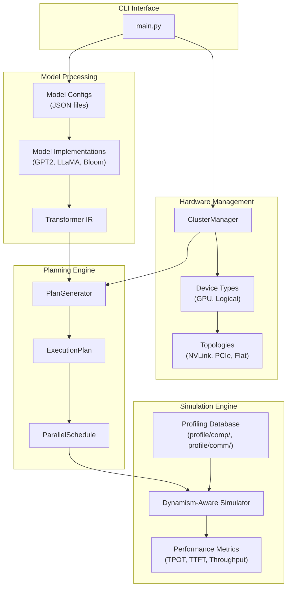
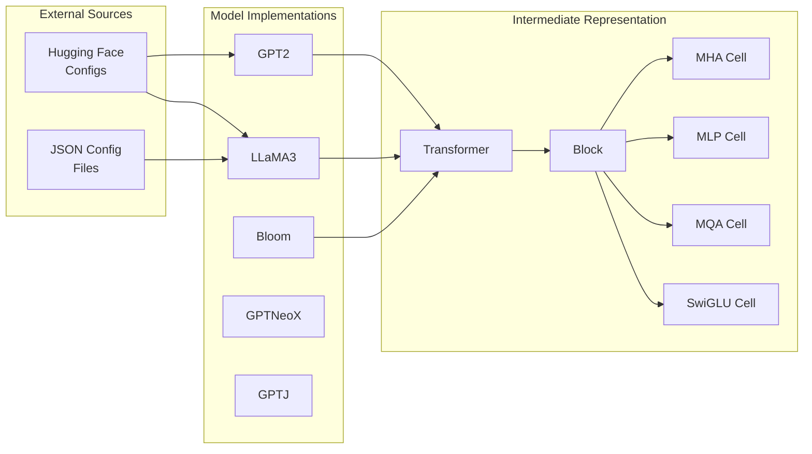
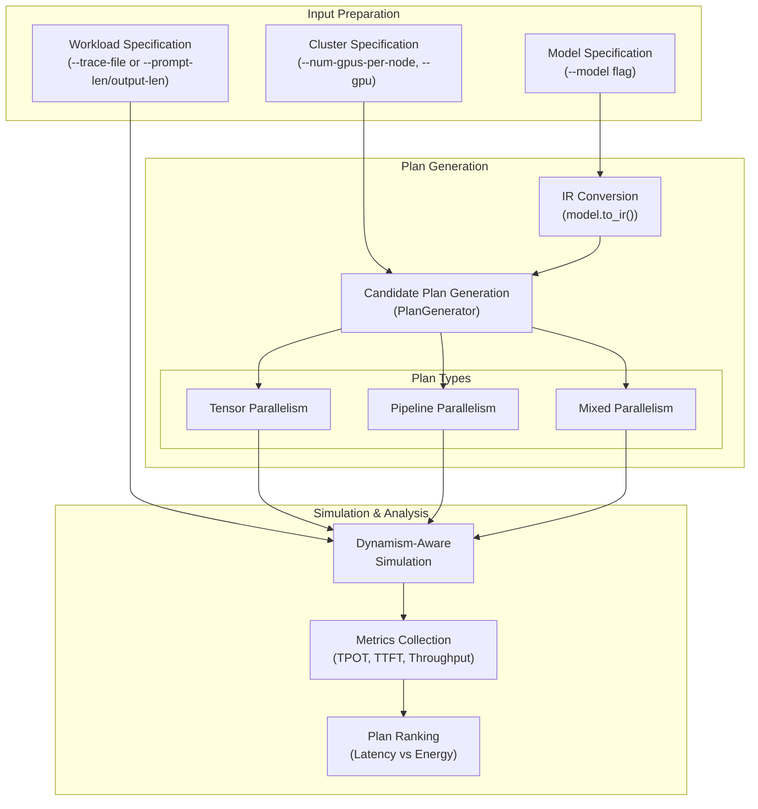

<!-- source: DeepWiki mcp.deepwiki.com · repo microsoft/apex_plus · page 1 APEX+ Overview · fetched 2026-10-26 -->

# APEX+ Overview

Relevant source files

The following files were used as context for generating this wiki page:

- [README.md](README.md)

## Purpose and Scope

This page provides a high-level introduction to APEX+ (Automated Parallel Execution), an extensible and dynamism-aware simulator for LLM serving optimization. APEX+ generates optimal parallel execution plans for large language models given hardware clusters and workload characteristics.

For installation and usage instructions, see [Getting Started](#2). For detailed architectural components, see [Core Architecture](#3). For specific model implementations, see [Model Support](#6).

## What is APEX+

APEX+ is a performance simulation system that automatically determines the best parallelization strategy for serving large language models. Given three inputs - an LLM architecture, a device cluster configuration, and request traces - APEX+ generates execution plans that optimize for throughput, latency, or energy efficiency.

The simulator performs **dynamism-aware simulation** to model iteration-level batching behavior and leverages the repetitive structure of transformer architectures to efficiently explore the parallelization design space. APEX+ can identify optimal execution plans within 15 minutes on a CPU, making it significantly more cost-effective than empirical tuning on GPU clusters.

Key capabilities include:
- **Multi-objective optimization**: Finds plans up to 3.37x faster than heuristics and reduces energy consumption by up to 45%
- **Comprehensive metrics**: Reports time per output token (TPOT), time to first token (TTFT), throughput, and SLO compliance
- **Scalable simulation**: Handles trillion-scale models through architectural abstractions
- **Hardware flexibility**: Supports various GPU types and cluster topologies with extensible profiling data

**Sources:** [README.md:5-10]()

## System Architecture Overview

APEX+ consists of five major subsystems that work together to generate and evaluate parallel execution plans:

The architecture follows a pipeline flow where models are converted to intermediate representation, matched with hardware clusters, used to generate candidate execution plans, and finally simulated to produce performance metrics.

**Sources:** [README.md:5-13](), system diagrams provided

## Core Components

### Model Layer
APEX+ supports multiple LLM architectures through a unified model abstraction. Each model implementation (e.g., `GPT2`, `LLaMA3`, `Bloom`) can be converted from Hugging Face configurations to APEX+ internal representation:

### Device and Cluster Management
APEX+ models computational resources through a hierarchical cluster abstraction that supports various GPU types and interconnect topologies. The system can simulate multi-node clusters with different intra-node and inter-node communication patterns.

### Execution Planning
The planning engine generates candidate parallelization strategies including tensor parallelism, pipeline parallelism, and mixed approaches. Each `ExecutionPlan` maps model components to device clusters and specifies communication patterns.

### Simulation Engine
The core simulator performs dynamism-aware modeling of LLM serving workloads, accounting for variable sequence lengths and batching behavior. It uses op-level profiling data to accurately estimate computation and communication costs.

**Sources:** [README.md:12-13](), system diagrams provided

## Simulation Workflow

APEX+ follows a structured workflow to generate and evaluate execution plans:

The workflow begins when `main.py` processes command-line arguments to configure the model, cluster, and workload. The system then converts the model to intermediate representation, generates candidate execution plans for different parallelization strategies, simulates each plan's performance, and ranks them based on optimization objectives.

**Sources:** [README.md:26-44](), [README.md:51-217]()

## Supported Models and Hardware

APEX+ includes built-in support for major LLM architectures:

| Model Family | Examples | Key Features |
|--------------|----------|--------------|  
| GPT-style | GPT-2, GPT-J, GPT-NeoX | Standard decoder-only transformers |
| LLaMA | LLaMA, LLaMA3 | RMSNorm, SwiGLU, rotary embeddings |
| Bloom | Bloom models | ALiBi positional encoding |
| Mixture of Experts | Mixtral-8x7B | Sparse expert routing |
| Specialized | Whisper, GPT-BigCode, CLIP | Task-specific architectures |

**Hardware Backend Support:**
- **V100-16GB**: PCIe and SXM variants
- **H100-SXM-80GB**: High-performance training/inference  
- **H200-SXM-141GB**: Extended memory configurations
- **Logical devices**: For modeling non-GPU accelerators

The system uses op-level profiling data stored in `profile/comp/{Backend}` and `profile/comm/{Backend}` directories to accurately model hardware performance characteristics.

**Sources:** [README.md:12-13](), [README.md:44]()

## Performance and Validation

APEX+ provides comprehensive performance analysis including:

- **Throughput metrics**: Tokens/second, requests/second
- **Latency metrics**: Time to first token (TTFT), time per output token (TPOT) 
- **Resource utilization**: Model FLOPS utilization (MFU), memory bandwidth utilization (MBU)
- **Energy consumption**: Total energy per workload
- **SLO compliance**: Percentage of requests meeting service level objectives

The simulator has been validated against real LLM serving systems including vLLM for dense models and SGLang for mixture-of-experts models, with experimental results available in the `results/` directory.

**Sources:** [README.md:46-48](), [README.md:51-217](), [README.md:221-240]()

---

