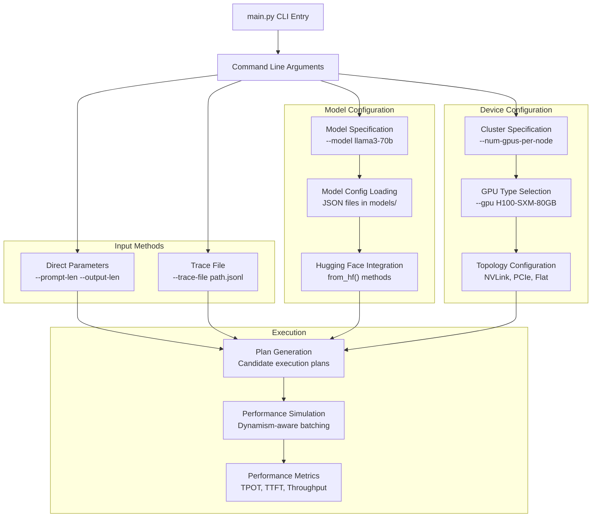

<!-- source: DeepWiki mcp.deepwiki.com · repo microsoft/apex_plus · page 2 Getting Started · fetched 2026-10-26 -->

# Getting Started

<details>
<summary>Relevant source files</summary>

The following files were used as context for generating this wiki page:

- [README.md](README.md)
- [SUPPORT.md](SUPPORT.md)

</details>


This guide covers the basic installation, usage patterns, and command-line interface for APEX+. It demonstrates how to run simulations, interpret results, and configure various execution scenarios. For detailed information about the underlying architecture and components, see [Core Architecture](#3). For comprehensive reference documentation on models and devices, see [Model Support](#6) and [Device Management Reference](#4).

## Installation and Setup

APEX+ requires Python dependencies that are managed through a requirements file. Install the necessary packages by running:

```bash
pip install -r requirements.txt
```

The system includes pre-compiled op-level profiling data for several GPU backends including V100-16GB, H100 SXM 80GB, and H200 SXM 141GB. This profiling data is stored in `profile/comp/{Backend}` and `profile/comm/{Backend}` directories and enables accurate performance simulation without requiring actual hardware.

**Sources:** [README.md:16-22]()

## Basic Usage Patterns

### CLI Entry Point Workflow



**Sources:** [README.md:24-44](), [main.py:1]()

### Core Simulation Command Structure

The primary entry point is `main.py` located in the repository root. All simulations follow this basic pattern:

```bash
python main.py [MODEL_OPTIONS] [CLUSTER_OPTIONS] [WORKLOAD_OPTIONS] [OUTPUT_OPTIONS]
```

The most basic simulation requires specifying a model and cluster configuration:

```bash
python main.py --model llama3-70b --num-gpus-per-node 2 --prompt-len 128 --output-len 2048
```

**Sources:** [README.md:26-29]()

## Command Line Reference

### Model Configuration Options

| Option | Description | Example |
|--------|-------------|---------|
| `--model` | Model specification (name or config path) | `llama3-70b`, `./apex_plus/models/llama3_70b_config.json` |
| `--num-experts` | Number of experts for MoE models | `8` |
| `--topk` | Top-k experts selection | `2` |
| `--capacity-factor` | MoE capacity factor | `1.0` |

### Cluster Configuration Options

| Option | Description | Example |
|--------|-------------|---------|
| `--num-nodes` | Number of compute nodes | `1` |
| `--num-gpus-per-node` | GPUs per node | `2`, `4`, `8` |
| `--gpu` | GPU type specification | `H100-SXM-80GB`, `V100-PCIE-16GB` |
| `--frequency` | GPU frequency in MHz | `1980` |

### Workload Configuration Options

#### Direct Parameter Method
| Option | Description | Example |
|--------|-------------|---------|
| `--prompt-len` | Input sequence length | `128`, `2048` |
| `--output-len` | Generated sequence length | `128`, `2048` |
| `--num-requests` | Number of requests to simulate | `1024` |

#### Trace File Method
| Option | Description | Example |
|--------|-------------|---------|
| `--trace-file` | Path to JSONL trace file | `./traces/llama/creation_05.jsonl` |

### Quantization and Precision Options

| Option | Description | Example |
|--------|-------------|---------|
| `--kv-dtype` | KV-cache data type | `half`, `float8` |
| `--weight-dtype` | Weight data type | `half`, `float8` |
| `--activation-dtype` | Activation data type | `half`, `float8` |

### Output and Analysis Options

| Option | Description | Default |
|--------|-------------|---------|
| `--all` | Show all execution plans | Only latency-optimal |
| `--ttft-slo` | Time to First Token SLO (msec) | `10` |
| `--tpot-slo` | Time per Output Token SLO (msec) | `10` |
| `--max-batch` | Maximum batch size constraint | Unlimited |

**Sources:** [README.md:27-42](), [README.md:221-240]()

## Common Usage Examples

### Decoder-Only Models
```bash
# Basic LLaMA3-70B simulation
python main.py --model llama3-70b --num-gpus-per-node 2 --prompt-len 128 --output-len 2048 --all

# With quantization (W8A16 weights, FP8 KV-cache)
python main.py --model llama3-70b --num-gpus-per-node 2 --trace-file ./traces/llama/creation_05.jsonl \
    --kv-dtype float8 --weight-dtype float8 --activation-dtype half
```

### Mixture of Experts Models
```bash
# Mixtral-8x7B simulation
python main.py --model mixtral-8x7b-local --num-gpus-per-node 4 --num-experts 8 \
    --trace-file ./traces/mistral/lmsys_05.jsonl
```

### Encoder-Decoder Models
```bash
# Whisper model simulation
python main.py --model whisper --num-gpus-per-node 2 --prompt-len 128 --output-len 2048
```

### SLO Analysis
```bash
# Configure SLO constraints and batch size limits
python main.py --model llama3-70b --num-gpus-per-node 8 --num-requests 10 \
    --ttft-slo 100 --tpot-slo 30 --max-batch 10
```

**Sources:** [README.md:27-42](), [README.md:225-228]()

## Understanding Output Format

### Execution Plan Structure

APEX+ generates multiple candidate execution plans and evaluates each one. The output shows detailed information for each plan including parallelization strategy, device mapping, and performance metrics.

```mermaid
graph TD
    subgraph "Execution Plan Output Structure"
        PlanHeader["Parallel Schedule N<br/>Model replicas, Stages, Blocks per stage"]
        
        subgraph "Device Mapping"
            MQAMapping["MQA Task Mapping<br/>replicas, tasks_per_device"]
            MLPMapping["SwiGLU Task Mapping<br/>replicas, tasks_per_device"] 
            CommOps["Communication Operations<br/>AllReduce, AllGather, AllToAll"]
        end
        
        subgraph "Resource Statistics"
            ParamSize["Parameter size per device (GB)"]
            ActivationMem["Activation memory per device (GB)"]
            BatchStats["Avg requests/tokens per iteration"]
        end
        
        subgraph "Performance Metrics"
            Throughput["Throughput<br/>tokens/sec, requests/sec"]
            Latency["Latency<br/>TTFT, TPOT in msec"]
            Percentiles["TBT Percentiles<br/>P50, P95"]
            Utilization["MFU, MBU percentages"]
        end
        
        subgraph "Detailed Analysis"
            TimeBreakdown["Time Breakdown<br/>Per operation timing"]
            EnergyConsumption["Energy Consumption (KJ)"]
        end
    end
    
    PlanHeader --> MQAMapping
    PlanHeader --> MLPMapping
    MQAMapping --> CommOps
    MLPMapping --> CommOps
    CommOps --> ParamSize
    ParamSize --> ActivationMem
    ActivationMem --> BatchStats
    BatchStats --> Throughput
    Throughput --> Latency
    Latency --> Percentiles
    Percentiles --> Utilization
    Utilization --> TimeBreakdown
    TimeBreakdown --> EnergyConsumption
```



### Key Performance Metrics

| Metric | Description | Units |
|--------|-------------|-------|
| **Throughput** | | |
| Tokens generated per second | Output token generation rate | tokens/sec |
| Tokens processed per second | Total token processing rate | tokens/sec |
| Requests per second | Request completion rate | requests/sec |
| **Latency** | | |
| TTFT | Time to First Token | msec |
| TPOT | Time per Output Token | msec |
| TBT Percentiles | Time Between Tokens distribution | msec |
| Request Completion Latency | End-to-end request latency | sec |
| **Utilization** | | |
| MFU | Model FLOPS Utilization | % |
| MBU | Memory Bandwidth Utilization | % |

### SLO Compliance Output

When SLO constraints are configured, APEX+ provides compliance analysis:

```
* Latency SLO Metrics:
* Batch Size: 10
-----------------------------------------
  Name   Target SLO(msec)   SLOs Met(%)  
-----------------------------------------
  TTFT   100                0.000 %      
  TPOT   30                 100.000 %    
-----------------------------------------
```

**Sources:** [README.md:50-217](), [README.md:229-240]()

## Trace File Format

APEX+ supports realistic request traces stored in JSONL format. Each line contains a request specification:

```json
{
  "StartTimeOffset": 1000000,
  "ContextTokens": 2048,
  "GeneratedTokens": 128
}
```

| Field | Description | Units |
|-------|-------------|-------|
| `StartTimeOffset` | Offset from first request | nanoseconds |
| `ContextTokens` | Input sequence length | tokens |
| `GeneratedTokens` | Output sequence length | tokens |

Sample trace files are provided in the `traces/` directory organized by model family (e.g., `traces/llama/`, `traces/mistral/`).

**Sources:** [README.md:43-44]()

## Getting Help

### Documentation Resources

- For comprehensive argument reference, see the comments in [main.py:1]()
- For profiling data collection, see [profile/scripts/README.md:1]()
- For validation against real serving systems, see the vLLM and SGLang folders
- File issues and questions on GitHub Issues after searching for existing topics

### Support Channels

As outlined in the project support policy, help is available through:
- The main [README.md:1]() for general usage questions
- [main.py:1]() argument documentation for full CLI functionality  
- GitHub Issues for bug reports and feature requests (search existing issues first)

**Sources:** [SUPPORT.md:1-12](), [README.md:219]()

---

