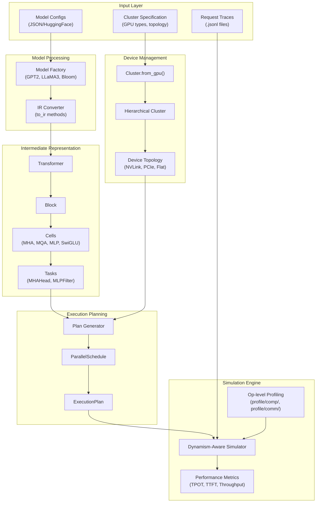
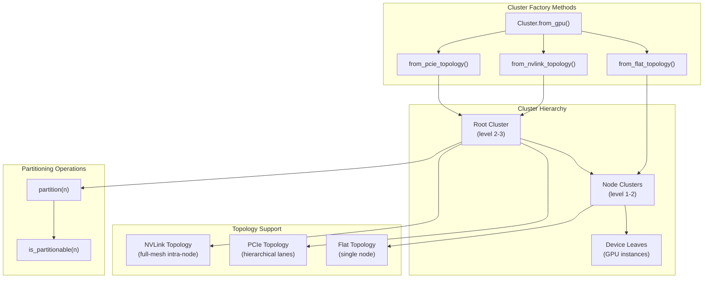
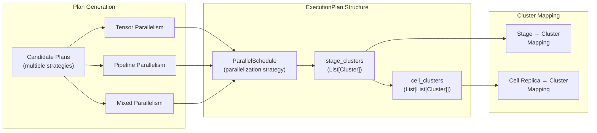
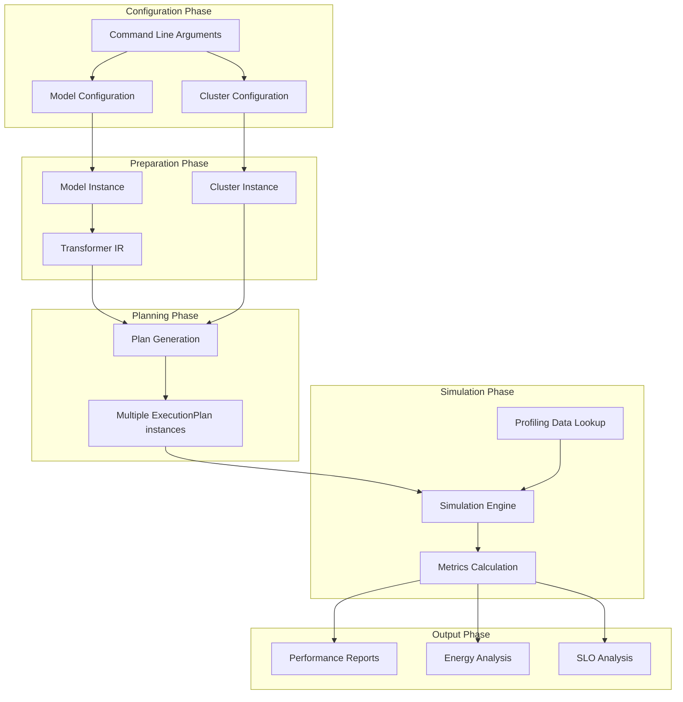

<!-- source: DeepWiki mcp.deepwiki.com · repo microsoft/apex_plus · page 3 Core Architecture · fetched 2026-10-26 -->

# Core Architecture

Relevant source files

The following files were used as context for generating this wiki page:

- [README.md](README.md)
- [apex_plus/cluster/cluster.py](apex_plus/cluster/cluster.py)
- [apex_plus/execution/plan.py](apex_plus/execution/plan.py)

This document provides a high-level overview of the APEX+ system architecture, including its core components and how they interact to generate optimal parallel execution plans for LLM serving. It covers the system's modular design, from model ingestion through execution plan generation and simulation.

For detailed information about specific components, see [Device and Cluster Management](#3.1), [Intermediate Representation System](#3.2), and [Execution Planning](#3.3). For implementation details of supported models, see [Model Support](#6).

## System Overview

APEX+ follows a multi-stage pipeline architecture that transforms high-level model configurations into optimized parallel execution plans. The system is designed around four core subsystems that work together to provide comprehensive LLM serving simulation capabilities.

### APEX+ Pipeline Architecture

Sources: [README.md:1-254](), [apex_plus/cluster/cluster.py:127-246](), [apex_plus/execution/plan.py:7-25]()

## Core Architectural Components

### Model Ingestion and IR Generation

The system begins by ingesting model configurations from either JSON files or HuggingFace model definitions. The `ModelFactory` classes handle the conversion from external formats to APEX+ internal representations, which are then transformed into a hierarchical Intermediate Representation (IR) structure.

| Component | Purpose | Key Classes |
|-----------|---------|-------------|
| Model Factory | Convert external model configs to APEX+ format | `GPT2`, `LLaMA3`, `Bloom` |
| IR Converter | Transform models to hierarchical IR | `to_ir()` methods |
| Transformer IR | Top-level model representation | `Transformer` |
| Block/Cell Hierarchy | Modular computation units | `Block`, `MHA`, `MLP`, `SwiGLU` |

### Device and Cluster Management

APEX+ uses a hierarchical cluster abstraction to represent computational resources. The `Cluster` class supports multiple topology types and can be partitioned to match different parallelization strategies.

Sources: [apex_plus/cluster/cluster.py:127-246](), [apex_plus/cluster/cluster.py:55-126]()

### Execution Planning System

The execution planning system generates multiple candidate parallelization strategies and maps them to the available cluster resources. The `ExecutionPlan` class encapsulates the mapping between computation stages and cluster partitions.

Sources: [apex_plus/execution/plan.py:7-25]()

### Simulation and Performance Evaluation

The simulation engine performs dynamism-aware simulation using op-level profiling data to compute performance metrics. It models iteration-level batching and provides comprehensive performance analysis.

| Metric Category | Key Metrics | Purpose |
|-----------------|-------------|---------|
| Latency | TTFT, TPOT | Request-level performance |
| Throughput | Tokens/sec, Requests/sec | System capacity |
| Resource Utilization | MFU, MBU | Hardware efficiency |
| Energy | Energy Consumption (KJ) | Operational cost |
| SLO Compliance | SLO percentage | Service quality |

## Data Flow and Integration

### Main Execution Flow

The system's main execution flow, orchestrated through `main.py`, follows this sequence:

1. **Configuration Loading**: Parse command-line arguments and load model configurations
2. **Model Instantiation**: Create model instances using factory methods
3. **IR Conversion**: Transform models to hierarchical IR using `to_ir()` methods
4. **Cluster Creation**: Build device clusters using `Cluster.from_gpu()`
5. **Plan Generation**: Generate candidate execution plans with different parallelization strategies
6. **Simulation**: Execute dynamism-aware simulation for each plan
7. **Performance Analysis**: Compute and report performance metrics

### Component Interaction Patterns

Sources: [README.md:24-44](), [README.md:51-214]()

## System Extension Points

APEX+ is designed for extensibility across multiple dimensions:

- **Model Support**: New model architectures can be added by implementing model factory classes and IR conversion methods
- **Device Types**: New hardware backends can be supported by extending the `Device` class hierarchy and providing profiling data
- **Parallelization Strategies**: Additional parallelization schemes can be implemented through new `ParallelSchedule` types
- **Simulation Features**: The simulation engine can be extended with new performance models and optimization objectives

The modular architecture ensures that extensions in one subsystem have minimal impact on others, supporting the system's role as an extensible research platform for LLM serving optimization.

Sources: [README.md:5-13](), [apex_plus/cluster/cluster.py:7-36]()

---

