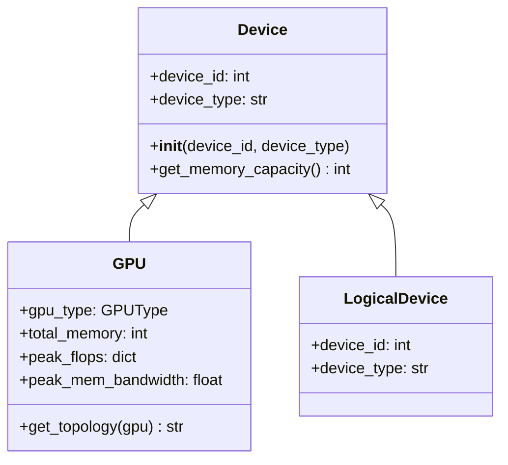
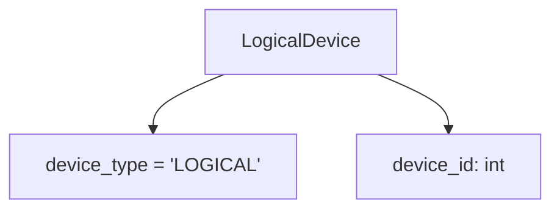
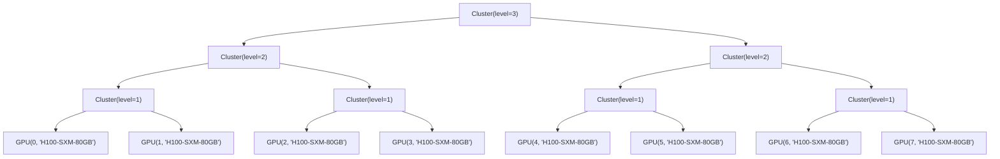
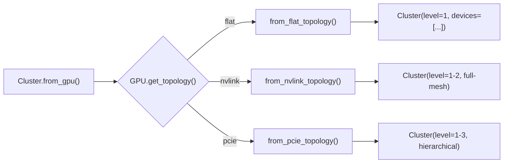
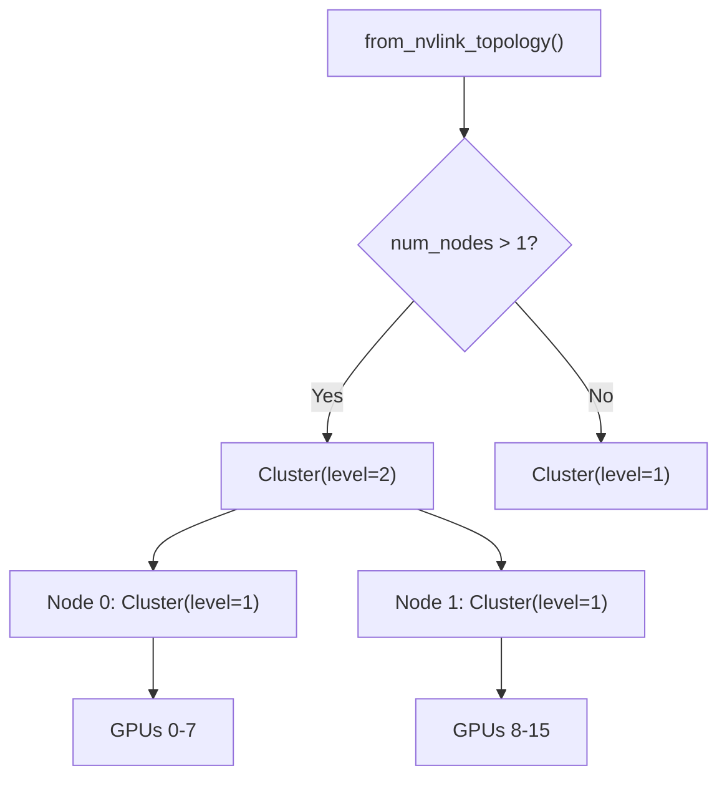
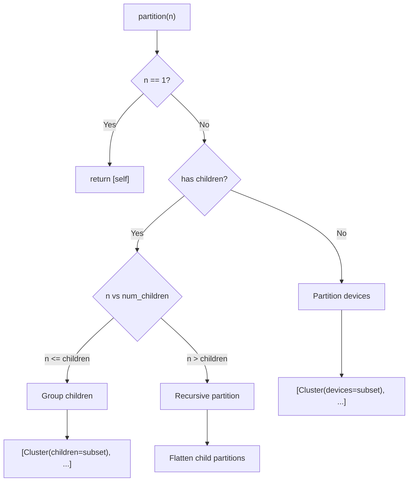
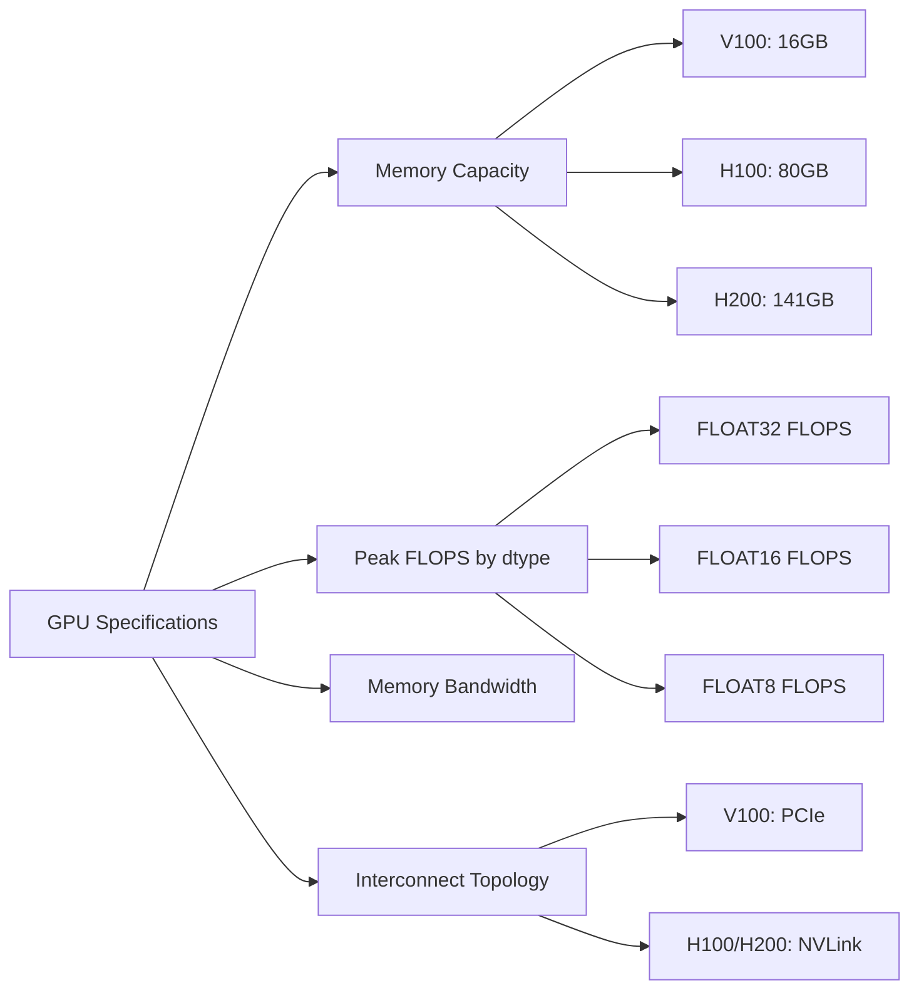

<!-- source: DeepWiki mcp.deepwiki.com · repo microsoft/apex_plus · page 3.1 Device and Cluster Management · fetched 2026-10-26 -->

# Device and Cluster Management

Relevant source files

The following files were used as context for generating this wiki page:

- [apex_plus/cluster/cluster.py](apex_plus/cluster/cluster.py)
- [apex_plus/cluster/device.py](apex_plus/cluster/device.py)
- [apex_plus/cluster/gpu.py](apex_plus/cluster/gpu.py)
- [apex_plus/cluster/logical.py](apex_plus/cluster/logical.py)

## Purpose and Scope

This document covers APEX+'s device and cluster management system, which provides abstractions for computational hardware and organizes devices into hierarchical clusters with different interconnect topologies. The system enables APEX+ to model various hardware configurations for LLM serving simulation.

For information about how clusters are used in execution planning, see [Execution Planning](#3.3). For detailed technical reference on specific device implementations, see [Device Management Reference](#4).

## Device Abstraction Layer

APEX+ uses a device abstraction layer to represent different types of computational resources. The base `Device` class provides a minimal interface that all device types must implement.

### Device Interface

The `Device` base class defines the core interface for all computational devices:

**Sources:** [apex_plus/cluster/device.py:1-12](), [apex_plus/cluster/gpu.py:69-103](), [apex_plus/cluster/logical.py:6-17]()

### GPU Device Implementation

The `GPU` class implements hardware-specific GPU devices with detailed specifications:

| GPU Type | Memory | Peak FLOPS (FP16) | Memory Bandwidth | Topology |
|----------|--------|-------------------|------------------|----------|
| V100-PCIE-16GB | 16 GB | 14 TFLOPS | 900 GB/s | PCIe |
| H100-SXM-80GB | 80 GB | 1,979 TFLOPS | 3,350 GB/s | NVLink |
| H200-SXM-141GB | 141 GB | 1,979 TFLOPS | 4,800 GB/s | NVLink |

**Sources:** [apex_plus/cluster/gpu.py:18-66]()

### Logical Devices

The `LogicalDevice` class represents non-physical computational resources for simulation purposes:

**Sources:** [apex_plus/cluster/logical.py:1-17]()

## Hierarchical Cluster Organization

APEX+ organizes devices into hierarchical clusters using the `Cluster` class. Clusters can contain either child clusters or devices, but not both.

### Cluster Structure

**Sources:** [apex_plus/cluster/cluster.py:7-35]()

### Cluster Constraints

The `Cluster` class enforces several structural constraints:

- Level 1 clusters must contain devices, not children ([apex_plus/cluster/cluster.py:28-29]())
- Higher-level clusters contain children, not devices ([apex_plus/cluster/cluster.py:22-26]())
- All children in a cluster must have the same number of devices ([apex_plus/cluster/cluster.py:24-26]())

## Supported Topologies

APEX+ supports three interconnect topologies, each with different performance characteristics and hierarchy requirements.

### Topology Factory Methods

**Sources:** [apex_plus/cluster/cluster.py:217-246]()

### Flat Topology

Flat topology creates a single-level cluster with direct device connections:

- Single node only ([apex_plus/cluster/cluster.py:226-227]())
- All devices at level 1 ([apex_plus/cluster/cluster.py:137]())
- Direct device-to-device communication

**Sources:** [apex_plus/cluster/cluster.py:127-137]()

### NVLink Topology

NVLink topology supports full-mesh intra-node connections with multiple nodes:

**Sources:** [apex_plus/cluster/cluster.py:139-158]()

### PCIe Topology

PCIe topology creates hierarchical clusters based on PCIe lane organization:

- Supports 1, 2, 4, or 8 devices per node ([apex_plus/cluster/cluster.py:167-170]())
- Creates multi-level hierarchy for 4 and 8 device configurations
- 8-device configuration creates 3-level hierarchy ([apex_plus/cluster/cluster.py:188-207]())

**Sources:** [apex_plus/cluster/cluster.py:159-216]()

## Cluster Operations

The `Cluster` class provides several operations for managing and querying cluster resources.

### Partitioning

The `partition()` method divides clusters into equal sub-clusters:

**Sources:** [apex_plus/cluster/cluster.py:55-108]()

### Device Queries

Common cluster query operations:

| Method | Purpose | Implementation |
|--------|---------|----------------|
| `get_num_devices()` | Total device count | Recursive sum across children |
| `get_device()` | Representative device | First device in hierarchy |
| `get_device_memory_capacity()` | Memory per device | Delegates to device |
| `is_partitionable(n)` | Check partition feasibility | Validates divisibility |

**Sources:** [apex_plus/cluster/cluster.py:37-54](), [apex_plus/cluster/cluster.py:110-126]()

## Hardware Specifications

### GPU Performance Characteristics

**Sources:** [apex_plus/cluster/gpu.py:27-66]()

The GPU specifications are stored in registry dictionaries that map GPU types to their capabilities, enabling APEX+ to accurately model hardware performance characteristics during simulation.

---

