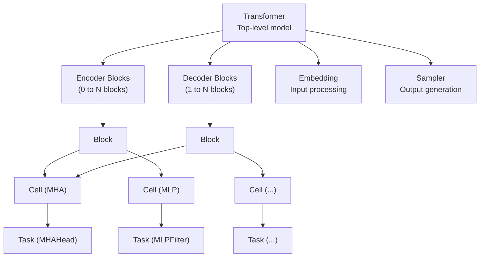
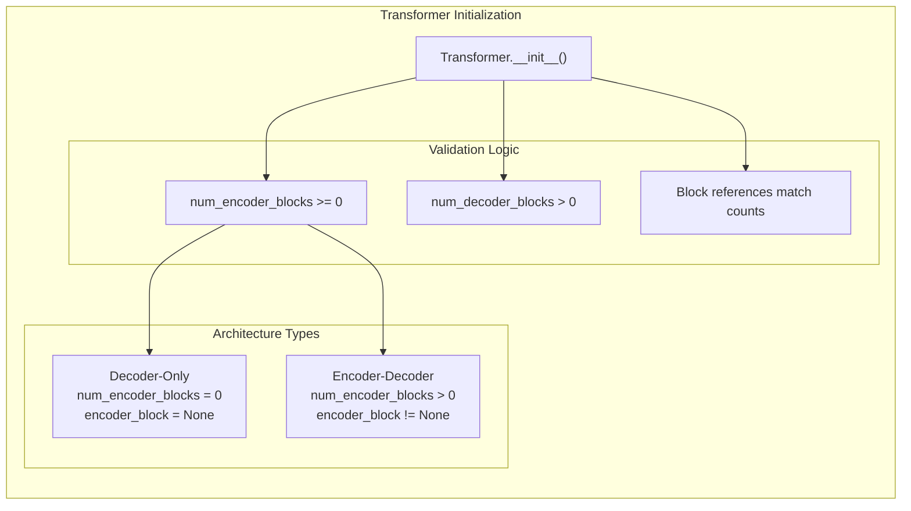
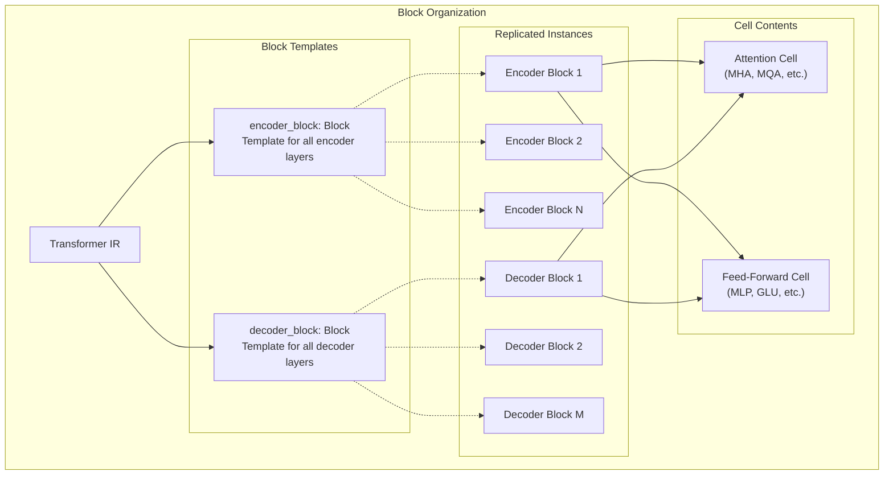
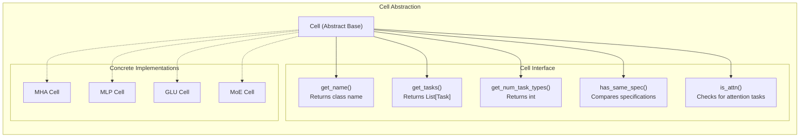
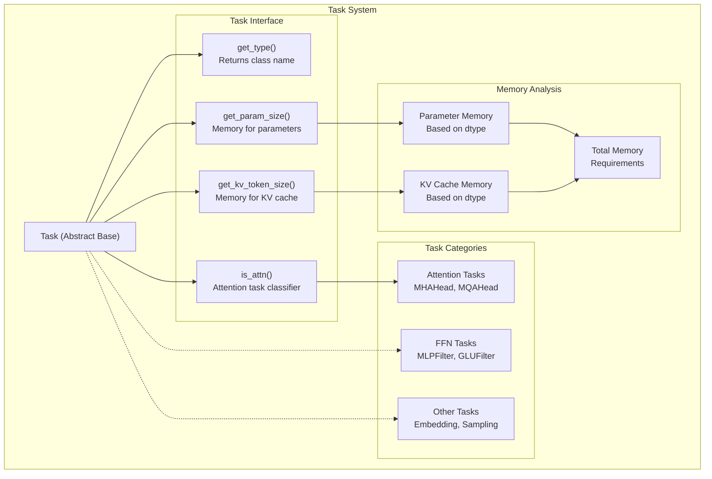
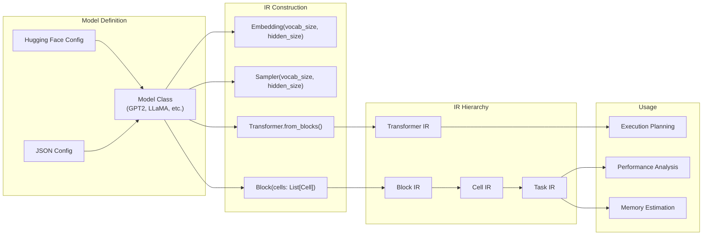

<!-- source: DeepWiki mcp.deepwiki.com · repo microsoft/apex_plus · page 3.2 Intermediate Representation System · fetched 2026-10-26 -->

# Intermediate Representation System

<details>
<summary>Relevant source files</summary>

The following files were used as context for generating this wiki page:

- [apex_plus/ir/block.py](apex_plus/ir/block.py)
- [apex_plus/ir/cell.py](apex_plus/ir/cell.py)
- [apex_plus/ir/task.py](apex_plus/ir/task.py)
- [apex_plus/ir/transformer.py](apex_plus/ir/transformer.py)

</details>


## Purpose and Scope

The Intermediate Representation (IR) System serves as the core abstraction layer in APEX+ that converts neural network models into a hierarchical, structured format suitable for parallel execution planning. The IR system provides a unified representation for transformer-based language models, decomposing them into logical components that can be mapped to computational resources and analyzed for performance characteristics.

This document covers the four-level IR hierarchy: Transformers, Blocks, Cells, and Tasks. For information about specific cell implementations like attention mechanisms, see [Attention Components](#5.1). For feed-forward components, see [Feed-Forward Components](#5.2). For execution planning that uses these IR components, see [Execution Planning](#3.3).

## IR Hierarchy Overview

The APEX+ IR system represents neural networks using a four-level hierarchy that mirrors the logical structure of transformer models:



**Sources:** [apex_plus/ir/transformer.py:1-102](), [apex_plus/ir/block.py:1-13](), [apex_plus/ir/cell.py:1-26](), [apex_plus/ir/task.py:1-25]()

## Transformer: Top-Level IR Component

The `Transformer` class represents the complete neural network model and orchestrates all other IR components. It supports both encoder-decoder and decoder-only architectures.

### Key Components

| Component | Type | Purpose |
|-----------|------|---------|
| `embedding` | `Embedding` | Token and position embedding processing |
| `encoder_block` | `Optional[Block]` | Template for encoder layers (can be None) |
| `decoder_block` | `Block` | Template for decoder layers |
| `sampler` | `Sampler` | Output token generation and sampling |
| `hidden_size` | `int` | Model's hidden dimension size |

### Architecture Flexibility

The `Transformer` class validates architecture configurations during initialization:

- **Encoder blocks**: Can be 0 (decoder-only) or positive (encoder-decoder)
- **Decoder blocks**: Must be positive (at least 1 block required)
- **Block references**: Must be None when count is 0, required when count > 0



**Sources:** [apex_plus/ir/transformer.py:28-68](), [apex_plus/ir/transformer.py:70-90]()

## Block: Container for Computational Cells

The `Block` class serves as a container that groups related computational cells together. Each block represents a single transformer layer and can contain multiple types of cells (attention, feed-forward, etc.).

### Structure and Usage

A `Block` is initialized with a list of `Cell` objects:

```python
# From apex_plus/ir/block.py
def __init__(self, cells: List[Cell]) -> None:
    self.cells = cells
```

Blocks are typically replicated across the model:
- **Encoder blocks**: Repeated `num_encoder_blocks` times
- **Decoder blocks**: Repeated `num_decoder_blocks` times



**Sources:** [apex_plus/ir/block.py:6-12](), [apex_plus/ir/transformer.py:14-16](), [apex_plus/ir/transformer.py:23-25]()

## Cell: Computational Units

The `Cell` class is an abstract base class that represents individual computational components within blocks. Each cell encapsulates a specific type of neural network operation and can contain multiple tasks.

### Core Interface

The `Cell` interface defines several key methods:

| Method | Return Type | Purpose |
|--------|-------------|---------|
| `get_name()` | `str` | Returns the cell's class name |
| `get_tasks()` | `List[Task]` | Returns the tasks this cell performs |
| `get_num_task_types()` | `int` | Returns the number of different task types |
| `has_same_spec()` | `bool` | Compares cell specifications |
| `is_attn()` | `bool` | Checks if cell contains attention tasks |

### Cell Type Detection

The `is_attn()` method uses task-level inspection to determine if a cell performs attention operations:

```python
# From apex_plus/ir/cell.py
def is_attn(self) -> bool:
    return any(task.is_attn() for task in self.get_tasks())
```



**Sources:** [apex_plus/ir/cell.py:6-26]()

## Task: Atomic Operations

The `Task` class represents the most granular level of the IR hierarchy. Tasks are atomic computational operations that can be profiled, scheduled, and executed independently.

### Task Interface

The `Task` base class provides several key methods:

| Method | Type | Purpose |
|--------|------|---------|
| `get_type()` | Instance | Returns the task's class name |
| `get_param_size()` | Static | Calculates parameter memory requirements |
| `get_kv_token_size()` | Static | Calculates key-value cache requirements |
| `is_attn()` | Class | Identifies attention-related tasks |

### Memory and Performance Analysis

Tasks provide static methods for memory analysis that are used during execution planning:

```python
# From apex_plus/ir/task.py
@staticmethod
def get_param_size(tasks: List["Task"], dtype: DTYPE) -> int:
    raise NotImplementedError

@staticmethod  
def get_kv_token_size(tasks: List["Task"], dtype: DTYPE) -> int:
    raise NotImplementedError
```

### Task Classification

The `is_attn()` class method enables the IR system to identify attention-related operations for specialized handling during parallelization.



**Sources:** [apex_plus/ir/task.py:6-25]()

## IR System Integration

The IR components work together to provide a complete representation of transformer models that can be analyzed and executed efficiently.

### Model-to-IR Conversion Flow



**Sources:** [apex_plus/ir/transformer.py:70-90](), [apex_plus/ir/block.py:8-12](), [apex_plus/ir/cell.py:15-25](), [apex_plus/ir/task.py:15-24]()

## Summary

The APEX+ Intermediate Representation System provides a four-level hierarchical abstraction that enables sophisticated analysis and optimization of transformer models:

1. **Transformer**: Top-level orchestration with embedding, blocks, and sampling
2. **Block**: Container grouping related computational cells  
3. **Cell**: Individual computational units with specific functionality
4. **Task**: Atomic operations with memory and performance characteristics

This hierarchy allows APEX+ to decompose complex models into manageable components that can be mapped to computational resources, analyzed for performance characteristics, and optimized for parallel execution.

**Sources:** [apex_plus/ir/transformer.py:1-102](), [apex_plus/ir/block.py:1-13](), [apex_plus/ir/cell.py:1-26](), [apex_plus/ir/task.py:1-25]()

---

