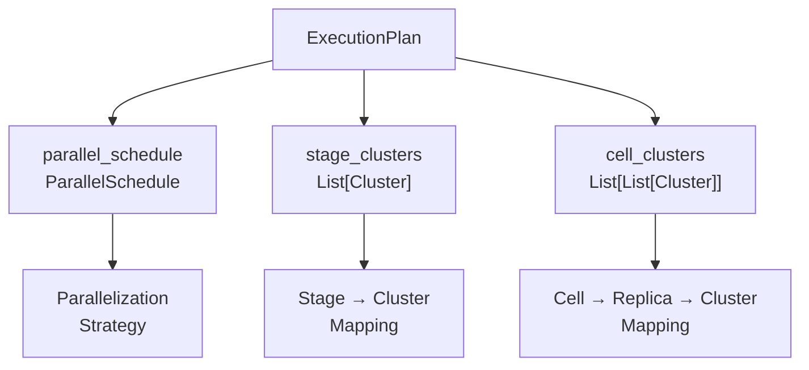
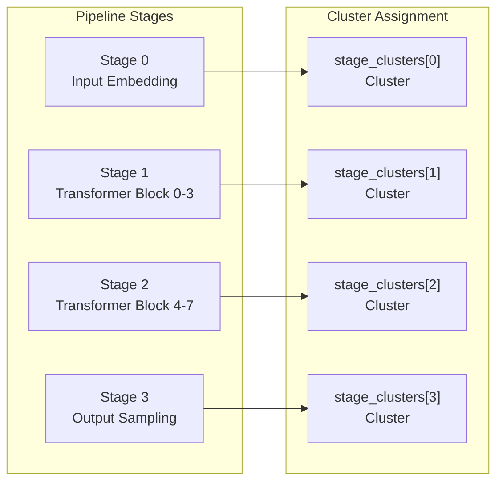
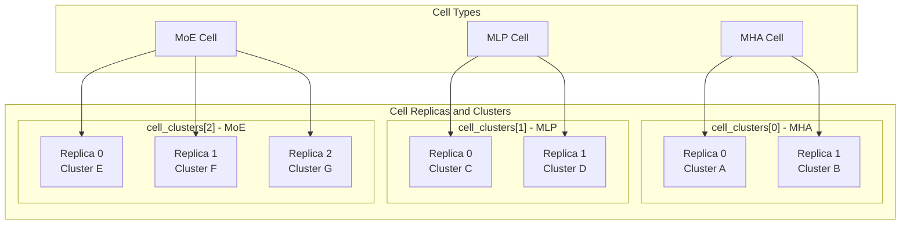
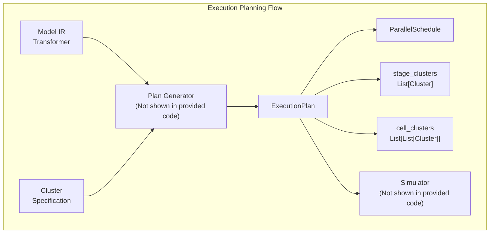

<!-- source: DeepWiki mcp.deepwiki.com · repo microsoft/apex_plus · page 3.3 Execution Planning · fetched 2026-10-26 -->

# Execution Planning

<details>
<summary>Relevant source files</summary>

The following files were used as context for generating this wiki page:

- [apex_plus/execution/plan.py](apex_plus/execution/plan.py)

</details>


This document covers APEX+'s execution planning system, which is responsible for mapping neural network model components to computational clusters and defining how parallel execution should be orchestrated. The execution planning system bridges the gap between the intermediate representation of models and the physical cluster resources that will execute them.

For information about the cluster management and device abstractions that execution plans target, see [Device and Cluster Management](#3.1). For details about the model components that execution plans orchestrate, see [Intermediate Representation System](#3.2).

## Overview

Execution planning in APEX+ transforms abstract model representations into concrete execution strategies by determining how model components should be distributed across available computational resources. The core of this system is the `ExecutionPlan` class, which encapsulates three key mapping relationships: parallel scheduling strategies, stage-to-cluster assignments, and cell-to-cluster assignments with replication support.

## ExecutionPlan Class

The `ExecutionPlan` class serves as the central data structure that defines how a model will be executed across a cluster of devices. It contains three primary components that work together to specify the complete execution strategy.

**ExecutionPlan Components**


The `ExecutionPlan` constructor takes three parameters that define the complete execution mapping:

| Parameter | Type | Purpose |
|-----------|------|---------|
| `parallel_schedule` | `ParallelSchedule` | Defines the parallelization strategy and scheduling approach |
| `stage_clusters` | `List[Cluster]` | Maps each pipeline stage to its assigned cluster |
| `cell_clusters` | `List[List[Cluster]]` | Maps each cell and its replicas to their assigned clusters |

Sources: [apex_plus/execution/plan.py:7-24]()

## Stage-to-Cluster Mapping

The `stage_clusters` attribute provides a direct mapping from pipeline stages to computational clusters. This list-based mapping enables pipeline parallelism by assigning different stages of the neural network to different clusters, allowing multiple stages to execute concurrently on different portions of the input data.

**Stage Mapping Architecture**


Each index in the `stage_clusters` list corresponds to a stage identifier, and the `Cluster` object at that index specifies which computational resources will execute that stage. This mapping is fundamental to pipeline parallelism strategies where the model is partitioned into sequential stages.

Sources: [apex_plus/execution/plan.py:12]()

## Cell-to-Cluster Mapping with Replication

The `cell_clusters` attribute implements a two-dimensional mapping that supports both cell distribution and replication. The outer list dimension corresponds to different cells (such as attention or feed-forward components), while the inner list dimension corresponds to replicas of each cell for tensor parallelism or redundancy.

**Cell Replication Mapping**


This two-dimensional structure enables sophisticated parallelization strategies:
- **Tensor Parallelism**: Multiple replicas of the same cell distributed across different clusters
- **Data Parallelism**: Identical replicas processing different data batches
- **Expert Parallelism**: Different experts in MoE cells assigned to different clusters

Sources: [apex_plus/execution/plan.py:13]()

## Integration with ParallelSchedule

The `ParallelSchedule` component defines the high-level parallelization strategy that governs how the stage and cell mappings should be interpreted during execution. This schedule coordinates the interaction between different parallelization approaches and determines the execution order and synchronization requirements.

**Execution Plan Integration**


The `ParallelSchedule` works in conjunction with the cluster mappings to ensure that:
- Dependencies between stages are respected in pipeline parallelism
- Synchronization points are established for tensor-parallel operations
- Communication patterns are optimized based on cluster topology
- Load balancing is maintained across replicated components

Sources: [apex_plus/execution/plan.py:11,15]()

## ExecutionPlan Representation

The `ExecutionPlan` class provides a comprehensive string representation that includes all three core components, enabling easy debugging and inspection of the execution strategy. The `__repr__` method formats the parallel schedule, stage clusters, and cell clusters in a readable format.

```python
def __repr__(self) -> str:
    return (
        f"ExecutionPlan(parallel_schedule={self.parallel_schedule}, "
        f"stage_clusters={self.stage_clusters}, "
        f"cell_clusters={self.cell_clusters})"
    )
```

This representation is particularly useful during plan generation and validation phases, where multiple candidate execution plans may be evaluated and compared based on their resource allocation and expected performance characteristics.

Sources: [apex_plus/execution/plan.py:19-24]()

---

