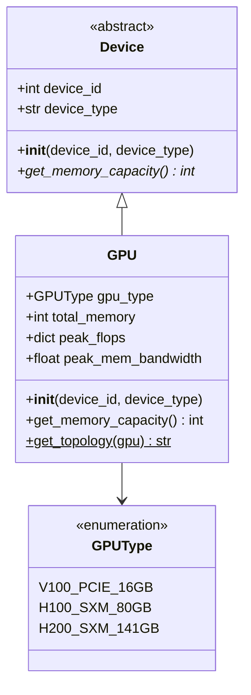
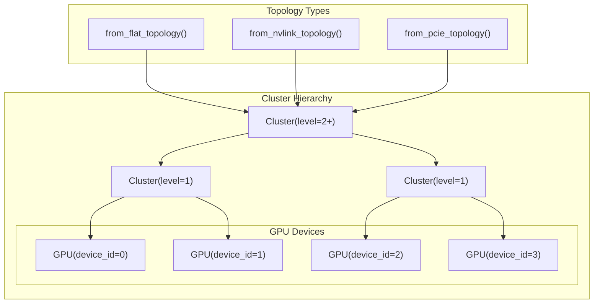
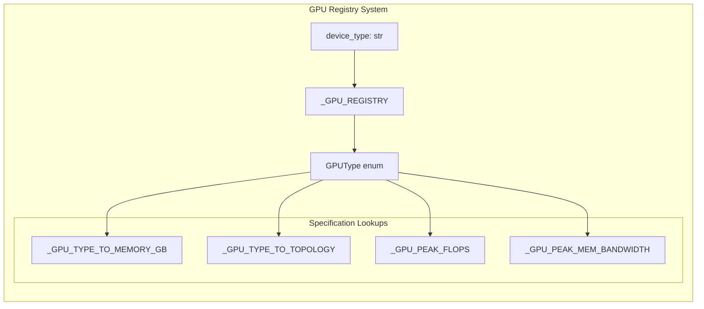
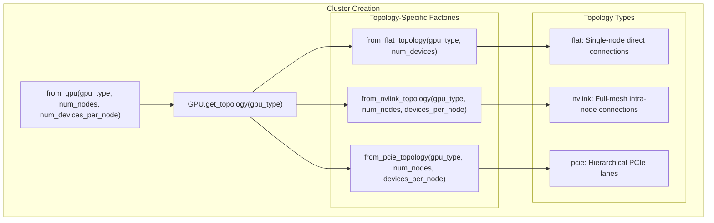
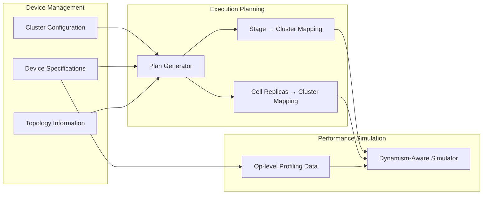

<!-- source: DeepWiki mcp.deepwiki.com · repo microsoft/apex_plus · page 4 Device Management Reference · fetched 2026-10-26 -->

# Device Management Reference

Relevant source files

The following files were used as context for generating this wiki page:

- [apex_plus/cluster/cluster.py](apex_plus/cluster/cluster.py)
- [apex_plus/cluster/device.py](apex_plus/cluster/device.py)
- [apex_plus/cluster/gpu.py](apex_plus/cluster/gpu.py)

## Purpose and Scope

This document provides a technical reference for APEX+'s device management system, which abstracts computational hardware and organizes it into hierarchical clusters with different topologies. The device management system serves as the foundation for execution planning by providing information about available compute resources, their capabilities, and interconnection topologies.

For detailed information about how device clusters are used in execution planning, see [Execution Planning](#3.3). For specific device abstraction details, see [Device Abstraction](#4.1). For GPU-specific implementations, see [GPU Devices](#4.2). For cluster topology management, see [Cluster Topology](#4.3).

## Device Management Architecture

The device management system in APEX+ consists of three main components that work together to represent and organize computational resources:

### Device Class Hierarchy

Sources: [apex_plus/cluster/device.py:1-12](), [apex_plus/cluster/gpu.py:69-103](), [apex_plus/cluster/gpu.py:9-16]()

### Cluster Topology Structure

Sources: [apex_plus/cluster/cluster.py:7-35](), [apex_plus/cluster/cluster.py:127-246]()

## Device Abstraction

The `Device` class provides the base abstraction for all computational devices in APEX+. It defines a minimal interface that all device implementations must support, including device identification and memory capacity reporting.

| Method | Purpose | Implementation |
|--------|---------|----------------|
| `__init__(device_id, device_type)` | Initialize device with ID and type | Abstract - must be implemented by subclasses |
| `get_memory_capacity()` | Return device memory in bytes | Abstract - must be implemented by subclasses |

The abstract nature of the `Device` class allows APEX+ to support different types of computational resources through a uniform interface. For complete device abstraction details, see [Device Abstraction](#4.1).

Sources: [apex_plus/cluster/device.py:1-12]()

## GPU Device Support

The `GPU` class implements the `Device` interface for GPU hardware, providing detailed specifications for supported GPU types including memory capacity, peak FLOPS, and memory bandwidth.

### Supported GPU Types

| GPU Type | Memory | Peak FLOPS (FP16) | Memory Bandwidth | Topology |
|----------|--------|-------------------|------------------|----------|
| `V100_PCIE_16GB` | 16 GB | 14 TFLOPS | 900 GB/s | PCIe |
| `H100_SXM_80GB` | 80 GB | 1979 TFLOPS | 3.35 TB/s | NVLink |
| `H200_SXM_141GB` | 141 GB | 1979 TFLOPS | 4.8 TB/s | NVLink |

### GPU Registration System

For detailed GPU specifications and implementations, see [GPU Devices](#4.2).

Sources: [apex_plus/cluster/gpu.py:18-66](), [apex_plus/cluster/gpu.py:69-103]()

## Cluster Topology Management

The `Cluster` class implements hierarchical organization of devices with support for different interconnection topologies. Clusters can be partitioned for parallel execution and support three main topology types.

### Cluster Factory Methods

### Cluster Partitioning

The `partition(n)` method enables splitting clusters into `n` sub-clusters for parallel execution planning:

| Partition Scenario | Behavior |
|-------------------|----------|
| `n == 1` | Returns the cluster unchanged |
| `n <= num_children` | Partitions by grouping child clusters |
| `n > num_children` | Recursively partitions child clusters |
| Leaf cluster | Partitions devices directly |

For complete cluster topology details, see [Cluster Topology](#4.3).

Sources: [apex_plus/cluster/cluster.py:55-125](), [apex_plus/cluster/cluster.py:217-246]()

## Integration with Execution Planning

The device management system integrates with APEX+'s execution planning through the cluster abstraction, enabling the plan generator to understand available computational resources and their capabilities.

### Device Management in Execution Flow

The cluster's `get_device()`, `get_device_memory_capacity()`, and `get_num_devices()` methods provide essential information for execution plan generation, while the `partition()` method enables cluster subdivision for different parallelization strategies.

Sources: [apex_plus/cluster/cluster.py:40-54](), [apex_plus/cluster/cluster.py:55-125]()

---

