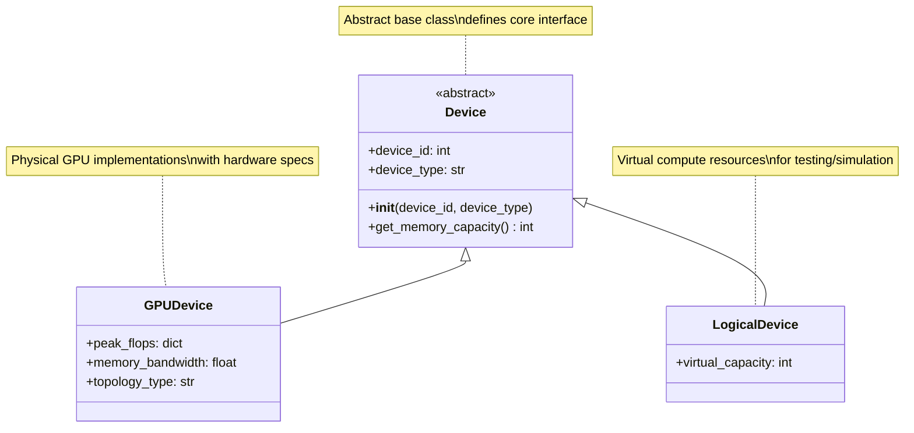
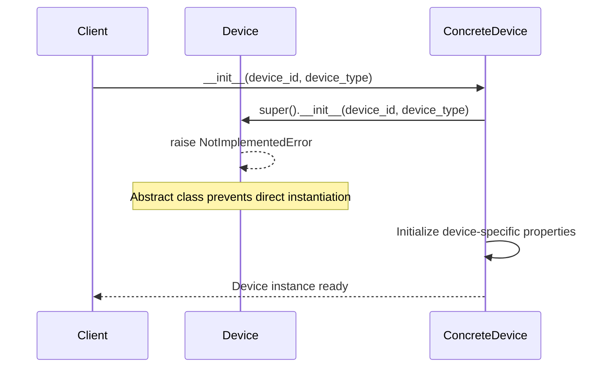
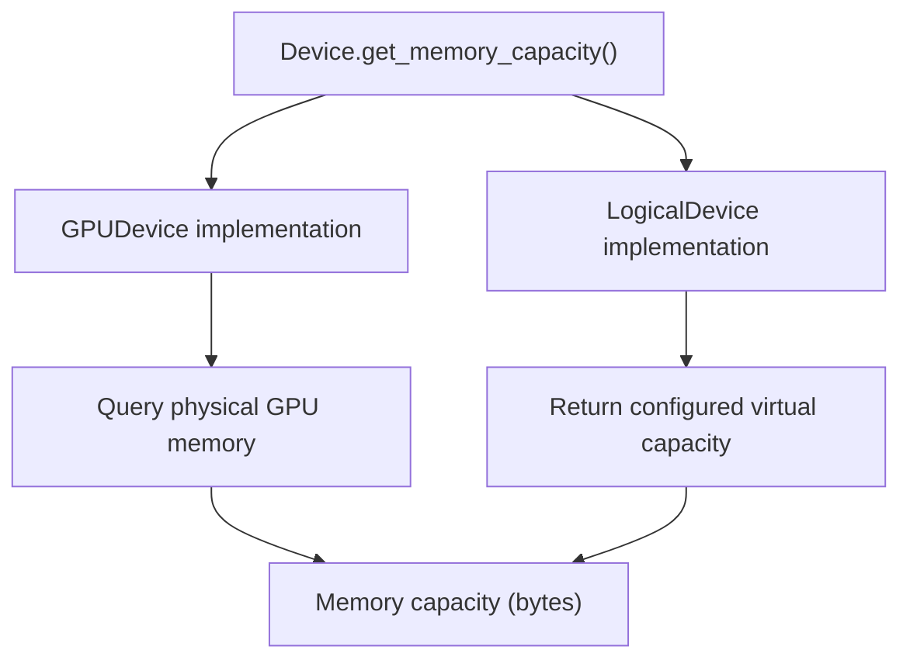
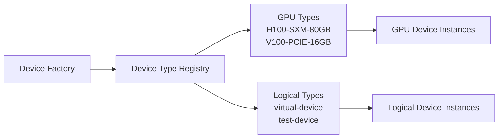
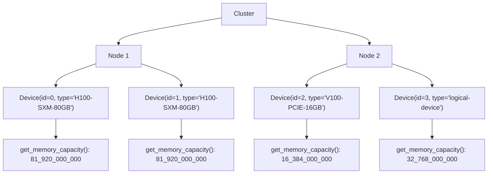

<!-- source: DeepWiki mcp.deepwiki.com · repo microsoft/apex_plus · page 4.1 Device Abstraction · fetched 2026-10-26 -->

# Device Abstraction

<details>
<summary>Relevant source files</summary>

The following files were used as context for generating this wiki page:

- [apex_plus/cluster/device.py](apex_plus/cluster/device.py)

</details>


This document covers the base `Device` abstraction that provides the fundamental interface for all computational devices in APEX+. This abstraction defines the core contract that all concrete device implementations must fulfill, enabling consistent device management across different hardware types.

For information about specific GPU device implementations, see [GPU Devices](#4.2). For logical device implementations, see [Logical Devices](#4.4). For the broader cluster topology system that organizes devices, see [Cluster Topology](#4.3).

## Abstract Device Interface

The `Device` class serves as the abstract base class for all computational devices in APEX+. It establishes the fundamental interface that concrete device implementations must provide, ensuring consistent behavior across different hardware types including GPUs and logical devices.

**Device Class Hierarchy**


Sources: [apex_plus/cluster/device.py:1-12]()

## Device Identification System

Every device in APEX+ is uniquely identified through a two-part identification system that enables precise device referencing and type-based operations.

### Device ID and Type Parameters

The base `Device` constructor requires two essential parameters:

| Parameter | Type | Purpose |
|-----------|------|---------|
| `device_id` | `int` | Unique numerical identifier within the device cluster |
| `device_type` | `str` | String identifier specifying the concrete device implementation type |

**Device Initialization Flow**


The abstract nature of the base `Device` class prevents direct instantiation, requiring clients to use concrete implementations like `GPUDevice` or `LogicalDevice`.

Sources: [apex_plus/cluster/device.py:3-8]()

## Memory Capacity Interface

The `Device` abstraction defines a standardized interface for querying device memory capacity through the `get_memory_capacity()` method. This method returns the total memory available on the device in bytes.

### Memory Capacity Contract

```python
def get_memory_capacity(self) -> int:
    raise NotImplementedError
```

This abstract method establishes the contract that all concrete device implementations must:

1. **Return integer values** representing memory capacity in bytes
2. **Provide accurate capacity information** for memory planning and allocation
3. **Handle device-specific memory architectures** (unified memory, dedicated VRAM, etc.)

**Memory Interface Implementation Pattern**


Sources: [apex_plus/cluster/device.py:10-12]()

## Implementation Requirements

Concrete device implementations must fulfill several requirements when inheriting from the `Device` base class:

### Mandatory Method Implementations

All concrete device classes must override the abstract methods with functional implementations:

| Method | Requirement | Purpose |
|--------|-------------|---------|
| `__init__()` | Call `super().__init__()` with appropriate parameters | Initialize base device properties |
| `get_memory_capacity()` | Return actual memory capacity as integer | Enable memory-aware execution planning |

### Type System Integration

Device implementations should integrate with APEX+'s type system by:

1. **Using descriptive `device_type` strings** that clearly identify the device category
2. **Maintaining consistent naming conventions** across similar device types
3. **Supporting device factory methods** that can instantiate devices by type string

**Device Type Registration Pattern**


Sources: [apex_plus/cluster/device.py:1-12]()

## Integration with Cluster Management

The `Device` abstraction integrates seamlessly with APEX+'s cluster management system, where devices are organized into hierarchical clusters with different topology configurations.

### Device-Cluster Relationship

Devices serve as the fundamental building blocks for:

- **Cluster construction** - Devices are grouped into clusters based on topology and performance characteristics
- **Resource allocation** - Memory capacity and compute capabilities inform execution planning
- **Parallel execution** - Device identification enables precise task placement and communication routing

**Device in Cluster Context**


The device abstraction enables cluster management algorithms to work uniformly across different hardware types while still accessing device-specific capabilities when needed.

Sources: [apex_plus/cluster/device.py:1-12]()

---

