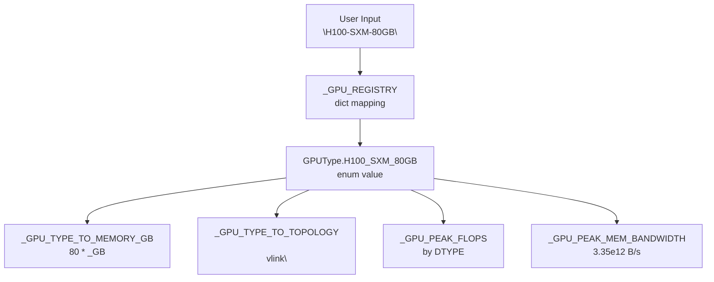
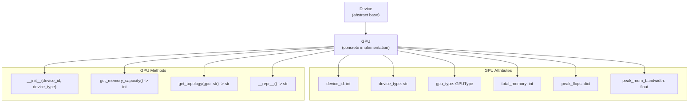

<!-- source: DeepWiki mcp.deepwiki.com · repo microsoft/apex_plus · page 4.2 GPU Devices · fetched 2026-10-26 -->

# GPU Devices

<details>
<summary>Relevant source files</summary>

The following files were used as context for generating this wiki page:

- [apex_plus/cluster/gpu.py](apex_plus/cluster/gpu.py)

</details>


This document covers the GPU device implementations in APEX+, including supported hardware types and their technical specifications. GPU devices are concrete implementations of the Device abstraction that represent physical GPU hardware with specific memory capacities, computational capabilities, and interconnect topologies.

For the base Device interface, see [Device Abstraction](#4.1). For how GPU devices are organized into clusters with specific topologies, see [Cluster Topology](#4.3).

## Supported GPU Types

APEX+ supports three GPU types through the `GPUType` enum, each representing different generations and capabilities of NVIDIA hardware:

| GPU Type | String Identifier | Memory | Topology |
|----------|------------------|---------|----------|
| V100 PCIe | `"V100-PCIE-16GB"` | 16 GB | PCIe |
| H100 SXM | `"H100-SXM-80GB"` | 80 GB | NVLink |
| H200 SXM | `"H200-SXM-141GB"` | 141 GB | NVLink |

The system uses a registry pattern to map string identifiers to enum values, allowing users to specify GPU types by name while maintaining type safety internally.

**GPU Type Registry Architecture**


Sources: [apex_plus/cluster/gpu.py:9-25]()

## GPU Specifications

### Memory Capacity

Each GPU type has a fixed total memory capacity defined in the `_GPU_TYPE_TO_MEMORY_GB` mapping:

- **V100 PCIe**: 16 GB
- **H100 SXM**: 80 GB  
- **H200 SXM**: 141 GB

Memory values are stored in bytes using the `_GB` constant (1 << 30).

### Peak FLOPS by Data Type

Different GPU generations support different data types with varying computational throughput. The `_GPU_PEAK_FLOPS` mapping defines peak floating-point operations per second:

| GPU Type | FLOAT32 | FLOAT16 | FLOAT8 |
|----------|---------|---------|---------|
| V100 PCIe | 7 TFLOPS | 14 TFLOPS | - |
| H100 SXM | 67 TFLOPS | 1,979 TFLOPS | 3,958 TFLOPS |
| H200 SXM | 67 TFLOPS | 1,979 TFLOPS | 3,958 TFLOPS |

Note that V100 does not support FLOAT8 operations, while H100/H200 provide significantly higher throughput for reduced precision formats.

### Memory Bandwidth

Peak memory bandwidth specifications in the `_GPU_PEAK_MEM_BANDWIDTH` mapping:

- **V100 PCIe**: 900 GB/s
- **H100 SXM**: 3.35 TB/s
- **H200 SXM**: 4.8 TB/s

Sources: [apex_plus/cluster/gpu.py:27-66]()

## GPU Class Implementation

The `GPU` class inherits from the abstract `Device` class and provides concrete implementations for GPU hardware.

**GPU Class Structure**


### Constructor

The `GPU.__init__()` method takes a device ID and device type string:

```python
def __init__(self, device_id: int, device_type: str) -> None
```

During initialization, the constructor:
1. Converts the device type string to uppercase for case-insensitive matching
2. Validates the device type exists in `_GPU_REGISTRY`
3. Looks up the corresponding `GPUType` enum value
4. Populates hardware specifications from the mapping dictionaries

### Key Methods

- `get_memory_capacity()`: Returns total memory capacity in bytes
- `get_topology()`: Static method that returns topology type ("pcie" or "nvlink") for a given GPU string
- `__repr__()`: Provides detailed string representation including all hardware specifications

Sources: [apex_plus/cluster/gpu.py:69-103]()

## Topology Integration

GPU devices are tightly integrated with the cluster topology system. Each GPU type has an associated default topology defined in `_GPU_TYPE_TO_TOPOLOGY`:

- **PCIe topology**: Used by V100 PCIe devices for hierarchical interconnects
- **NVLink topology**: Used by H100/H200 SXM devices for high-bandwidth full-mesh connectivity

The `get_topology()` static method allows the cluster management system to determine appropriate topology types when building device clusters without instantiating GPU objects.

**GPU-Topology Mapping**
```mermaid
graph LR
    subgraph "GPU Types"
        V100["GPUType.V100_PCIE_16GB"]
        H100["GPUType.H100_SXM_80GB"] 
        H200["GPUType.H200_SXM_141GB"]
    end
    
    subgraph "Topology Types"
        PCIe["\"pcie\"<br/>Hierarchical"]
        NVLink["\"nvlink\"<br/>Full-mesh"]
    end
    
    V100 --> PCIe
    H100 --> NVLink
    H200 --> NVLink
```

This topology information is used by the cluster management system to determine communication costs and optimal placement strategies for parallel execution plans.

Sources: [apex_plus/cluster/gpu.py:36-43](), [apex_plus/cluster/gpu.py:100-102]()

---

