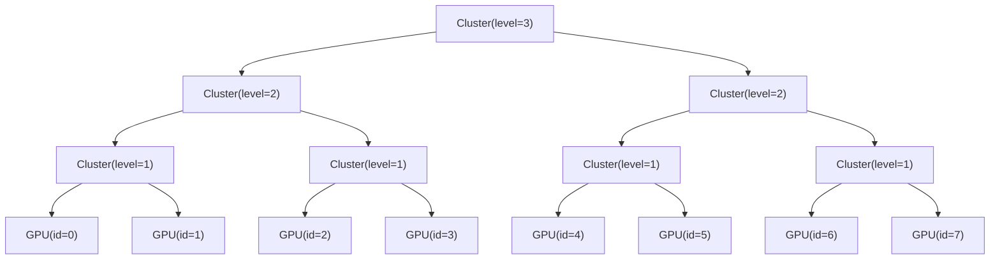
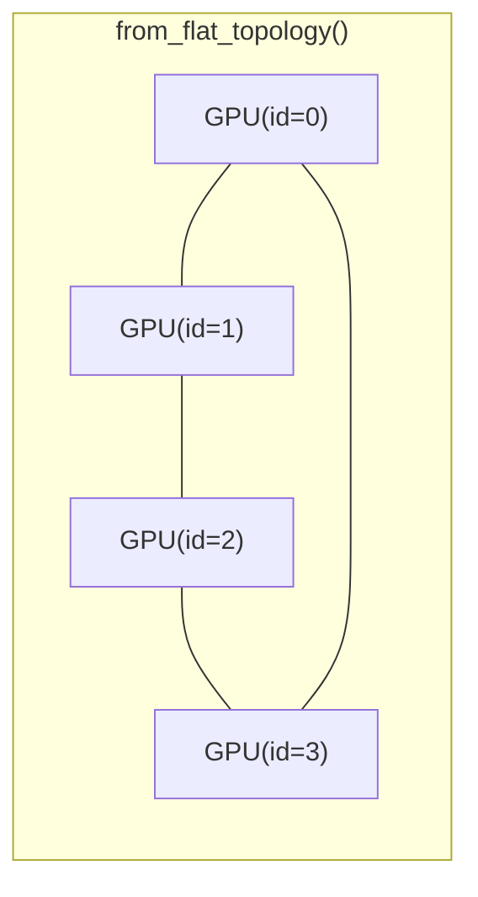
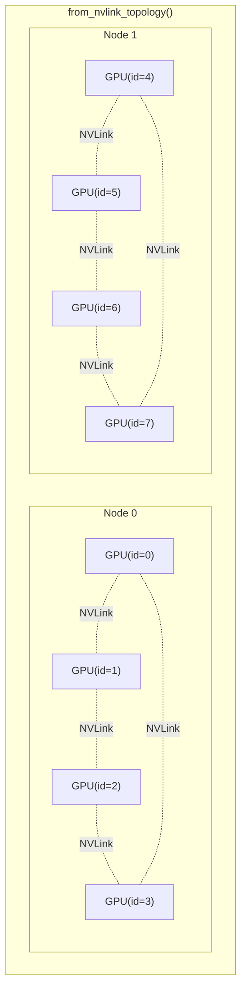
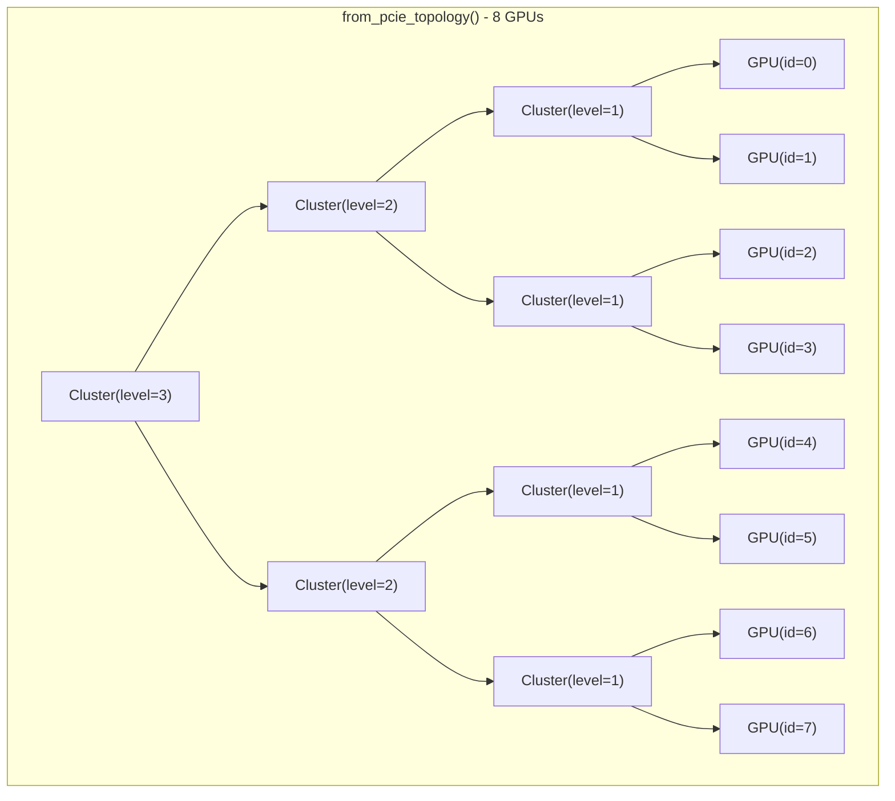
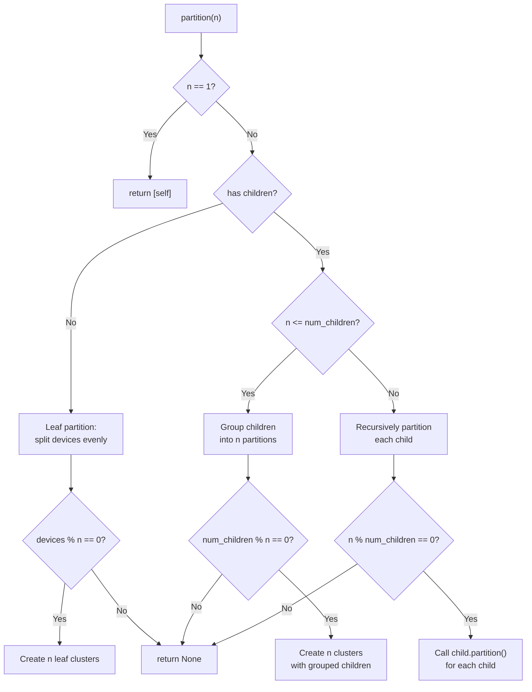
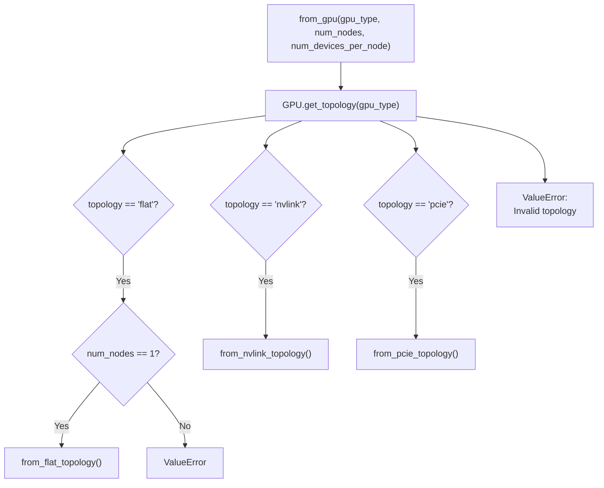

<!-- source: DeepWiki mcp.deepwiki.com · repo microsoft/apex_plus · page 4.3 Cluster Topology · fetched 2026-10-26 -->

# Cluster Topology

Relevant source files

The following files were used as context for generating this wiki page:

- [apex_plus/cluster/cluster.py](apex_plus/cluster/cluster.py)

This document covers the hierarchical cluster organization system in APEX+, including the three supported topology types (NVLink, PCIe, flat) and cluster partitioning capabilities. For information about individual device abstractions, see [Device Abstraction](#4.1). For GPU device specifications and implementations, see [GPU Devices](#4.2).

## Overview

The APEX+ cluster topology system provides a hierarchical abstraction for organizing computational devices into clusters with different interconnection topologies. The system supports multi-level cluster hierarchies that can be partitioned for parallel execution planning.

## Hierarchical Cluster Structure

The `Cluster` class implements a tree-like hierarchical structure where each cluster has a level, optional children clusters, and optional devices at leaf nodes.

### Cluster Properties

| Property | Type | Description |
|----------|------|-------------|
| `level` | `int` | Hierarchy level (1=leaf, higher=internal) |
| `children` | `List[Cluster]` | Child clusters (empty for leaf nodes) |
| `devices` | `List[Device]` | Devices (only for leaf nodes) |
| `num_nodes` | `int` | Number of physical nodes in cluster |

The cluster hierarchy enforces these constraints:
- Internal nodes have children but no devices [apex_plus/cluster/cluster.py:22-26]()
- Leaf nodes (level=1) have devices but no children [apex_plus/cluster/cluster.py:28-29]()
- All children of a cluster must have the same number of devices [apex_plus/cluster/cluster.py:24-26]()

Sources: [apex_plus/cluster/cluster.py:7-35]()

## Topology Types

APEX+ supports three topology types that determine how devices are interconnected and organized into clusters.

### Flat Topology

Flat topology creates a single-level cluster with direct connections between all devices, typically used for smaller configurations or logical devices.

The flat topology is created using `Cluster.from_flat_topology(gpu_type, num_devices)` and produces a single level-1 cluster containing all devices [apex_plus/cluster/cluster.py:127-137]().

Sources: [apex_plus/cluster/cluster.py:127-137]()

### NVLink Topology

NVLink topology creates full-mesh intra-node connections, where devices within each node are fully connected via high-bandwidth NVLink interconnects.

NVLink topology creates a hierarchy where:
- Single node: Returns a level-1 cluster [apex_plus/cluster/cluster.py:154-155]()
- Multiple nodes: Returns a level-2 cluster with level-1 children [apex_plus/cluster/cluster.py:156-157]()

Sources: [apex_plus/cluster/cluster.py:139-157]()

### PCIe Topology

PCIe topology creates hierarchical lanes based on typical PCIe switch architectures, supporting 1, 2, 4, or 8 devices per node.

PCIe topology creates different hierarchies based on device count:
- 1-2 devices: Single level-1 cluster [apex_plus/cluster/cluster.py:178-179]()
- 4 devices: Level-2 cluster with two level-1 children [apex_plus/cluster/cluster.py:180-187]()
- 8 devices: Level-3 cluster with hierarchical structure [apex_plus/cluster/cluster.py:188-207]()

Sources: [apex_plus/cluster/cluster.py:159-215]()

## Cluster Partitioning

The cluster partitioning system enables splitting clusters into sub-clusters for parallel execution planning.

### Partitioning Algorithm

### Partitioning Examples

The partitioning behavior depends on cluster structure and the requested number of partitions:

| Cluster Type | Devices | Partition Request | Result |
|--------------|---------|------------------|---------|
| Leaf (8 devices) | 8 | `partition(4)` | 4 clusters with 2 devices each |
| Internal (4 children) | 16 | `partition(2)` | 2 clusters with 2 children each |
| Internal (2 children) | 8 | `partition(4)` | 4 clusters from recursive partitioning |

Sources: [apex_plus/cluster/cluster.py:55-108](), [apex_plus/cluster/cluster.py:110-125]()

## Factory Methods

The `Cluster.from_gpu()` method provides a unified interface for creating clusters based on GPU topology specifications.

The factory method automatically selects the appropriate topology constructor based on the GPU type's inherent topology [apex_plus/cluster/cluster.py:217-245]().

Sources: [apex_plus/cluster/cluster.py:217-245]()

## Integration with Device Management

Clusters integrate with the device management system by:
- Storing references to `Device` objects at leaf nodes [apex_plus/cluster/cluster.py:14]()
- Providing access to device properties through `get_device()` [apex_plus/cluster/cluster.py:40-44]()
- Exposing device memory capacity via `get_device_memory_capacity()` [apex_plus/cluster/cluster.py:46-47]()
- Calculating total device counts with `get_num_devices()` [apex_plus/cluster/cluster.py:49-53]()

Sources: [apex_plus/cluster/cluster.py:40-53]()

---

