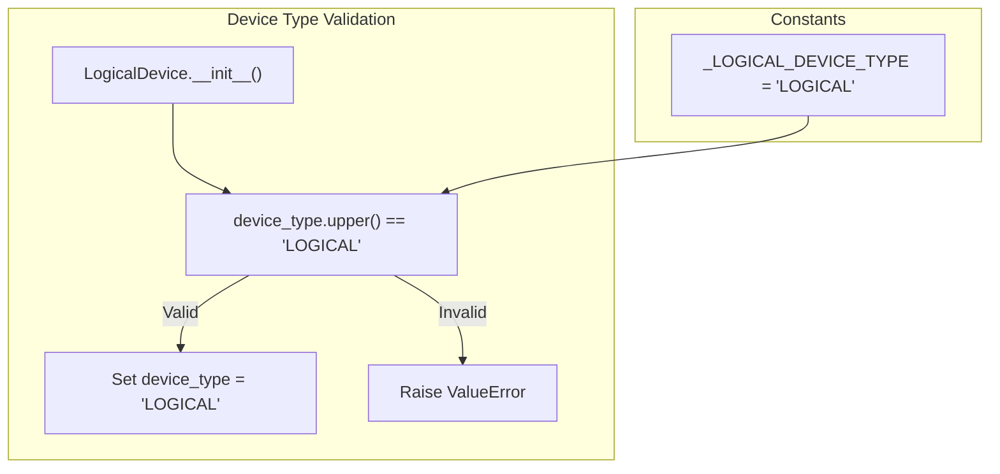
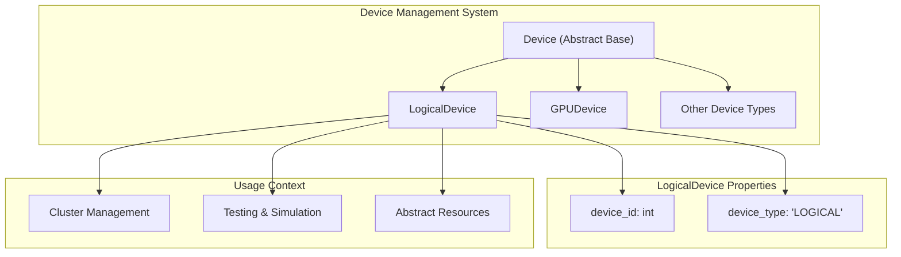

<!-- source: DeepWiki mcp.deepwiki.com · repo microsoft/apex_plus · page 4.4 Logical Devices · fetched 2026-10-26 -->

# Logical Devices

<details>
<summary>Relevant source files</summary>

The following files were used as context for generating this wiki page:

- [apex_plus/cluster/logical.py](apex_plus/cluster/logical.py)

</details>


This document covers the `LogicalDevice` implementation in APEX+, which provides an abstraction for non-physical computational resources within the device management system. Logical devices serve as placeholder or abstract computational units that can be used for testing, simulation, or representing conceptual compute resources that don't correspond to specific hardware.

For physical GPU device implementations, see [GPU Devices](#4.2). For the base device abstraction that logical devices inherit from, see [Device Abstraction](#4.1). For how logical devices are organized within clusters, see [Cluster Topology](#4.3).

## LogicalDevice Implementation

The `LogicalDevice` class provides a minimal concrete implementation of the base `Device` interface. It represents computational resources that exist conceptually rather than as physical hardware.

### Class Structure

The `LogicalDevice` class is implemented in [apex_plus/cluster/logical.py:6-17]() and inherits from the base `Device` class:

```python
class LogicalDevice(Device):
    def __init__(self, device_id: int, device_type: str) -> None:
        self.device_id = device_id
        if device_type.upper() != _LOGICAL_DEVICE_TYPE:
            raise ValueError(f"Unknown device type: {device_type}")
        self.device_type = _LOGICAL_DEVICE_TYPE
```

### Key Properties

| Property | Type | Description |
|----------|------|-------------|
| `device_id` | `int` | Unique identifier for the logical device instance |
| `device_type` | `str` | Always set to `"LOGICAL"` constant |

The device type validation ensures that only `"LOGICAL"` (case-insensitive) is accepted as a valid device type, enforced by the `_LOGICAL_DEVICE_TYPE` constant defined at [apex_plus/cluster/logical.py:3]().

*Sources: [apex_plus/cluster/logical.py:1-17]()*

## Device Type Validation

### LogicalDevice Type System



The validation system ensures type safety by only accepting the predefined logical device type. This prevents misconfiguration and maintains consistency across the device management system.

*Sources: [apex_plus/cluster/logical.py:3-16]()*

## Integration with Device Hierarchy

### Device Class Hierarchy



Logical devices implement the same `Device` interface as physical devices, allowing them to be used interchangeably in cluster configurations and execution planning scenarios where physical hardware specifications are not required.

*Sources: [apex_plus/cluster/logical.py:1-17]()*

## Use Cases and Applications

Logical devices serve several purposes within the APEX+ ecosystem:

### Testing and Development
- **Unit Testing**: Provide lightweight device instances for testing device management logic without requiring physical hardware
- **Development Environments**: Enable development and debugging on systems without access to specific GPU hardware

### Simulation Scenarios
- **Abstract Resources**: Represent computational capacity without specific hardware constraints
- **Conceptual Modeling**: Model theoretical or future hardware configurations

### Cluster Configuration
- **Placeholder Devices**: Serve as temporary or abstract nodes in cluster topology definitions
- **Resource Allocation**: Represent logical partitions of physical resources

The minimal implementation allows logical devices to participate in the device management system while avoiding the complexity of physical device specifications like memory capacity, FLOPS ratings, or interconnect topologies.

*Sources: [apex_plus/cluster/logical.py:6-17]()*

## Limitations and Considerations

Since `LogicalDevice` provides only the basic device interface implementation, it lacks:

- **Performance Characteristics**: No memory, FLOPS, or bandwidth specifications
- **Topology Integration**: No built-in support for specific interconnect types
- **Resource Constraints**: No physical limitations on computational capacity

These limitations make logical devices suitable primarily for abstract scenarios rather than realistic performance simulation. For detailed hardware modeling, use the GPU device implementations covered in [GPU Devices](#4.2).

*Sources: [apex_plus/cluster/logical.py:6-17]()*

---

