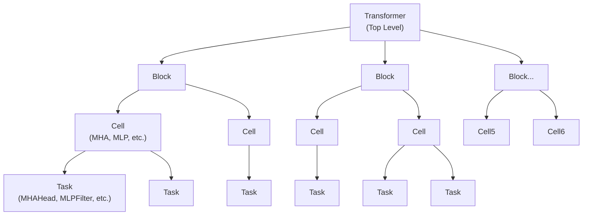
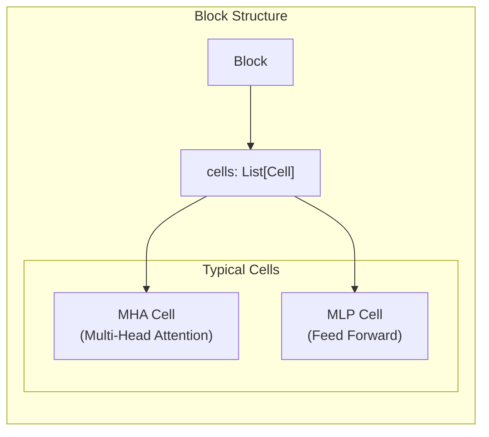
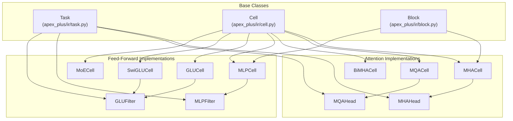

<!-- source: DeepWiki mcp.deepwiki.com · repo microsoft/apex_plus · page 5 IR Components Reference · fetched 2026-10-26 -->

# IR Components Reference

Relevant source files

The following files were used as context for generating this wiki page:

- [apex_plus/ir/block.py](apex_plus/ir/block.py)
- [apex_plus/ir/cell.py](apex_plus/ir/cell.py)
- [apex_plus/ir/task.py](apex_plus/ir/task.py)

This document provides a comprehensive reference for APEX+ Intermediate Representation (IR) components. The IR system represents neural network architectures as a hierarchical structure of blocks, cells, and tasks that can be mapped to parallel execution plans.

For device-specific execution details, see [Device Management Reference](#4). For model implementations that use these IR components, see [Model Support](#6). For transformer-level orchestration, see [Transformer IR](#5.4).

## IR Component Hierarchy

The APEX+ IR system uses a four-level hierarchy to represent neural network architectures:

**Sources:** [apex_plus/ir/block.py:1-13](), [apex_plus/ir/cell.py:1-26](), [apex_plus/ir/task.py:1-25]()

## Core Base Classes

### Task Class

The `Task` class is the fundamental unit of computation in the IR system. Each task represents a specific neural network operation that can be profiled and scheduled.

| Method | Purpose | Return Type |
|--------|---------|-------------|
| `get_type()` | Returns class name as task identifier | `str` |
| `get_param_size()` | Calculates parameter memory requirements | `int` |
| `get_kv_token_size()` | Calculates key-value cache memory per token | `int` |
| `is_attn()` | Identifies attention-related tasks | `bool` |

**Sources:** [apex_plus/ir/task.py:6-25]()

### Cell Class

The `Cell` class represents a logical grouping of related tasks, such as a multi-head attention mechanism or feed-forward network. Cells are the primary unit for parallelization strategies.

| Method | Purpose | Return Type |
|--------|---------|-------------|
| `get_name()` | Returns class name as cell identifier | `str` |
| `get_tasks()` | Returns list of constituent tasks | `List[Task]` |
| `get_num_task_types()` | Returns number of distinct task types | `int` |
| `has_same_spec()` | Compares cell specifications for equivalence | `bool` |
| `is_attn()` | Checks if cell contains attention tasks | `bool` |

**Sources:** [apex_plus/ir/cell.py:6-26]()

### Block Class

The `Block` class represents a transformer layer containing multiple cells. Blocks are typically replicated across multiple transformer layers.

**Sources:** [apex_plus/ir/block.py:6-13]()

## Component Type Categories

### Attention Components

Attention components handle the self-attention mechanisms that are central to transformer architectures:

- **Multi-Head Attention (MHA)** - Standard attention with multiple parallel heads
- **Bidirectional MHA** - Attention that processes both directions  
- **Multi-Query Attention (MQA)** - Attention with shared key-value projections

For detailed specifications, see [Attention Components](#5.1).

### Feed-Forward Components  

Feed-forward components implement the position-wise neural networks in transformer layers:

- **MLP** - Standard multi-layer perceptron
- **GLU** - Gated Linear Unit with sigmoid gating
- **SwiGLU** - Swish-activated GLU variant
- **MoE** - Mixture of Experts with sparse activation

For detailed specifications, see [Feed-Forward Components](#5.2).

### Supporting Components

Additional components provide embedding, normalization, and output sampling:

- **Embedding layers** - Token and position embeddings
- **Sampling mechanisms** - Output token generation strategies

For detailed specifications, see [Other IR Components](#5.3).

## IR Component Relationships

**Sources:** [apex_plus/ir/task.py:6-25](), [apex_plus/ir/cell.py:6-26](), [apex_plus/ir/block.py:6-13]()

## Key Design Patterns

### Abstract Interface Pattern

All IR components follow an abstract interface pattern where base classes define the contract and concrete implementations provide specific behavior:

- `Task` base class defines computation interface
- `Cell` base class defines task aggregation interface  
- Concrete implementations override abstract methods

### Composition Hierarchy

Components use composition to build complex structures:

- Blocks contain lists of Cells
- Cells contain lists of Tasks
- Tasks represent atomic operations

### Type Identification

Components provide both class-based and instance-based type identification:

- `get_name()` returns class name for cells
- `get_type()` returns class name for tasks
- `is_attn()` provides functional classification

**Sources:** [apex_plus/ir/cell.py:12-13](), [apex_plus/ir/cell.py:24-25](), [apex_plus/ir/task.py:11-12](), [apex_plus/ir/task.py:23-24]()

---

