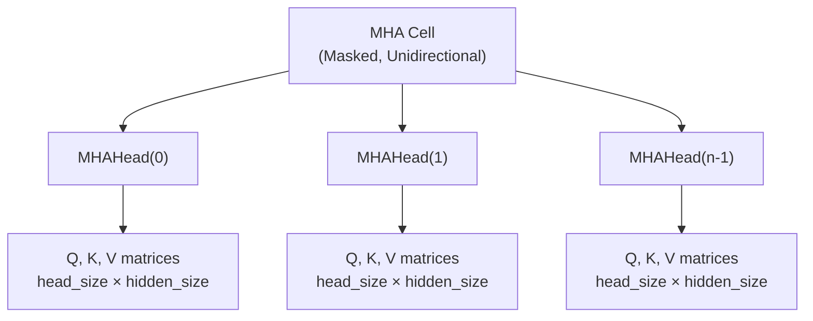
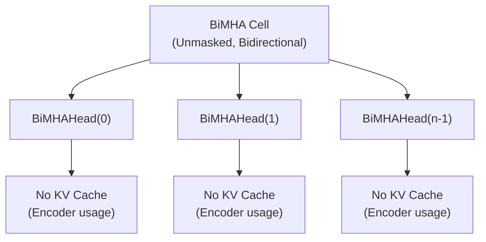
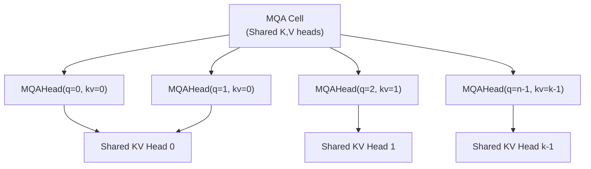
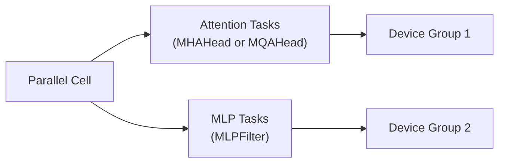
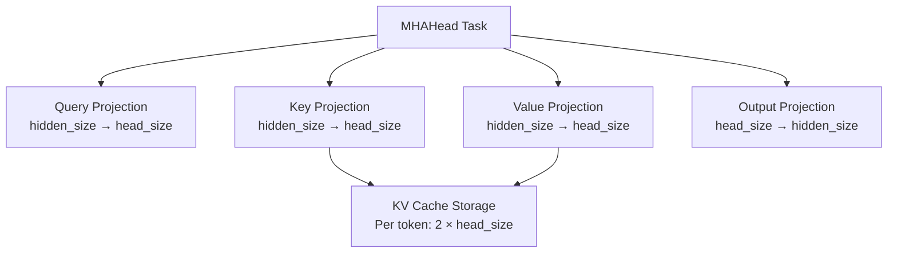
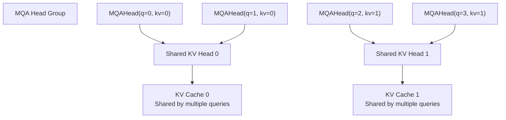
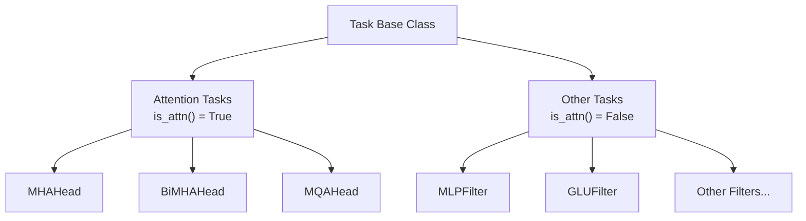
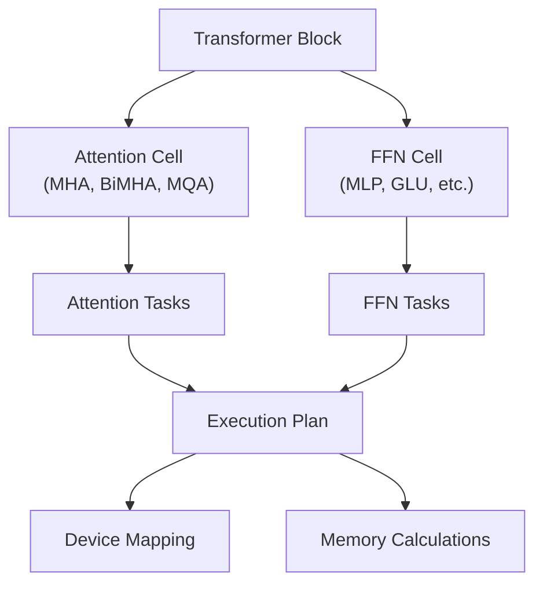

<!-- source: DeepWiki mcp.deepwiki.com · repo microsoft/apex_plus · page 5.1 Attention Components · fetched 2026-10-26 -->

# Attention Components

Relevant source files

The following files were used as context for generating this wiki page:

- [apex_plus/ir/cells/attention.py](apex_plus/ir/cells/attention.py)
- [apex_plus/ir/tasks/attention.py](apex_plus/ir/tasks/attention.py)

This document covers the attention mechanism implementations in APEX+'s Intermediate Representation (IR) system. Attention components are foundational elements that represent different types of attention mechanisms used in transformer models, including Multi-Head Attention (MHA), Bidirectional MHA, and Multi-Query Attention (MQA).

For feed-forward network components like MLP and GLU variants, see [Feed-Forward Components](#5.2). For the overall IR system architecture, see [Intermediate Representation System](#3.2).

## Attention Cell Types

APEX+ implements attention mechanisms as `Cell` objects that contain collections of attention tasks. Each cell type represents a different attention variant optimized for specific model architectures and use cases.

### Multi-Head Attention (MHA)

The `MHA` class implements masked, unidirectional multi-head attention used in decoder-only transformer models. It divides the hidden dimension across multiple attention heads and creates individual `MHAHead` tasks for parallel execution.

**MHA Cell Configuration**

| Parameter | Description | Constraint |
|-----------|-------------|------------|
| `num_heads` | Number of attention heads | Must divide `hidden_size` evenly |
| `hidden_size` | Model hidden dimension | Must be divisible by `num_heads` |
| `head_size` | Dimension per head | Computed as `hidden_size // num_heads` |

Sources: [apex_plus/ir/cells/attention.py:8-36]()

### Bidirectional Multi-Head Attention (BiMHA)

The `BiMHA` class implements unmasked, bidirectional multi-head attention typically used in encoder architectures. Unlike `MHA`, it does not use causal masking and can attend to future tokens.

Sources: [apex_plus/ir/cells/attention.py:38-67]()

### Multi-Query Attention (MQA)

The `MQA` class implements multi-query attention where multiple query heads share fewer key-value heads. This reduces memory usage and computational overhead compared to standard MHA.

**MQA Cell Configuration**

| Parameter | Description | Constraint |
|-----------|-------------|------------|
| `num_query_heads` | Number of query heads | Must be divisible by `num_kv_heads` |
| `num_kv_heads` | Number of key-value heads | Typically much smaller than query heads |
| `head_size` | Dimension per head | Fixed across all heads |
| `hidden_size` | Model hidden dimension | Used for projection matrices |

Sources: [apex_plus/ir/cells/attention.py:107-148]()

### Parallel Attention-MLP Cells

APEX+ provides hybrid cells that combine attention mechanisms with feed-forward layers for parallel execution:

- `ParallelMHAMLP`: Combines `MHA` with `MLPFilter` tasks
- `ParallelMQAMLP`: Combines `MQA` with `MLPFilter` tasks

Sources: [apex_plus/ir/cells/attention.py:69-105](), [apex_plus/ir/cells/attention.py:150-198]()

## Attention Task Types

Attention cells decompose into individual task objects that represent the smallest units of computation for parallel execution planning.

### MHAHead Task

The `MHAHead` class represents a single attention head in multi-head attention. Each head processes a slice of the hidden dimension and maintains its own query, key, value, and output projection matrices.

**MHAHead Memory Calculations**

| Component | Size Formula | Description |
|-----------|--------------|-------------|
| Parameters | `4 × hidden_size × head_size × dtype.size` | Q, K, V, O projection matrices |
| KV Cache per token | `2 × head_size × dtype.size` | Key and value vectors per token |

Sources: [apex_plus/ir/tasks/attention.py:7-37]()

### BiMHAHead Task

The `BiMHAHead` class implements bidirectional attention heads for encoder architectures. Unlike `MHAHead`, it does not maintain KV cache since encoder attention typically processes the entire sequence simultaneously.

Sources: [apex_plus/ir/tasks/attention.py:39-68]()

### MQAHead Task

The `MQAHead` class represents a query head in multi-query attention that shares key-value heads with other query heads. This sharing reduces memory overhead and enables more efficient attention computation.

**MQAHead Parameter Optimization**

The `MQAHead.get_param_size()` method calculates parameters efficiently by accounting for shared KV heads:

- Query projections: `num_query_heads × head_size × hidden_size`
- Key projections: `num_kv_heads × head_size × hidden_size` (shared)
- Value projections: `num_kv_heads × head_size × hidden_size` (shared)
- Output projections: `num_query_heads × head_size × hidden_size`

Sources: [apex_plus/ir/tasks/attention.py:70-114]()

## Task Classification and Properties

All attention task types implement the `is_attn()` class method returning `True`, which allows APEX+ to identify attention tasks for specialized handling during execution planning and memory management.

This classification enables APEX+ to:
- Apply attention-specific optimizations during execution planning
- Calculate KV cache memory requirements accurately
- Schedule attention and non-attention tasks appropriately

Sources: [apex_plus/ir/tasks/attention.py:35-36](), [apex_plus/ir/tasks/attention.py:65-67](), [apex_plus/ir/tasks/attention.py:111-113]()

## Integration with IR System

Attention components integrate with the broader APEX+ IR system through the `Cell` interface, enabling consistent handling across different attention mechanisms.

Each attention cell provides:
- `get_tasks()`: Returns list of constituent attention tasks
- `get_num_task_types()`: Returns number of distinct task types (1 for pure attention, 2 for parallel attention-MLP)
- `has_same_spec()`: Enables cell comparison for optimization

Sources: [apex_plus/ir/cells/attention.py:24-28](), [apex_plus/ir/cells/attention.py:55-59](), [apex_plus/ir/cells/attention.py:133-137]()

---

