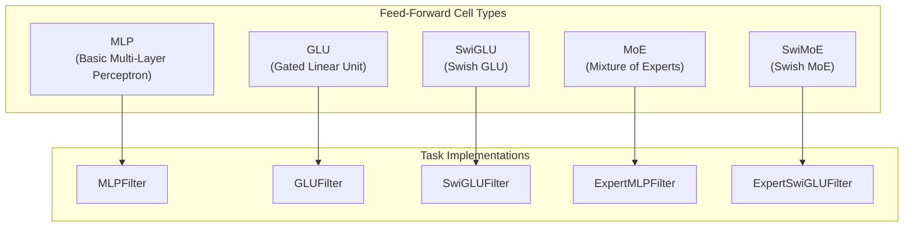
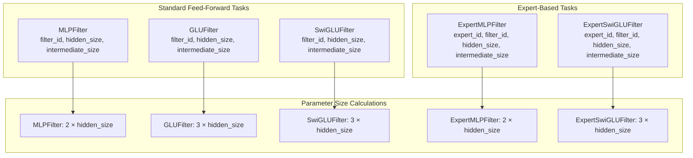
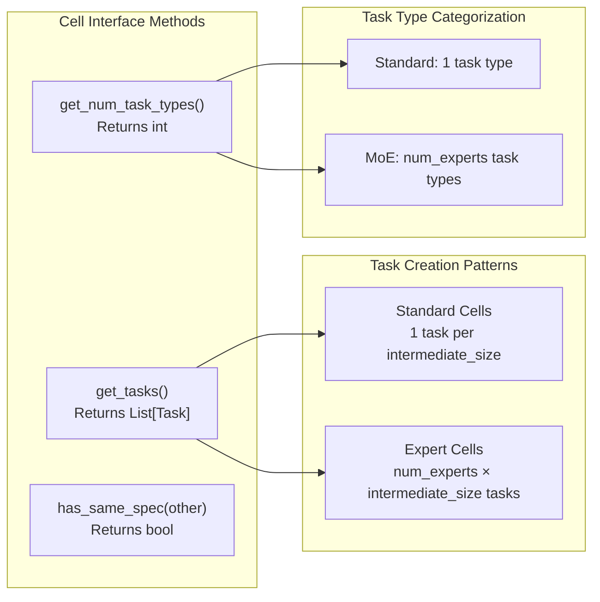

<!-- source: DeepWiki mcp.deepwiki.com · repo microsoft/apex_plus · page 5.2 Feed-Forward Components · fetched 2026-10-26 -->

# Feed-Forward Components

Relevant source files

The following files were used as context for generating this wiki page:

- [apex_plus/ir/cells/ffn.py](apex_plus/ir/cells/ffn.py)
- [apex_plus/ir/tasks/ffn.py](apex_plus/ir/tasks/ffn.py)

This document covers the feed-forward network components within APEX+'s Intermediate Representation (IR) system. These components represent the various types of feed-forward layers used in transformer architectures, including basic MLPs, gated linear units, and mixture of experts implementations.

For attention mechanisms, see [Attention Components](#5.1). For the overall IR system architecture, see [Intermediate Representation System](#3.2). For other IR components like embeddings, see [Other IR Components](#5.3).

## Component Architecture Overview

APEX+ implements feed-forward components using a two-level hierarchy: **Cells** contain the high-level feed-forward layer logic, while **Tasks** represent the individual computational operations that can be parallelized across devices.

Sources: [apex_plus/ir/cells/ffn.py:1-181](), [apex_plus/ir/tasks/ffn.py:1-131]()

## Feed-Forward Cell Types

Feed-forward cells inherit from the base `Cell` class and implement different architectural variations commonly found in transformer models. Each cell creates and manages multiple task instances that represent parallelizable computational units.

### MLP (Multi-Layer Perceptron)

The `MLP` class implements a basic feed-forward layer with linear transformations and activation functions.

| Property | Description |
|----------|-------------|
| **Parameters** | `hidden_size`, `intermediate_size` |
| **Task Type** | `MLPFilter` |
| **Task Count** | `intermediate_size` |
| **Parameter Multiplier** | 2x (up and down projections) |

The MLP creates one `MLPFilter` task per intermediate dimension: [apex_plus/ir/cells/ffn.py:23-26]()

### GLU (Gated Linear Unit)

The `GLU` class implements gated linear units, which use element-wise multiplication to control information flow through the network.

| Property | Description |
|----------|-------------|
| **Parameters** | `hidden_size`, `intermediate_size` |
| **Task Type** | `GLUFilter` |
| **Task Count** | `intermediate_size` |
| **Parameter Multiplier** | 3x (gate, up, and down projections) |

### SwiGLU (Swish Gated Linear Unit)

The `SwiGLU` class implements the SwiGLU activation function, which combines Swish activation with gating mechanisms. This is commonly used in models like LLaMA.

| Property | Description |
|----------|-------------|
| **Parameters** | `hidden_size`, `intermediate_size` |
| **Task Type** | `SwiGLUFilter` |
| **Task Count** | `intermediate_size` |
| **Parameter Multiplier** | 3x (gate, up, and down projections) |

### MoE (Mixture of Experts)

The `MoE` class implements mixture of experts layers, which route tokens to different expert networks based on learned routing decisions.

| Property | Description |
|----------|-------------|
| **Parameters** | `num_experts`, `hidden_size`, `intermediate_size`, `topk`, `capacity_factor` |
| **Task Type** | `ExpertMLPFilter` |
| **Task Count** | `num_experts × intermediate_size` |
| **Task Types** | `num_experts` (one per expert) |

The MoE creates expert filters for each combination of expert and intermediate dimension: [apex_plus/ir/cells/ffn.py:119-125]()

### SwiMoE (Swish Mixture of Experts)

The `SwiMoE` class combines mixture of experts with SwiGLU activation functions within each expert.

| Property | Description |
|----------|-------------|
| **Parameters** | `num_experts`, `hidden_size`, `intermediate_size`, `topk`, `capacity_factor` |
| **Task Type** | `ExpertSwiGLUFilter` |
| **Task Count** | `num_experts × intermediate_size` |
| **Task Types** | `num_experts` (one per expert) |

Sources: [apex_plus/ir/cells/ffn.py:13-180]()

## Task Implementations

Tasks represent the atomic computational operations within feed-forward layers. Each task type implements parameter size calculations and can be scheduled independently across devices.

### Standard Feed-Forward Tasks

**MLPFilter**: Represents a single filter in a basic MLP layer. Parameter size calculation: [apex_plus/ir/tasks/ffn.py:23-26]()

**GLUFilter**: Represents a single filter in a GLU layer with gating mechanism. Parameter size calculation: [apex_plus/ir/tasks/ffn.py:44-48]()

**SwiGLUFilter**: Represents a single filter in a SwiGLU layer. Parameter size calculation: [apex_plus/ir/tasks/ffn.py:66-70]()

### Expert-Based Tasks

**ExpertMLPFilter**: Represents a filter within a specific expert in a MoE layer. Includes both `expert_id` and `filter_id` for precise identification: [apex_plus/ir/tasks/ffn.py:73-100]()

**ExpertSwiGLUFilter**: Represents a SwiGLU filter within a specific expert. Provides expert-specific task typing through the `get_type()` method: [apex_plus/ir/tasks/ffn.py:123-124]()

Sources: [apex_plus/ir/tasks/ffn.py:7-130]()

## Component Relationships

The relationship between cells and tasks follows a consistent pattern where cells manage collections of tasks and provide specifications for execution planning.

### Task Generation Patterns

**Standard Cells** (`MLP`, `GLU`, `SwiGLU`): Create one task per `intermediate_size` dimension, all of the same task type.

**Expert Cells** (`MoE`, `SwiMoE`): Create `num_experts × intermediate_size` tasks, with `num_experts` different task types for specialized scheduling.

### Specification Matching

All feed-forward cells implement `has_same_spec()` to determine if two cells have identical configurations, enabling optimization opportunities in execution planning: [apex_plus/ir/cells/ffn.py:34-40](), [apex_plus/ir/cells/ffn.py:133-140]()

Sources: [apex_plus/ir/cells/ffn.py:28-32](), [apex_plus/ir/cells/ffn.py:127-131](), [apex_plus/ir/tasks/ffn.py:93-94](), [apex_plus/ir/tasks/ffn.py:123-124]()

---

