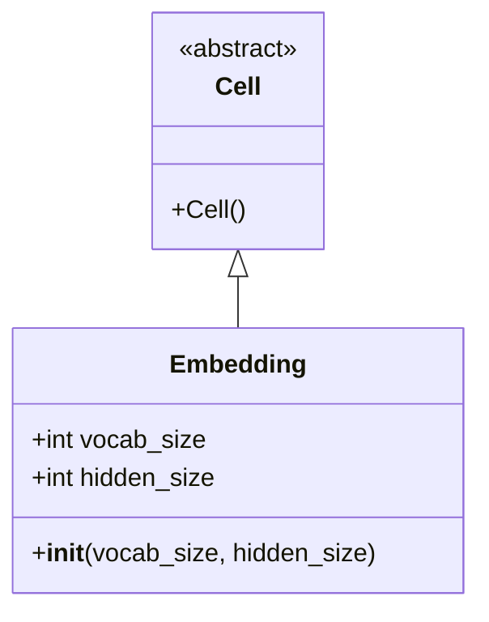
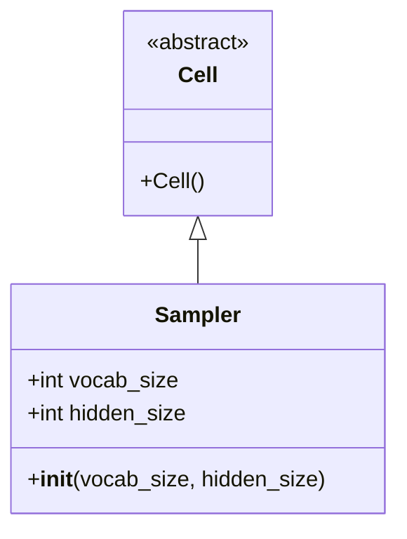
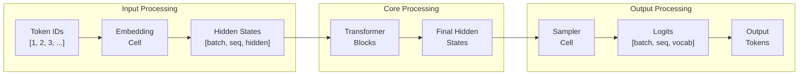
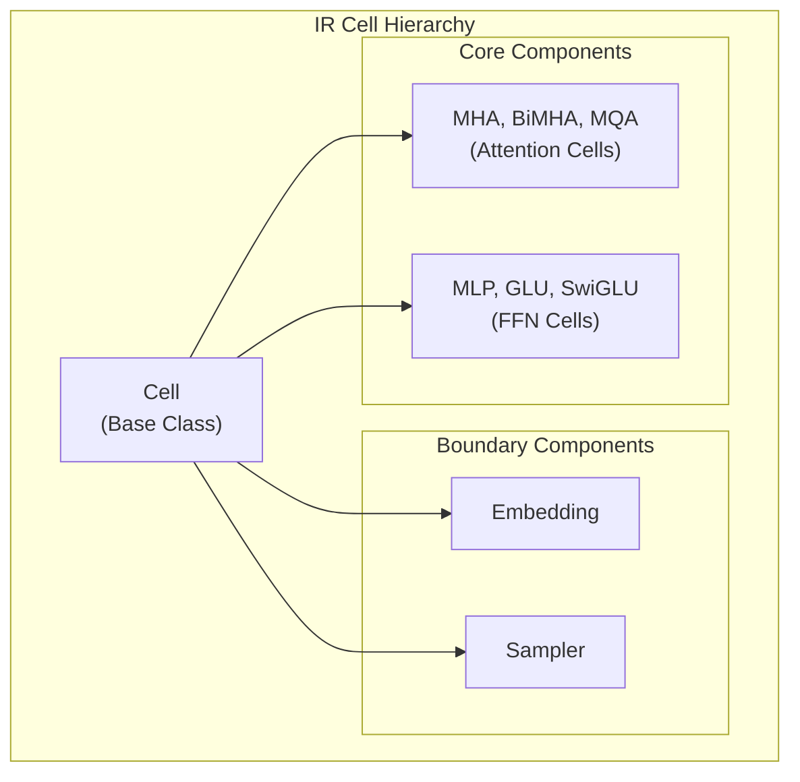

<!-- source: DeepWiki mcp.deepwiki.com · repo microsoft/apex_plus · page 5.3 Other IR Components · fetched 2026-10-26 -->

# Other IR Components

Relevant source files

The following files were used as context for generating this wiki page:

- [apex_plus/ir/cells/embedding.py](apex_plus/ir/cells/embedding.py)
- [apex_plus/ir/cells/sampler.py](apex_plus/ir/cells/sampler.py)

This page documents additional intermediate representation (IR) components in APEX+ beyond the core attention and feed-forward mechanisms. These components handle the input and output transformations that convert between token space and hidden space in transformer models.

For attention mechanisms, see [Attention Components](#5.1). For feed-forward components, see [Feed-Forward Components](#5.2). For the overall transformer structure, see [Transformer IR](#5.4).

## Purpose and Scope

The components covered in this page handle the boundary transformations in transformer models:

- **Embedding components** convert discrete tokens into continuous vector representations
- **Sampler components** convert hidden states back into token probability distributions for generation

These components work alongside the core transformer blocks to complete the end-to-end processing pipeline from input tokens to output tokens.

## Embedding Components

### Embedding Cell

The `Embedding` class provides the input embedding functionality that converts discrete token IDs into dense vector representations.

**Class Definition**

The `Embedding` cell inherits from the base `Cell` class and encapsulates vocabulary-to-vector mapping functionality:

| Property | Type | Description |
|----------|------|-------------|
| `vocab_size` | `int` | Size of the vocabulary (number of possible tokens) |
| `hidden_size` | `int` | Dimensionality of the embedding vectors |

**Implementation Structure**

The `Embedding` component serves as the entry point for transformer models, converting discrete token indices into continuous vector representations that can be processed by subsequent attention and feed-forward layers.

Sources: [apex_plus/ir/cells/embedding.py:1-13]()

## Sampler Components

### Sampler Cell

The `Sampler` class handles the output transformation that converts final hidden states into token probability distributions for text generation.

**Class Definition** 

The `Sampler` cell also inherits from the base `Cell` class and manages the hidden-to-vocabulary transformation:

| Property | Type | Description |
|----------|------|-------------|
| `vocab_size` | `int` | Size of the output vocabulary |
| `hidden_size` | `int` | Dimensionality of the input hidden states |

**Implementation Structure**

The `Sampler` component serves as the exit point for transformer models, converting the final hidden representations back into probability distributions over the vocabulary for token generation.

Sources: [apex_plus/ir/cells/sampler.py:1-13]()

## Integration with Transformer Architecture

### Token Processing Pipeline

These components integrate with the broader transformer architecture to form a complete token-to-token processing pipeline:

**End-to-End Flow**

**Cell Hierarchy in IR System**

Sources: [apex_plus/ir/cells/embedding.py:1-13](), [apex_plus/ir/cells/sampler.py:1-13]()

## Parameter Configuration

Both `Embedding` and `Sampler` components share similar parameter requirements that must align with the transformer model configuration:

| Parameter | Embedding | Sampler | Purpose |
|-----------|-----------|---------|---------|
| `vocab_size` | Input vocab size | Output vocab size | Defines vocabulary dimensions |
| `hidden_size` | Output embedding dim | Input hidden dim | Defines vector dimensions |

The `vocab_size` typically matches between embedding and sampler components for autoregressive language models, while `hidden_size` must match the transformer's hidden dimension to ensure proper tensor compatibility throughout the processing pipeline.

Sources: [apex_plus/ir/cells/embedding.py:6-12](), [apex_plus/ir/cells/sampler.py:6-12]()

---

