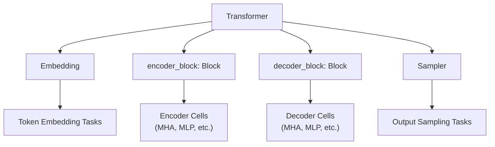
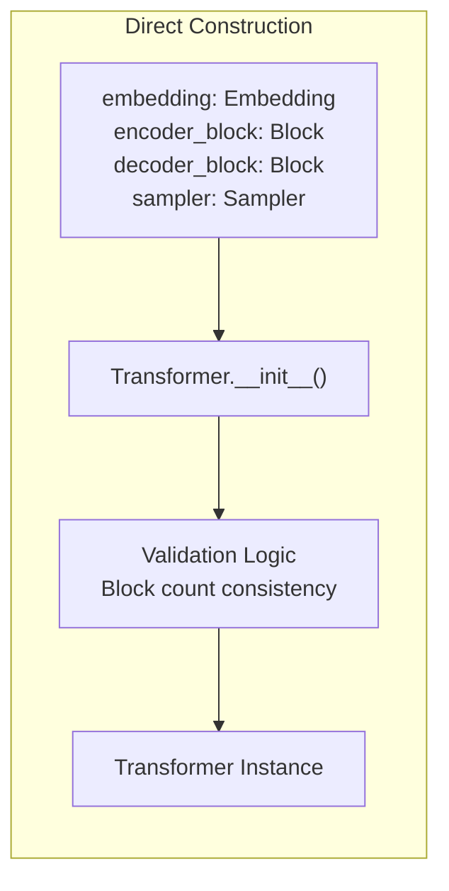
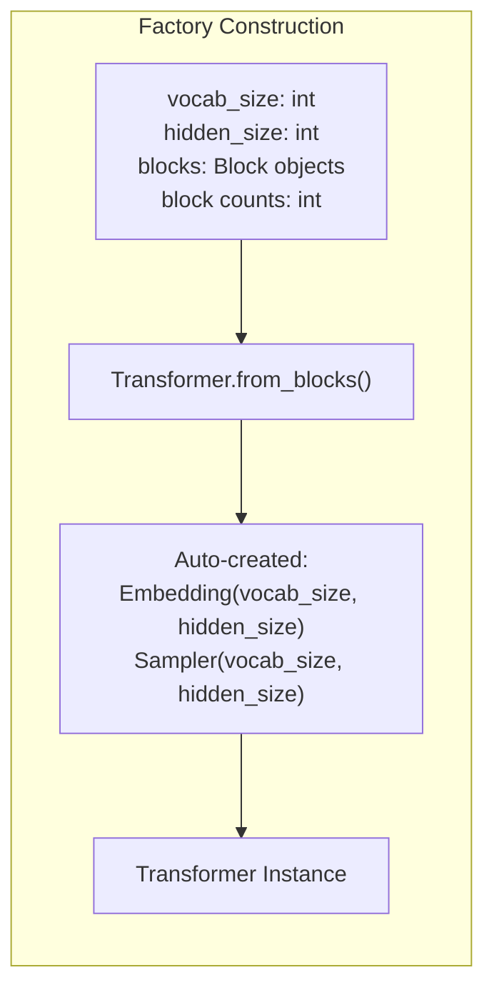
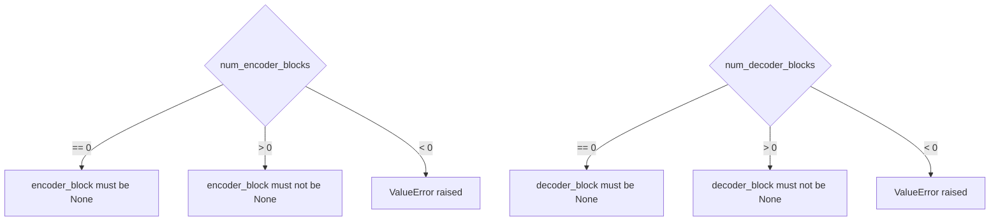
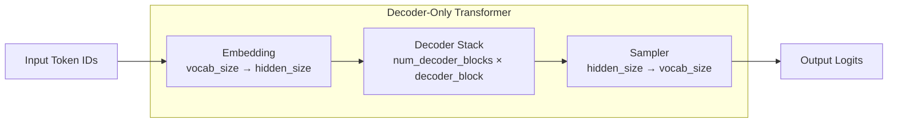

<!-- source: DeepWiki mcp.deepwiki.com · repo microsoft/apex_plus · page 5.4 Transformer IR · fetched 2026-10-26 -->

# Transformer IR

Relevant source files

The following files were used as context for generating this wiki page:

- [apex_plus/ir/transformer.py](apex_plus/ir/transformer.py)

## Purpose and Scope

The Transformer IR represents the top-level intermediate representation for transformer-based language models in APEX+. This class orchestrates the complete model architecture by composing embedding layers, encoder/decoder blocks, and sampling components into a unified transformer model representation.

For details about the individual components that make up the transformer, see [Attention Components](#5.1), [Feed-Forward Components](#5.2), and [Other IR Components](#5.3). For information about how transformer IR is used in execution planning, see [Execution Planning](#3.3).

## Transformer IR Architecture

The `Transformer` class serves as the root-level container that defines the complete structure of a transformer model through composition of specialized IR components.

### Core Structure

**Sources:** [apex_plus/ir/transformer.py:8-27]()

### Component Relationships

The transformer IR establishes the following architectural relationships:

| Component | Type | Purpose | Cardinality |
|-----------|------|---------|-------------|
| `embedding` | `Embedding` | Input token embedding | 1 |
| `encoder_block` | `Block` | Encoder layer template | 0 or 1 |
| `decoder_block` | `Block` | Decoder layer template | 0 or 1 |
| `sampler` | `Sampler` | Output token generation | 1 |
| `num_encoder_blocks` | `int` | Number of encoder layers | ≥ 0 |
| `num_decoder_blocks` | `int` | Number of decoder layers | ≥ 0 |
| `hidden_size` | `int` | Model hidden dimension | > 0 |

**Sources:** [apex_plus/ir/transformer.py:10-26]()

## Construction Patterns

### Direct Construction

The `Transformer` class supports direct instantiation with explicit component specifications:

**Sources:** [apex_plus/ir/transformer.py:10-69]()

### Factory Construction

The `from_blocks` class method provides a simplified construction pattern that automatically creates embedding and sampler components:

**Sources:** [apex_plus/ir/transformer.py:70-90]()

## Validation and Constraints

The transformer IR enforces several architectural constraints to ensure model consistency:

### Block Count Validation

**Sources:** [apex_plus/ir/transformer.py:28-68]()

### Validation Rules

1. **Encoder Consistency**: When `num_encoder_blocks > 0`, `encoder_block` must be provided and not None
2. **Decoder Consistency**: When `num_decoder_blocks > 0`, `decoder_block` must be provided and not None  
3. **Zero Block Handling**: When block count is 0, the corresponding block template must be None
4. **Non-negative Counts**: Both encoder and decoder block counts must be non-negative integers

**Sources:** [apex_plus/ir/transformer.py:28-68]()

## Model Architecture Support

The transformer IR supports various transformer architectures through flexible block configuration:

### Architecture Types

| Architecture | Encoder Blocks | Decoder Blocks | Common Models |
|--------------|----------------|----------------|---------------|
| Encoder-Decoder | > 0 | > 0 | T5, BART |
| Decoder-Only | 0 | > 0 | GPT-2, LLaMA, Bloom |
| Encoder-Only | > 0 | 0 | BERT, RoBERTa |

### Decoder-Only Configuration

Most modern LLMs use decoder-only architectures:

**Sources:** [apex_plus/ir/transformer.py:70-90]()

## Integration with APEX+ System

The transformer IR integrates with the broader APEX+ system through several interfaces:

### Model Factory Integration

Model-specific factory methods (e.g., `GPT2.to_ir()`, `LLaMA.to_ir()`) create transformer IR instances from model configurations.

### Execution Planning Interface

The execution planner uses transformer IR to understand model structure and generate optimal parallelization strategies across the embedding, block layers, and sampling components.

### Block Template Replication

During execution planning, the `encoder_block` and `decoder_block` templates are replicated according to their respective counts to create the full layer stack.

**Sources:** [apex_plus/ir/transformer.py:8-101]()

---

