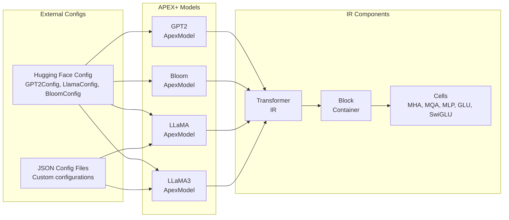
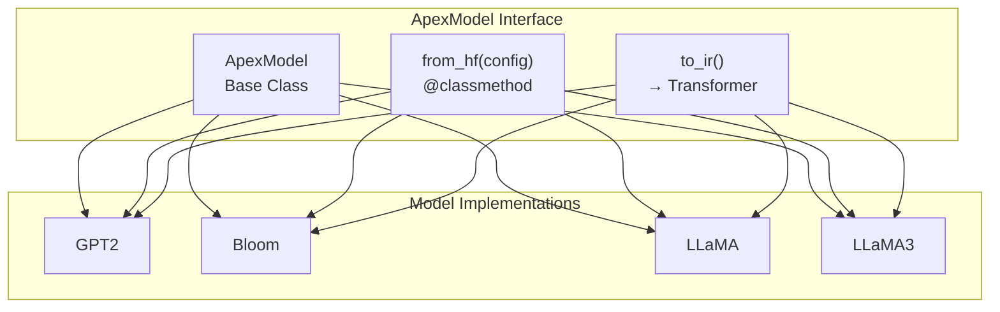
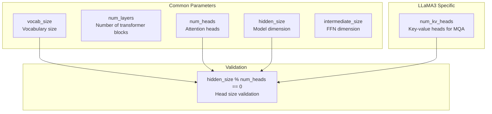
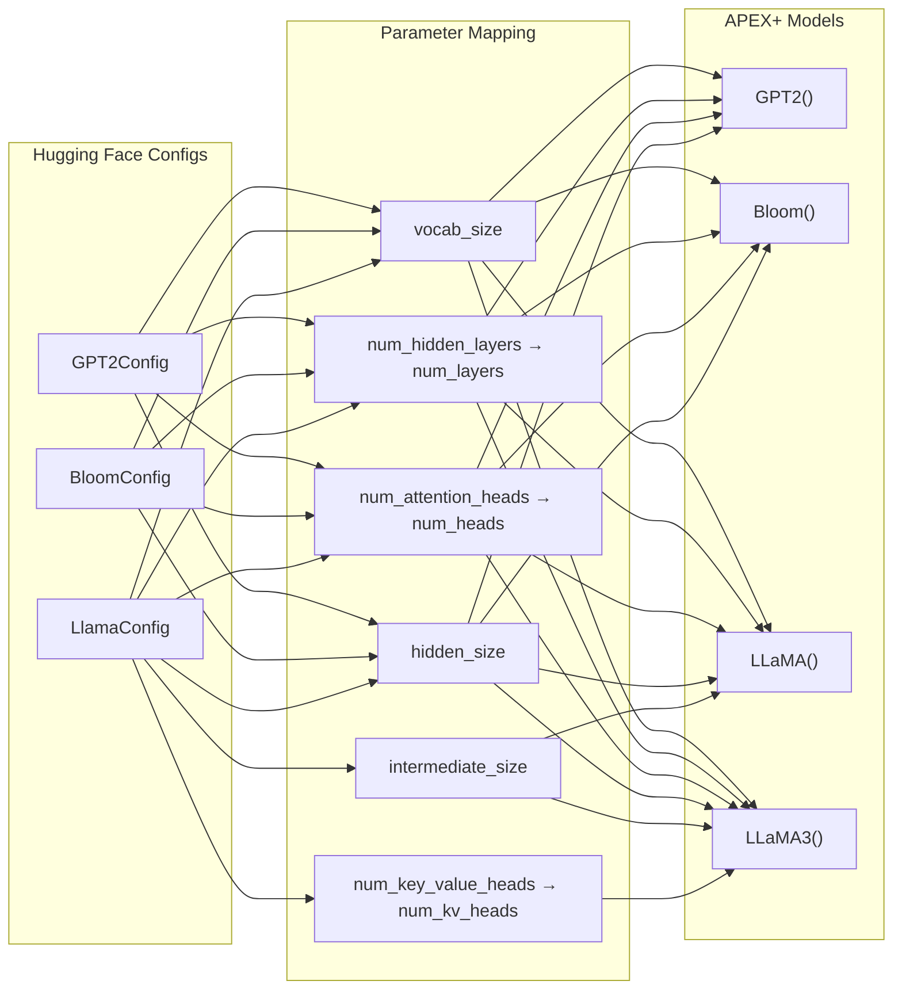
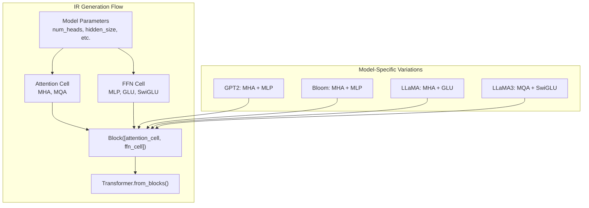
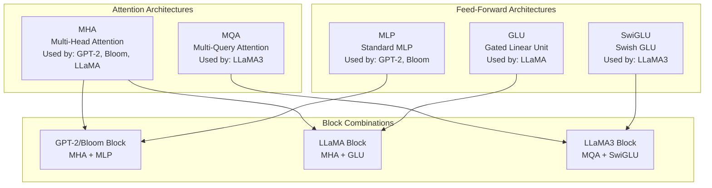

<!-- source: DeepWiki mcp.deepwiki.com · repo microsoft/apex_plus · page 6 Model Support · fetched 2026-10-26 -->

# Model Support

Relevant source files

The following files were used as context for generating this wiki page:

- [apex_plus/models/bloom.py](apex_plus/models/bloom.py)
- [apex_plus/models/gpt2.py](apex_plus/models/gpt2.py)
- [apex_plus/models/llama.py](apex_plus/models/llama.py)
- [apex_plus/models/llama3.py](apex_plus/models/llama3.py)

This document covers APEX+'s support for large language models and the conversion process from external model configurations to the APEX+ intermediate representation (IR). It explains the model abstraction layer, supported model architectures, and how Hugging Face configurations are transformed into executable IR components.

For detailed information about the IR components that models are converted to, see [IR Components Reference](#5). For information about how the generated IR is used in execution planning, see [Execution Planning](#3.3).

## Model Conversion Architecture

APEX+ provides a unified interface for converting various language model architectures into its intermediate representation. The conversion process follows a standardized pattern where external model configurations are first loaded into APEX+ model objects, then converted to IR components.

### Model Conversion Pipeline

**Sources:** [apex_plus/models/gpt2.py:1-66](), [apex_plus/models/bloom.py:1-66](), [apex_plus/models/llama.py:1-64](), [apex_plus/models/llama3.py:1-70]()

### Model Interface Pattern

All APEX+ models implement a consistent interface through the `ApexModel` base class:

**Sources:** [apex_plus/models/gpt2.py:7](), [apex_plus/models/bloom.py:9](), [apex_plus/models/llama.py:7](), [apex_plus/models/llama3.py:7]()

## Supported Model Architectures

APEX+ supports several major language model architectures, each with distinct computational patterns and IR mappings.

### Architecture to IR Component Mapping

| Model Family | Attention Mechanism | Feed-Forward | IR Components Used |
|--------------|-------------------|--------------|-------------------|
| GPT-2 | Multi-Head Attention | Standard MLP | `MHA` + `MLP` |
| Bloom | Multi-Head Attention | Standard MLP | `MHA` + `MLP` |
| LLaMA | Multi-Head Attention | Gated Linear Unit | `MHA` + `GLU` |
| LLaMA3 | Multi-Query Attention | SwiGLU | `MQA` + `SwiGLU` |

**Sources:** [apex_plus/models/gpt2.py:44-46](), [apex_plus/models/bloom.py:46-47](), [apex_plus/models/llama.py:44-45](), [apex_plus/models/llama3.py:49-50]()

### Model Parameter Processing

Each model processes standard transformer parameters with architecture-specific variations:

**Sources:** [apex_plus/models/gpt2.py:26-31](), [apex_plus/models/bloom.py:28-33](), [apex_plus/models/llama.py:26-31](), [apex_plus/models/llama3.py:28-33]()

## Configuration Processing

### Hugging Face Integration

APEX+ models integrate with Hugging Face transformers library through the `from_hf()` classmethod pattern:

**Sources:** [apex_plus/models/gpt2.py:34-41](), [apex_plus/models/bloom.py:36-43](), [apex_plus/models/llama.py:34-41](), [apex_plus/models/llama3.py:36-44]()

### Architecture-Specific Configuration Handling

Different model families handle intermediate size calculation differently:

- **GPT-2 and Bloom**: Calculate `intermediate_size` as `4 * hidden_size` [apex_plus/models/gpt2.py:40](), [apex_plus/models/bloom.py:42]()
- **LLaMA and LLaMA3**: Use `intermediate_size` directly from config [apex_plus/models/llama.py:40](), [apex_plus/models/llama3.py:43]()

## IR Generation Process

### Block Construction Pattern

All supported models follow a consistent pattern for generating IR blocks:

**Sources:** [apex_plus/models/gpt2.py:43-54](), [apex_plus/models/bloom.py:45-56](), [apex_plus/models/llama.py:43-54](), [apex_plus/models/llama3.py:46-59]()

### Transformer IR Construction

All models use the same `Transformer.from_blocks()` factory method with decoder-only configuration:

| Parameter | Value |
|-----------|-------|
| `vocab_size` | From model config |
| `hidden_size` | From model config |
| `num_encoder_blocks` | `0` (decoder-only) |
| `encoder_block` | `None` (decoder-only) |
| `num_decoder_blocks` | `num_layers` from config |
| `decoder_block` | Generated block with model-specific cells |

**Sources:** [apex_plus/models/gpt2.py:47-54](), [apex_plus/models/bloom.py:49-56](), [apex_plus/models/llama.py:47-54](), [apex_plus/models/llama3.py:52-59]()

### Cell-Level Architecture Differences

The key architectural differences between models are captured at the cell level:

**Sources:** [apex_plus/models/gpt2.py:44-46](), [apex_plus/models/bloom.py:46-47](), [apex_plus/models/llama.py:44-45](), [apex_plus/models/llama3.py:49-50]()

---

