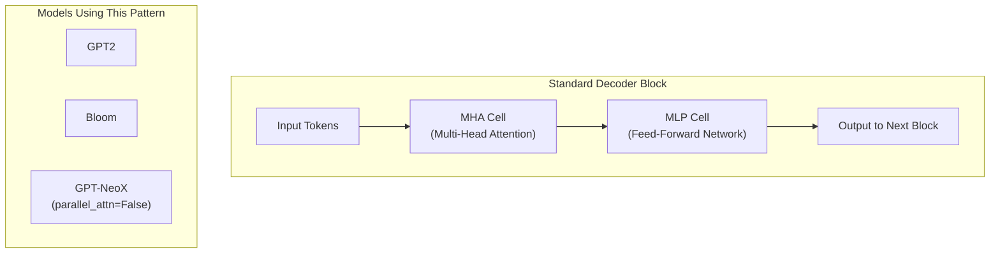
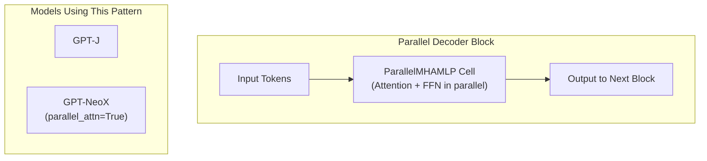
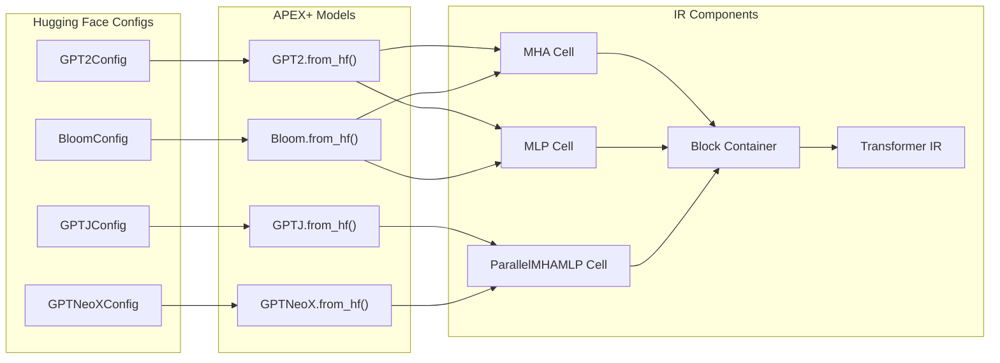

<!-- source: DeepWiki mcp.deepwiki.com · repo microsoft/apex_plus · page 6.1 Decoder-Only Models · fetched 2026-10-26 -->

# Decoder-Only Models

<details>
<summary>Relevant source files</summary>

The following files were used as context for generating this wiki page:

- [apex_plus/models/bloom.py](apex_plus/models/bloom.py)
- [apex_plus/models/gpt2.py](apex_plus/models/gpt2.py)
- [apex_plus/models/gpt_neox.py](apex_plus/models/gpt_neox.py)
- [apex_plus/models/gptj.py](apex_plus/models/gptj.py)

</details>


This page documents the decoder-only transformer models supported in APEX+, including GPT-2, Bloom, GPT-J, and GPT-NeoX. These models follow the GPT-style architecture with causal self-attention and are commonly used for text generation tasks. For LLaMA models, see [LLaMA Model Family](#6.2). For other specialized models like GPT-BigCode, see [Specialized Models](#6.3).

## Architecture Overview

Decoder-only models in APEX+ share a common architectural pattern consisting of:

- **Token Embedding Layer**: Maps input tokens to dense vectors
- **Stack of Decoder Blocks**: Each containing attention and feed-forward components
- **Output Head**: Projects hidden states to vocabulary logits for next-token prediction

All decoder-only models inherit from the `ApexModel` base class and implement two key methods:
- `from_hf()`: Creates model instances from Hugging Face configurations
- `to_ir()`: Converts the model to APEX+ Intermediate Representation

## Model Implementation Patterns

### Standard Sequential Architecture

Most decoder-only models use a sequential arrangement of Multi-Head Attention (MHA) followed by Multi-Layer Perceptron (MLP) within each decoder block.



### Parallel Architecture

Some models execute attention and feed-forward operations in parallel rather than sequentially, which can improve training efficiency.



Sources: [apex_plus/models/gpt2.py:43-54](), [apex_plus/models/bloom.py:45-56](), [apex_plus/models/gptj.py:42-52](), [apex_plus/models/gpt_neox.py:46-63]()

## Model Implementations

### GPT-2

The `GPT2` class implements the original GPT-2 architecture with standard sequential attention and feed-forward layers.

| Parameter | Source | Description |
|-----------|--------|-------------|
| `vocab_size` | `config.vocab_size` | Size of the vocabulary |
| `num_layers` | `config.num_hidden_layers` | Number of decoder blocks |
| `num_heads` | `config.num_attention_heads` | Number of attention heads |
| `hidden_size` | `config.hidden_size` | Hidden dimension size |
| `intermediate_size` | `4 * config.hidden_size` | Feed-forward intermediate size |

Sources: [apex_plus/models/gpt2.py:33-41]()

### Bloom

The `Bloom` class implements the BigScience BLOOM architecture, which is structurally identical to GPT-2 but uses different pre-training objectives and datasets.

| Parameter | Source | Description |
|-----------|--------|-------------|
| `vocab_size` | `config.vocab_size` | Size of the vocabulary |
| `num_layers` | `config.num_hidden_layers` | Number of decoder blocks |
| `num_heads` | `config.num_attention_heads` | Number of attention heads |
| `hidden_size` | `config.hidden_size` | Hidden dimension size |
| `intermediate_size` | `4 * config.hidden_size` | Feed-forward intermediate size |

Sources: [apex_plus/models/bloom.py:35-43]()

### GPT-J

The `GPTJ` class implements the EleutherAI GPT-J architecture, which uses parallel attention and feed-forward computation within each decoder block.

| Parameter | Source | Description |
|-----------|--------|-------------|
| `vocab_size` | `config.vocab_size` | Size of the vocabulary |
| `num_layers` | `config.num_hidden_layers` | Number of decoder blocks |
| `num_heads` | `config.num_attention_heads` | Number of attention heads |
| `hidden_size` | `config.hidden_size` | Hidden dimension size |
| `intermediate_size` | `4 * config.hidden_size` | Feed-forward intermediate size |

Sources: [apex_plus/models/gptj.py:32-40]()

### GPT-NeoX

The `GPTNeoX` class implements the EleutherAI GPT-NeoX architecture with configurable parallel attention behavior.

| Parameter | Source | Description |
|-----------|--------|-------------|
| `vocab_size` | `config.vocab_size` | Size of the vocabulary |
| `num_layers` | `config.num_hidden_layers` | Number of decoder blocks |
| `num_heads` | `config.num_attention_heads` | Number of attention heads |
| `hidden_size` | `config.hidden_size` | Hidden dimension size |
| `intermediate_size` | `config.intermediate_size` | Feed-forward intermediate size |
| `parallel_attn` | `config.use_parallel_residual` | Whether to use parallel attention |

The `parallel_attn` parameter determines the decoder block architecture:
- `False`: Uses sequential `MHA` + `MLP` cells
- `True`: Uses a single `ParallelMHAMLP` cell

Sources: [apex_plus/models/gpt_neox.py:35-44](), [apex_plus/models/gpt_neox.py:46-63]()

## IR Conversion Process

All decoder-only models follow a consistent conversion process from Hugging Face configurations to APEX+ Intermediate Representation:



The `to_ir()` method creates a `Transformer` with the following structure:
- `num_encoder_blocks=0` (decoder-only)
- `encoder_block=None` (no encoder)
- `num_decoder_blocks=self.num_layers` (specified number of decoder blocks)
- `decoder_block` containing the appropriate cell configuration

Sources: [apex_plus/models/gpt2.py:43-54](), [apex_plus/models/bloom.py:45-56](), [apex_plus/models/gptj.py:42-52](), [apex_plus/models/gpt_neox.py:46-63]()

## Cell Configurations

### Multi-Head Attention (MHA)

Used by GPT-2, Bloom, and GPT-NeoX (when `parallel_attn=False`):

```python
mha = MHA(self.num_heads, self.hidden_size)
```

### Multi-Layer Perceptron (MLP)

Used by GPT-2, Bloom, and GPT-NeoX (when `parallel_attn=False`):

```python
mlp = MLP(self.hidden_size, self.intermediate_size)
```

### Parallel MHA+MLP

Used by GPT-J and GPT-NeoX (when `parallel_attn=True`):

```python
layer = ParallelMHAMLP(self.num_heads, self.hidden_size, self.intermediate_size)
```

Sources: [apex_plus/models/gpt2.py:44-47](), [apex_plus/models/bloom.py:46-47](), [apex_plus/models/gptj.py:43](), [apex_plus/models/gpt_neox.py:48-55]()

## Validation and Constraints

All decoder-only models enforce the constraint that `hidden_size` must be evenly divisible by `num_heads` to ensure proper attention head sizing:

```python
if hidden_size % num_heads != 0:
    raise ValueError(
        f"hidden_size {hidden_size} must be divisible by "
        f"num_heads {num_heads}"
    )
```

The `head_size` is calculated as `hidden_size // num_heads` for internal use.

Sources: [apex_plus/models/gpt2.py:26-33](), [apex_plus/models/bloom.py:28-33](), [apex_plus/models/gptj.py:25-30](), [apex_plus/models/gpt_neox.py:28-33]()

---

