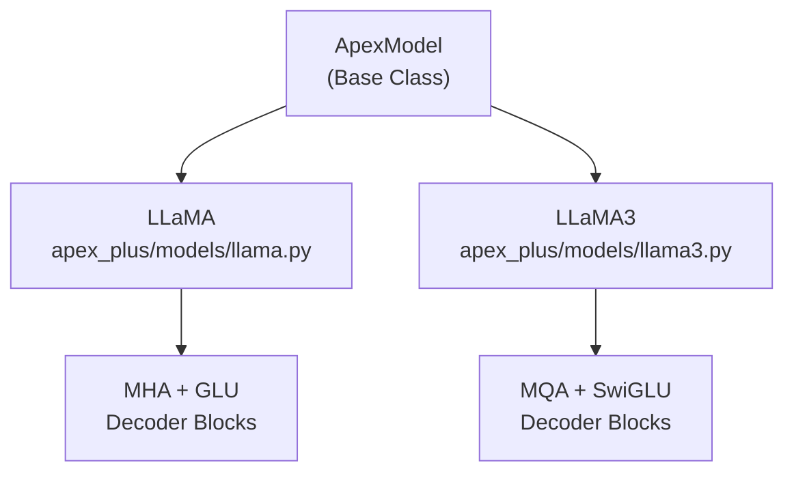
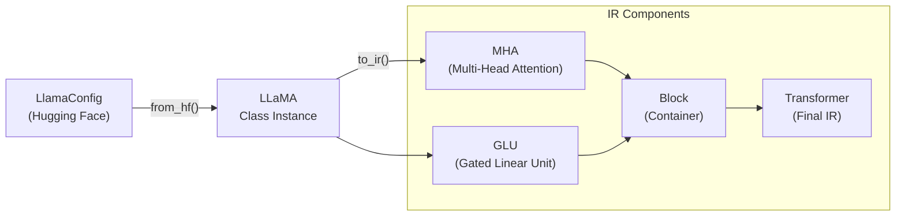
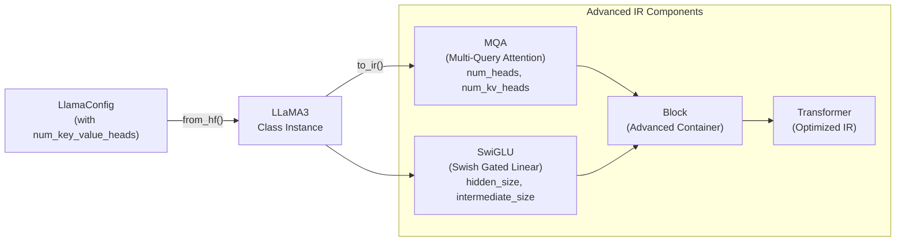
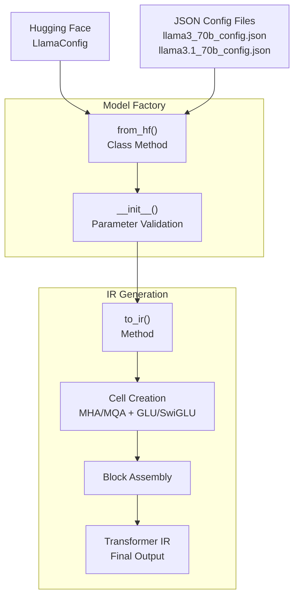

<!-- source: DeepWiki mcp.deepwiki.com · repo microsoft/apex_plus · page 6.2 LLaMA Model Family · fetched 2026-10-26 -->

# LLaMA Model Family

Relevant source files

The following files were used as context for generating this wiki page:

- [apex_plus/models/llama.py](apex_plus/models/llama.py)
- [apex_plus/models/llama3.1_70b_config.json](apex_plus/models/llama3.1_70b_config.json)
- [apex_plus/models/llama3.py](apex_plus/models/llama3.py)
- [apex_plus/models/llama3_70b_config.json](apex_plus/models/llama3_70b_config.json)

This document covers the LLaMA model family implementations in APEX+, including the original LLaMA and LLaMA3 variants. These models represent decoder-only transformer architectures that are converted from Hugging Face configurations to APEX+ intermediate representation for parallel execution planning.

For information about the attention mechanisms used by these models, see [Attention Components](#5.1). For details on the feed-forward network components, see [Feed-Forward Components](#5.2). For general decoder-only model information, see [Decoder-Only Models](#6.1).

## Model Classes Overview

The LLaMA model family in APEX+ consists of two main implementations that inherit from the `ApexModel` base class:

| Model Class | Attention Type | Feed-Forward Type | Key Features |
|-------------|----------------|-------------------|--------------|
| `LLaMA` | Multi-Head Attention (MHA) | Gated Linear Unit (GLU) | Standard attention with equal query/key/value heads |
| `LLaMA3` | Multi-Query Attention (MQA) | SwiGLU | Grouped query attention with separate key/value heads |

Both classes support conversion from Hugging Face `LlamaConfig` objects and generate APEX+ intermediate representation for execution planning.

**Model Class Hierarchy**

Sources: [apex_plus/models/llama.py:10](), [apex_plus/models/llama3.py:10](), [apex_plus/models/model.py]()

## LLaMA (Original) Implementation

The `LLaMA` class implements the original LLaMA architecture with standard multi-head attention and gated linear units.

### Core Parameters

The `LLaMA` class constructor accepts these parameters:

- `vocab_size`: Size of the vocabulary
- `num_layers`: Number of transformer decoder layers  
- `num_heads`: Number of attention heads
- `hidden_size`: Hidden dimension size
- `intermediate_size`: Intermediate FFN dimension size

The class validates that `hidden_size` is divisible by `num_heads` and computes `head_size` accordingly.

### IR Conversion Architecture

The `to_ir()` method creates:
1. An `MHA` cell with `num_heads` and `hidden_size`
2. A `GLU` cell with `hidden_size` and `intermediate_size`  
3. A `Block` containing both cells
4. A `Transformer` with only decoder blocks (no encoder)

Sources: [apex_plus/models/llama.py:43-54]()

## LLaMA3 Implementation

The `LLaMA3` class implements the LLaMA3 architecture with grouped query attention and SwiGLU activation.

### Enhanced Parameters

LLaMA3 extends the original parameters with:

- `num_kv_heads`: Number of key/value heads for grouped query attention
- All other parameters from the original LLaMA class

This enables more efficient attention computation by sharing key and value representations across multiple query heads.

### Advanced IR Conversion

The `to_ir()` method creates:
1. An `MQA` cell with `num_heads`, `num_kv_heads`, `head_size`, and `hidden_size`
2. A `SwiGLU` cell with `hidden_size` and `intermediate_size`
3. A `Block` containing both cells
4. A `Transformer` with decoder-only architecture

Sources: [apex_plus/models/llama3.py:46-59]()

## Configuration Files

APEX+ includes pre-configured JSON files for specific LLaMA3 model variants:

### LLaMA3 70B Configuration

The `llama3_70b_config.json` file specifies a 70 billion parameter model:

| Parameter | Value | Description |
|-----------|-------|-------------|
| `hidden_size` | 8192 | Hidden dimension size |
| `intermediate_size` | 28672 | FFN intermediate size |
| `num_hidden_layers` | 80 | Number of decoder layers |
| `num_attention_heads` | 64 | Number of query heads |
| `num_key_value_heads` | 8 | Number of key/value heads |
| `vocab_size` | 128256 | Vocabulary size |

### LLaMA3.1 70B Configuration  

The `llama3.1_70b_config.json` extends the base configuration with:

- Extended `max_position_embeddings`: 131072 (vs 8192)
- Advanced `rope_scaling` with llama3 rope type
- Higher frequency factors for position embeddings

Sources: [apex_plus/models/llama3_70b_config.json:1-27](), [apex_plus/models/llama3.1_70b_config.json:1-34]()

## Model Instantiation and Conversion Flow

**Complete Model Processing Pipeline**

The conversion process follows these steps:

1. **Configuration Loading**: Either from Hugging Face config or JSON files
2. **Model Instantiation**: Using `from_hf()` class method or direct constructor
3. **Parameter Validation**: Ensuring `hidden_size` divisibility by `num_heads`
4. **IR Generation**: Creating appropriate attention and FFN cells
5. **Block Assembly**: Combining cells into decoder blocks
6. **Transformer Creation**: Generating final IR with specified architecture

Sources: [apex_plus/models/llama.py:33-41](), [apex_plus/models/llama3.py:35-44]()

## Architecture Comparison

The key architectural differences between LLaMA and LLaMA3 implementations:

| Component | LLaMA | LLaMA3 | Performance Impact |
|-----------|-------|--------|-------------------|
| Attention | MHA (all heads independent) | MQA (grouped key/value) | Reduced memory and compute |
| Feed-Forward | GLU (gated linear) | SwiGLU (swish activation) | Better gradient flow |
| Parameters | 5 core parameters | 6 parameters (adds `num_kv_heads`) | More configuration flexibility |
| Head Ratio | 1:1:1 (Q:K:V) | N:1:1 (multiple queries per key/value) | Memory efficiency gains |

Sources: [apex_plus/models/llama.py:44-45](), [apex_plus/models/llama3.py:49-50]()

---

