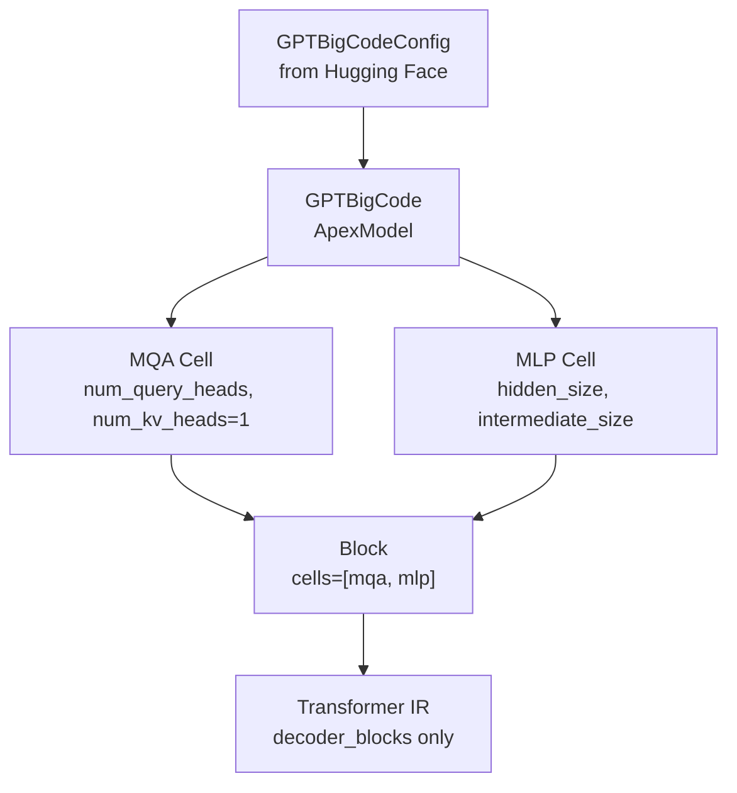
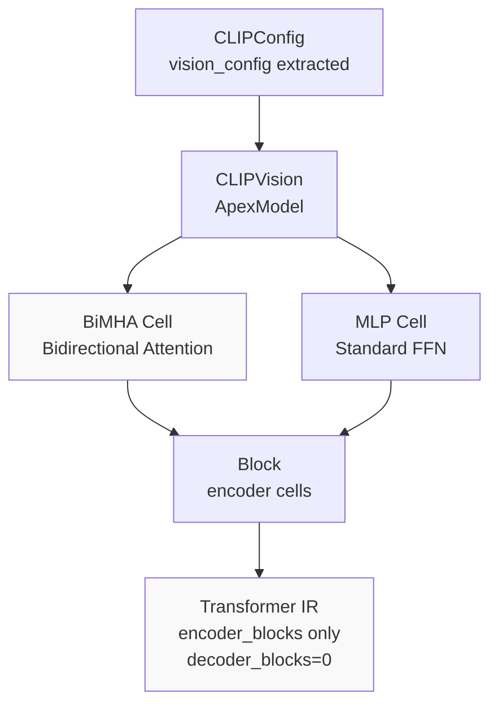
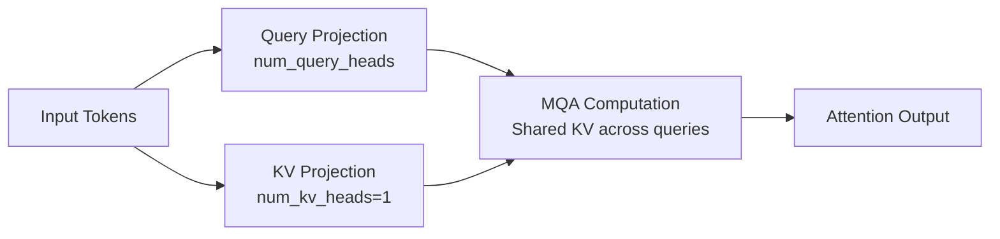

<!-- source: DeepWiki mcp.deepwiki.com · repo microsoft/apex_plus · page 6.3 Specialized Models · fetched 2026-10-26 -->

# Specialized Models

Relevant source files

The following files were used as context for generating this wiki page:

- [apex_plus/models/CLIP_vision.py](apex_plus/models/CLIP_vision.py)
- [apex_plus/models/gpt_bigcode.py](apex_plus/models/gpt_bigcode.py)

## Purpose and Scope

This section covers specialized model implementations in APEX+ that have unique architectural characteristics beyond standard decoder-only models and LLaMA variants. These models implement specific attention mechanisms or architectural patterns that differentiate them from conventional transformer models.

For standard decoder-only models like GPT-2, Bloom, and GPT-J, see [Decoder-Only Models](#6.1). For LLaMA model family implementations, see [LLaMA Model Family](#6.2).

## GPT-BigCode Architecture

The `GPTBigCode` class implements models designed for code generation tasks, featuring Multi-Query Attention (MQA) as its primary distinguishing characteristic. This architecture reduces memory bandwidth requirements by sharing key-value heads across multiple query heads.

### Key Characteristics

| Feature | GPT-BigCode | Standard GPT |
|---------|-------------|--------------|
| Attention Mechanism | Multi-Query Attention (MQA) | Multi-Head Attention (MHA) |
| KV Heads | 1 shared head | Equal to query heads |
| Query Heads | Configurable | Same as attention heads |
| Primary Use Case | Code generation | General text generation |

The `GPTBigCode` class validates that the Hugging Face configuration has `multi_query=True` and sets `num_kv_heads=1` [apex_plus/models/gpt_bigcode.py:37-44]().

### IR Conversion

The model creates an MQA cell with the specified query and key-value head configuration [apex_plus/models/gpt_bigcode.py:48-50](), then assembles this into a standard decoder block structure [apex_plus/models/gpt_bigcode.py:52-60]().

Sources: `apex_plus/models/gpt_bigcode.py`

## CLIP Vision Architecture

The `CLIPVision` class implements the vision encoder component of CLIP models, designed for processing visual inputs. This model uses Bidirectional Multi-Head Attention and follows an encoder-only architecture pattern.

### Vision-Specific Parameters

The model includes vision-specific configuration parameters beyond standard transformer dimensions:

| Parameter | Purpose | Example Values |
|-----------|---------|----------------|
| `num_channels` | Input image channels | 3 (RGB) |
| `image_size` | Input image resolution | 224, 336, 384 |
| `patch_size` | Vision transformer patch size | 14, 16, 32 |

### Architecture Distinctions

The CLIP vision model extracts only the vision configuration from the full CLIP config [apex_plus/models/CLIP_vision.py:40-50]() and creates an encoder-only transformer with `num_decoder_blocks=0` [apex_plus/models/CLIP_vision.py:57-64]().

Sources: `apex_plus/models/CLIP_vision.py`

## Specialized Attention Mechanisms

Both specialized models implement unique attention patterns that distinguish them from standard transformer architectures:

### Multi-Query Attention (MQA) Pattern

### Bidirectional Multi-Head Attention (BiMHA) Pattern

Sources: `apex_plus/models/gpt_bigcode.py`, `apex_plus/models/CLIP_vision.py`

## Model Integration Patterns

All specialized models follow the standard APEX+ model interface, implementing the `ApexModel` base class with two key methods:

### Factory Method Pattern

Both models implement `from_hf()` class methods for instantiation from Hugging Face configurations:

| Model | Configuration Type | Special Handling |
|-------|-------------------|------------------|
| `GPTBigCode` | `GPTBigCodeConfig` | Asserts `multi_query=True` |
| `CLIPVision` | `CLIPConfig` | Extracts `vision_config` component |

### IR Conversion Pattern

The `to_ir()` methods create transformer representations with model-specific cell compositions:

- **GPTBigCode**: MQA + MLP in decoder blocks [apex_plus/models/gpt_bigcode.py:47-60]()
- **CLIPVision**: BiMHA + MLP in encoder blocks [apex_plus/models/CLIP_vision.py:52-64]()

Sources: `apex_plus/models/gpt_bigcode.py`, `apex_plus/models/CLIP_vision.py`

---

