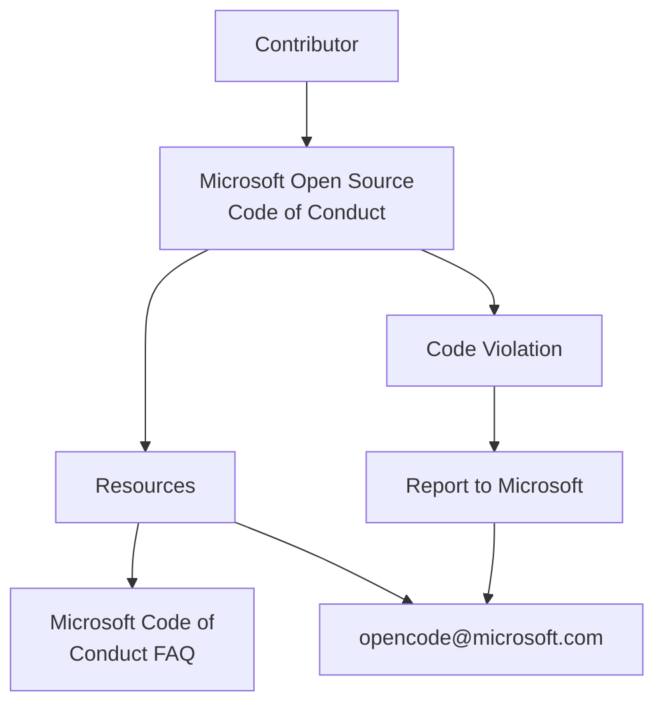
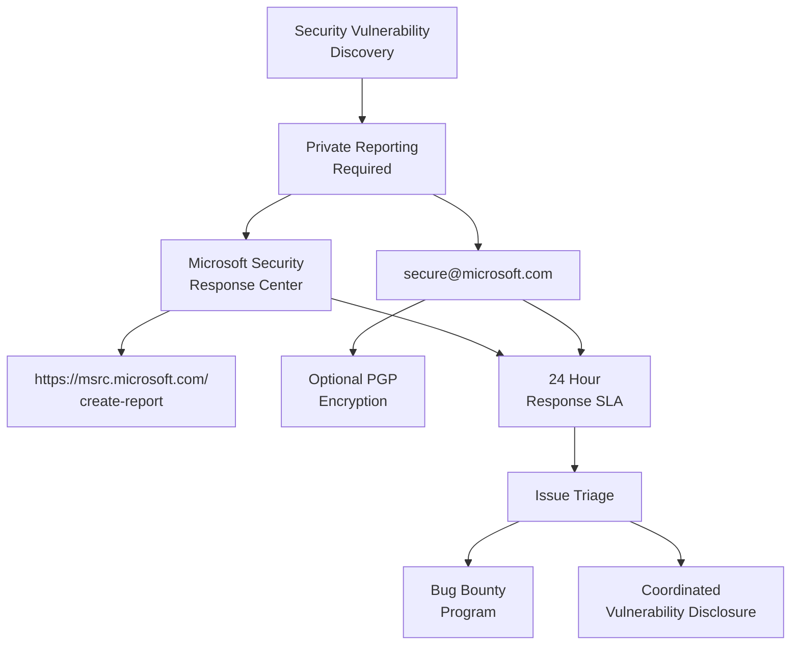
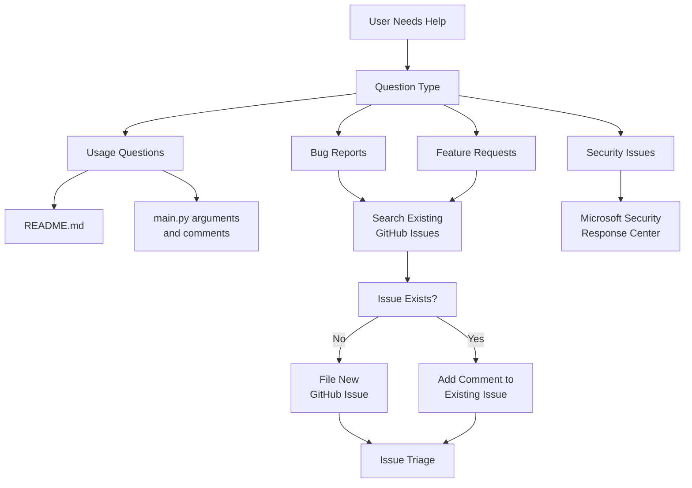

<!-- source: DeepWiki mcp.deepwiki.com · repo microsoft/apex_plus · page 7 Project Documentation · fetched 2026-10-26 -->

# Project Documentation

Relevant source files

The following files were used as context for generating this wiki page:

- [CODE_OF_CONDUCT.md](CODE_OF_CONDUCT.md)
- [LICENSE](LICENSE)
- [SECURITY.md](SECURITY.md)
- [SUPPORT.md](SUPPORT.md)

This document covers the project governance, licensing, security policies, and support processes for APEX+. This includes information about contributing to the project, reporting security vulnerabilities, and getting help with usage or development issues.

For technical architecture and implementation details, see [Core Architecture](#3). For information about using APEX+ as a developer, see [Getting Started](#2).

## License and Legal Framework

APEX+ is released under the MIT License, providing broad permissions for use, modification, and distribution. The project is owned by Microsoft Corporation and follows Microsoft's open source practices.

### MIT License Terms

The software is provided under the MIT License with the following key provisions:

| Permission | Condition | Limitation |
|------------|-----------|------------|
| Commercial use | Include copyright notice | No warranty |
| Modification | Include license text | No liability |
| Distribution | - | No trademark use |
| Private use | - | - |

The license grants permission to use, copy, modify, merge, publish, distribute, sublicense, and sell copies of the software, subject to including the copyright notice and license text in all copies.

**Sources:** [LICENSE:1-22]()

### Copyright and Attribution

All copyright is held by Microsoft Corporation. Any distribution or derivative work must include the original copyright notice and license terms as specified in the MIT License.

**Sources:** [LICENSE:3](), [LICENSE:12-13]()

## Contributing and Code of Conduct

### Code of Conduct Framework

APEX+ follows the Microsoft Open Source Code of Conduct, which establishes behavioral expectations for all project participants.

### Code of Conduct Resources

The project provides multiple resources for understanding and enforcing the code of conduct:

- **Primary Policy**: Microsoft Open Source Code of Conduct at `https://opensource.microsoft.com/codeofconduct/`
- **FAQ**: Detailed questions and answers about conduct expectations
- **Contact**: Direct email support at `opencode@microsoft.com` for questions or concerns

**Sources:** [CODE_OF_CONDUCT.md:3](), [CODE_OF_CONDUCT.md:7-9]()

## Security Policy

### Vulnerability Reporting Process

APEX+ follows Microsoft's coordinated vulnerability disclosure policy. Security issues must be reported through official Microsoft channels, not through public GitHub issues.

### Security Reporting Requirements

When reporting security vulnerabilities, include the following information to help with triage:

| Information Type | Details |
|------------------|---------|
| Issue Type | Buffer overflow, SQL injection, XSS, etc. |
| Source Files | Full paths to affected files |
| Location | Tag/branch/commit or direct URL |
| Configuration | Special setup required to reproduce |
| Reproduction | Step-by-step instructions |
| Proof of Concept | Exploit code if available |
| Impact Assessment | How an attacker might exploit the issue |

**Sources:** [SECURITY.md:21-27]()

### Security Contact Information

- **Primary Contact**: Microsoft Security Response Center (MSRC)
- **Portal**: `https://msrc.microsoft.com/create-report`
- **Email**: `secure@microsoft.com`
- **PGP Key**: Available from Microsoft Security Response Center PGP Key page
- **Response Time**: 24 hours expected
- **Follow-up**: Contact if no response received

**Sources:** [SECURITY.md:13-17]()

## Support and Issue Management

### Support Channels and Processes

APEX+ provides multiple channels for getting help and reporting issues, with different processes for different types of problems.

### Getting Help with Usage

For questions about using APEX+, the primary resources are:

1. **README Documentation**: Basic usage and setup information
2. **Command Line Arguments**: Full argument reference in `main.py` with inline comments
3. **GitHub Issues**: Search existing issues for similar problems

Users should search existing GitHub Issues before filing new ones to avoid duplicates.

**Sources:** [SUPPORT.md:5-6](), [SUPPORT.md:8]()

### Issue Filing Process

The project uses GitHub Issues for tracking both bugs and feature requests. The process follows these steps:

1. **Search First**: Check existing issues to avoid duplicates
2. **File New Issue**: Create a new issue if none exists
3. **Provide Details**: Include relevant information for reproduction or implementation
4. **Follow Up**: Monitor the issue for responses from maintainers

**Sources:** [SUPPORT.md:5-6]()

### Microsoft Support Policy

Support for APEX+ is limited to the resources listed in the project documentation. Microsoft provides:

- **Community Support**: Through GitHub Issues and project documentation
- **Security Support**: Through Microsoft Security Response Center
- **Limited Scope**: Support is restricted to publicly available resources

The project does not provide direct Microsoft customer support beyond the documented channels.

**Sources:** [SUPPORT.md:10-12]()

## Project Governance Structure

### Documentation Hierarchy

The project maintains several key governance documents that work together to establish the project's operational framework:

| Document | Purpose | Authority |
|----------|---------|-----------|
| `LICENSE` | Legal permissions and restrictions | MIT License terms |
| `CODE_OF_CONDUCT.md` | Behavioral expectations | Microsoft Open Source policy |
| `SECURITY.md` | Vulnerability reporting process | Microsoft Security policy |
| `SUPPORT.md` | Help and issue resolution | Project maintenance policy |

**Sources:** [LICENSE:1-22](), [CODE_OF_CONDUCT.md:1-10](), [SECURITY.md:1-42](), [SUPPORT.md:1-13]()