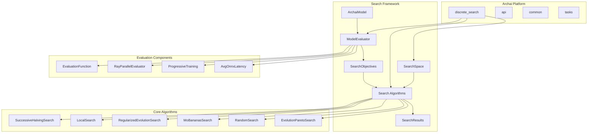
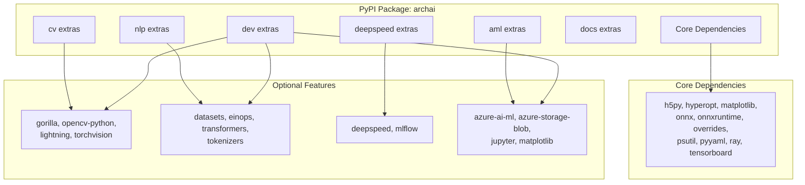
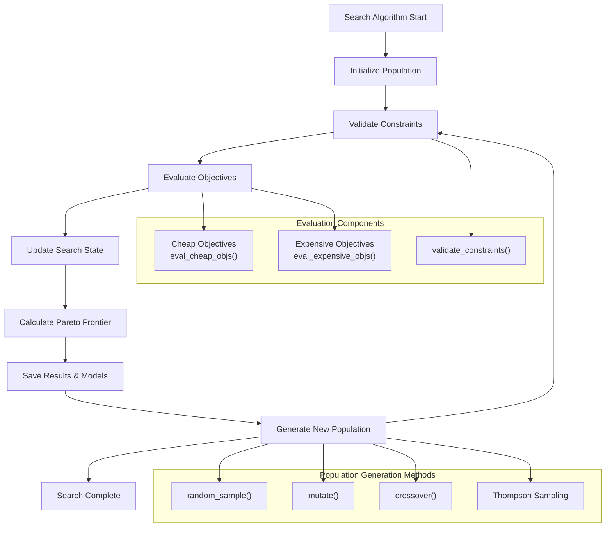
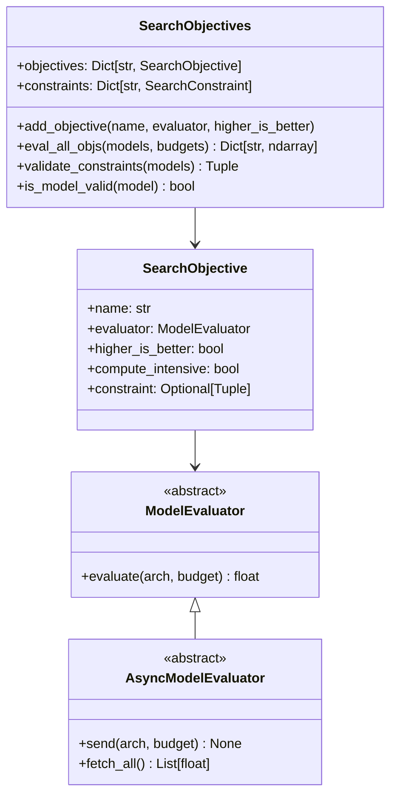
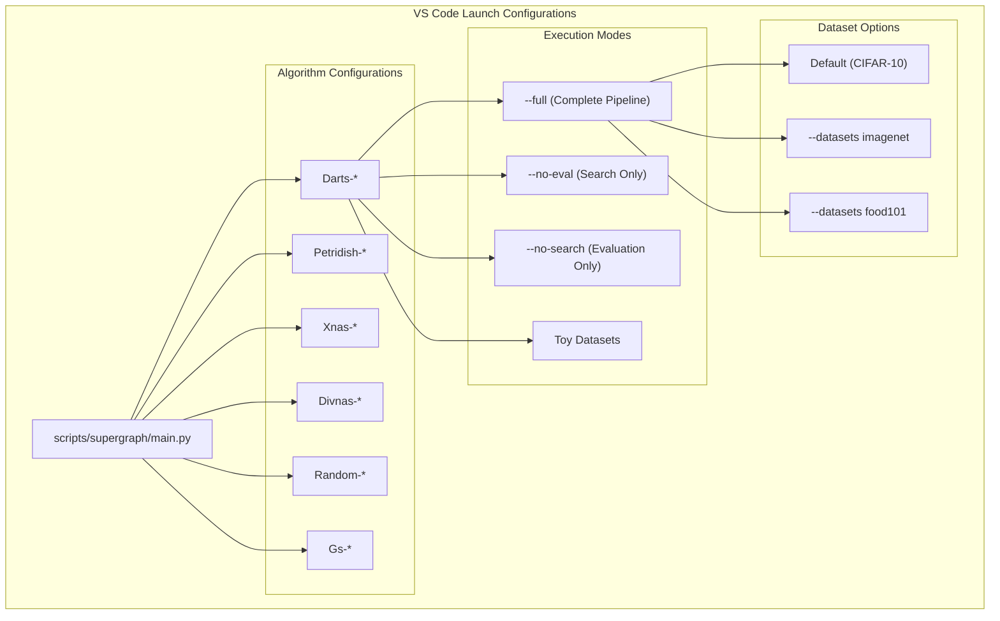
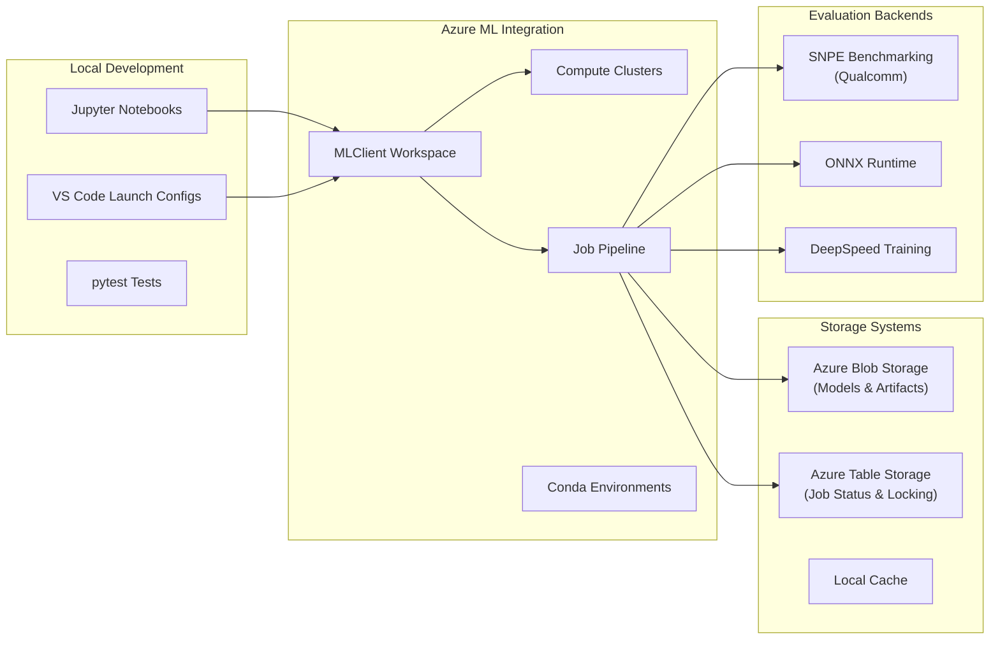
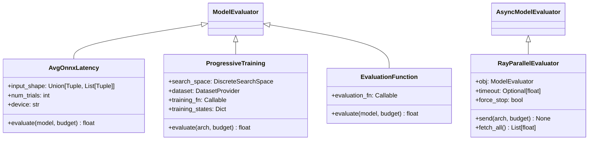

<!-- source: DeepWiki mcp.deepwiki.com · repo microsoft/archai · page 1 Overview · fetched 2026-10-26 -->

# Overview

Relevant source files

The following files were used as context for generating this wiki page:

- [.amltignore](.amltignore)
- [.gitattributes](.gitattributes)
- [.github/ISSUE_TEMPLATE/bug-report.md](.github/ISSUE_TEMPLATE/bug-report.md)
- [.github/ISSUE_TEMPLATE/feature-request.md](.github/ISSUE_TEMPLATE/feature-request.md)
- [.github/ISSUE_TEMPLATE/regular-issue.md](.github/ISSUE_TEMPLATE/regular-issue.md)
- [.github/workflows/build-publish-docs.yml](.github/workflows/build-publish-docs.yml)
- [.github/workflows/build-release-pypi.yml](.github/workflows/build-release-pypi.yml)
- [.github/workflows/check-with-codeql.yml](.github/workflows/check-with-codeql.yml)
- [.github/workflows/check-with-devskim.yml](.github/workflows/check-with-devskim.yml)
- [.vscode/launch.json](.vscode/launch.json)
- [README.md](README.md)
- [archai/discrete_search/__init__.py](archai/discrete_search/__init__.py)
- [archai/discrete_search/algos/bananas.py](archai/discrete_search/algos/bananas.py)
- [archai/discrete_search/algos/evolution_pareto.py](archai/discrete_search/algos/evolution_pareto.py)
- [archai/discrete_search/algos/local_search.py](archai/discrete_search/algos/local_search.py)
- [archai/discrete_search/algos/random_search.py](archai/discrete_search/algos/random_search.py)
- [archai/discrete_search/algos/regularized_evolution.py](archai/discrete_search/algos/regularized_evolution.py)
- [archai/discrete_search/algos/successive_halving.py](archai/discrete_search/algos/successive_halving.py)
- [archai/discrete_search/api/model_evaluator.py](archai/discrete_search/api/model_evaluator.py)
- [archai/discrete_search/api/search_objectives.py](archai/discrete_search/api/search_objectives.py)
- [archai/discrete_search/api/search_results.py](archai/discrete_search/api/search_results.py)
- [archai/discrete_search/api/searcher.py](archai/discrete_search/api/searcher.py)
- [archai/discrete_search/evaluators/functional.py](archai/discrete_search/evaluators/functional.py)
- [archai/discrete_search/evaluators/onnx_model.py](archai/discrete_search/evaluators/onnx_model.py)
- [archai/discrete_search/evaluators/progressive_training.py](archai/discrete_search/evaluators/progressive_training.py)
- [archai/discrete_search/evaluators/ray.py](archai/discrete_search/evaluators/ray.py)
- [setup.py](setup.py)

## Purpose and Scope

Archai is a comprehensive Neural Architecture Search (NAS) platform designed to accelerate the discovery of efficient deep neural network architectures through fast, reproducible, and modular research. This document provides a high-level overview of the Archai system architecture, core components, and key capabilities.

Archai enables researchers and practitioners to:
- Define and explore custom neural architecture search spaces
- Apply various search algorithms (evolutionary, Bayesian optimization, random search)
- Evaluate architectures using multiple objectives (accuracy, latency, memory, parameters)
- Deploy and scale experiments using cloud infrastructure
- Integrate with existing ML workflows and frameworks

For detailed information about specific algorithms, see [Search Algorithms](#4.1). For task-specific implementations, see [Tasks and Applications](#6). For cloud deployment guidance, see [Cloud and Distributed Computing](#7).

## System Architecture

The Archai platform follows a modular architecture that separates search algorithms, evaluation objectives, search spaces, and infrastructure concerns:

### Core System Components

Sources: [setup.py:7](), [archai/discrete_search/api/searcher.py:11-47](), [archai/discrete_search/api/search_objectives.py:33-397](), [archai/discrete_search/algos/evolution_pareto.py:21-309](), [archai/discrete_search/evaluators/onnx_model.py:16-91]()

### Package Distribution and Dependencies

Sources: [setup.py:9-188]()

## Neural Architecture Search Workflow

The core NAS workflow in Archai follows a standardized pattern across different search algorithms:

### Search Algorithm Execution Flow

Sources: [archai/discrete_search/algos/evolution_pareto.py:223-308](), [archai/discrete_search/api/search_objectives.py:260-361](), [archai/discrete_search/algos/bananas.py:248-312]()

### Multi-Objective Evaluation System

The `SearchObjectives` class coordinates evaluation of multiple criteria:

Sources: [archai/discrete_search/api/search_objectives.py:24-397](), [archai/discrete_search/api/model_evaluator.py:13-139]()

## Development and Execution Environment

### VS Code Integration and Launch Configurations

Archai provides extensive VS Code integration through predefined launch configurations for different NAS experiments:

Sources: [.vscode/launch.json:1-269]()

### Package Installation and Development Setup

The platform supports multiple installation modes through setuptools configuration:

| Installation Mode | Command | Components Included |
|------------------|---------|-------------------|
| Core | `pip install archai` | Basic NAS functionality, ONNX evaluation |
| Computer Vision | `pip install archai[cv]` | + OpenCV, Lightning, torchvision |
| Natural Language Processing | `pip install archai[nlp]` | + Transformers, datasets, tokenizers |
| Azure ML | `pip install archai[aml]` | + Azure ML SDK, Jupyter notebooks |
| Development | `pip install archai[dev]` | All extras except DeepSpeed (Windows) |

Sources: [setup.py:76-144](), [README.md:30-43]()

## Integration Capabilities

### Cloud Infrastructure Support

Archai integrates with cloud platforms for distributed execution and storage:

Sources: [setup.py:114-127](), [.amltignore:1-12](), [.github/workflows/build-publish-docs.yml:1-46]()

### Evaluation and Benchmarking Framework

The platform provides multiple evaluation backends for comprehensive architecture assessment:

Sources: [archai/discrete_search/evaluators/onnx_model.py:16-91](), [archai/discrete_search/evaluators/progressive_training.py:29-158](), [archai/discrete_search/evaluators/ray.py:23-91](), [archai/discrete_search/evaluators/functional.py:13-34]()

---

