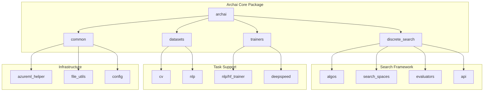
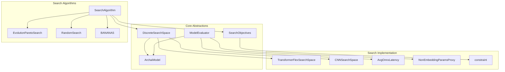
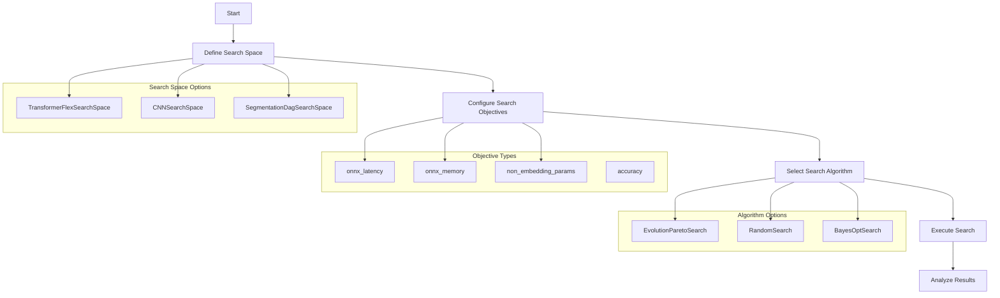
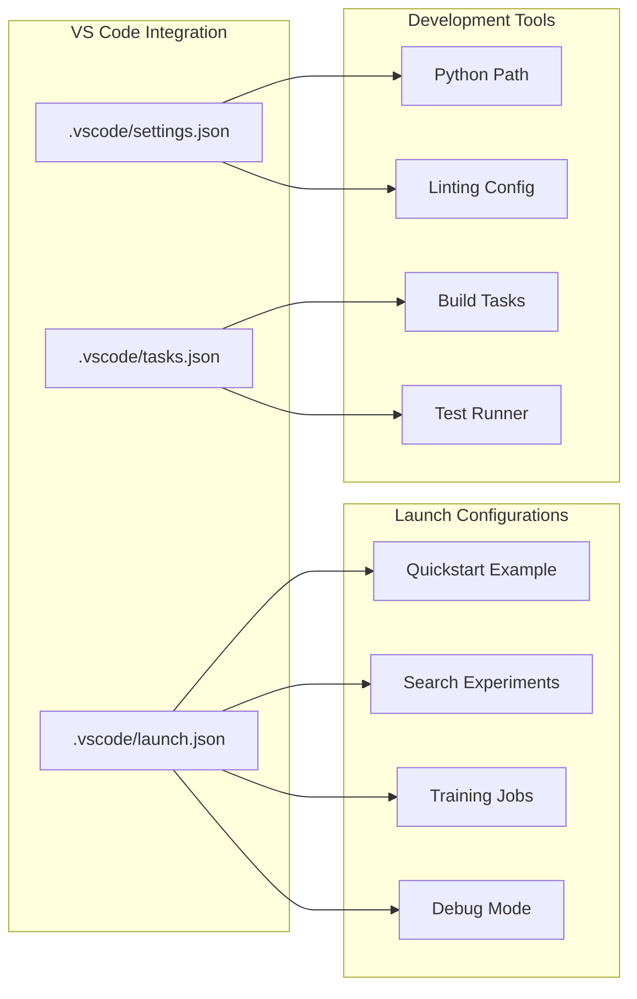

<!-- source: DeepWiki mcp.deepwiki.com · repo microsoft/archai · page 2 Getting Started · fetched 2026-10-26 -->

# Getting Started

<details>
<summary>Relevant source files</summary>

The following files were used as context for generating this wiki page:

- [.amltignore](.amltignore)
- [.gitattributes](.gitattributes)
- [.github/ISSUE_TEMPLATE/bug-report.md](.github/ISSUE_TEMPLATE/bug-report.md)
- [.github/ISSUE_TEMPLATE/feature-request.md](.github/ISSUE_TEMPLATE/feature-request.md)
- [.github/ISSUE_TEMPLATE/regular-issue.md](.github/ISSUE_TEMPLATE/regular-issue.md)
- [.github/workflows/build-publish-docs.yml](.github/workflows/build-publish-docs.yml)
- [.github/workflows/build-release-pypi.yml](.github/workflows/build-release-pypi.yml)
- [.github/workflows/check-with-codeql.yml](.github/workflows/check-with-codeql.yml)
- [.github/workflows/check-with-devskim.yml](.github/workflows/check-with-devskim.yml)
- [README.md](README.md)
- [docs/advanced_guide/cloud/azure/notebooks/quickstart/conda.yaml](docs/advanced_guide/cloud/azure/notebooks/quickstart/conda.yaml)
- [docs/advanced_guide/cloud/azure/notebooks/quickstart/main.py](docs/advanced_guide/cloud/azure/notebooks/quickstart/main.py)
- [docs/advanced_guide/cloud/azure/notebooks/quickstart/quickstart.ipynb](docs/advanced_guide/cloud/azure/notebooks/quickstart/quickstart.ipynb)
- [docs/advanced_guide/cloud/azure/notebooks/text_generation/conda.yaml](docs/advanced_guide/cloud/azure/notebooks/text_generation/conda.yaml)
- [docs/advanced_guide/cloud/azure/notebooks/text_generation/src/generate_text.py](docs/advanced_guide/cloud/azure/notebooks/text_generation/src/generate_text.py)
- [docs/advanced_guide/cloud/azure/notebooks/text_generation/src/generate_text.yaml](docs/advanced_guide/cloud/azure/notebooks/text_generation/src/generate_text.yaml)
- [docs/advanced_guide/cloud/azure/notebooks/text_generation/src/search.py](docs/advanced_guide/cloud/azure/notebooks/text_generation/src/search.py)
- [docs/advanced_guide/cloud/azure/notebooks/text_generation/src/search.yaml](docs/advanced_guide/cloud/azure/notebooks/text_generation/src/search.yaml)
- [docs/advanced_guide/cloud/azure/notebooks/text_generation/src/train.py](docs/advanced_guide/cloud/azure/notebooks/text_generation/src/train.py)
- [docs/advanced_guide/cloud/azure/notebooks/text_generation/src/train.yaml](docs/advanced_guide/cloud/azure/notebooks/text_generation/src/train.yaml)
- [docs/advanced_guide/cloud/azure/notebooks/text_generation/text_generation.ipynb](docs/advanced_guide/cloud/azure/notebooks/text_generation/text_generation.ipynb)
- [docs/getting_started/notebooks/discrete_search.rst](docs/getting_started/notebooks/discrete_search.rst)
- [docs/getting_started/notebooks/discrete_search/algos.ipynb](docs/getting_started/notebooks/discrete_search/algos.ipynb)
- [docs/getting_started/notebooks/discrete_search/config_search.ipynb](docs/getting_started/notebooks/discrete_search/config_search.ipynb)
- [docs/getting_started/notebooks/discrete_search/evaluators.ipynb](docs/getting_started/notebooks/discrete_search/evaluators.ipynb)
- [docs/getting_started/notebooks/discrete_search/search_space.ipynb](docs/getting_started/notebooks/discrete_search/search_space.ipynb)
- [docs/getting_started/notebooks/discrete_search/ss_example.png](docs/getting_started/notebooks/discrete_search/ss_example.png)
- [setup.py](setup.py)

</details>


This document provides an introduction to using Archai, Microsoft's Neural Architecture Search (NAS) platform. It covers installation, core concepts, and your first NAS experiment. For detailed information about specific algorithms and search spaces, see [Neural Architecture Search](#4). For cloud deployment and distributed execution, see [Cloud and Distributed Computing](#7).

## Overview

Archai is a modular platform for Neural Architecture Search that enables researchers and practitioners to discover efficient neural network architectures through automated search. The platform supports both computer vision and natural language processing tasks, with capabilities for multi-objective optimization, distributed execution, and cloud integration.

The system is built around four key abstractions:
- **Search Spaces**: Define the universe of possible architectures
- **Search Algorithms**: Explore the search space efficiently  
- **Evaluators**: Assess architecture quality across multiple objectives
- **Search Objectives**: Define optimization goals with constraints

Sources: [README.md:1-158](), [setup.py:166-188]()

## Installation

### Basic Installation

Archai requires Python 3.8+ and PyTorch 1.7.0+. Install the core package via PyPI:

```bash
pip install archai
```

### Optional Dependencies

Archai uses a modular dependency system allowing you to install only the components you need:

| Extra | Purpose | Install Command |
|-------|---------|-----------------|
| `cv` | Computer Vision tasks | `pip install archai[cv]` |
| `nlp` | Natural Language Processing | `pip install archai[nlp]` |
| `aml` | Azure Machine Learning integration | `pip install archai[aml]` |
| `deepspeed` | Distributed training support | `pip install archai[deepspeed]` |
| `dev` | Development tools and testing | `pip install archai[dev]` |

For development with all features:
```bash
pip install archai[dev]
```

Sources: [setup.py:74-145](), [README.md:30-42]()

## Core Architecture

### Package Structure



Sources: [setup.py:7-63](), [docs/getting_started/notebooks/discrete_search/search_space.ipynb:52-53]()

### Key Classes and Components



Sources: [docs/getting_started/notebooks/discrete_search/search_space.ipynb:42-53](), [docs/getting_started/notebooks/discrete_search/algos.ipynb:453-456]()

## Your First NAS Experiment

### Quick Start Example

The simplest way to get started is with the transformer search example from the README:

```python
from archai.discrete_search.search_spaces.nlp.transformer_flex.search_space import TransformerFlexSearchSpace
from archai.discrete_search.api.search_objectives import SearchObjectives
from archai.discrete_search.evaluators.nlp.parameters import NonEmbeddingParamsProxy
from archai.discrete_search.evaluators.nlp.transformer_flex_latency import TransformerFlexOnnxLatency
from archai.discrete_search.evaluators.nlp.transformer_flex_memory import TransformerFlexOnnxMemory
from archai.discrete_search.algos.evolution_pareto import EvolutionParetoSearch

# Create search space
space = TransformerFlexSearchSpace("gpt2")

# Define objectives
search_objectives = SearchObjectives()
search_objectives.add_objective(
    "non_embedding_params",
    NonEmbeddingParamsProxy(),
    higher_is_better=True,
    compute_intensive=False,
    constraint=(1e6, 1e9),
)

# Initialize algorithm and run search
algo = EvolutionParetoSearch(
    space, search_objectives, None, "output_dir",
    num_iters=5, init_num_models=10, seed=1234,
)
algo.search()
```

This example demonstrates the core workflow: define a search space, specify optimization objectives, choose an algorithm, and execute the search.

Sources: [README.md:53-115](), [docs/advanced_guide/cloud/azure/notebooks/quickstart/main.py:10-53]()

### Search Workflow



Sources: [docs/getting_started/notebooks/discrete_search/algos.ipynb:483-530](), [docs/getting_started/notebooks/discrete_search/search_space.ipynb:283-334]()

## Development Environment Setup

### VS Code Integration

Archai provides extensive VS Code integration for development and debugging:



### Jupyter Notebooks

Interactive examples are provided through Jupyter notebooks:

| Notebook | Purpose | Location |
|----------|---------|----------|
| Search Spaces | Define custom architectures | `docs/getting_started/notebooks/discrete_search/search_space.ipynb` |
| Evaluators | Model assessment | `docs/getting_started/notebooks/discrete_search/evaluators.ipynb` |
| Algorithms | Search algorithm usage | `docs/getting_started/notebooks/discrete_search/algos.ipynb` |
| Config Search | Configuration-based spaces | `docs/getting_started/notebooks/discrete_search/config_search.ipynb` |

Sources: [docs/getting_started/notebooks/discrete_search.rst:1-11](), [.github/workflows/build-publish-docs.yml:19-45]()

## Cloud Integration

### Azure Machine Learning

Archai provides first-class Azure ML integration for distributed search:

```python
import archai.common.azureml_helper as aml_helper

# Get ML client
ml_client = aml_helper.get_aml_client_from_file("config.json")

# Create compute cluster  
compute_cluster = aml_helper.create_compute_cluster(
    ml_client, "nas-cpu-cluster-D14-v2"
)

# Submit search job
job = ml_client.create_or_update(search_job)
```

### Environment Configuration

Cloud environments are defined using conda YAML files:

```yaml
name: nas-env
channels:
  - conda-forge
dependencies:
  - python=3.10
  - pip
  - pip:
    - "archai[cv,nlp] @ git+https://github.com/microsoft/archai.git"
```

Sources: [docs/advanced_guide/cloud/azure/notebooks/quickstart/quickstart.ipynb:27-41](), [docs/advanced_guide/cloud/azure/notebooks/quickstart/conda.yaml:1-8]()

## Next Steps

After completing your first experiment, explore these areas:

1. **Custom Search Spaces**: Learn to define domain-specific architectures in [Search Spaces and Architecture Definitions](#4.2)
2. **Multi-Objective Optimization**: Understand Pareto frontier search in [Evaluators and Search Objectives](#4.3)  
3. **Distributed Execution**: Scale experiments using [Distributed Training and Execution](#7.3)
4. **Task Applications**: Apply to specific domains in [Tasks and Applications](#6)

For comprehensive examples, see the task implementations:
- **Text Generation**: [tasks/text_generation]()
- **Face Segmentation**: [tasks/face_segmentation]()

Sources: [README.md:119-125](), [docs/advanced_guide/cloud/azure/notebooks/text_generation/text_generation.ipynb:17-37]()

---

