<!-- source: DeepWiki mcp.deepwiki.com · repo microsoft/archai · page 3 Core Framework · fetched 2026-10-26 -->

# Core Framework

<details>
<summary>Relevant source files</summary>

The following files were used as context for generating this wiki page:

- [archai/common/__init__.py](archai/common/__init__.py)
- [archai/common/apex_utils.py](archai/common/apex_utils.py)
- [archai/common/common.py](archai/common/common.py)
- [archai/common/config.py](archai/common/config.py)
- [archai/common/distributed_utils.py](archai/common/distributed_utils.py)
- [archai/common/file_utils.py](archai/common/file_utils.py)
- [archai/common/ml_utils.py](archai/common/ml_utils.py)
- [archai/common/ordered_dict_logger.py](archai/common/ordered_dict_logger.py)
- [archai/common/timing.py](archai/common/timing.py)
- [archai/common/utils.py](archai/common/utils.py)
- [archai/datasets/cv/face_synthetics.py](archai/datasets/cv/face_synthetics.py)
- [archai/datasets/nlp/nvidia_dataset_provider.py](archai/datasets/nlp/nvidia_dataset_provider.py)
- [archai/datasets/nlp/nvidia_dataset_provider_utils.py](archai/datasets/nlp/nvidia_dataset_provider_utils.py)
- [archai/datasets/nlp/tokenizer_utils/bbpe_tokenizer.py](archai/datasets/nlp/tokenizer_utils/bbpe_tokenizer.py)
- [archai/datasets/nlp/tokenizer_utils/gpt2_tokenizer.py](archai/datasets/nlp/tokenizer_utils/gpt2_tokenizer.py)
- [archai/datasets/nlp/tokenizer_utils/tokenizer_base.py](archai/datasets/nlp/tokenizer_utils/tokenizer_base.py)
- [archai/datasets/nlp/tokenizer_utils/word_tokenizer.py](archai/datasets/nlp/tokenizer_utils/word_tokenizer.py)
- [archai/trainers/nlp/nvidia_trainer.py](archai/trainers/nlp/nvidia_trainer.py)
- [archai/trainers/nlp/nvidia_training_args.py](archai/trainers/nlp/nvidia_training_args.py)
- [confs/algos/darts.yaml](confs/algos/darts.yaml)
- [confs/datasets/imagenet.yaml](confs/datasets/imagenet.yaml)
- [confs/datasets/size_224x224_base.yaml](confs/datasets/size_224x224_base.yaml)

</details>


## Purpose and Scope

The Core Framework provides the foundational infrastructure that underpins all Archai functionality. It encompasses system initialization, configuration management, distributed training support, logging infrastructure, and common utilities. This framework serves as the base layer that enables neural architecture search algorithms, training pipelines, and task-specific applications to operate consistently across different environments and hardware configurations.

For information about specific NAS algorithms and search spaces built on this framework, see [Neural Architecture Search](#4). For details about training implementations and dataset handling, see [Data and Training](#5). For cloud deployment and distributed execution capabilities, see [Cloud and Distributed Computing](#7).

## Configuration System Architecture

The configuration system in Archai is built around hierarchical YAML files with support for includes, environment variable expansion, and command-line overrides. The `Config` class provides the core functionality for loading and managing these configurations.

### Configuration Hierarchy and Resolution

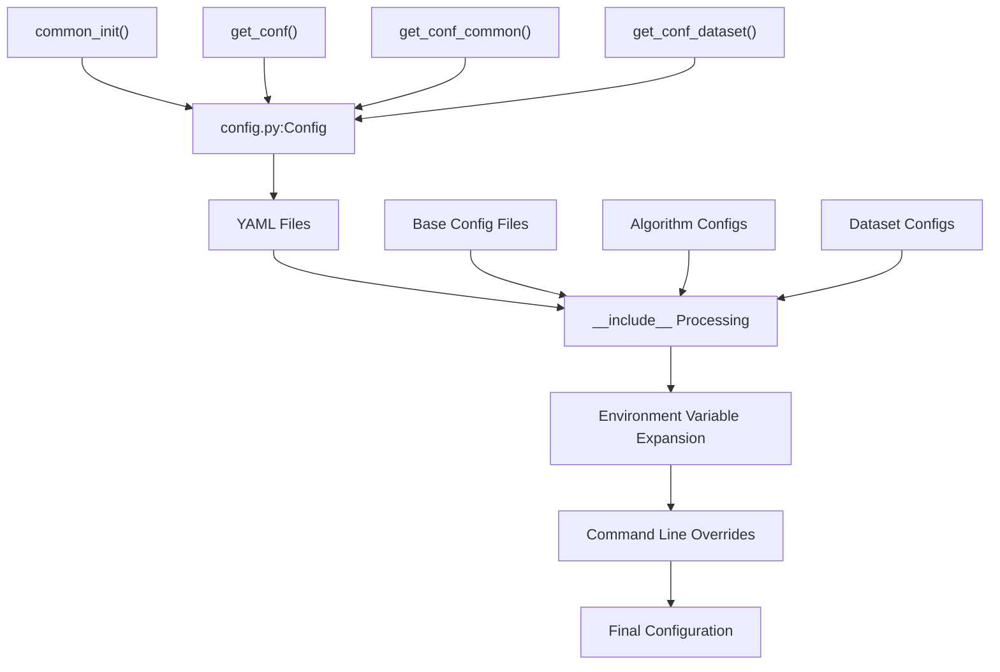

**Configuration Processing Flow**

Sources: [archai/common/config.py:32-178](), [archai/common/common.py:111-127]()

The `Config` class extends `UserDict` and supports hierarchical configuration loading with multiple inheritance levels. Key configuration files include algorithm-specific settings like [confs/algos/darts.yaml:1-277]() and dataset configurations like [confs/datasets/imagenet.yaml:1-84]().

### Configuration Access Patterns

| Function | Purpose | Return Type |
|----------|---------|-------------|
| `get_conf()` | Get global config instance | `Config` |
| `get_conf_common()` | Get common section | `Config` |
| `get_conf_dataset()` | Get dataset section | `Config` |
| `get_experiment_name()` | Get experiment identifier | `str` |
| `get_expdir()` | Get experiment directory | `str` |

Sources: [archai/common/common.py:36-54]()

## System Initialization and Infrastructure

The core framework provides centralized system initialization through the `common_init()` function, which sets up all necessary components for consistent execution across different environments.

### System Initialization Flow

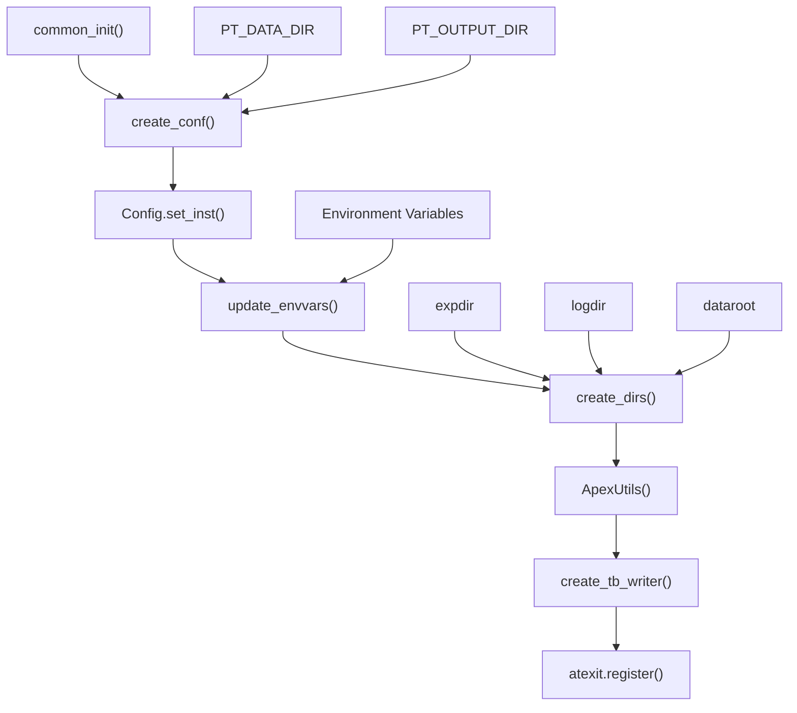

**Core System Setup Process**

Sources: [archai/common/common.py:132-167]()

The initialization process handles both local development and cloud infrastructure environments, automatically detecting PT (PyTorch/Azure ML) infrastructure through environment variables and adjusting paths accordingly.

### Directory Structure Management

The framework automatically creates and manages a standardized directory structure:

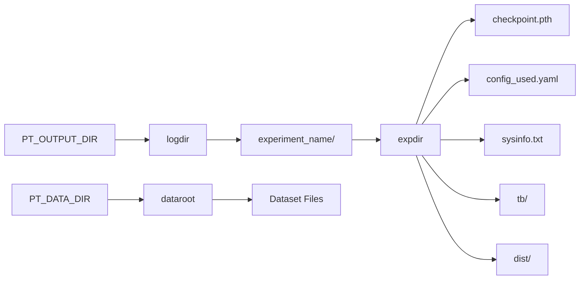

**Directory Organization and Path Resolution**

Sources: [archai/common/common.py:182-290](), [archai/common/utils.py:136-144]()

## Distributed Training and Hardware Support

The `ApexUtils` class provides comprehensive support for distributed training, mixed precision, and hardware optimization across different deployment scenarios.

### Distributed Training Architecture

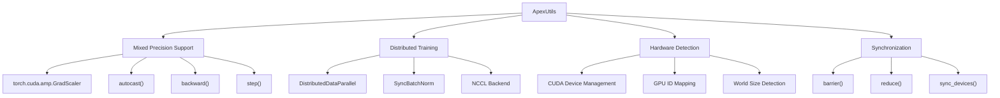

**ApexUtils Hardware and Distribution Management**

Sources: [archai/common/apex_utils.py:26-281]()

### Multi-GPU Training Configuration

The framework supports multiple distributed training strategies through environment variable detection and automatic configuration:

| Environment Variable | Purpose | Effect |
|---------------------|---------|---------|
| `WORLD_SIZE` | Total number of processes | Enables distributed mode |
| `LOCAL_RANK` | Local process rank | GPU assignment |
| `RANK` | Global process rank | Process identification |
| `CUDA_VISIBLE_DEVICES` | Available GPUs | Device filtering |

Sources: [archai/common/apex_utils.py:139-170]()

## Machine Learning Infrastructure

The framework provides standardized components for model training, optimization, and evaluation that work consistently across different algorithms and tasks.

### Training Component Factory System

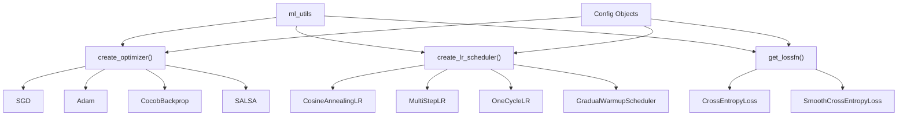

**ML Component Creation and Configuration**

Sources: [archai/common/ml_utils.py:24-154]()

### Model Utilities and Evaluation

The framework includes utilities for model analysis, parameter counting, and performance evaluation:

```python
# Example usage patterns from the codebase
param_size(model, ignore_aux=True)  # Parameter counting
accuracy(output, target, topk=(1,5))  # Top-k accuracy
drop_path_(tensor, drop_prob, training)  # DropPath regularization
```

Sources: [archai/common/ml_utils.py:157-206]()

## Logging and Development Infrastructure

Archai provides structured logging through the `OrderedDictLogger` class, which supports hierarchical logging with automatic YAML serialization for experiment tracking.

### Structured Logging Architecture

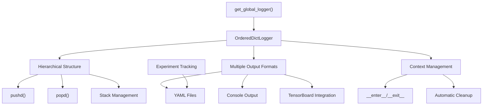

**Structured Logging System**

Sources: [archai/common/ordered_dict_logger.py:20-318]()

### Development and Debugging Support

The framework includes debugging detection, process management, and development environment support:

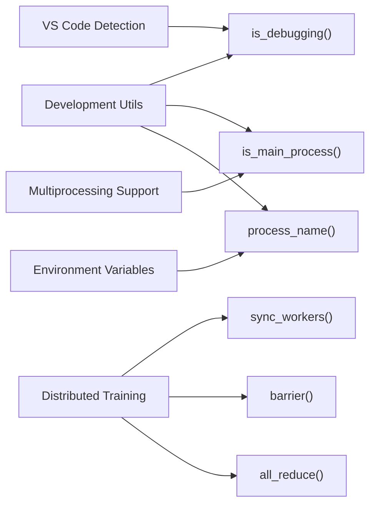

**Development and Process Management**

Sources: [archai/common/utils.py:124-389](), [archai/common/distributed_utils.py:12-153]()

## File and Storage Management

The framework provides comprehensive file handling utilities that work consistently across different storage backends and operating systems.

### File Operations Infrastructure

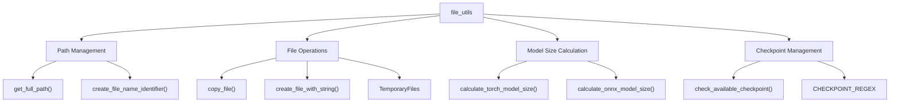

**File System Utilities and Management**

Sources: [archai/common/file_utils.py:15-215]()

The framework handles platform-specific file system differences and provides robust file operations that work across Azure blob storage, local filesystems, and networked storage systems.

# Core Framework

The Core Framework provides the foundational infrastructure that underpins all Archai functionality. It encompasses system initialization, configuration management, distributed training support, logging infrastructure, and common utilities. This framework serves as the base layer that enables neural architecture search algorithms, training pipelines, and task-specific applications to operate consistently across different environments and hardware configurations.

For information about specific NAS algorithms and search spaces built on this framework, see [Neural Architecture Search](#4). For details about training implementations and dataset handling, see [Data and Training](#5). For cloud deployment and distributed execution capabilities, see [Cloud and Distributed Computing](#7).

## Configuration System Architecture

The configuration system in Archai is built around hierarchical YAML files with support for includes, environment variable expansion, and command-line overrides. The `Config` class provides the core functionality for loading and managing these configurations.

### Configuration Hierarchy and Resolution

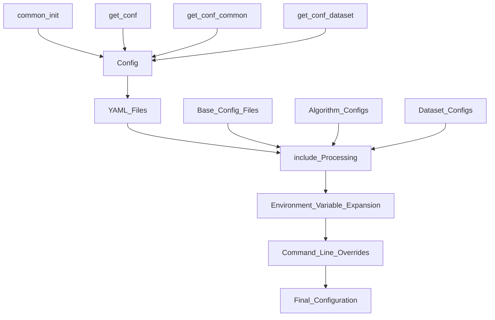

The `Config` class extends `UserDict` and supports hierarchical configuration loading with multiple inheritance levels. Key configuration files include algorithm-specific settings and dataset configurations that can be composed through the `__include__` mechanism.

### Configuration Access Patterns

| Function | Purpose | Return Type |
|----------|---------|-------------|
| `get_conf()` | Get global config instance | `Config` |
| `get_conf_common()` | Get common section | `Config` |
| `get_conf_dataset()` | Get dataset section | `Config` |
| `get_experiment_name()` | Get experiment identifier | `str` |
| `get_expdir()` | Get experiment directory | `str` |

Sources: [archai/common/config.py:32-178](), [archai/common/common.py:36-54](), [confs/algos/darts.yaml:1-277]()

## System Initialization and Infrastructure

The core framework provides centralized system initialization through the `common_init()` function, which sets up all necessary components for consistent execution across different environments.

### System Initialization Flow

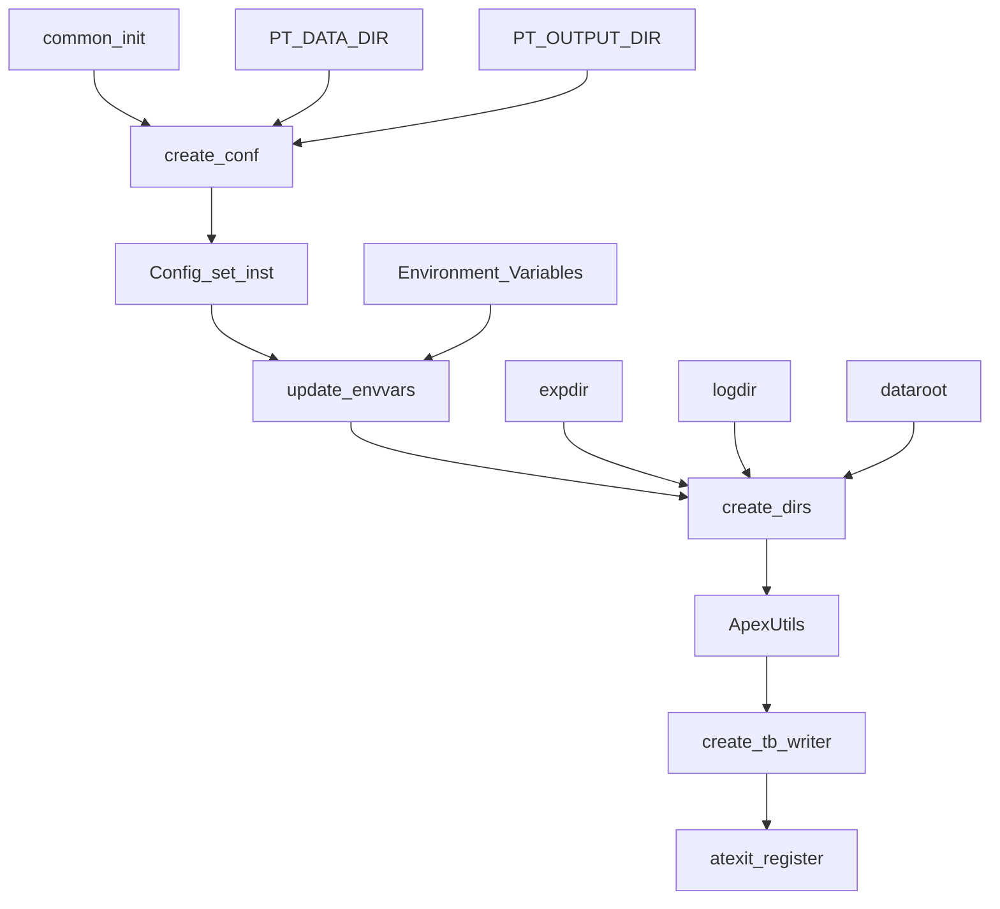

The initialization process handles both local development and cloud infrastructure environments, automatically detecting PT (PyTorch/Azure ML) infrastructure through environment variables and adjusting paths accordingly.

### Directory Structure Management

The framework automatically creates and manages a standardized directory structure:

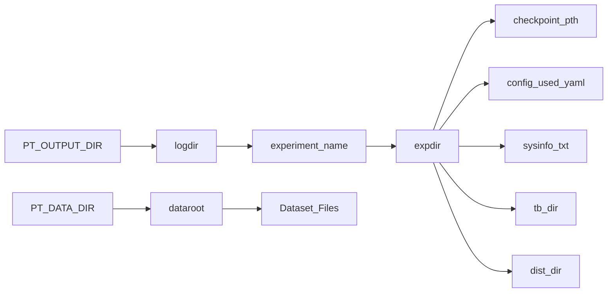

Sources: [archai/common/common.py:132-167](), [archai/common/common.py:182-290](), [archai/common/utils.py:136-144]()

## Distributed Training and Hardware Support

The `ApexUtils` class provides comprehensive support for distributed training, mixed precision, and hardware optimization across different deployment scenarios.

### Distributed Training Architecture

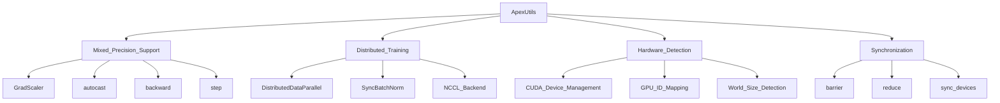

### Multi-GPU Training Configuration

The framework supports multiple distributed training strategies through environment variable detection and automatic configuration:

| Environment Variable | Purpose | Effect |
|---------------------|---------|---------|
| `WORLD_SIZE` | Total number of processes | Enables distributed mode |
| `LOCAL_RANK` | Local process rank | GPU assignment |
| `RANK` | Global process rank | Process identification |
| `CUDA_VISIBLE_DEVICES` | Available GPUs | Device filtering |

Sources: [archai/common/apex_utils.py:26-281](), [archai/common/apex_utils.py:139-170]()

## Machine Learning Infrastructure

The framework provides standardized components for model training, optimization, and evaluation that work consistently across different algorithms and tasks.

### Training Component Factory System

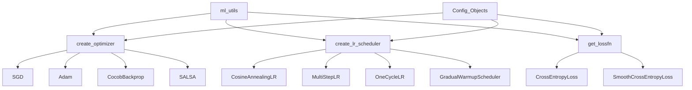

### Model Utilities and Evaluation

The framework includes utilities for model analysis, parameter counting, and performance evaluation:

- `param_size()` for parameter counting with auxiliary tower handling
- `accuracy()` for top-k accuracy computation
- `drop_path_()` for DropPath regularization during training
- `clear_gpu_memory()` for memory management during long runs

Sources: [archai/common/ml_utils.py:24-154](), [archai/common/ml_utils.py:157-260]()

## Logging and Development Infrastructure

Archai provides structured logging through the `OrderedDictLogger` class, which supports hierarchical logging with automatic YAML serialization for experiment tracking.

### Structured Logging Architecture

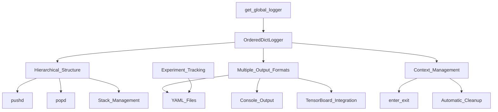

### Development and Debugging Support

The framework includes debugging detection, process management, and development environment support:

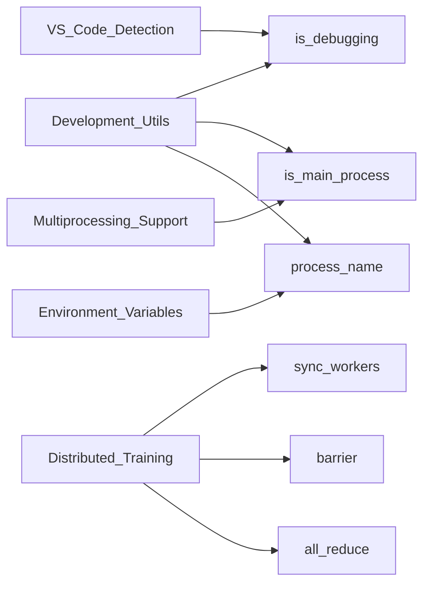

Sources: [archai/common/ordered_dict_logger.py:20-318](), [archai/common/utils.py:124-389](), [archai/common/distributed_utils.py:12-153]()

## File and Storage Management

The framework provides comprehensive file handling utilities that work consistently across different storage backends and operating systems.

### File Operations Infrastructure

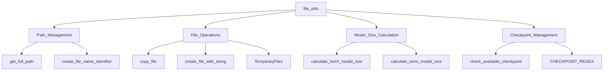

The framework handles platform-specific file system differences and provides robust file operations that work across Azure blob storage, local filesystems, and networked storage systems. The `TemporaryFiles` context manager addresses Windows-specific file handling limitations.

Sources: [archai/common/file_utils.py:15-215](), [archai/common/utils.py:333-371]()

---

