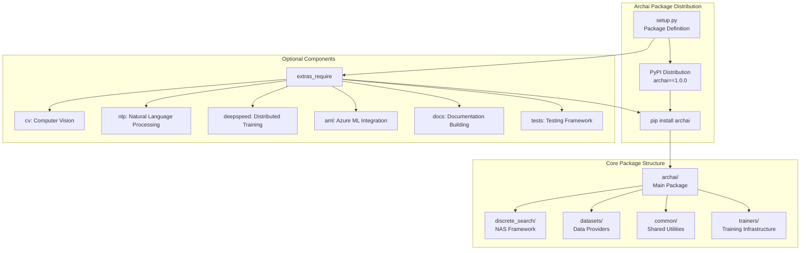
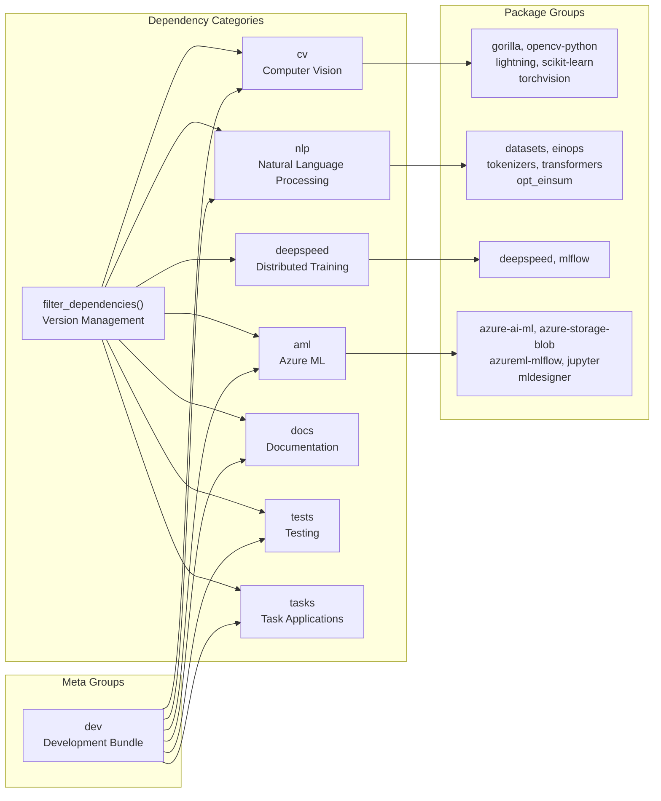
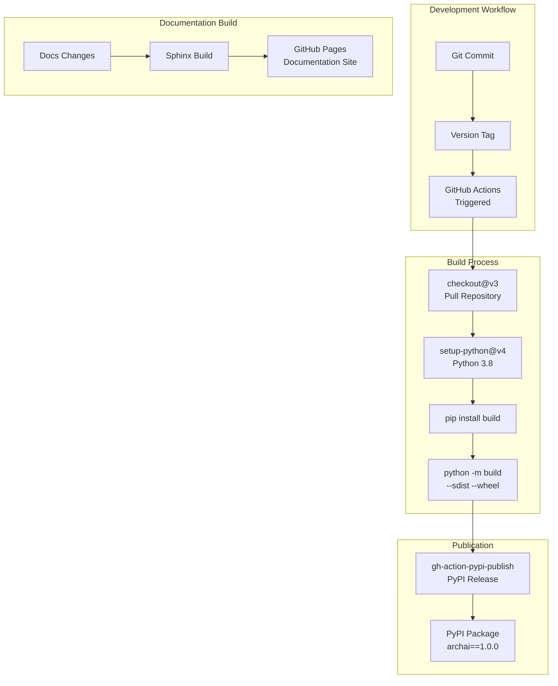

<!-- source: DeepWiki mcp.deepwiki.com · repo microsoft/archai · page 3.1 Package Structure and Distribution · fetched 2026-10-26 -->

# Package Structure and Distribution

<details>
<summary>Relevant source files</summary>

The following files were used as context for generating this wiki page:

- [.amltignore](.amltignore)
- [.gitattributes](.gitattributes)
- [.github/ISSUE_TEMPLATE/bug-report.md](.github/ISSUE_TEMPLATE/bug-report.md)
- [.github/ISSUE_TEMPLATE/feature-request.md](.github/ISSUE_TEMPLATE/feature-request.md)
- [.github/ISSUE_TEMPLATE/regular-issue.md](.github/ISSUE_TEMPLATE/regular-issue.md)
- [.github/workflows/build-publish-docs.yml](.github/workflows/build-publish-docs.yml)
- [.github/workflows/build-release-pypi.yml](.github/workflows/build-release-pypi.yml)
- [.github/workflows/check-with-codeql.yml](.github/workflows/check-with-codeql.yml)
- [.github/workflows/check-with-devskim.yml](.github/workflows/check-with-devskim.yml)
- [README.md](README.md)
- [setup.py](setup.py)

</details>


This document covers the structure of the Archai Python package, its distribution mechanism via PyPI, and the modular dependency system that allows users to install only the components they need. It explains how the package is organized, built, and published, along with the optional dependency groups that enable specific functionality.

For information about the internal code organization and module architecture, see [Common Utilities and Infrastructure](#3.3). For details about configuration files and YAML-based setup, see [Configuration System](#3.2).

## Package Overview

Archai is distributed as a single Python package named `archai` through PyPI, with a modular architecture that supports optional dependencies for different use cases. The package follows standard Python packaging conventions using setuptools.



**Sources:** [setup.py:1-189](), [README.md:30-42]()

## Dependency Management System

The package implements a sophisticated dependency management system that allows users to install only the components they need. Dependencies are organized into core requirements and optional extras, with a helper function to manage version specifications.

### Core Dependencies

The base installation includes essential dependencies for the neural architecture search framework:

| Dependency Category | Key Packages | Purpose |
|-------------------|--------------|---------|
| NAS Framework | `hyperopt`, `ray`, `statopt` | Search algorithms and optimization |
| Model Operations | `onnx`, `onnxruntime` | Model export and inference |
| Utilities | `pyyaml`, `tqdm`, `psutil` | Configuration, progress, system monitoring |
| Visualization | `tensorboard`, `tensorwatch`, `matplotlib` | Experiment tracking and plotting |
| Storage | `h5py`, `send2trash` | Data persistence and file management |

**Sources:** [setup.py:146-161]()

### Optional Dependency Groups

The `extras_require` system provides modular installation options:



**Sources:** [setup.py:67-145]()

### Platform-Specific Handling

The dependency system includes platform-specific logic to handle compatibility issues:

```python
# Windows compatibility handling
if os.name != "nt":
    # Support for DeepSpeed is not available on native Windows
    extras_require["dev"] += extras_require["deepspeed"]
```

**Sources:** [setup.py:142-144]()

## Distribution and Build Process

Archai is distributed through PyPI using automated GitHub Actions workflows that handle building, testing, and publishing.



**Sources:** [.github/workflows/build-release-pypi.yml:1-33](), [.github/workflows/build-publish-docs.yml:1-46]()

## Installation Options

Users can install Archai with different combinations of optional dependencies based on their specific needs:

### Basic Installation
```bash
pip install archai
```
Includes core NAS functionality with minimal dependencies.

### Domain-Specific Installations
```bash
# Computer Vision tasks
pip install archai[cv]

# Natural Language Processing tasks  
pip install archai[nlp]

# Azure ML integration
pip install archai[aml]
```

### Development Installation
```bash
# Full development environment
pip install archai[dev]

# Documentation building
pip install archai[docs]

# Testing framework
pip install archai[tests]
```

### Performance Optimizations
```bash
# DeepSpeed distributed training
pip install archai[deepspeed]

# Flash attention optimization
pip install archai[flash-attn]

# XFormers memory-efficient attention
pip install archai[xformers]
```

**Sources:** [setup.py:76-144](), [README.md:34-42]()

## Package Metadata and Classification

The package is configured with comprehensive metadata for PyPI distribution:

| Attribute | Value | Purpose |
|-----------|-------|---------|
| `name` | `"archai"` | PyPI package identifier |
| `version` | `"1.0.0"` | Current release version |
| `description` | `"Platform for Neural Architecture Search"` | Short description |
| `author` | `"Microsoft"` | Package maintainer |
| `license` | `"MIT"` | Open source license |
| `url` | `"https://github.com/microsoft/archai"` | Source repository |

The package includes comprehensive classifiers for PyPI categorization:
- **Audience:** Science/Research
- **License:** MIT License  
- **Development Status:** Production/Stable
- **Programming Language:** Python 3
- **Topic:** Software Development Libraries

**Sources:** [setup.py:166-188]()

## Excluded Components

Certain directories and files are excluded from different distribution contexts:

### Azure ML Exclusions
The `.amltignore` file excludes development and documentation files from Azure ML job uploads:
- `confs/` - Configuration files
- `devops/` - CI/CD scripts  
- `docs/` - Documentation source
- `research/` - Research code
- `scripts/` - Utility scripts
- `tasks/` - Task-specific implementations
- `tests/` - Test suites

**Sources:** [.amltignore:4-12]()

### Git Attributes
The `.gitattributes` file configures repository behavior:
- Documentation and notebooks excluded from language statistics
- Shell scripts use LF line endings
- Jupyter notebooks classified as Python for GitHub statistics

**Sources:** [.gitattributes:4-9]()

---

