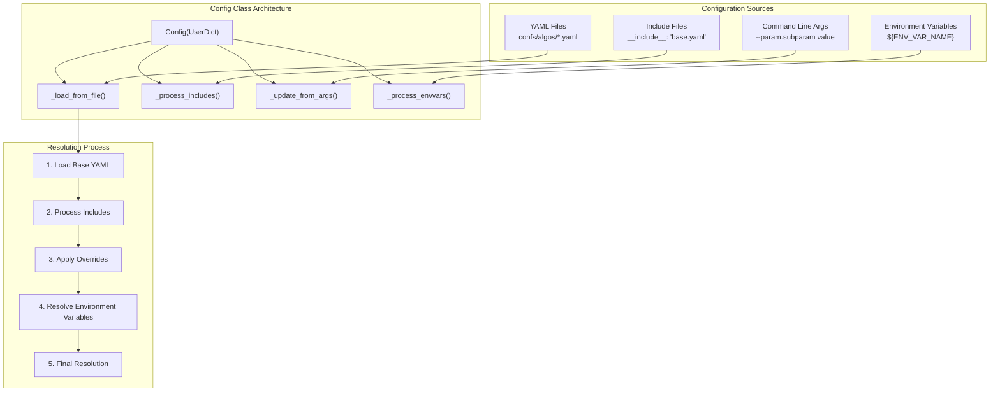
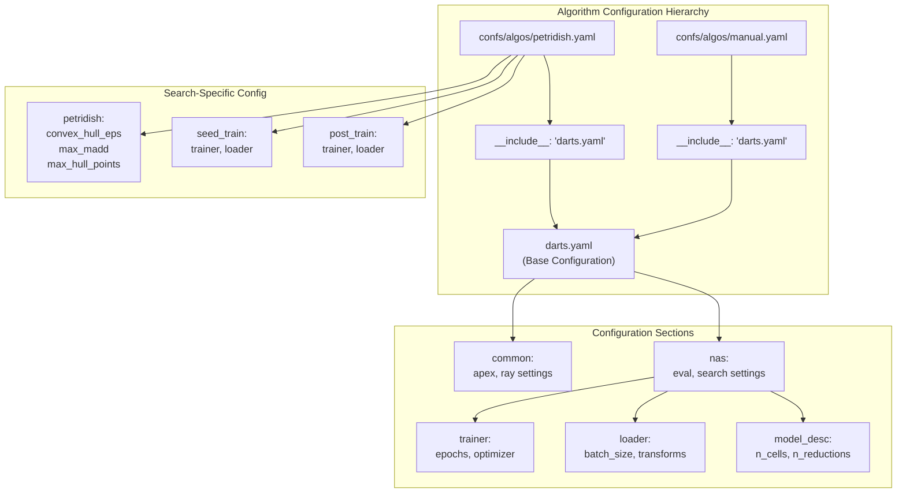
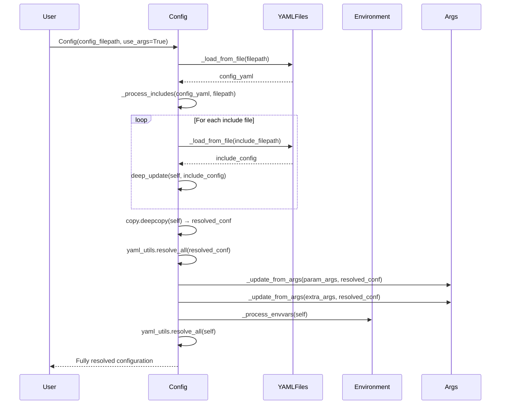
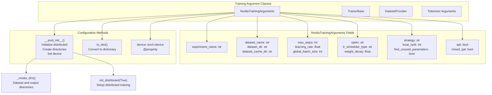
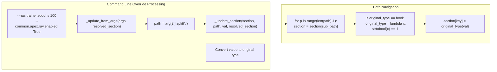
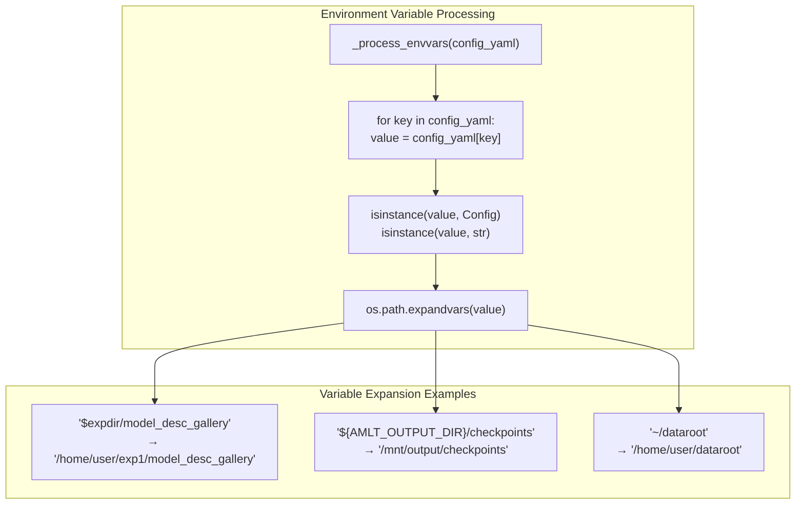
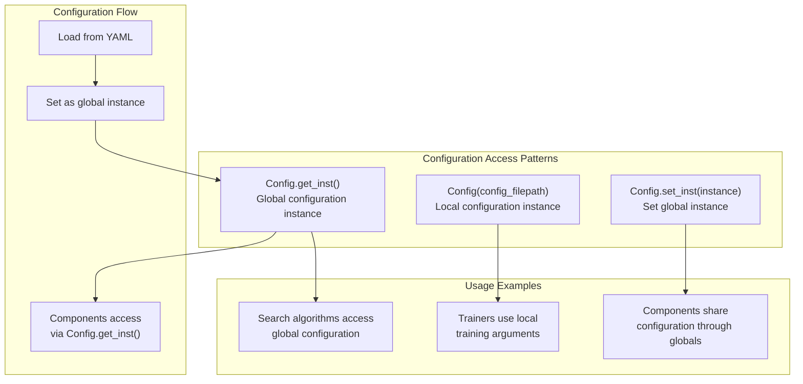

<!-- source: DeepWiki mcp.deepwiki.com · repo microsoft/archai · page 3.2 Configuration System · fetched 2026-10-26 -->

# Configuration System

Relevant source files

The following files were used as context for generating this wiki page:

- [archai/common/__init__.py](archai/common/__init__.py)
- [archai/common/config.py](archai/common/config.py)
- [archai/common/distributed_utils.py](archai/common/distributed_utils.py)
- [archai/common/file_utils.py](archai/common/file_utils.py)
- [archai/common/ordered_dict_logger.py](archai/common/ordered_dict_logger.py)
- [archai/common/timing.py](archai/common/timing.py)
- [archai/datasets/cv/face_synthetics.py](archai/datasets/cv/face_synthetics.py)
- [archai/datasets/nlp/nvidia_dataset_provider.py](archai/datasets/nlp/nvidia_dataset_provider.py)
- [archai/datasets/nlp/nvidia_dataset_provider_utils.py](archai/datasets/nlp/nvidia_dataset_provider_utils.py)
- [archai/datasets/nlp/tokenizer_utils/bbpe_tokenizer.py](archai/datasets/nlp/tokenizer_utils/bbpe_tokenizer.py)
- [archai/datasets/nlp/tokenizer_utils/gpt2_tokenizer.py](archai/datasets/nlp/tokenizer_utils/gpt2_tokenizer.py)
- [archai/datasets/nlp/tokenizer_utils/tokenizer_base.py](archai/datasets/nlp/tokenizer_utils/tokenizer_base.py)
- [archai/datasets/nlp/tokenizer_utils/word_tokenizer.py](archai/datasets/nlp/tokenizer_utils/word_tokenizer.py)
- [archai/trainers/nlp/nvidia_trainer.py](archai/trainers/nlp/nvidia_trainer.py)
- [archai/trainers/nlp/nvidia_training_args.py](archai/trainers/nlp/nvidia_training_args.py)
- [confs/algos/manual.yaml](confs/algos/manual.yaml)
- [confs/algos/petridish.yaml](confs/algos/petridish.yaml)

The Configuration System provides a hierarchical, YAML-based approach to configuring all aspects of the Archai framework. It enables reproducible experiments through structured configuration files, supports environment-specific overrides, and integrates with command-line arguments for flexible experiment management.

For information about VS Code integration and launch configurations, see [VS Code Integration and Launch Configurations](#8.1). For details about training infrastructure configuration, see [Training Infrastructure](#5.2).

## Core Configuration Architecture

The configuration system is built around the `Config` class which extends Python's `UserDict` to provide hierarchical configuration management with YAML file loading, include support, and runtime overrides.

Sources: [archai/common/config.py:32-178]()

## YAML Configuration Structure

Algorithm configurations follow a hierarchical structure with support for inheritance through the `__include__` mechanism. The system uses a nested dictionary approach where configuration sections correspond to different framework components.

Sources: [confs/algos/petridish.yaml:1-62](), [confs/algos/manual.yaml:1-62]()

## Configuration Loading and Processing

The `Config` class implements a sophisticated loading mechanism that processes includes, handles command-line overrides, and resolves environment variables in a specific order to ensure predictable configuration resolution.

Sources: [archai/common/config.py:67-87](), [archai/common/config.py:119-164]()

## Component-Specific Training Arguments

Different training backends and components use specialized argument classes that integrate with the global configuration system while providing component-specific validation and defaults.

Sources: [archai/trainers/nlp/nvidia_training_args.py:72-250]()

## Command Line Override System

The configuration system supports dot-notation command line overrides that can modify any nested configuration value while preserving type safety through the original configuration structure.

Sources: [archai/common/config.py:119-164]()

## Environment Variable Resolution

The configuration system supports environment variable substitution using shell-style `${VAR_NAME}` syntax, enabling environment-specific configuration without modifying YAML files.

Sources: [archai/common/config.py:111-118]()

## Configuration Integration Points

The configuration system integrates with multiple framework components through standardized interfaces and global configuration access patterns.

| Component | Configuration Method | Key Classes | Purpose |
|-----------|---------------------|-------------|---------|
| Trainers | Training Arguments Classes | `NvidiaTrainingArguments` | Training-specific parameters |
| Datasets | Provider Configuration | `NvidiaDatasetProvider`, `Corpus` | Dataset loading and caching |
| Tokenizers | Tokenizer-specific Args | `BbpeTokenizer`, `Gpt2Tokenizer`, `WordTokenizer` | Vocabulary and encoding |
| Distributed | Environment Variables | `distributed_utils` | Multi-node coordination |
| Logging | Logger Configuration | `OrderedDictLogger` | Structured logging |

Sources: [archai/trainers/nlp/nvidia_training_args.py:19-69](), [archai/datasets/nlp/nvidia_dataset_provider_utils.py:32-78](), [archai/datasets/nlp/tokenizer_utils/bbpe_tokenizer.py:28-92]()

## Global Configuration Access

The framework provides both instance-based and global configuration access patterns to support different usage scenarios while maintaining configuration consistency across components.

Sources: [archai/common/config.py:169-178]()

---

