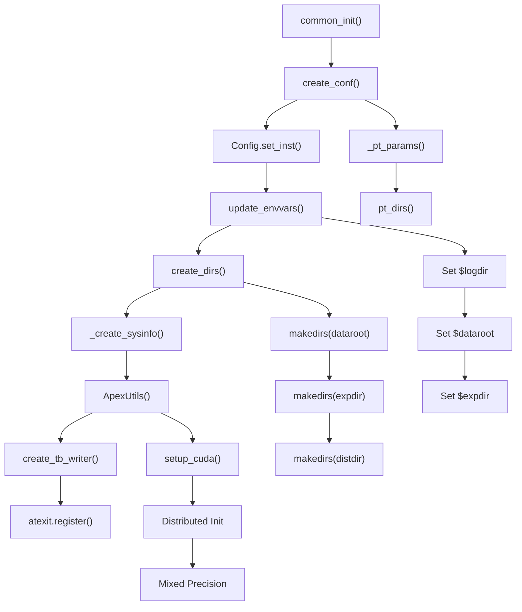
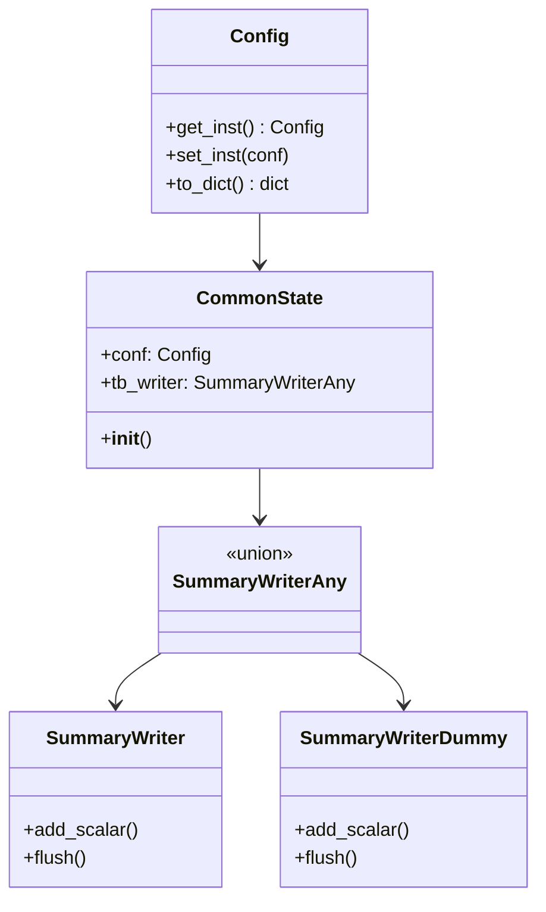
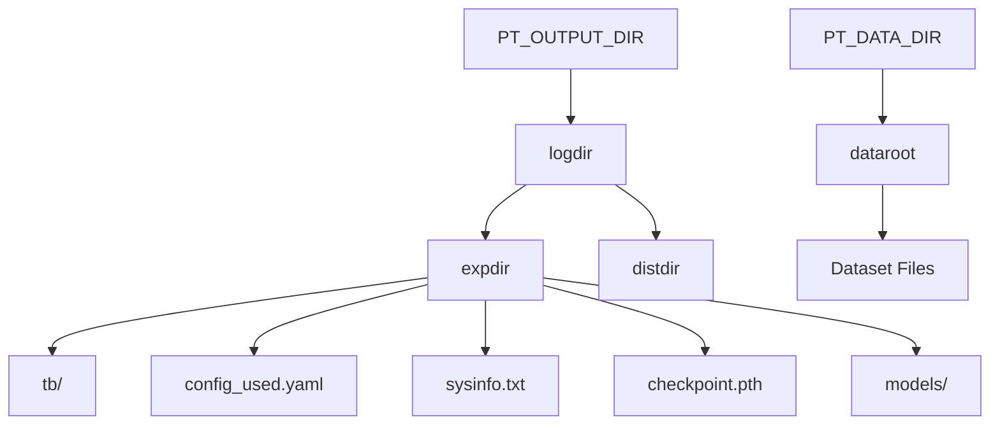
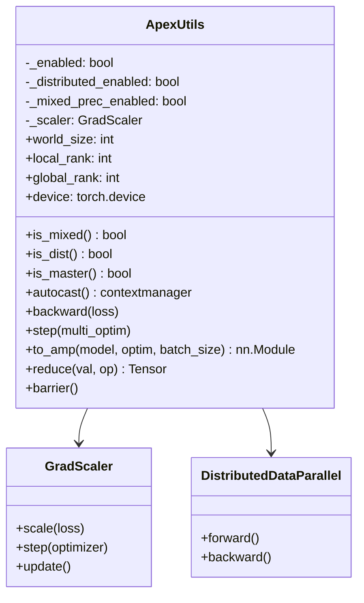
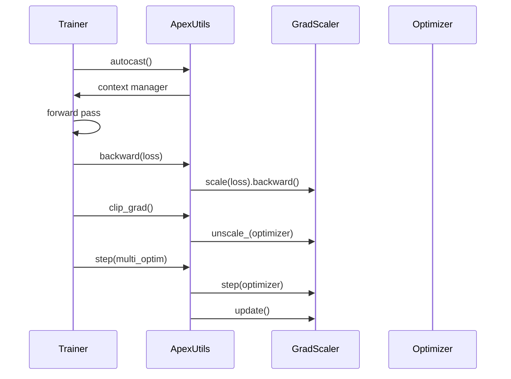
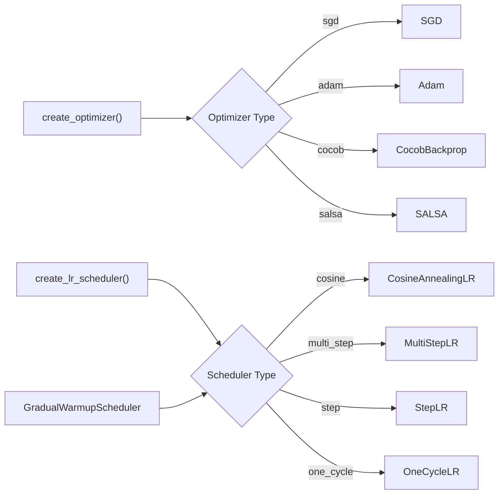
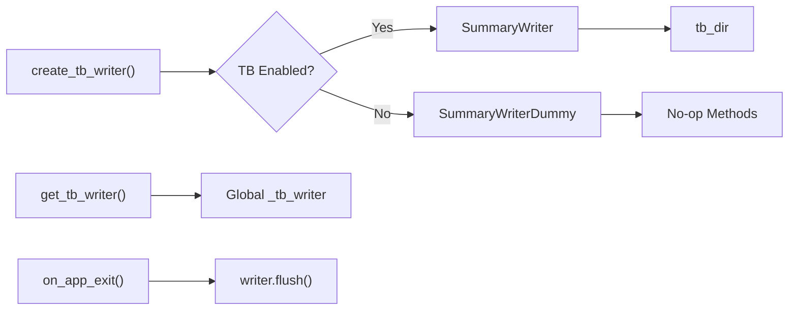
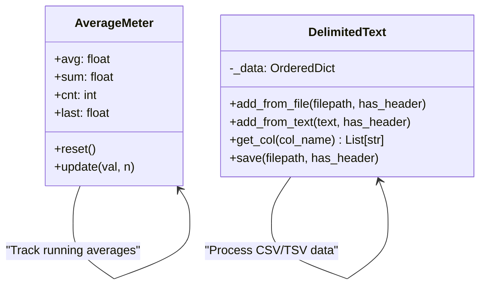
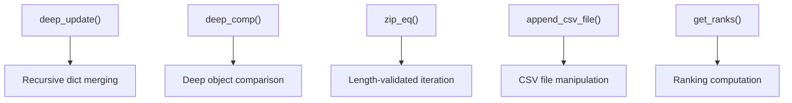

<!-- source: DeepWiki mcp.deepwiki.com · repo microsoft/archai · page 3.3 Common Utilities and Infrastructure · fetched 2026-10-26 -->

# Common Utilities and Infrastructure

Relevant source files

The following files were used as context for generating this wiki page:

- [archai/common/apex_utils.py](archai/common/apex_utils.py)
- [archai/common/common.py](archai/common/common.py)
- [archai/common/delimited_text.py](archai/common/delimited_text.py)
- [archai/common/ml_utils.py](archai/common/ml_utils.py)
- [archai/common/utils.py](archai/common/utils.py)
- [confs/algos/darts.yaml](confs/algos/darts.yaml)
- [confs/datasets/cifar100.yaml](confs/datasets/cifar100.yaml)
- [confs/datasets/imagenet.yaml](confs/datasets/imagenet.yaml)
- [confs/datasets/size_224x224_base.yaml](confs/datasets/size_224x224_base.yaml)

This document covers the shared infrastructure components that provide foundational services across the Archai Neural Architecture Search framework. These utilities handle system initialization, configuration management, distributed training coordination, logging, and general-purpose functions that support all other Archai components.

For information about the package structure and distribution, see [Package Structure and Distribution](#3.1). For details about the YAML-based configuration system, see [Configuration System](#3.2).

## System Initialization and Startup

The Archai framework provides a centralized initialization system through the `common_init()` function, which coordinates the setup of all foundational components.

### Initialization Flow

The `common_init()` function in [archai/common/common.py:132-167]() orchestrates the initialization of:

- **Configuration Loading**: Creates and validates YAML configuration
- **Environment Setup**: Resolves paths and sets environment variables  
- **Directory Creation**: Ensures experiment and data directories exist
- **Distributed Training**: Initializes multi-GPU and distributed capabilities
- **Logging Infrastructure**: Sets up TensorBoard and structured logging
- **Cleanup Handlers**: Registers exit hooks for proper resource cleanup

### Configuration State Management

The framework uses singleton pattern for configuration management through [archai/common/common.py:36-55]() accessor functions like `get_conf()`, `get_conf_common()`, and `get_conf_dataset()`.

**Sources:** [archai/common/common.py:132-167](), [archai/common/common.py:36-55](), [archai/common/common.py:61-109]()

## Environment and Path Management

Archai provides robust path resolution and environment management to support both local development and cloud execution environments.

### Path Resolution System

The `full_path()` function in [archai/common/utils.py:136-144]() performs comprehensive path resolution:

- **Environment Variable Expansion**: Resolves `$VAR` and `${VAR}` syntax
- **User Home Expansion**: Handles `~` prefix for home directory
- **Absolute Path Conversion**: Converts to absolute paths
- **Optional Directory Creation**: Creates directories when `create=True`

### Environment Detection and Setup

| Function | Purpose | Location |
|----------|---------|----------|
| `is_debugging()` | Detects VS Code debugging mode | [archai/common/utils.py:132-134]() |
| `is_main_process()` | Identifies main vs child processes | [archai/common/utils.py:378-381]() |
| `is_pt()` | Detects PT infrastructure execution | [archai/common/common.py:200-202]() |
| `setup_cuda()` | Initializes CUDA and random seeds | [archai/common/utils.py:249-264]() |

### Directory Structure Management

The `create_dirs()` function in [archai/common/common.py:262-289]() establishes the complete directory hierarchy with proper permissions and validation.

**Sources:** [archai/common/utils.py:136-144](), [archai/common/utils.py:132-134](), [archai/common/utils.py:378-381](), [archai/common/common.py:200-202](), [archai/common/common.py:262-289]()

## Distributed Training Infrastructure

The `ApexUtils` class provides comprehensive distributed training coordination, managing multi-GPU execution, mixed precision training, and process synchronization.

### ApexUtils Architecture

### Mixed Precision Training Flow

The distributed training system supports:

- **Multi-GPU Training**: Automatic GPU detection and assignment via [archai/common/apex_utils.py:139-170]()
- **Mixed Precision**: PyTorch native AMP integration via [archai/common/apex_utils.py:67-70]()
- **Synchronized Batch Normalization**: Cross-GPU batch norm synchronization
- **Learning Rate Scaling**: Automatic LR adjustment for distributed training
- **Process Coordination**: Barrier synchronization and collective operations

**Sources:** [archai/common/apex_utils.py:26-281](), [archai/common/apex_utils.py:139-170](), [archai/common/apex_utils.py:67-70]()

## Machine Learning Utilities

The `ml_utils` module provides essential machine learning components and utilities for model training and evaluation.

### Optimizer and Scheduler Creation

### Model Evaluation Functions

| Function | Purpose | Location |
|----------|---------|----------|
| `accuracy()` | Computes top-k accuracy metrics | [archai/common/ml_utils.py:187-206]() |
| `param_size()` | Counts model parameters | [archai/common/ml_utils.py:157-163]() |
| `memory_allocated()` | Reports GPU memory usage | [archai/common/ml_utils.py:239-248]() |
| `clear_gpu_memory()` | Releases GPU memory | [archai/common/ml_utils.py:229-236]() |

The `create_optimizer()` function in [archai/common/ml_utils.py:24-44]() supports multiple optimizer types with parameter group customization for batch normalization layers.

**Sources:** [archai/common/ml_utils.py:24-44](), [archai/common/ml_utils.py:83-135](), [archai/common/ml_utils.py:187-206](), [archai/common/ml_utils.py:157-163]()

## Logging and Monitoring

Archai integrates structured logging with TensorBoard support for experiment monitoring and debugging.

### TensorBoard Integration

The TensorBoard system in [archai/common/common.py:186-198]() provides:

- **Conditional Logging**: Enables TensorBoard only on master processes
- **Automatic Cleanup**: Flushes logs on application exit
- **Dummy Implementation**: No-op writer when TensorBoard is disabled

### System Information Collection

The `_create_sysinfo()` function in [archai/common/common.py:169-180]() automatically captures:

- **Configuration Snapshot**: Saves `config_used.yaml` for reproducibility
- **System Information**: Executes `sysinfo.sh` script for environment details
- **Experiment Metadata**: Links configuration to experiment directory

**Sources:** [archai/common/common.py:186-198](), [archai/common/common.py:169-180](), [archai/common/common.py:67-70]()

## File and Data Handling Utilities

The utilities module provides comprehensive file operations and data processing capabilities.

### File Operations

| Function Category | Functions | Purpose |
|------------------|-----------|---------|
| **Path Utilities** | `full_path()`, `filepath_ext()`, `filepath_name_ext()` | Path manipulation and resolution |
| **Copy Operations** | `copy_file()`, `copy_dir()` | File system operations with fallbacks |
| **Archive Handling** | `extract_tar()`, `extract_zip()`, `download_and_extract_tar()` | Archive extraction and downloading |
| **File Management** | `zero_file()`, `write_string()`, `read_string()` | Basic file I/O operations |

### Data Processing Utilities

The `AverageMeter` class in [archai/common/utils.py:40-55]() provides efficient running average computation, while `DelimitedText` in [archai/common/delimited_text.py:9-64]() handles structured text data processing.

### Utility Functions

**Sources:** [archai/common/utils.py:40-55](), [archai/common/delimited_text.py:9-64](), [archai/common/utils.py:333-371](), [archai/common/utils.py:420-425]()

---

