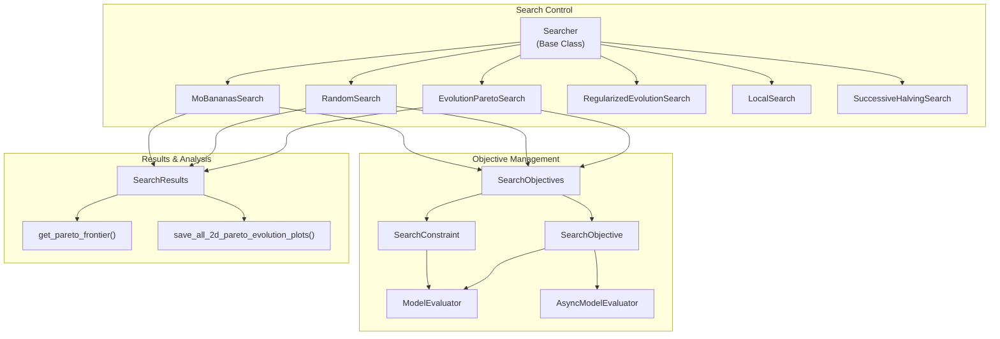
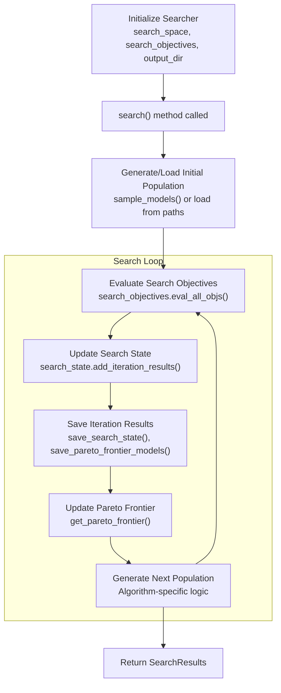
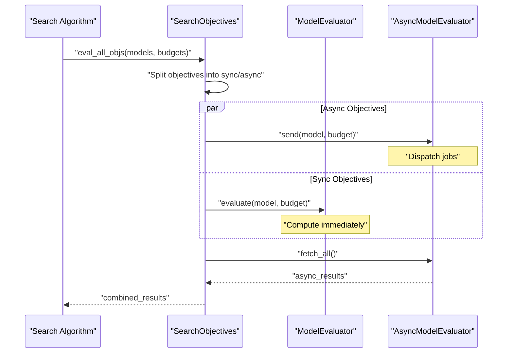
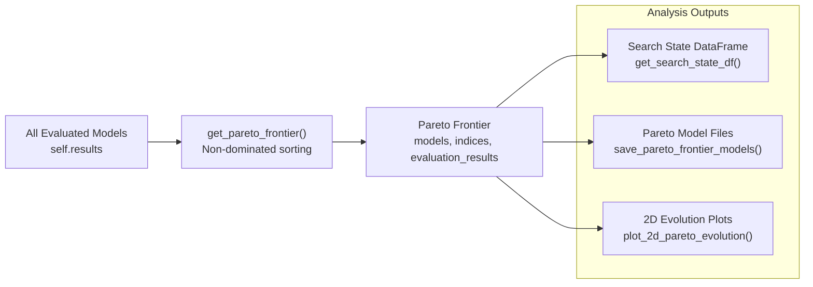

<!-- source: DeepWiki mcp.deepwiki.com · repo microsoft/archai · page 4 Neural Architecture Search · fetched 2026-10-26 -->

# Neural Architecture Search

<details>
<summary>Relevant source files</summary>

The following files were used as context for generating this wiki page:

- [.vscode/launch.json](.vscode/launch.json)
- [archai/discrete_search/__init__.py](archai/discrete_search/__init__.py)
- [archai/discrete_search/algos/bananas.py](archai/discrete_search/algos/bananas.py)
- [archai/discrete_search/algos/evolution_pareto.py](archai/discrete_search/algos/evolution_pareto.py)
- [archai/discrete_search/algos/local_search.py](archai/discrete_search/algos/local_search.py)
- [archai/discrete_search/algos/random_search.py](archai/discrete_search/algos/random_search.py)
- [archai/discrete_search/algos/regularized_evolution.py](archai/discrete_search/algos/regularized_evolution.py)
- [archai/discrete_search/algos/successive_halving.py](archai/discrete_search/algos/successive_halving.py)
- [archai/discrete_search/api/model_evaluator.py](archai/discrete_search/api/model_evaluator.py)
- [archai/discrete_search/api/search_objectives.py](archai/discrete_search/api/search_objectives.py)
- [archai/discrete_search/api/search_results.py](archai/discrete_search/api/search_results.py)
- [archai/discrete_search/api/searcher.py](archai/discrete_search/api/searcher.py)
- [archai/discrete_search/evaluators/functional.py](archai/discrete_search/evaluators/functional.py)
- [archai/discrete_search/evaluators/onnx_model.py](archai/discrete_search/evaluators/onnx_model.py)
- [archai/discrete_search/evaluators/progressive_training.py](archai/discrete_search/evaluators/progressive_training.py)
- [archai/discrete_search/evaluators/ray.py](archai/discrete_search/evaluators/ray.py)

</details>


This document covers the discrete neural architecture search framework in Archai, which provides a unified platform for multi-objective architecture optimization. The framework supports various search algorithms, evaluation strategies, and objective functions for finding Pareto-optimal architectures.

For information about specific search spaces and architecture definitions, see [Search Spaces and Architecture Definitions](#4.2). For training infrastructure used during evaluation, see [Training Infrastructure](#5.2).

## Framework Architecture

The Archai discrete search framework is built around several core abstractions that work together to enable flexible multi-objective neural architecture search:



Sources: [archai/discrete_search/api/searcher.py:11-55](), [archai/discrete_search/api/search_objectives.py:33-397](), [archai/discrete_search/api/search_results.py:23-267]()

## Search Execution Flow

The framework follows a standardized execution pattern across all search algorithms:



Sources: [archai/discrete_search/algos/evolution_pareto.py:223-308](), [archai/discrete_search/algos/random_search.py:101-138](), [archai/discrete_search/algos/bananas.py:247-312]()

## Search Objectives System

The `SearchObjectives` class manages both optimization objectives and architectural constraints in a unified framework:

### Objective Types

| Objective Type | `compute_intensive` | Constraints Allowed | Use Case |
|---|---|---|---|
| Cheap Objectives | `False` | Yes | Model size, FLOPs, latency estimation |
| Expensive Objectives | `True` | No | Training accuracy, validation performance |

### Multi-Objective Evaluation Pipeline



The caching system uses tuples of `(obj_name, archid, budget)` as keys to avoid redundant evaluations:

```python
# Cache structure from SearchObjectives
self._cache: Dict[Tuple[str, str, Optional[float]], Optional[float]] = {}
```

Sources: [archai/discrete_search/api/search_objectives.py:33-397](), [archai/discrete_search/api/model_evaluator.py:13-139]()

## Search Algorithms

### Evolutionary Multi-Objective Search

The `EvolutionParetoSearch` algorithm implements a greedy evolutionary approach that maintains and evolves the Pareto frontier:

**Key Parameters:**
- `mutations_per_parent`: Number of mutations generated per Pareto frontier member
- `num_crossovers`: Number of crossover operations per iteration  
- `num_random_mix`: Random models added to prevent local minima
- `max_unseen_population`: Maximum models evaluated per iteration

**Algorithm Flow:**
1. Initialize with random population or provided architectures
2. Evaluate objectives and update Pareto frontier
3. Generate offspring through mutation and crossover of Pareto members
4. Mix with random samples and select subset for next iteration

Sources: [archai/discrete_search/algos/evolution_pareto.py:21-309]()

### Bayesian Optimization with BANANAS

The `MoBananasSearch` implements multi-objective BANANAS using surrogate models:

**Key Components:**
- `surrogate_model`: Predictor for expensive objectives (defaults to `PredictiveDNNEnsemble`)
- `thompson_sampling()`: Acquisition function for candidate selection
- `predict_expensive_objectives()`: Surrogate-based prediction

**Workflow:**
1. Train surrogate model on evaluated architectures
2. Generate mutations from non-dominated sorting parents
3. Predict expensive objectives using surrogate
4. Use Thompson sampling to select candidates for evaluation

Sources: [archai/discrete_search/algos/bananas.py:27-313]()

### Random Search Baseline

The `RandomSearch` provides a baseline by randomly sampling from the search space with constraint validation:

Sources: [archai/discrete_search/algos/random_search.py:20-139]()

## Model Evaluation Framework

### Synchronous Evaluators

The `ModelEvaluator` base class defines the interface for sequential evaluation:

```python
@abstractmethod
def evaluate(self, arch: ArchaiModel, budget: Optional[float] = None) -> float:
```

**Built-in Evaluators:**
- `AvgOnnxLatency`: ONNX inference latency measurement
- `EvaluationFunction`: Wrapper for custom evaluation functions
- `ProgressiveTraining`: Stateful training with budget progression

### Asynchronous Evaluators

The `AsyncModelEvaluator` enables parallel evaluation through a send/fetch pattern:

```python
@abstractmethod  
def send(self, arch: ArchaiModel, budget: Optional[float] = None) -> None:

@abstractmethod
def fetch_all(self) -> List[Optional[float]]:
```

**Implementations:**
- `RayParallelEvaluator`: Ray-based parallel execution
- `RayProgressiveTraining`: Distributed training with state synchronization

Sources: [archai/discrete_search/api/model_evaluator.py:13-139](), [archai/discrete_search/evaluators/onnx_model.py:16-91](), [archai/discrete_search/evaluators/ray.py:23-91]()

## Search Results and Analysis

The `SearchResults` class provides comprehensive tracking and visualization of the search process:

### Pareto Frontier Analysis



### Key Methods

| Method | Purpose | Output |
|---|---|---|
| `add_iteration_results()` | Store evaluation results | Updates internal state |
| `get_pareto_frontier()` | Extract non-dominated solutions | Dictionary with models, results, indices |
| `save_search_state()` | Export complete search history | CSV file with all evaluations |
| `save_pareto_frontier_models()` | Save optimal architectures | Model files and optional weights |
| `plot_2d_pareto_evolution()` | Visualize frontier evolution | Matplotlib figure |

The search state tracking includes:
- Architecture IDs and iteration numbers
- All objective values and extra model data
- Pareto frontier membership flags
- Search walltime in hours

Sources: [archai/discrete_search/api/search_results.py:23-267]()

## Configuration and Execution

Search algorithms are typically configured through VS Code launch configurations that specify algorithm parameters:

**Example Launch Configuration:**
```json
{
    "name": "Darts-E2E-Toy",
    "type": "python", 
    "program": "${cwd}/scripts/supergraph/main.py",
    "args": ["--algos", "darts"]
}
```

**Pareto-Enabled Configuration:**
```json
{
    "name": "All-Toy-Pareto",
    "args": [
        "--nas.search.pareto.enabled", "True",
        "--nas.search.seed_train.trainer.epochs", "1",
        "--nas.search.post_train.trainer.epochs", "1"
    ]
}
```

The framework supports both search-only and evaluation-only modes through `--no-eval` and `--no-search` flags.

Sources: [.vscode/launch.json:1-269]()

---

