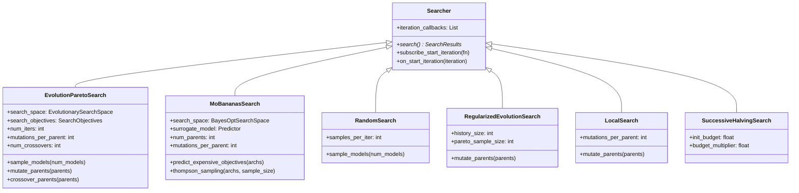
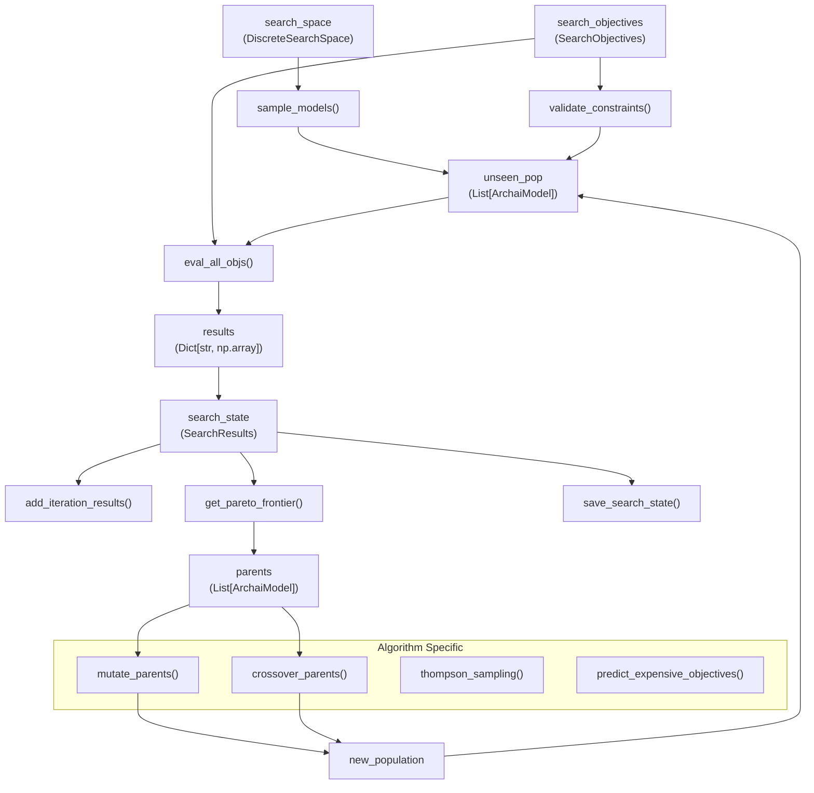
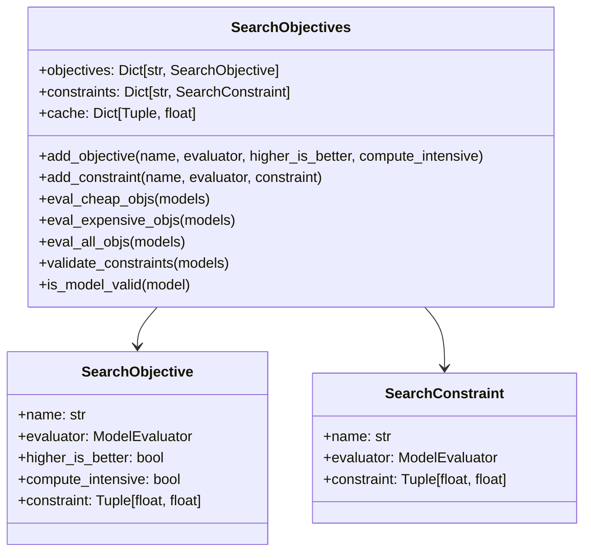

<!-- source: DeepWiki mcp.deepwiki.com · repo microsoft/archai · page 4.1 Search Algorithms · fetched 2026-10-26 -->

# Search Algorithms

Relevant source files

The following files were used as context for generating this wiki page:

- [archai/discrete_search/__init__.py](archai/discrete_search/__init__.py)
- [archai/discrete_search/algos/bananas.py](archai/discrete_search/algos/bananas.py)
- [archai/discrete_search/algos/evolution_pareto.py](archai/discrete_search/algos/evolution_pareto.py)
- [archai/discrete_search/algos/local_search.py](archai/discrete_search/algos/local_search.py)
- [archai/discrete_search/algos/random_search.py](archai/discrete_search/algos/random_search.py)
- [archai/discrete_search/algos/regularized_evolution.py](archai/discrete_search/algos/regularized_evolution.py)
- [archai/discrete_search/algos/successive_halving.py](archai/discrete_search/algos/successive_halving.py)
- [archai/discrete_search/api/model_evaluator.py](archai/discrete_search/api/model_evaluator.py)
- [archai/discrete_search/api/search_objectives.py](archai/discrete_search/api/search_objectives.py)
- [archai/discrete_search/api/search_results.py](archai/discrete_search/api/search_results.py)
- [archai/discrete_search/api/searcher.py](archai/discrete_search/api/searcher.py)
- [archai/discrete_search/evaluators/functional.py](archai/discrete_search/evaluators/functional.py)
- [archai/discrete_search/evaluators/onnx_model.py](archai/discrete_search/evaluators/onnx_model.py)
- [archai/discrete_search/evaluators/progressive_training.py](archai/discrete_search/evaluators/progressive_training.py)
- [archai/discrete_search/evaluators/ray.py](archai/discrete_search/evaluators/ray.py)
- [docs/getting_started/notebooks/discrete_search.rst](docs/getting_started/notebooks/discrete_search.rst)
- [docs/getting_started/notebooks/discrete_search/algos.ipynb](docs/getting_started/notebooks/discrete_search/algos.ipynb)
- [docs/getting_started/notebooks/discrete_search/config_search.ipynb](docs/getting_started/notebooks/discrete_search/config_search.ipynb)
- [docs/getting_started/notebooks/discrete_search/evaluators.ipynb](docs/getting_started/notebooks/discrete_search/evaluators.ipynb)
- [docs/getting_started/notebooks/discrete_search/search_space.ipynb](docs/getting_started/notebooks/discrete_search/search_space.ipynb)
- [docs/getting_started/notebooks/discrete_search/ss_example.png](docs/getting_started/notebooks/discrete_search/ss_example.png)

This document covers the search algorithms available in Archai's discrete search framework, focusing on the implementations, interfaces, and usage patterns for Neural Architecture Search (NAS). For information about search spaces and architecture definitions, see [Search Spaces and Architecture Definitions](#4.2). For details about evaluation metrics and objectives, see [Evaluators and Search Objectives](#4.3).

## Purpose and Scope

The search algorithms module provides a collection of optimization algorithms for exploring discrete architecture search spaces. These algorithms operate on `ArchaiModel` instances and use `SearchObjectives` to evaluate and compare candidate architectures. The framework supports both single-objective and multi-objective optimization with constraints, and provides tools for tracking search progress and analyzing results.

## Core Architecture and Interfaces

### Base Searcher Interface

All search algorithms inherit from the `Searcher` abstract base class, which defines the common interface and provides iteration callback support.

Sources: [archai/discrete_search/api/searcher.py:11-55](), [archai/discrete_search/algos/evolution_pareto.py:21-309](), [archai/discrete_search/algos/bananas.py:27-313]()

### Search Algorithm Execution Flow

The following diagram shows how search algorithms interact with search spaces, objectives, and results during execution:

Sources: [archai/discrete_search/algos/evolution_pareto.py:222-309](), [archai/discrete_search/api/search_results.py:23-267](), [archai/discrete_search/api/search_objectives.py:33-397]()

## Available Search Algorithms

### EvolutionParetoSearch

A multi-objective evolutionary algorithm that maintains and evolves a Pareto frontier of optimal architectures. This algorithm is particularly effective for problems with multiple conflicting objectives.

**Key Features:**
- Starts with random initial population
- Generates mutations and crossovers from Pareto frontier members
- Maintains diversity through random mixing
- Supports constraints through `SearchObjectives`

**Core Methods:**
- `sample_models(num_models)` - generates valid random architectures
- `mutate_parents(parents, mutations_per_parent)` - creates mutations from parent models
- `crossover_parents(parents, num_crossovers)` - generates crossover offspring
- `select_next_population(current_pop)` - controls population size

**Configuration Parameters:**
| Parameter | Purpose | Default |
|-----------|---------|---------|
| `num_iters` | Number of search iterations | 10 |
| `init_num_models` | Initial population size | 10 |
| `mutations_per_parent` | Mutations generated per parent | 1 |
| `num_crossovers` | Total crossovers per iteration | 5 |
| `max_unseen_population` | Maximum models evaluated per iteration | 100 |
| `num_random_mix` | Random models added each iteration | 5 |

Sources: [archai/discrete_search/algos/evolution_pareto.py:21-309]()

### MoBananasSearch (Multi-Objective BANANAS)

A Bayesian optimization algorithm that uses surrogate models to predict expensive objectives and Thompson sampling for acquisition. Efficient for expensive evaluations by learning from previous results.

**Key Features:**
- Uses `PredictiveDNNEnsemble` as default surrogate model
- Separates cheap and expensive objectives
- Thompson sampling for exploration-exploitation balance
- Non-dominated sorting for multi-objective optimization

**Core Methods:**
- `predict_expensive_objectives(archs)` - surrogate model predictions
- `thompson_sampling(archs, sample_size, pred_expensive_objs, cheap_objs)` - acquisition function
- `get_surrogate_iter_dataset(all_pop)` - prepares training data for surrogate

**Configuration Parameters:**
| Parameter | Purpose | Default |
|-----------|---------|---------|
| `num_parents` | Parents selected each iteration | 10 |
| `mutations_per_parent` | Mutations per parent | 5 |
| `num_candidates` | Models selected for next iteration | 10 |

Sources: [archai/discrete_search/algos/bananas.py:27-313]()

### RandomSearch

A baseline algorithm that randomly samples architectures from the search space. Useful for establishing performance baselines and exploring search space characteristics.

**Key Features:**
- Simple random sampling strategy
- Constraint validation through `SearchObjectives`
- Pareto frontier tracking and visualization
- Memory optimization options

**Configuration Parameters:**
| Parameter | Purpose | Default |
|-----------|---------|---------|
| `samples_per_iter` | Models sampled per iteration | 10 |
| `num_iters` | Number of iterations | 10 |

Sources: [archai/discrete_search/algos/random_search.py:20-139]()

### RegularizedEvolutionSearch

An evolutionary algorithm with aging that maintains a history buffer and regularly samples from it to prevent premature convergence. Based on the RegularizedEvolution paper.

**Key Features:**
- History buffer with configurable size
- Regular sampling from recent history
- Pareto frontier-based parent selection
- Mutation-only evolution (no crossover)

**Core Methods:**
- History buffer management through `history_size` parameter
- Pareto frontier sampling from history subset
- Single mutation per parent model

**Configuration Parameters:**
| Parameter | Purpose | Default |
|-----------|---------|---------|
| `history_size` | Models kept in history buffer | 100 |
| `pareto_sample_size` | Models sampled from history | 40 |

Sources: [archai/discrete_search/algos/regularized_evolution.py:22-230]()

### LocalSearch

A simple local search algorithm that iteratively mutates the current Pareto frontier to find better solutions. Effective for fine-tuning architectures in promising regions.

**Key Features:**
- Mutation-based exploration
- Pareto frontier maintenance
- No crossover operations
- Greedy local improvement

Sources: [archai/discrete_search/algos/local_search.py:21-206]()

### SuccessiveHalvingSearch

A budget-based search algorithm that progressively eliminates poor-performing architectures while increasing the evaluation budget for promising ones.

**Key Features:**
- Progressive budget increase
- Non-dominated sorting for selection
- Early termination when single architecture remains
- Budget-aware objective evaluation

**Configuration Parameters:**
| Parameter | Purpose | Default |
|-----------|---------|---------|
| `init_budget` | Starting evaluation budget | 1.0 |
| `budget_multiplier` | Budget increase factor | 2.0 |

Sources: [archai/discrete_search/algos/successive_halving.py:21-124]()

## Search Objectives and Multi-Objective Optimization

### SearchObjectives Framework

The `SearchObjectives` class manages evaluation metrics, constraints, and caching for search algorithms. It supports both cheap (fast to compute) and expensive (slow to compute) objectives.

**Objective Types:**
- **Cheap objectives** (`compute_intensive=False`): Fast metrics like parameter count, FLOPs, latency
- **Expensive objectives** (`compute_intensive=True`): Slow metrics like accuracy requiring training
- **Constraints**: Filtering criteria with valid ranges

**Key Methods:**
- `add_objective(name, model_evaluator, higher_is_better, compute_intensive, constraint)` - registers optimization objectives
- `add_constraint(name, model_evaluator, constraint)` - adds filtering constraints  
- `validate_constraints(models)` - filters architectures meeting all constraints
- `eval_all_objs(models, budgets)` - evaluates all objectives with optional budget control

Sources: [archai/discrete_search/api/search_objectives.py:33-397]()

## Results Management and Analysis

### SearchResults Class

The `SearchResults` class tracks search progress, maintains evaluation history, and provides analysis tools including Pareto frontier computation and visualization.

**Key Features:**
- Iteration-based result storage
- Pareto frontier tracking and evolution plots
- Search state persistence to CSV
- Model architecture saving with optional weights

**Core Methods:**
- `add_iteration_results(models, evaluation_results, extra_model_data)` - stores iteration data
- `get_pareto_frontier(start_iteration, end_iteration)` - computes optimal architectures
- `save_search_state(file_path)` - exports complete search history
- `save_pareto_frontier_models(directory, save_weights)` - saves optimal models
- `plot_2d_pareto_evolution(objective_names)` - visualizes frontier evolution

**Output Files:**
- `search_state_{iteration}.csv` - complete evaluation history
- `pareto_models_iter_{iteration}/` - optimal architecture definitions
- `pareto_{obj1}_vs_{obj2}.png` - Pareto frontier evolution plots

Sources: [archai/discrete_search/api/search_results.py:23-267]()

## Algorithm Selection Guidelines

### When to Use Each Algorithm

| Algorithm | Best For | Characteristics |
|-----------|----------|-----------------|
| `EvolutionParetoSearch` | Multi-objective problems with moderate compute budgets | Balances exploration and exploitation, maintains diversity |
| `MoBananasSearch` | Expensive objectives requiring surrogate modeling | Sample-efficient, learns from evaluation history |
| `RandomSearch` | Baselines, search space exploration | Simple, good for understanding search space properties |
| `RegularizedEvolutionSearch` | Long-running searches, avoiding local optima | Prevents premature convergence through aging |
| `LocalSearch` | Fine-tuning promising regions | Fast convergence in local neighborhoods |
| `SuccessiveHalvingSearch` | Budget-constrained optimization | Progressive resource allocation to promising candidates |

### Search Space Compatibility

Different algorithms require specific search space interfaces:

- **Evolutionary algorithms** (`EvolutionParetoSearch`, `RegularizedEvolutionSearch`, `LocalSearch`): Require `EvolutionarySearchSpace` with `mutate()` and `crossover()` methods
- **Bayesian optimization** (`MoBananasSearch`): Requires `BayesOptSearchSpace` with `encode()` method for surrogate model training
- **General algorithms** (`RandomSearch`, `SuccessiveHalvingSearch`): Work with any `DiscreteSearchSpace`

Sources: [archai/discrete_search/algos/evolution_pareto.py:69-71](), [archai/discrete_search/algos/bananas.py:74-75](), [archai/discrete_search/algos/random_search.py:53-55]()

---

