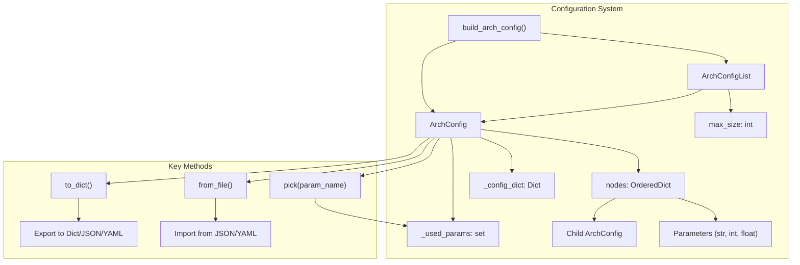
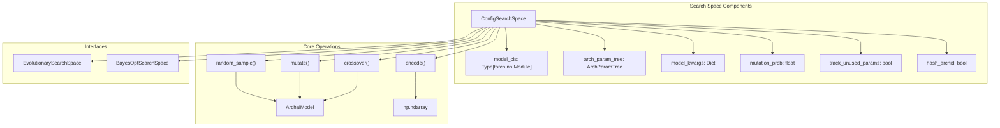
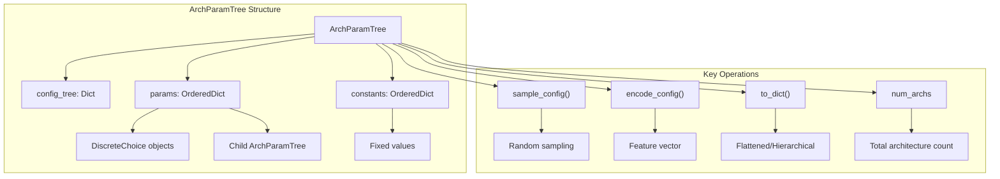
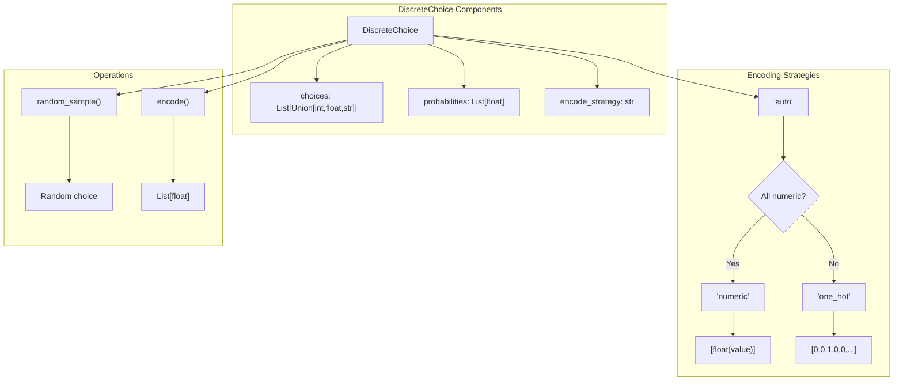
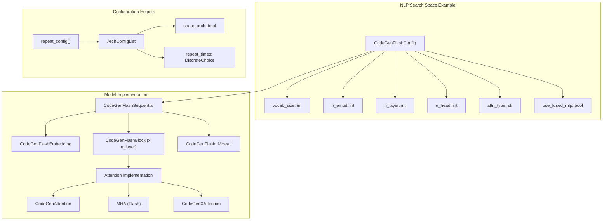
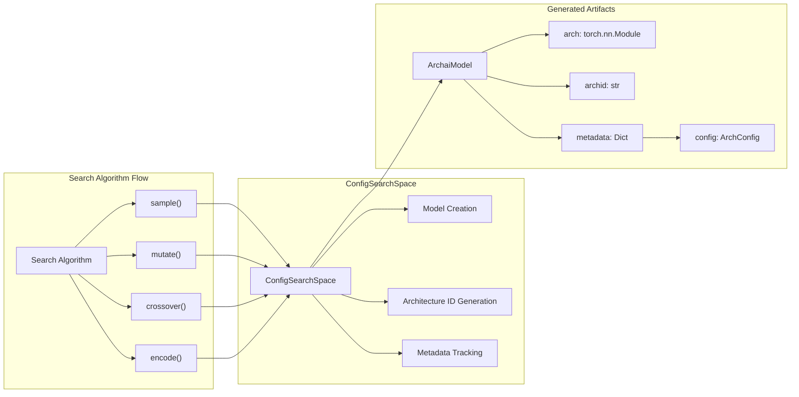

<!-- source: DeepWiki mcp.deepwiki.com · repo microsoft/archai · page 4.2 Search Spaces and Architecture Definitions · fetched 2026-10-26 -->

# Search Spaces and Architecture Definitions

Relevant source files

The following files were used as context for generating this wiki page:

- [archai/discrete_search/search_spaces/config/__init__.py](archai/discrete_search/search_spaces/config/__init__.py)
- [archai/discrete_search/search_spaces/config/arch_config.py](archai/discrete_search/search_spaces/config/arch_config.py)
- [archai/discrete_search/search_spaces/config/arch_param_tree.py](archai/discrete_search/search_spaces/config/arch_param_tree.py)
- [archai/discrete_search/search_spaces/config/discrete_choice.py](archai/discrete_search/search_spaces/config/discrete_choice.py)
- [archai/discrete_search/search_spaces/config/helpers.py](archai/discrete_search/search_spaces/config/helpers.py)
- [archai/discrete_search/search_spaces/config/search_space.py](archai/discrete_search/search_spaces/config/search_space.py)
- [archai/discrete_search/search_spaces/config/utils.py](archai/discrete_search/search_spaces/config/utils.py)
- [archai/discrete_search/search_spaces/nlp/tfpp/modeling_codegen_flash.py](archai/discrete_search/search_spaces/nlp/tfpp/modeling_codegen_flash.py)
- [archai/trainers/nlp/ds_trainer.py](archai/trainers/nlp/ds_trainer.py)
- [archai/trainers/nlp/ds_training_args.py](archai/trainers/nlp/ds_training_args.py)
- [docker/Dockerfile.flash](docker/Dockerfile.flash)
- [scripts/eval/README.md](scripts/eval/README.md)
- [scripts/eval/deepspeed/evaluate_human_eval.py](scripts/eval/deepspeed/evaluate_human_eval.py)
- [scripts/eval/hf/evaluate_human_eval.py](scripts/eval/hf/evaluate_human_eval.py)
- [scripts/eval/requirements.txt](scripts/eval/requirements.txt)
- [scripts/trainers/README.md](scripts/trainers/README.md)
- [scripts/trainers/deepspeed/.gitignore](scripts/trainers/deepspeed/.gitignore)
- [scripts/trainers/deepspeed/ds_config.json](scripts/trainers/deepspeed/ds_config.json)
- [scripts/trainers/deepspeed/train_codegen.py](scripts/trainers/deepspeed/train_codegen.py)
- [scripts/trainers/hf/train_codegen.py](scripts/trainers/hf/train_codegen.py)
- [scripts/trainers/hf/train_opt.py](scripts/trainers/hf/train_opt.py)
- [scripts/trainers/nvidia/train_gpt2.py](scripts/trainers/nvidia/train_gpt2.py)
- [setup.cfg](setup.cfg)

This document covers the core framework for defining neural architecture search spaces and architecture configurations in Archai. It explains how to parameterize model architectures, define search spaces, and integrate them with search algorithms. For information about specific search algorithms that operate on these spaces, see [Search Algorithms](#4.1). For details about evaluation and objectives used with these architectures, see [Evaluators and Search Objectives](#4.3).

## Core Architecture Configuration System

The foundation of Archai's search space system is the `ArchConfig` class, which provides a hierarchical way to store and access architecture parameters. This system enables tracking parameter usage, serialization, and flexible model construction.

**Architecture Configuration Classes**

The `ArchConfig` class [archai/discrete_search/search_spaces/config/arch_config.py:30-179]() serves as a hierarchical container for architecture parameters. It maintains an ordered dictionary of nodes that can contain either nested `ArchConfig` objects or primitive values (strings, integers, floats).

Key features include:
- **Parameter tracking**: The `pick()` method [archai/discrete_search/search_spaces/config/arch_config.py:90-117]() records which parameters were accessed during model construction
- **Hierarchical structure**: Supports nested configurations through recursive `ArchConfig` nodes
- **Serialization**: Can export to and import from JSON/YAML formats [archai/discrete_search/search_spaces/config/arch_config.py:136-178]()

The `ArchConfigList` class [archai/discrete_search/search_spaces/config/arch_config.py:181-226]() extends this system to handle repeated architectural blocks, supporting indexing and iteration over configuration lists.

Sources: [archai/discrete_search/search_spaces/config/arch_config.py:1-226]()

## Search Space Framework

The `ConfigSearchSpace` class provides the primary interface for defining searchable architecture spaces that integrate with Archai's optimization algorithms.

**Search Space Operations**

The `ConfigSearchSpace` [archai/discrete_search/search_spaces/config/search_space.py:25-169]() implements both evolutionary and Bayesian optimization interfaces:

- **Sampling**: `random_sample()` generates random architectures by sampling from the parameter tree
- **Mutation**: `mutate()` modifies architectures by randomly changing parameters with specified probability
- **Crossover**: `crossover()` combines two parent architectures to create offspring
- **Encoding**: `encode()` converts architectures to fixed-length numerical vectors for optimization algorithms

Each operation returns an `ArchaiModel` object containing the PyTorch model, unique architecture ID, and metadata including the `ArchConfig`.

Sources: [archai/discrete_search/search_spaces/config/search_space.py:1-169]()

## Architecture Parameter Trees

The `ArchParamTree` class defines the structure and constraints of searchable architecture spaces through hierarchical parameter definitions.

**Parameter Tree Definition**

The `ArchParamTree` [archai/discrete_search/search_spaces/config/arch_param_tree.py:19-181]() organizes architecture parameters into a tree structure where:

- **Parameters**: `DiscreteChoice` objects defining searchable options
- **Constants**: Fixed values that don't change during search
- **Sub-trees**: Nested `ArchParamTree` objects for hierarchical architectures

Key capabilities:
- **Space size calculation**: `num_archs` property computes total number of possible architectures
- **Configuration sampling**: `sample_config()` generates random valid configurations [archai/discrete_search/search_spaces/config/arch_param_tree.py:113-128]()
- **Encoding**: `encode_config()` converts configurations to numerical features [archai/discrete_search/search_spaces/config/arch_param_tree.py:142-180]()
- **Parameter tracking**: Identifies unused parameters during encoding when `track_unused_params=True`

Sources: [archai/discrete_search/search_spaces/config/arch_param_tree.py:1-181]()

## Discrete Choice Parameters

The `DiscreteChoice` class defines individual searchable parameters with their valid options and encoding strategies.

**Parameter Definition and Encoding**

The `DiscreteChoice` class [archai/discrete_search/search_spaces/config/discrete_choice.py:10-78]() represents individual searchable parameters:

- **Choices**: List of valid options (integers, floats, or strings)
- **Probabilities**: Optional sampling weights for non-uniform distributions
- **Encoding strategies**: 
  - `'numeric'`: Direct value encoding for numerical choices
  - `'one_hot'`: Binary vector encoding for categorical choices
  - `'auto'`: Automatically selects based on choice types

The encoding strategy affects how parameters are converted to numerical features for optimization algorithms. Numeric encoding produces single-element vectors, while one-hot encoding creates binary vectors with length equal to the number of choices.

Sources: [archai/discrete_search/search_spaces/config/discrete_choice.py:1-78]()

## Search Space Implementation Examples

The codebase includes concrete implementations demonstrating how to define search spaces for different model types.

**Transformer Architecture Search Space**

The NLP implementation demonstrates search space definition for transformer models [archai/discrete_search/search_spaces/nlp/tfpp/modeling_codegen_flash.py:23-249]():

- **Architecture parameters**: Model dimensions, layer counts, attention heads
- **Implementation variants**: Different attention mechanisms (default, flash, xformers)
- **Optimization features**: Fused MLP, vocabulary padding for efficiency

**Configuration Repetition**

The `repeat_config()` helper [archai/discrete_search/search_spaces/config/helpers.py:10-36]() enables defining repeated architectural blocks:
- Variable repetition counts through `DiscreteChoice`
- Shared vs. independent parameters across repetitions
- Support for heterogeneous block configurations

Sources: [archai/discrete_search/search_spaces/nlp/tfpp/modeling_codegen_flash.py:1-249](), [archai/discrete_search/search_spaces/config/helpers.py:1-37]()

## Integration with Search Algorithms

The search space framework integrates seamlessly with Archai's optimization algorithms through standardized interfaces.

**Search Algorithm Integration**

The `ConfigSearchSpace` provides standardized methods that search algorithms can call:

- **Architecture generation**: Creates `ArchaiModel` instances with PyTorch models and metadata
- **Unique identification**: Generates deterministic architecture IDs based on parameter values [archai/discrete_search/search_spaces/config/search_space.py:70-87]()
- **Serialization support**: Saves and loads architecture configurations and model weights

**Parameter Usage Tracking**

The system tracks which parameters are actually used during model construction, enabling:
- Identification of irrelevant parameters for specific architectures
- Compact encoding that excludes unused parameters
- Validation of search space definitions

Sources: [archai/discrete_search/search_spaces/config/search_space.py:1-169](), [archai/discrete_search/search_spaces/config/utils.py:1-129]()

---

