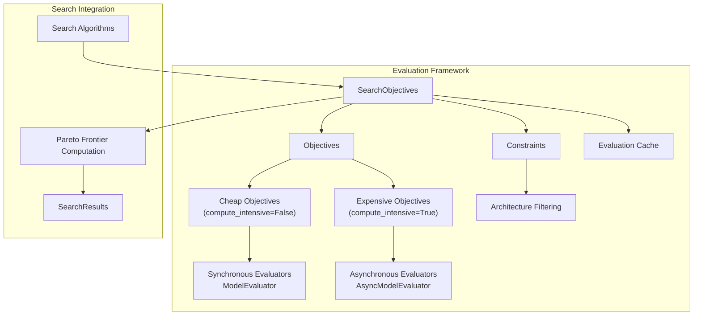
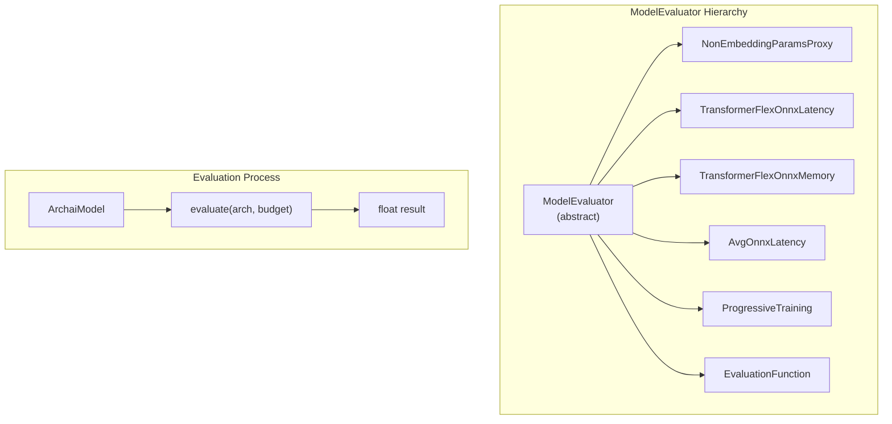
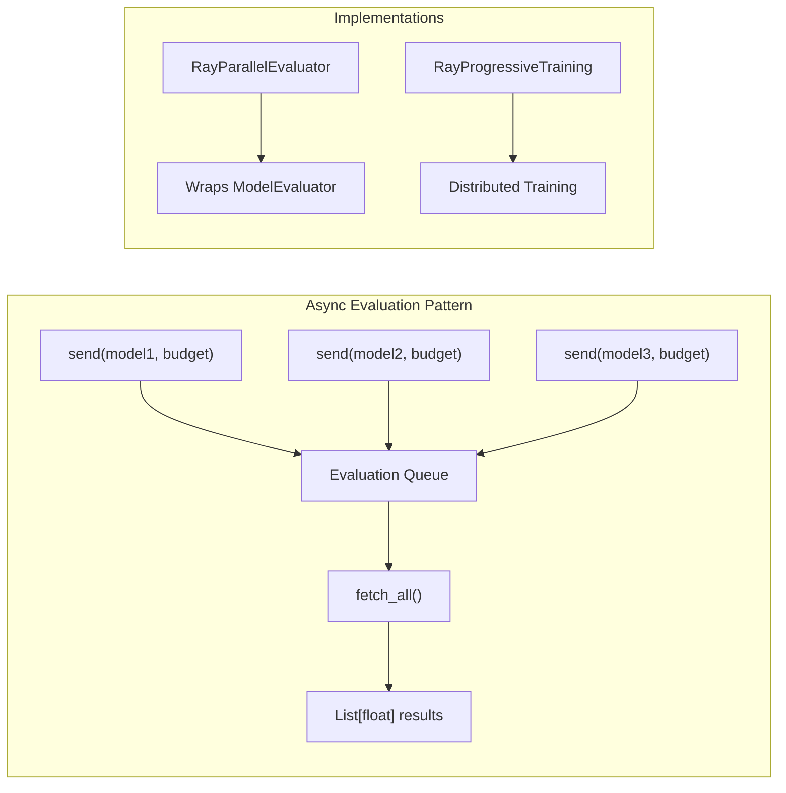
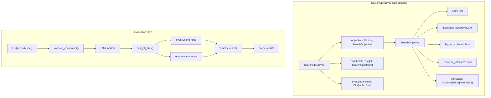
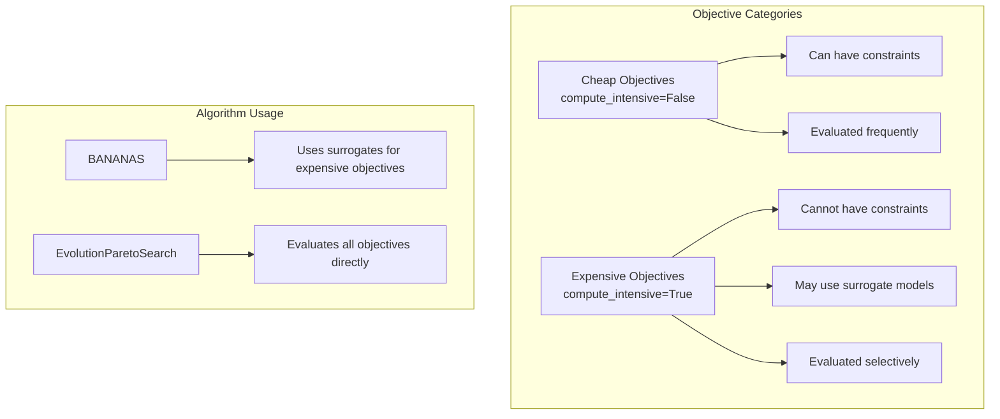
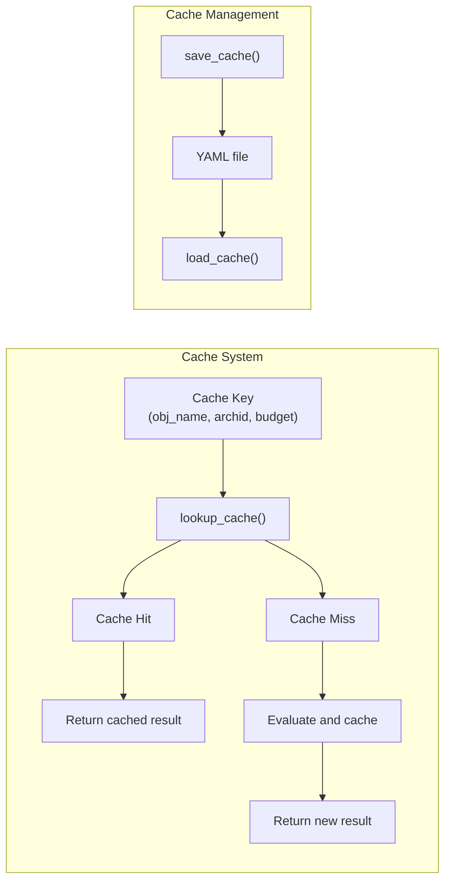
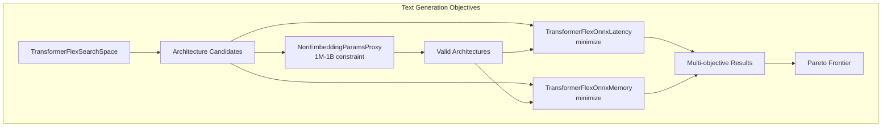

<!-- source: DeepWiki mcp.deepwiki.com · repo microsoft/archai · page 4.3 Evaluators and Search Objectives · fetched 2026-10-26 -->

# Evaluators and Search Objectives

<details>
<summary>Relevant source files</summary>

The following files were used as context for generating this wiki page:

- [archai/discrete_search/__init__.py](archai/discrete_search/__init__.py)
- [archai/discrete_search/algos/bananas.py](archai/discrete_search/algos/bananas.py)
- [archai/discrete_search/algos/evolution_pareto.py](archai/discrete_search/algos/evolution_pareto.py)
- [archai/discrete_search/algos/local_search.py](archai/discrete_search/algos/local_search.py)
- [archai/discrete_search/algos/random_search.py](archai/discrete_search/algos/random_search.py)
- [archai/discrete_search/algos/regularized_evolution.py](archai/discrete_search/algos/regularized_evolution.py)
- [archai/discrete_search/algos/successive_halving.py](archai/discrete_search/algos/successive_halving.py)
- [archai/discrete_search/api/model_evaluator.py](archai/discrete_search/api/model_evaluator.py)
- [archai/discrete_search/api/search_objectives.py](archai/discrete_search/api/search_objectives.py)
- [archai/discrete_search/api/search_results.py](archai/discrete_search/api/search_results.py)
- [archai/discrete_search/api/searcher.py](archai/discrete_search/api/searcher.py)
- [archai/discrete_search/evaluators/functional.py](archai/discrete_search/evaluators/functional.py)
- [archai/discrete_search/evaluators/nlp/__init__.py](archai/discrete_search/evaluators/nlp/__init__.py)
- [archai/discrete_search/evaluators/nlp/parameters.py](archai/discrete_search/evaluators/nlp/parameters.py)
- [archai/discrete_search/evaluators/nlp/transformer_flex_latency.py](archai/discrete_search/evaluators/nlp/transformer_flex_latency.py)
- [archai/discrete_search/evaluators/nlp/transformer_flex_memory.py](archai/discrete_search/evaluators/nlp/transformer_flex_memory.py)
- [archai/discrete_search/evaluators/onnx_model.py](archai/discrete_search/evaluators/onnx_model.py)
- [archai/discrete_search/evaluators/progressive_training.py](archai/discrete_search/evaluators/progressive_training.py)
- [archai/discrete_search/evaluators/ray.py](archai/discrete_search/evaluators/ray.py)
- [archai/onnx/__init__.py](archai/onnx/__init__.py)
- [archai/onnx/config_utils/__init__.py](archai/onnx/config_utils/__init__.py)
- [archai/onnx/config_utils/codegen_onnx_config.py](archai/onnx/config_utils/codegen_onnx_config.py)
- [archai/onnx/config_utils/gpt2_onnx_config.py](archai/onnx/config_utils/gpt2_onnx_config.py)
- [archai/onnx/config_utils/onnx_config_base.py](archai/onnx/config_utils/onnx_config_base.py)
- [archai/onnx/export.py](archai/onnx/export.py)
- [archai/onnx/export_utils.py](archai/onnx/export_utils.py)
- [archai/onnx/onnx_forward.py](archai/onnx/onnx_forward.py)
- [archai/onnx/onnx_loader.py](archai/onnx/onnx_loader.py)
- [archai/onnx/optimization.py](archai/onnx/optimization.py)
- [tasks/text_generation/README.md](tasks/text_generation/README.md)
- [tasks/text_generation/assets/pareto_zero_shot_eval.png](tasks/text_generation/assets/pareto_zero_shot_eval.png)
- [tasks/text_generation/generate_text.py](tasks/text_generation/generate_text.py)
- [tasks/text_generation/search.py](tasks/text_generation/search.py)
- [tasks/text_generation/train.py](tasks/text_generation/train.py)
- [tests/discrete_search/evaluators/nlp/test_parameters.py](tests/discrete_search/evaluators/nlp/test_parameters.py)
- [tests/discrete_search/evaluators/nlp/test_transformer_flex_latency.py](tests/discrete_search/evaluators/nlp/test_transformer_flex_latency.py)
- [tests/discrete_search/evaluators/nlp/test_transformer_flex_memory.py](tests/discrete_search/evaluators/nlp/test_transformer_flex_memory.py)

</details>


This document covers the evaluation framework used by Archai's Neural Architecture Search algorithms to assess model architectures across multiple criteria. The system enables multi-objective optimization by combining individual evaluators into a unified search objectives framework that handles evaluation orchestration, constraint validation, and Pareto frontier computation.

For information about search algorithms that use these objectives, see [Search Algorithms](#4.1). For details about search spaces and architecture definitions, see [Search Spaces and Architecture Definitions](#4.2).

## Overview

The evaluator system consists of two main components:
- **Model Evaluators**: Individual functions that assess specific aspects of architectures (latency, memory, accuracy, etc.)
- **Search Objectives**: Orchestrator that manages multiple evaluators, handles constraints, and coordinates multi-objective optimization



Sources: [archai/discrete_search/api/search_objectives.py:1-397](), [archai/discrete_search/api/model_evaluator.py:1-139]()

## Model Evaluators

Model evaluators implement specific evaluation criteria for architectures. The system provides two base classes depending on execution requirements.

### Synchronous Evaluators

The `ModelEvaluator` base class is used for evaluations that can be computed sequentially:



Key implementations include:

| Evaluator | Purpose | File Location |
|-----------|---------|---------------|
| `NonEmbeddingParamsProxy` | Count non-embedding parameters | [archai/discrete_search/evaluators/nlp/parameters.py:13-47]() |
| `TransformerFlexOnnxLatency` | Measure ONNX inference latency | [archai/discrete_search/evaluators/nlp/transformer_flex_latency.py:29-147]() |
| `TransformerFlexOnnxMemory` | Measure ONNX model memory usage | [archai/discrete_search/evaluators/nlp/transformer_flex_memory.py:24-96]() |
| `AvgOnnxLatency` | Generic ONNX latency measurement | [archai/discrete_search/evaluators/onnx_model.py:16-91]() |

Sources: [archai/discrete_search/api/model_evaluator.py:13-75](), [archai/discrete_search/evaluators/nlp/parameters.py:13-47](), [archai/discrete_search/evaluators/nlp/transformer_flex_latency.py:29-147]()

### Asynchronous Evaluators

The `AsyncModelEvaluator` base class enables parallel evaluation through a send/fetch pattern:



Key implementations:
- `RayParallelEvaluator`: Wraps synchronous evaluators for parallel execution using Ray [archai/discrete_search/evaluators/ray.py:23-91]()
- `RayProgressiveTraining`: Enables distributed progressive training [archai/discrete_search/evaluators/progressive_training.py:60-158]()

Sources: [archai/discrete_search/api/model_evaluator.py:77-139](), [archai/discrete_search/evaluators/ray.py:23-91]()

## Search Objectives Framework

The `SearchObjectives` class orchestrates multiple evaluators and manages the multi-objective optimization process:



Sources: [archai/discrete_search/api/search_objectives.py:33-397]()

### Adding Objectives and Constraints

Objectives are optimization targets that can be minimized or maximized:

```python
# From tasks/text_generation/search.py:105-124
search_objectives = SearchObjectives()
search_objectives.add_objective(
    "non_embedding_params",
    NonEmbeddingParamsProxy(),
    higher_is_better=True,  # Want more parameters (within constraints)
    compute_intensive=False,
    constraint=(1e6, 1e9),  # Must be between 1M and 1B parameters
)
search_objectives.add_objective(
    "onnx_latency",
    TransformerFlexOnnxLatency(space, seq_len=1024, n_trials=5),
    higher_is_better=False,  # Want lower latency
    compute_intensive=False,
)
```

Constraints filter out invalid architectures before expensive evaluation:

```python
# Constraints can be added separately or as part of objectives
search_objectives.add_constraint(
    "parameter_limit",
    NonEmbeddingParamsProxy(),
    constraint=(1e5, 1e8)  # Only evaluate models with 100K-100M parameters
)
```

Sources: [tasks/text_generation/search.py:105-124](), [archai/discrete_search/api/search_objectives.py:95-148]()

### Evaluation Categories

The system categorizes objectives based on computational cost:

| Category | Description | Usage |
|----------|-------------|-------|
| **Cheap Objectives** | Fast to compute, can be used for constraints | Parameter counting, simple metrics |
| **Expensive Objectives** | Computationally intensive | Training-based accuracy, complex benchmarks |



Sources: [archai/discrete_search/api/search_objectives.py:80-127](), [archai/discrete_search/algos/bananas.py:188-205]()

## Integration with Search Algorithms

Search algorithms use the evaluation framework through standardized interfaces:

### Constraint Validation

Algorithms validate architectures before expensive evaluation:

```python
# From archai/discrete_search/algos/evolution_pareto.py:119-123
_, valid_indices = self.so.validate_constraints(sample)
valid_sample += [sample[i] for i in valid_indices]
```

### Multi-Objective Evaluation

All objectives are evaluated together:

```python
# From archai/discrete_search/algos/evolution_pareto.py:245-256
results = self.so.eval_all_objs(unseen_pop)
self.search_state.add_iteration_results(
    unseen_pop,
    results,
    extra_model_data={
        "parent": [p.metadata.get("parent", None) for p in unseen_pop],
        "parents": [p.metadata.get("parents", None) for p in unseen_pop],
    },
)
```

Sources: [archai/discrete_search/algos/evolution_pareto.py:119-123](), [archai/discrete_search/algos/evolution_pareto.py:245-256]()

### Surrogate Model Integration

Advanced algorithms like BANANAS use surrogate models for expensive objectives:

```python
# From archai/discrete_search/algos/bananas.py:296-300
pred_expensive_objs = self.predict_expensive_objectives(mutated)
cheap_objs = self.so.eval_cheap_objs(mutated)
selected_indices = self.thompson_sampling(mutated, self.num_candidates, pred_expensive_objs, cheap_objs)
```

Sources: [archai/discrete_search/algos/bananas.py:296-300](), [archai/discrete_search/algos/bananas.py:188-205]()

## Caching and Performance

The system includes automatic caching to avoid redundant evaluations:



The cache uses a tuple of `(objective_name, architecture_id, budget)` as the key and can be persisted to disk for reuse across search sessions.

Sources: [archai/discrete_search/api/search_objectives.py:225-236](), [archai/discrete_search/api/search_objectives.py:362-396]()

## Example: Text Generation Multi-Objective Search

A complete example from the text generation task demonstrates the evaluation framework in practice:



This setup evaluates transformer architectures across three dimensions:
- **Parameter efficiency**: Number of non-embedding parameters (with constraints)
- **Inference speed**: ONNX runtime latency  
- **Memory efficiency**: ONNX model size

The search finds architectures that optimally trade off between these competing objectives.

Sources: [tasks/text_generation/search.py:95-140](), [tasks/text_generation/README.md:34-73]()

---

