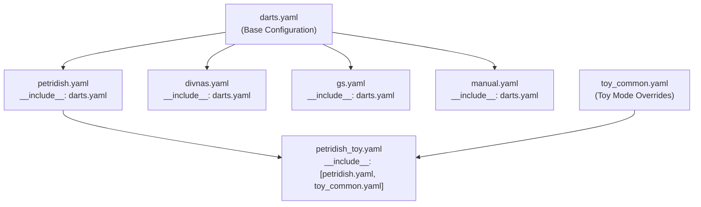
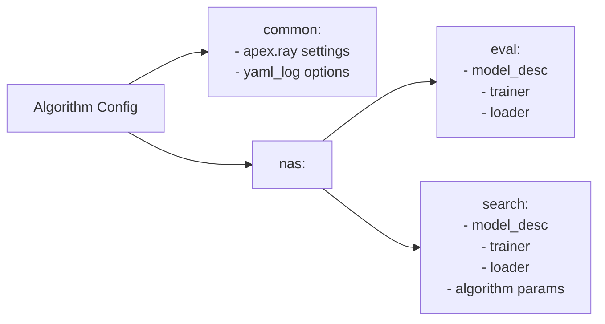
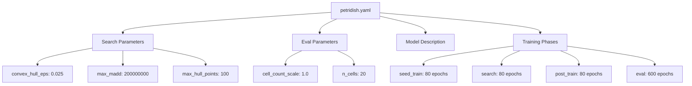
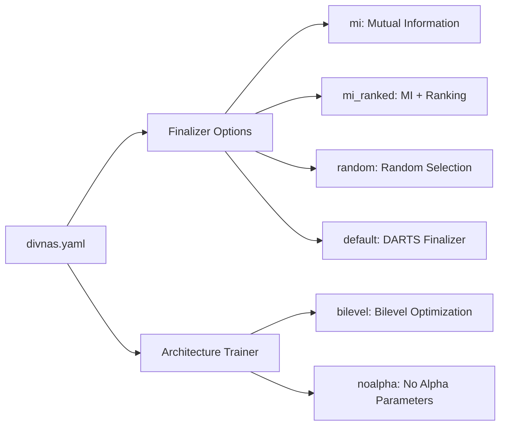
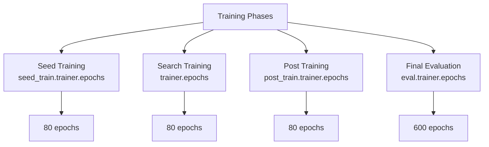

<!-- source: DeepWiki mcp.deepwiki.com · repo microsoft/archai · page 4.4 Algorithm Configurations · fetched 2026-10-26 -->

# Algorithm Configurations

<details>
<summary>Relevant source files</summary>

The following files were used as context for generating this wiki page:

- [.vscode/settings.json](.vscode/settings.json)
- [confs/algos/divnas.yaml](confs/algos/divnas.yaml)
- [confs/algos/gs.yaml](confs/algos/gs.yaml)
- [confs/algos/manual.yaml](confs/algos/manual.yaml)
- [confs/algos/petridish.yaml](confs/algos/petridish.yaml)
- [confs/algos/petridish_toy.yaml](confs/algos/petridish_toy.yaml)

</details>


This document covers the YAML configuration files that define parameters and settings for different Neural Architecture Search (NAS) algorithms in Archai. These configuration files are located in the `confs/algos/` directory and provide algorithm-specific settings that control search behavior, model architecture parameters, training hyperparameters, and evaluation criteria.

For information about the actual algorithm implementations, see [Search Algorithms](#4.1). For details about search space definitions, see [Search Spaces and Architecture Definitions](#4.2). For the general YAML configuration system, see [Configuration System](#3.2).

## Configuration Structure and Inheritance

Archai uses a hierarchical configuration system where algorithm-specific configs inherit from base configurations using the `__include__` directive.

### Configuration Inheritance Hierarchy



**Sources:** [confs/algos/petridish.yaml:1](), [confs/algos/divnas.yaml:1](), [confs/algos/gs.yaml:1](), [confs/algos/manual.yaml:1](), [confs/algos/petridish_toy.yaml:3]()

### Core Configuration Sections

Each algorithm configuration contains nested sections that control different aspects of the NAS process:



**Sources:** [confs/algos/petridish.yaml:3-62]()

## Algorithm-Specific Configurations

### Petridish Configuration

The Petridish algorithm configuration defines parameters for progressive search that builds architectures incrementally while maintaining a Pareto frontier.

#### Key Configuration Parameters

| Parameter | Location | Purpose |
|-----------|----------|---------|
| `convex_hull_eps` | `nas.search.petridish` | Tolerance for Pareto frontier computation |
| `max_madd` | `nas.search.petridish` | Maximum multiply-adds threshold for search termination |
| `max_hull_points` | `nas.search.petridish` | Maximum number of models in parent pool |
| `cell_count_scale` | `nas.eval.petridish` | Scaling factor for cell count during evaluation |



**Sources:** [confs/algos/petridish.yaml:23-33](), [confs/algos/petridish.yaml:47-62]()

#### Pareto Frontier Configuration

The Petridish configuration includes specific settings for multi-objective optimization:

```yaml
pareto:
  max_cells: 8
  max_reductions: 3
  max_nodes: 3
  enabled: True
```

**Sources:** [confs/algos/petridish.yaml:35-39]()

### DivNAS Configuration

DivNAS (Diversity-based NAS) focuses on architectural diversity through mutual information-based selection.

#### Algorithm-Specific Parameters

| Parameter | Value | Purpose |
|-----------|-------|---------|
| `finalizer` | `'mi_ranked'` | Mutual information ranked selection |
| `sigma` | `168` | Diversity parameter |
| `archtrainer` | `'bilevel'` | Architecture training method |



**Sources:** [confs/algos/divnas.yaml:9-16]()

### Gradient-based Search (GS) Configuration

The GS configuration implements efficient gradient-based architecture search with minimal validation requirements.

```yaml
nas:
  search:
    loader:
      val_ratio: 0.0  # no validation needed during search
    trainer:
      epochs: 1       # single epoch search
    model_desc:
      max_final_edges: 1
      cell:
        gs:
          num_sample: 1
```

**Sources:** [confs/algos/gs.yaml:8-17]()

### Manual Configuration

The manual configuration supports baseline model evaluation and traditional training workflows.

#### Model Factory Integration

```yaml
nas:
  eval:
    model_factory_spec: 'resnet18'
```

#### Optimizer Configuration

| Parameter | Value | Purpose |
|-----------|-------|---------|
| `type` | `'sgd'` | Optimizer type |
| `lr` | `0.0333` | Initial learning rate |
| `decay` | `3.0e-4` | Weight decay |
| `momentum` | `0.9` | SGD momentum |

**Sources:** [confs/algos/manual.yaml:6](), [confs/algos/manual.yaml:17-22]()

## Toy Mode Configurations

Toy mode configurations provide reduced parameter settings for rapid testing and development.

### Petridish Toy Mode

```yaml
# petridish_toy.yaml
__include__: ['petridish.yaml', 'toy_common.yaml']

nas:
  search:
    petridish:
      sampling_max_try: 1
      max_hull_points: 2
```

This overrides the full Petridish configuration to use minimal settings suitable for quick validation.

**Sources:** [confs/algos/petridish_toy.yaml:1-9]()

## Configuration Parameter Categories

### Model Architecture Parameters

Common architecture parameters across algorithms:

| Parameter | Section | Purpose |
|-----------|---------|---------|
| `n_cells` | `model_desc` | Number of cells in architecture |
| `n_reductions` | `model_desc` | Number of reduction operations |
| `n_nodes` | `cell` | Number of nodes per cell |
| `num_edges_to_sample` | `model_desc` | Input edges per node |

### Training Configuration

Training parameters are organized into phases:



**Sources:** [confs/algos/petridish.yaml:47-62]()

### Data Loading Configuration

Batch size and validation split settings:

| Parameter | Typical Values | Usage Context |
|-----------|----------------|---------------|
| `train_batch` | 96-128 | Training batch size |
| `val_ratio` | 0.0-0.2 | Validation split ratio |
| `cutout` | 0-16 | Cutout augmentation size |

**Sources:** [confs/algos/petridish.yaml:51](), [confs/algos/petridish.yaml:56](), [confs/algos/manual.yaml:11]()

---

