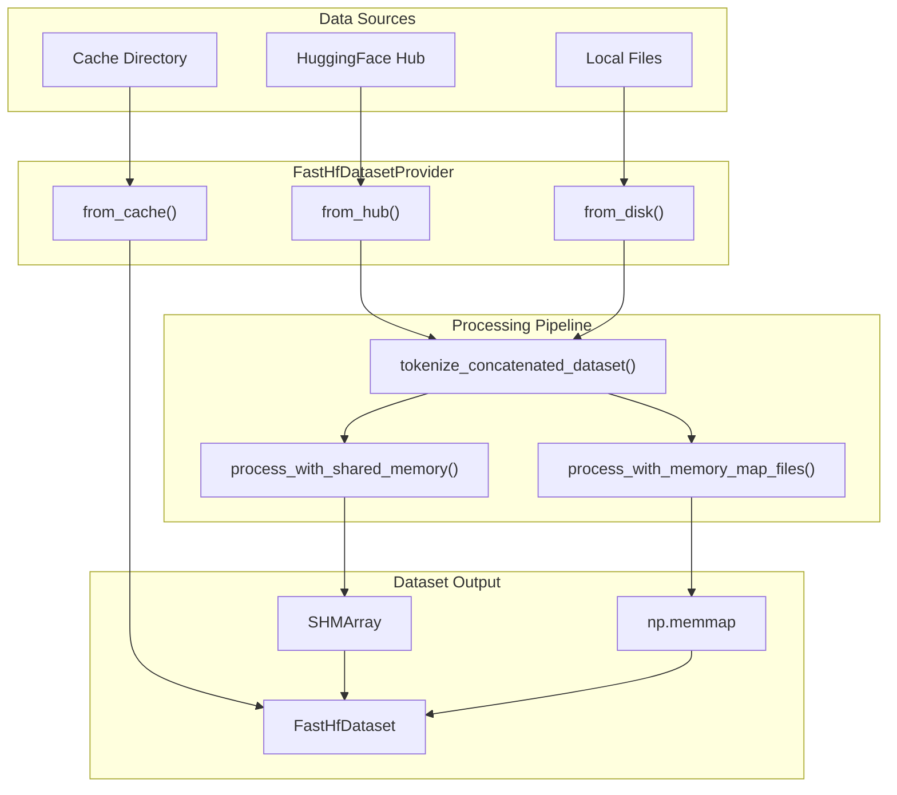
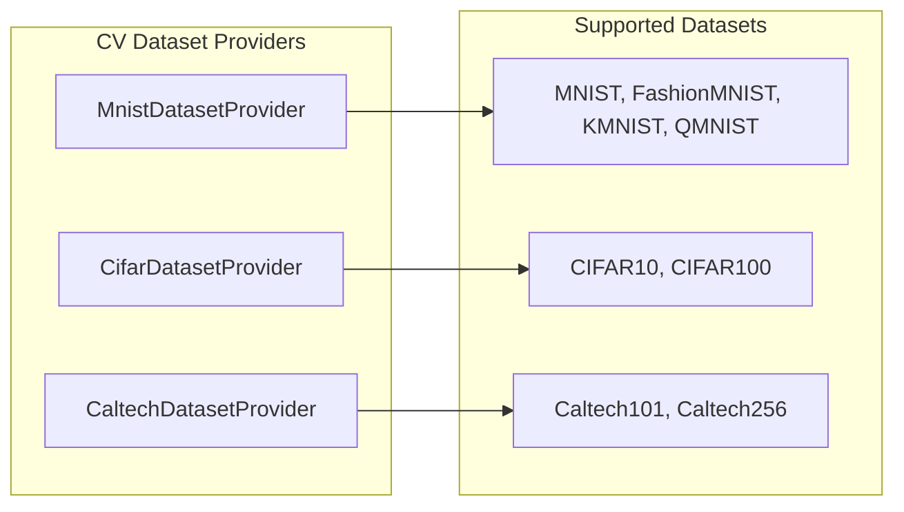
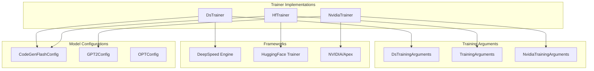
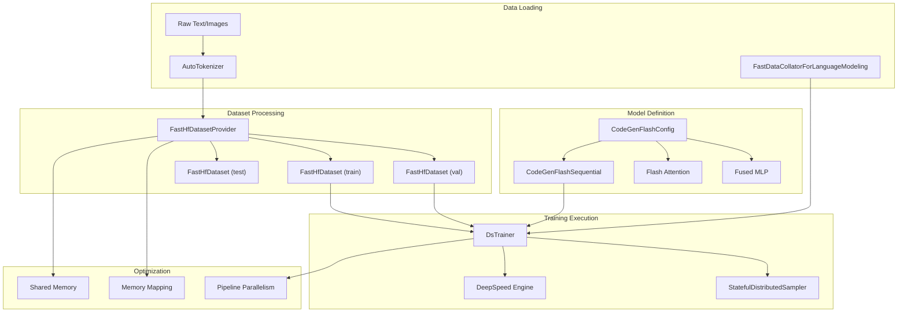

<!-- source: DeepWiki mcp.deepwiki.com · repo microsoft/archai · page 5 Data and Training · fetched 2026-10-26 -->

# Data and Training

<details>
<summary>Relevant source files</summary>

The following files were used as context for generating this wiki page:

- [.github/workflows/lint-run-unit-tests.yaml](.github/workflows/lint-run-unit-tests.yaml)
- [.github/workflows/run-notebook-tests.yml](.github/workflows/run-notebook-tests.yml)
- [archai/datasets/cv/caltech_dataset_provider.py](archai/datasets/cv/caltech_dataset_provider.py)
- [archai/datasets/cv/cifar_dataset_provider.py](archai/datasets/cv/cifar_dataset_provider.py)
- [archai/datasets/cv/mnist_dataset_provider.py](archai/datasets/cv/mnist_dataset_provider.py)
- [archai/datasets/nlp/fast_hf_dataset_provider.py](archai/datasets/nlp/fast_hf_dataset_provider.py)
- [archai/datasets/nlp/fast_hf_dataset_provider_utils.py](archai/datasets/nlp/fast_hf_dataset_provider_utils.py)
- [archai/datasets/nlp/hf_dataset_provider_utils.py](archai/datasets/nlp/hf_dataset_provider_utils.py)
- [archai/discrete_search/search_spaces/nlp/tfpp/modeling_codegen_flash.py](archai/discrete_search/search_spaces/nlp/tfpp/modeling_codegen_flash.py)
- [archai/trainers/nlp/ds_trainer.py](archai/trainers/nlp/ds_trainer.py)
- [archai/trainers/nlp/ds_training_args.py](archai/trainers/nlp/ds_training_args.py)
- [docker/Dockerfile.flash](docker/Dockerfile.flash)
- [docs/contributing/unit_tests.rst](docs/contributing/unit_tests.rst)
- [scripts/eval/README.md](scripts/eval/README.md)
- [scripts/eval/deepspeed/evaluate_human_eval.py](scripts/eval/deepspeed/evaluate_human_eval.py)
- [scripts/eval/hf/evaluate_human_eval.py](scripts/eval/hf/evaluate_human_eval.py)
- [scripts/eval/requirements.txt](scripts/eval/requirements.txt)
- [scripts/trainers/README.md](scripts/trainers/README.md)
- [scripts/trainers/deepspeed/.gitignore](scripts/trainers/deepspeed/.gitignore)
- [scripts/trainers/deepspeed/ds_config.json](scripts/trainers/deepspeed/ds_config.json)
- [scripts/trainers/deepspeed/train_codegen.py](scripts/trainers/deepspeed/train_codegen.py)
- [scripts/trainers/hf/train_codegen.py](scripts/trainers/hf/train_codegen.py)
- [scripts/trainers/hf/train_opt.py](scripts/trainers/hf/train_opt.py)
- [scripts/trainers/nvidia/train_gpt2.py](scripts/trainers/nvidia/train_gpt2.py)
- [setup.cfg](setup.cfg)

</details>


This document covers Archai's data handling and training infrastructure, including dataset providers for NLP and computer vision tasks, and multiple training backends supporting distributed execution. The system provides optimized data loading with caching mechanisms and supports various training frameworks including DeepSpeed, HuggingFace, and NVIDIA.

For information about search algorithms and architecture definitions, see [Neural Architecture Search](#4). For cloud integration and distributed computing details, see [Cloud and Distributed Computing](#7).

## Dataset Infrastructure

Archai provides a unified dataset provider interface with specialized implementations for different domains. The core abstraction is the `DatasetProvider` base class, with domain-specific implementations for NLP and computer vision tasks.

### NLP Dataset Providers

The primary NLP dataset provider is `FastHfDatasetProvider`, which offers optimized loading and processing of text datasets from HuggingFace Hub or local storage.



**Sources:** [archai/datasets/nlp/fast_hf_dataset_provider.py:41-435](), [archai/datasets/nlp/fast_hf_dataset_provider_utils.py:26-196]()

The `FastHfDatasetProvider` supports three initialization methods:
- `from_hub()`: Downloads and processes datasets from HuggingFace Hub
- `from_disk()`: Loads pre-saved datasets from local storage  
- `from_cache()`: Loads previously processed and cached datasets

Key optimization features include:
- **Shared Memory Processing**: Uses `SHMArray` for efficient multi-process data sharing
- **Memory Mapping**: Employs `np.memmap` for large datasets that don't fit in memory
- **Automatic Caching**: Saves processed datasets for fast reloading

### Computer Vision Dataset Providers

Archai includes several CV dataset providers that wrap torchvision datasets:



**Sources:** [archai/datasets/cv/mnist_dataset_provider.py:17-82](), [archai/datasets/cv/cifar_dataset_provider.py:17-80](), [archai/datasets/cv/caltech_dataset_provider.py:17-75]()

## Training Infrastructure

Archai supports multiple training backends through a unified trainer interface. Each backend is optimized for different use cases and hardware configurations.

### Training Backends Architecture



**Sources:** [archai/trainers/nlp/ds_trainer.py:73-395](), [archai/trainers/nlp/ds_training_args.py:16-102](), [scripts/trainers/deepspeed/train_codegen.py:22-144]()

### DeepSpeed Integration

The `DsTrainer` provides comprehensive DeepSpeed integration with support for:
- **Pipeline Parallelism**: Automatic model partitioning across devices
- **ZeRO Optimization**: Memory-efficient distributed training
- **Mixed Precision**: FP16 training with automatic loss scaling
- **Gradient Accumulation**: Effective large batch training

Key components:
- `StatefulDistributedSampler`: Resumable data sampling for distributed training
- `_create_base_config()`: Default DeepSpeed configuration factory
- Pipeline parallel loss functions for sequential models

**Sources:** [archai/trainers/nlp/ds_trainer.py:38-71](), [archai/trainers/nlp/ds_trainer.py:28-36]()

## Data Flow and Training Pipeline

The complete data and training pipeline integrates dataset providers with training backends:



**Sources:** [scripts/trainers/deepspeed/train_codegen.py:86-143](), [archai/discrete_search/search_spaces/nlp/tfpp/modeling_codegen_flash.py:23-249]()

### Performance Optimizations

The training pipeline includes several performance optimizations:

| Optimization | Component | Benefit |
|--------------|-----------|---------|
| Flash Attention | `CodeGenFlashBlock` | Reduced memory usage and faster attention |
| Fused MLP | `FusedMLP` | Optimized feedforward operations |
| Shared Memory | `SHMArray` | Efficient multi-process data sharing |
| Memory Mapping | `np.memmap` | Large dataset handling without OOM |
| Pipeline Parallelism | `PipelineModule` | Model parallelism across devices |
| Gradient Accumulation | `DsTrainer` | Effective large batch training |

**Sources:** [archai/discrete_search/search_spaces/nlp/tfpp/modeling_codegen_flash.py:120-177](), [archai/datasets/nlp/fast_hf_dataset_provider_utils.py:67-86]()

## Training Script Examples

Archai provides training scripts for different frameworks that demonstrate the complete training pipeline:

### DeepSpeed Training

The DeepSpeed training script showcases distributed training with optimizations:

```bash
deepspeed train_codegen.py --dataset_name wikitext --ds_config_path ds_config.json
```

Key features:
- Automatic model configuration with `CodeGenFlashConfig`
- DeepSpeed engine initialization with pipeline parallelism
- Checkpoint resuming and state management
- Multi-node distributed execution support

**Sources:** [scripts/trainers/deepspeed/train_codegen.py:1-144](), [scripts/trainers/deepspeed/ds_config.json:1-37]()

### HuggingFace Training

The HuggingFace integration provides familiar trainer interface:

```bash
python -m torch.distributed.run --nproc_per_node=4 train_codegen.py
```

**Sources:** [scripts/trainers/hf/train_codegen.py:1-104]()

### Configuration Management

Training configurations are managed through specialized argument classes that handle:
- DeepSpeed configuration loading and validation
- Distributed training setup and device assignment  
- Random seed management for reproducibility
- Output directory and checkpoint management

**Sources:** [archai/trainers/nlp/ds_training_args.py:78-91]()

---

